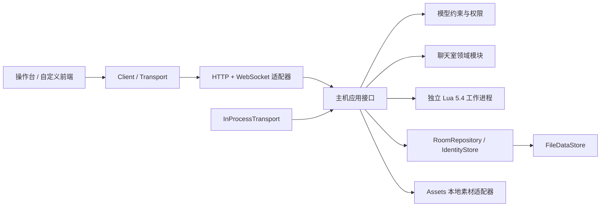

# 首测工程：运行、模块与运维

- 文档类型：当前
- 文档子类：工程
- 状态：有效
- 创建日期：2026-10-30
- 最后更新：2026-10-30
- 关联文档：[工程索引](README.md)、[编写 Lua](lua-authoring.md)、[验收报告](first-test-acceptance.md)、[施工计划](<../../plans/project planning/first-test-construction-plan.md>)

## 1. 实现范围

本机首测已提供主机权威的房间存档、账号与权限、统一实例/关系、配置与个人进度、文件持久回执、Lua 动态导入与版本激活、可恢复等待流程、素材和备份恢复，聊天室后端，以及浏览器操作台。单个数据目录运行一个 `demo` 房间；多份实验使用不同目录和端口。账号 ID 在首测中等于创建时的登录名，昵称是独立字段，不用于恢复绑定。

本阶段没有数据库依赖。聊天室的实际结构、权限和接口见 [聊天室后端](chat-backend.md)，尚无聊天页面。完整 COC 等具体规则归配置包实现；地图、逻辑图、2D/3D 空间与地图战斗暂不作为必要能力。回合/实时游戏驱动、LAN/公网/P2P 和正式产品面板仍未实现。

## 2. 安装与开始游玩

Windows 用户可直接使用根目录的安装与启动 exe，见 [桌面工具说明](desktop-tools.md)。它使用独立的项目内运行时和环境，不依赖下面的手工开发环境；两者默认指向同一份 `.runtime/demo`，不能同时打开该存档。以下命令仍是有效的开发和运维入口。

以下 PowerShell 命令均从项目根目录执行。验证环境为 Windows x64、CPython 3.14.2；Lua 来自 `lupa.lua54`，不需要系统 Lua 或本机 C 编译器。精确版本和平台 wheel 摘要见 [依赖清单](../../../engineering/dependency-manifest.json)。其他 Python/平台组合需另行生成锁并验收。

```powershell
python -m venv engineering/.venv
engineering/.venv/Scripts/python -m pip install --require-hashes -r engineering/requirements-dev.lock
engineering/.venv/Scripts/python engineering/backend/scripts/run.py --data-dir engineering/.runtime/demo init
engineering/.venv/Scripts/python engineering/backend/scripts/run.py --data-dir engineering/.runtime/demo serve
```

`init` 交互输入至少 8 位密码，为 `kp`、`player1`、`player2` 建立首测账号及固定测试对象。自动化可用 `ONLINECOC_BOOTSTRAP_PASSWORD` 环境变量，脚本不会打印它；不要将真实密码写进版本库。只运行服务时可以安装较小的 `requirements-runtime.lock`。

打开 `http://127.0.0.1:8765`。使用三个不同浏览器配置/隔离上下文登录三种身份；普通标签页共用 Cookie，不能视为独立身份。`--port 8766` 可变更端口。服务固定绑定 `127.0.0.1`，不默认暴露到局域网。Ctrl+C 停止服务，重开同一数据目录恢复原房间；不要加自动重载或多 worker 参数。

操作台按主机动作目录生成表单，可执行检定、伤害、转移、组合值、失败问 KP 和限时选择。KP 可以导入完整 Lua/JSON 文件组，检查暂存后激活；旧流程继续使用旧修订。管理区通用命令的可用参数以 [操作契约](../../../engineering/contracts/operations.json) 为准。

## 3. 模块边界



`server.py` 处理 Cookie、Origin、CSRF、Host、消息大小及订阅，业务不导入 FastAPI。`gateway.py` 定义应用接口和直接调用适配器。以后增加联机方式，应在可信边界完成身份认证，再调用相同主机接口；客户端不能自行指定权威身份或上传已计算结果。

`onlinecoc_data` 单独维护快照、CAS、查询与导出，不认识角色、Lua、HTTP。`Host(..., store_factory=...)` 可注入同契约实现；默认文件实现，内存实现仅用于测试。`RoomRepository` 和 `IdentityStore` 使用同一存储契约但拥有独立数据集。事务中的完整变更集以新状态快照提交，`expected_generation` 是内部 CAS；网络客户端只接触授权视图 token。

聊天室以独立 `chat.py` 领域模块管理频道、消息与个人已读，复用房间事务和文件存储，不绑定网络适配器；联系人目录、历史分页和写命令均有 HTTP 与进程内入口。

素材字节与业务存档分离，消息通过 `assetIds` 引用公共素材，实体仅在 `components.core.assets` 保存 `assetId`。素材适配器负责内容摘要、文件落盘、登记、读取权限与回收。

## 4. 数据与文件提交

账号和房间分别存于数据目录下的 `identity/` 与 `rooms/demo/`。每个存储包含 `writer.lock`、`generations/000000000001.json` 等最终代和 `staging/`。素材位于 `rooms/demo/assets/`，文件名为内容 SHA-256，外部读取使用 assetId 而非摘要。

每代文件包含格式版本、代号、前代摘要、规范化 JSON 字节数及摘要。提交执行：CAS → 配额检查 → 暂存文件写入/flush/fsync → 发布最终代。打开时校验整个已发布链；缺中间代、校验失败、不支持格式均停止打开，不自动回退。未发布暂存不参与恢复。业务格式与文件格式均为 1；没有历史数据库迁移器。无 chat 字段的旧房间会以一个新文件代初始化公共频道，现有数据保留；已含 chat 的房间不重复升级，结构不兼容时拒绝打开。

Windows 已验证进程强制退出下的发布恢复。文件 fsync 不等于断电下目录元数据一定持久；本次没有物理断电实验。保留外部备份，不能把这一实现称为已验证的断电容灾系统。

主机按房间串行处理写命令。T1 保存固定输入、规则锁和执行快照；每次随机调用在返回 Lua 前单独记录；T2 原子保存实体/引用、最终回执、流程节点/等待、审计及 Outbox。失败丢弃拟效果。进程重启继续 pending 尝试，并使用原随机序列。已提交命令不重算。

每个账号的 commandId 是幂等键。同 ID 同 payload 返回原结果；不同 payload 为 `COMMAND_ID_CONFLICT`。协议/当前权限/目录等准入失败在 T1 前返回错误；已进入执行的成功和拒绝保存回执。查询旧回执仍按当前权限过滤。连接和登录会话不等于房间或场次；每次启动更换 authorityEpoch。

统一实例包括角色、背包、物品、武器、技能、状态。数值表保存原始量，组合值通过只读 Lua 查询。配置变更不会静默覆盖已有实例数值；实例保留创建时配置修订。关系存房间级表，支持类型、标签与元数据，检查目标存在、唯一持有、包含环及归档引用。成员/实体个人记录与世界状态共同持久化。

## 5. 管理和恢复

常见管理命令：`configuration.put/remove`、`entity.create/update/patch/archive`、`relation.set/remove`、`member.add/update`、`progress.set`、`room.status`、`flow.respond/retry/cancel`、`asset.attach/remove`。实例/配置管理除自有对象改名和指定身份回应待办外，由 KP 执行；chat.* 写入使用独立频道与作者权限。普通玩家不能直接修改受保护数值或关系。KP 数值修改同样经过模型校验并记录审计。

配置的 `behaviors` 与实例的 `rules` 采用 `{event: {ruleId: "..."}}`，通过 `behavior.invoke` 解析入口；公开动作目录仍控制可调用范围。属性/关系属于实例数据，不附在规则引用里。旧流程已经固定规则 ID、修订及输入，不随配置入口改写。

离线管理应先停止持有该目录的服务，否则排他锁拒绝第二主机：

```powershell
engineering/.venv/Scripts/python engineering/backend/scripts/run.py --data-dir engineering/.runtime/demo account-create alice --role player
engineering/.venv/Scripts/python engineering/backend/scripts/run.py --data-dir engineering/.runtime/demo password alice
engineering/.venv/Scripts/python engineering/backend/scripts/run.py --data-dir engineering/.runtime/demo backup --output engineering/.runtime/backup-01 --include-identity
engineering/.venv/Scripts/python engineering/backend/scripts/run.py --data-dir engineering/.runtime/restored restore --bundle engineering/.runtime/backup-01
```

备份锁住房间写入、规则发布和资源回收，导出一代完整业务状态及引用资源，最后写 manifest。`--include-identity` 额外包含账号密码散列，但清空登录会话；它是完整主机迁移备份，应按账号资料保护。网页按钮默认只备份房间，返回本机数据目录 `backups/<backupId>`。

仅房间备份恢复时指定 `--identity-dir <原主机数据目录/identity>`，原身份库必须处于停止状态。恢复验证账号 ID 与密码散列绑定，不按昵称匹配。若之后改过密码导致绑定不匹配，应重新制作一致备份；首测没有自动跨账号映射。恢复目标必须不存在，先校验素材和清单再发布新目录，原存档不被覆盖。失败可能留下独立 `.restoring-<id>` 目录供诊断，不能当作成功存档使用。

`asset.remove` 只移除无引用登记，字节延迟回收；离线 `collect-assets` 清理超过一天的未引用字节/暂存文件。快照代和旧规则工件目前不自动裁剪。单存储默认累计配额 512 MiB，达到配额后需备份并恢复到新目录建立新链；不能手动删除历史中间代。备份失败没有最终 manifest 时视为未完成。

## 6. 协议与首测限额

| 入口 | 用途 |
| --- | --- |
| `GET /api/v1/capabilities`、`/contracts` | 协议、限额和公共机器契约 |
| `POST /login`、`GET /me`、`POST /logout` | 身份和 CSRF |
| `GET /view`、`/catalog`；`POST /query`、`/calculate` | 授权投影、动作、受限查询、只读计算 |
| `POST /commands`；`GET /receipts/{commandId}` | 管理/行动/聊天命令及结果查询 |
| `GET /chat/members`；`POST /chat/history` | 活跃成员公开目录、授权聊天历史分页 |
| `WS /api/v1/connect` | 原子分片快照订阅、重连 |
| `POST /preview` | KP 对指定修订的隔离预览，不提交效果 |
| `POST /assets`、`GET /assets/{assetId}` | KP 上传、授权下载 |
| `GET /admin`、`/admin/artifacts/{revision}` | 管理、审计、计时、规则源码/数据差异 |
| `POST /backup` | 一致房间备份 |

表中省略的前缀为 `/api/v1`。HTTP 写请求需要同源 Origin，登录后的写请求还需要 CSRF header；登录 Cookie 为 HttpOnly、SameSite=Strict。页面固定 JS/CSS MIME 类型，避免 Windows 注册表关联影响脚本加载。

本机适配器每约 250ms 检查投影变化，使用 begin/part/end 完整快照，客户端收齐后原子替换；后续更改再次发送最新快照。慢连接不堆积历史增量，单次发送超过 2 秒关闭，重连重新获取完整视图。能力返回 `resumeWindow: 0`，没有跨连接增量回放；Outbox 已与提交同存，但此适配器用最新状态实现最终同步。权限变化也用新投影移除字段/对象，彻底撤权发送 reset 后断开。聊天订阅仅发送可见频道元信息和修订，不携带历史正文；频道修订变化后客户端查询历史并使旧页缓存失效，频道消失时清空缓存，详见 [聊天室同步约定](chat-backend.md#7-实时同步与缓存)。

普通 API 请求 64 KiB；上传素材 10 MiB；投影 2 MiB；单文件存储 512 MiB；Lua 内存 32 MiB、整个工作进程默认 10 秒、API 调用 2048 次、拟效果 256 条、规则文件 64 个、流程节点 32 个。HTTP 命令入口最多 128 个在途请求，主机内部另有有界准入。持久流程不保存协程栈，等待期限不因重启重置。暂停房间不推进待办；恢复后已过期等待按超时分支处理。

客户端只在收到完整快照后允许新写入，保留原始命令封套用于同 ID 重试；页面刷新会丢失内存命令封套，结果不明时先按 commandId 查询，不能换 ID 盲目重复操作。正式离线队列、长期客户端缓存及多语言 SDK 尚不在此版本。

常见错误：`VERSION_CONFLICT` 刷新后重新确认；`STALE_CATALOG` 重新选择动作；`RULE_TIMEOUT/RULE_FAILED` 检查脚本，失败不提交拟效果；`FLOW_ALREADY_RESOLVED` 查询原待办；`STORE_LOCKED` 停止另一个宿主；`STORE_CORRUPT_OR_UNSUPPORTED` 保留故障目录并从有效备份恢复；`STORE_FULL` 不得删除中间代。
