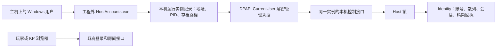

# 本机主机账号维护

- 文档类型：当前
- 文档子类：工程
- 状态：有效
- 创建日期：2026-11-05
- 最后更新：2026-11-05
- 关联文档：[工具与操作说明](../../../tools/host-accounts/README.md)、[接口契约](../../../engineering/contracts/host-control.json)、[首测工程](first-test.md)、[验证结果](../../../tools/host-accounts/results.json)

## 入口和职责

`tools/host-accounts/HostAccounts.exe` 为工程外独立 WinForms 工具。Windows 上公开 CLI 的 `serve` 在同一宿主进程中启用本机身份管理入口，使用已有 Host 锁与 Identity 存储，不启动第二个 Host，不绕过文件锁。原有操作台和配置包登录方式保持适用。直接嵌入 `create_app` 的第三方程序需显式提供 `HostControl`，默认没有本机管理授权。

默认实例发现目录为 `%LOCALAPPDATA%/OnlineCOC/HostControl/`；记录包含随机实例 ID、PID、本机地址、存档目录及 DPAPI CurrentUser 加密的随机密钥。凭据每次启动更新，正常退出删除记录，工具忽略失效记录。测试／部署可通过 CLI `--host-control-dir` 选择独立目录。DPAPI 失败时不发布管理权限，房间服务继续运行。当前原生工具与自动发现只支持 Windows。

## 授权边界

服务器同时要求连接来源为 loopback、正确实例 ID 和随机管理密钥；带 Origin 或 Referer 的请求拒绝，不根据 Cookie、账号 ID 或 KP 角色授予身份库管理权。工具只从本机记录连接 `http://127.0.0.1:端口`，禁用 HTTP 代理和重定向。网页适配器不会把普通网页登录变成本机维护授权。

授权代表“启动此实例的本机 Windows 用户”。同一 Windows 用户下可读取用户资料的本机程序也处于这一信任边界；这不是对该用户自身程序的隔离。没有运行实例的客户端设备不会出现可管理目标。管理密钥不放在房间投影、能力查询、备份回执或网页中。

## 接口与一致性

完整机器说明见 `engineering/contracts/host-control.json`，它是独立的主机本地控制契约版本 1，不混入普通房间命令目录。

| 路由 | 用途 |
| --- | --- |
| `GET /api/v1/host-control/accounts` | 当前实例信息和完整身份账号列表；账号只返回 ID、登录名、昵称、disabled、关联 roomRole |
| `POST /api/v1/host-control/accounts` | UUID requestId、operation=create/password、accountId、password；创建身份或重设密码 |
| `GET /api/v1/host-control/receipts/{requestId}` | 查询精简已提交回执或 unknown |

请求携带 `X-OnlineCOC-Instance` 和 `X-OnlineCOC-Host-Key`。所有接口都检查本机维护授权，不接受普通房间权限替代。创建只提交身份库，房间成员绑定继续通过既有成员管理接口操作。

密码校验、账号变更、目标会话注销和精简回执在一代身份库中原子提交。新密码 8–1024 位，仍使用已有密码散列算法；原文不持久化。重设会注销目标的全部会话；其他账号保留。回执同时作为审计，保存 requestId、操作、目标、local-host-user、时间和结果，不记录密码、额外快速密码摘要或普通命令参数。旧身份库存档无需迁移，首次操作按需增加 hostAdminReceipts。

同一 requestId 返回首次提交结果；更换目标或操作报冲突。同一 ID 携带不同密码也不会再次执行，工具必须保留原请求用于恢复。为避免额外保存密码比较材料，不按密码判断冲突。回执达到 10000 条时拒绝新操作，不静默淘汰。此限额的进一步归档管理不在当前工具内。

日志和报告不保存认证材料。包含身份的主机备份会包含散列和精简维护审计，应继续按账号资料保护；密码重设会改变身份绑定，既有恢复约束仍然适用。

## 验证范围

专项验证覆盖两实例隔离、DPAPI、无管理权设备、浏览器与远程请求拒绝、KP Cookie 不具管理权、密码重设及目标会话撤销、其他会话保留、创建身份、重放幂等、回执查询、重启恢复、故障写入无部分状态、发现记录清理，以及原生窗口加载。结果与源码摘要见验证入口；所有账号修改均发生在新建隔离数据中。

本次专项检查 40 项通过，原有后端回归 74 项通过；测试命令为 `python -B -m pytest engineering/backend/tests -q -p no:cacheprovider --basetemp tools/host-accounts/.test-output/backend-regression`。已有 TestClient/httpx 弃用提示不影响通过结果。
