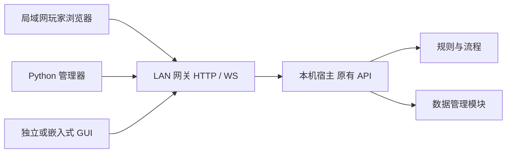

# 局域网联网模块设计与运行

- 文档类型：当前
- 文档子类：工程
- 状态：有效
- 创建日期：2026-11-09
- 最后更新：2026-11-09
- 关联文档：[模块入口](../../../engineering/network-lan/README.md)、[Python 管理器](room-manager.md)、[验收](../../../tools/room-manager/docs/acceptance.md)

## 目标与模块边界

`engineering/network-lan/` 为独立 Python 包，提供 HTTP 与 WebSocket 双向转发及 GUI。原宿主仍监听回环，游戏计算、账号鉴权、权限、版本冲突和存储全部留在宿主；LAN 模块没有导入 backend、Host 或数据管理包，也不打开数据目录。该边界允许以后替换 LAN 网关或增加其他联机方式。

## 传输与权限设计

网关绑定一个明确的回环或 RFC1918 IPv4 地址与端口；上游仅允许本机 HTTP 根地址。外部请求必须使用该网关的准确 Host；写入与 WebSocket 握手必须有一致 Origin，其他请求若携带 Origin 也必须一致。验证后将上游 Host/Origin 转换为宿主地址，转发客户端自己的 Cookie、CSRF 和素材头，不产生默认 KP 身份、不共享 cookie jar。

仅公开现有游戏/管理 API 白名单及通用操作台静态文件。`/api/v1/host-control/*` 始终不公开，该接口属于本机专用账号控制。拒绝编码路径歧义、路径穿越、跨来源请求、任意上游地址和上游重定向。KP 经网关拥有宿主原有的管理权限；普通玩家的权限仍由宿主决定。

HTTP 请求体一般最多 64 KiB、素材 10 MiB；响应最多 16 MiB。默认最多 32 个并发 HTTP 请求和 32 个 WS 连接，构造 Config 可在 1—128 范围设置。WS 上行消息最多 64 KiB、下行分片 256 KiB，慢端发送超时 5 秒；宿主保持完整快照 2 MiB 限制。转发不提供缓存回放、离线提交或计算结果合并。

网关使用独立事件循环线程；启动校验宿主协议 1、绑定失败返回错误。停止关闭远端 WS 和自身监听，不关闭宿主，不修改存档。客户端自动退避重连，恢复后建立新观察段，不能推断断线期间的完整历史。

## GUI 与使用路径

Python 管理器的“局域网联机”页和 `RoomManager.exe --lan` 使用同一个 LanPanel。面板提供上游宿主地址、网卡 IPv4、共享端口、可信网络确认、启动/停止、连接计数和复制地址。默认共享端口为 8877，操作前选择当前机器的实际网卡地址。

启动后，同网段成员打开共享地址即可访问通用操作台；管理者也可将该地址填入 Python 管理器。WebSocket 和 HTTP 使用同一对外端口，避免旧配置包网页代理“HTTP 登录成功但实时连接失败”的问题。网关不代理配置包自己的页面或自动化服务，这些仍使用配置包原入口。

本版 HTTP 不加密，只适用于可信局域网；不默认开放公网，不自动配置防火墙、端口映射或穿透。若需要固定地址，应由操作者配置本机网络和固定网关端口。UDP 自动发现、TLS/公网部署及游戏包网页接入仍需单独设计，不视为已实现能力。

## 验证范围

已在本机真实 WLAN IPv4 上验证两会话、身份隔离、HTTP/WS、业务命令、权限约束、网关启停与重连；已验证实际 Tk 面板与独立发布窗口。测试客户端仍运行在同一物理电脑上，不能据此宣称跨设备、防火墙穿越或不可信网络已验收。详细结果与截图见[验收报告](../../../tools/room-manager/docs/acceptance.md)。
