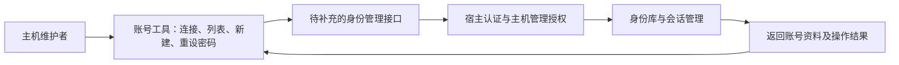

# ISSUE-005：简易账号工具与在线身份管理接口

- 文档类型：历史
- 状态：已归档
- 创建日期：2026-11-05
- 最后更新：2026-11-05
- 关联文档：[问题索引](../plans/Issues/README.md)、[首测工程](../current/engineering/first-test.md)、[聊天室接口](../current/engineering/chat-backend.md)、[独立房间管理工具](../../tools/room-manager/README.md)、[机器契约](../../engineering/contracts/README.md)
- 问题状态：已实现并验证
- 影响版本：当前协议 1；新增独立主机控制契约 1
- 原路径：docs/plans/Issues/issue-005-online-account-management.md
- 原状态：待确认
- 归档日期：2026-11-05
- 归档原因：用户授权工程改动，主机本地账号维护已实现并验证
- 替代文档：[本机主机账号维护](../current/engineering/host-accounts.md)

## 最终决策与交付

2026-11-05 用户授权处理本 Issue，要求工具放在 engineering 外，且仅在设备为主机时管理当前运行实例。最终采用独立 WinForms 工具及 Windows 当前用户的本机授权，替代最初候选的账号／KP 在线管理授权。工具在 tools/host-accounts/，支持运行实例选择、完整账号列表、创建身份和重设密码。创建身份后的房间成员绑定保留独立操作。密码原文不返回，登录名／账号 ID 保持稳定。

40 项专项检查通过，包括真实双实例、DPAPI、原生窗口加载、权限拒绝、会话注销、幂等、重启恢复和故障提交。原后端测试 74 项通过。测试使用全新隔离存档，没有修改实际服务器账号。工具全部鼠标交互及视觉检查不在本次自动验收声明内。

以下保留接口缺口核查与早期候选方案，当前实现以替代文档为准。

## 需求与核查结论

用户希望有简易工具查询和设置当前服务器上的账密。首版建议提供服务器连接、账号列表、新建账号、重设所选账号密码。密码查询应表示查询账号的认证状态，密码原文不能查回，也不向工具返回密码散列。

2026-11-05 核查的是文档和公开机器契约，没有对正在游玩的服务器执行身份写操作，没有读取其身份存档，也没有复现未公开的管理接口。

| 依据 | 当前能力 | 对工具的影响 |
| --- | --- | --- |
| 首测工程第 5 节 | 停止持有数据目录的服务后，可用 CLI `account-create` 和 `password` | 可用于离线维护，不能宣称支持运行中在线设置 |
| 聊天室接口 `GET /chat/members` | 返回活跃房间成员的 accountId、memberId、nickname、role | 可显示房间成员，但不代表完整的服务器账号库 |
| `contracts/messages.json` | 已有登录、会话等消息 | 未提供文档化的在线账号列表或密码重设消息 |
| `contracts/operations.json` | 已有 `member.add`、`member.update` | 管理的是房间成员，不等于创建身份账号或设置密码 |
| `contracts/models.json` 的账号模型 | 包含 `passwordHash` | 不能把散列当作可显示或可恢复的密码 |

最短需求场景：服务器正在运行，主机维护者打开工具，选择 player1 并重设密码，随后 player1 使用新密码登录。当前公开接口不能完成这一在线写入。忘记全部管理密码时的恢复还需要本地主机维护入口，不能假设凭空获得在线管理会话。

## 工具方案

建议在 `engineering/` 外维护独立账号工具，连接指定服务器；与现有房间管理器共用公开认证方式，具体是否合并为其中一个页签由后续施工确定。



界面层级：

```text
账号管理
├─ 服务器：地址、连接身份、连接状态
├─ 账号列表：登录名、账号 ID、可用状态、关联房间角色
├─ 新建账号：登录名、新密码、确认密码
└─ 重设所选账号密码：目标账号、新密码、确认密码、执行结果
```

列表不显示密码或散列。登录名与持久账号 ID 的含义由契约明确；首版账号创建后保持 ID 稳定，避免破坏角色所有者、成员及历史回执绑定。角色属于房间成员关系，应独立展示。具体状态字段只在工程确认并实现后开放，不能用“在线”替代“账号可用”。

## 工程侧候选接口与职责

下列是候选能力，不是已实现的 URL 或操作名称：

| 候选能力 | 输入与输出边界 |
| --- | --- |
| 账号列表 | 返回 accountId、loginName、状态及明确支持的非敏感资料；角色绑定按房间查询；不返回认证材料 |
| 创建账号 | 接收登录名及新密码，校验唯一性、密码要求，返回稳定账号 ID；房间成员绑定作为独立步骤 |
| 重设密码 | 明确目标账号 ID，设置新密码，返回成功或失败；错误时保留原认证资料 |

工程责任者需要确认主机级管理授权。房间 KP 角色不自动意味着可以管理整个身份库；不能接受客户端自报管理员身份。为首个维护者提供明确的本地初始化／忘密恢复途径，现有离线 CLI 可以继续承担恢复。

密码写操作应由身份层负责校验、持久化和会话撤销，明确重设后旧会话、目标本人会话及当前维护者会话的行为。不要直接复用会保存完整参数的普通房间命令日志来记录密码；审计只保存操作者、目标、时间和结果。网络失败后必须能确认结果或明确提示结果未知，不能自动换请求 ID 盲目重设。

工具负责表单、确认、列表刷新和结果反馈，不直接读写身份 JSON，不绕过宿主锁，不将运行中身份数据改为另一个离线 Host 实例。密码不写入工具设置、日志、报告或命令行参数。

## 临时方式与实施顺序

现阶段需要设置密码时，先停止目标服务器，再由主机维护者使用现有公开 CLI 的 `password <登录名>` 交互设置，`--data-dir` 必须明确指向实际服务器存档。配置包存档继续位于 `engineering/` 外。重启同一存档后使用新密码登录。此方式不是在线管理工具。

1. 工程责任者确认授权、身份操作和会话语义，发布接口文档与机器契约。
2. 工程侧实现并验证账号查询、创建、密码重设及身份持久化；保留离线恢复途径。
3. 工具侧基于公开接口实现上述简易界面，再做真实宿主联调和 exe 发布。

按用户此前“必须工程支持时提 Issue 并暂停”的要求，本轮完成接口核查与工具设计，在线账号工具实现暂停在工程接口边界。

## 验收条件

- 主机维护者能看到服务器账号列表，房间成员和身份账号含义清楚。
- 创建账号后能以新账号登录；重复登录名失败，既有账号不受影响。
- 重设后新密码有效、旧密码无效；按约定撤销旧会话，重启后结果保持。
- 普通玩家及未获主机授权的 KP 不能查询敏感管理信息或重设他人密码。
- 失败和断线不会报告虚假成功，身份库不会出现部分写入。
- 请求、错误、审计、工具设置与测试报告均不泄漏密码、散列或会话令牌。
- 工具只使用公开接口，工程目录保持由工程责任者维护。

## 处理记录

- 2026-11-05：完成文档与机器契约核查，登记待工程支持的接口缺口；未修改工程和实际账号。

- 2026-11-05：经用户授权实现工程接口与工程外工具，完成专项及后端回归，归档本 Issue。
