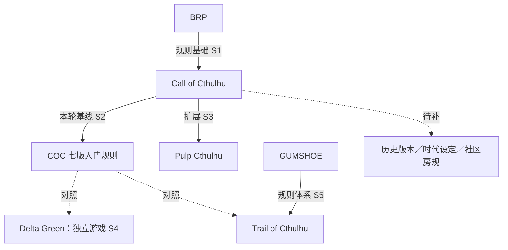
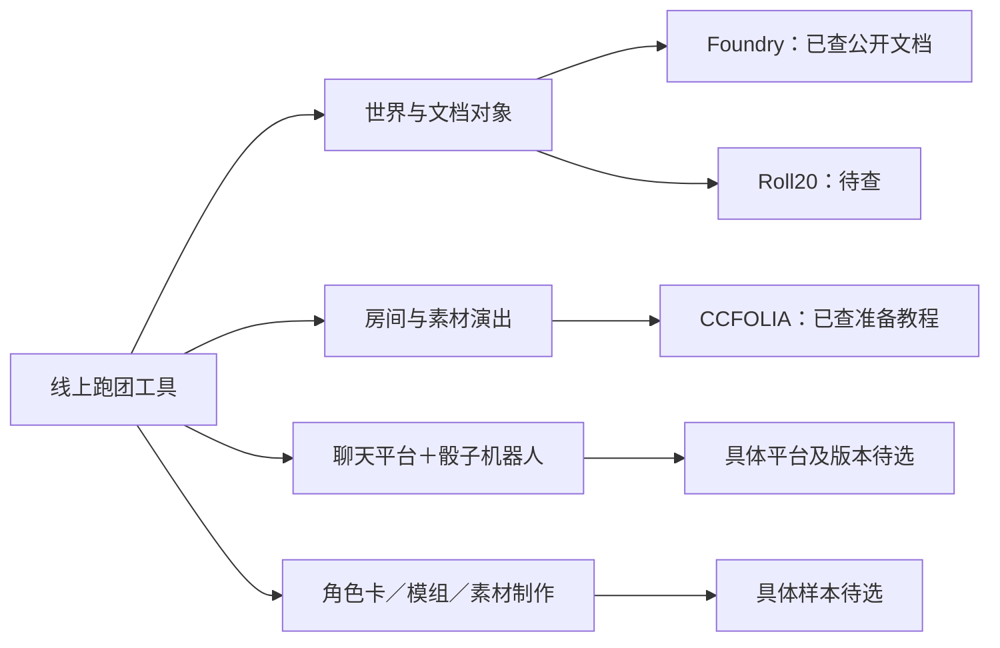
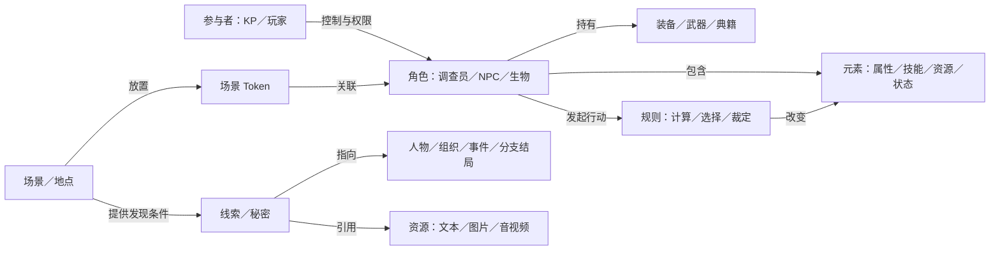
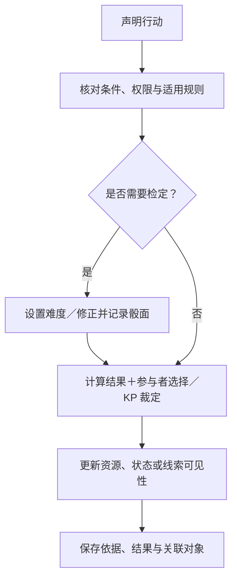

# COC 与线上跑团的工程构成调研

- 文档类型：计划
- 状态：进行中
- 创建日期：2026-10-29
- 最后更新：2026-10-29
- 关联文档：[计划索引](README.md)、[项目概况](../current/design/project-overview.md)、[文档维护标准](../standards/document-maintenance.md)

## 1. 目标与范围

从工程与构成角度，梳理现有 COC 和线上跑团的**图谱分支、规则对象、内容类型**，为通用工具提供调研依据。

| 主线 | 要回答的问题 | 首轮范围 |
| --- | --- | --- |
| 图谱 | 版本、扩展、近邻系统及工具如何关联？ | COC 七版、Pulp、Delta Green、Trail of Cthulhu；Foundry、CCFOLIA |
| 规则 | 有哪些元素、对象、状态与裁定过程？ | 公开入门规则；完整规则与边界案例待补 |
| 内容 | 使用哪些格式、做什么、如何交换？ | 准备 → 进行 → 结算 → 复盘 → 迁移全流程 |

**进度**：已完成首轮公开资料整理，尚未实测平台或逐条核对完整规则。下文“待查”表示尚无结论；示意图和工程观察属于分析框架，尚非项目设计。内容类型以选定样本的全流程覆盖为界，持续补缺，不宣称穷尽全部系统与插件。

## 2. 图谱分支

### 2.1 规则谱系与对照样本

实线表示已核查的规则关系，虚线表示调研对照或待补范围，不代表继承或数据兼容。

| 样本 | 已核实的特点 | 工程观察／待查 |
| --- | --- | --- |
| COC 七版 | 技能与百分骰；入门包含规则、角色、冒险。[S1][S2] | 完整角色创建、追逐、可选规则待补 |
| Pulp | 改变生命值、幸运、伤害与生存能力。[S3] | 检查基础规则与扩展覆盖的表达方式 |
| Delta Green | 独立游戏；Bonds 影响角色生活。[S4] | 补查关系对象、历史关联及转换边界 |
| Trail of Cthulhu | 区分调查与一般能力；取得调查信息不全依赖掷骰。[S5] | 检查行动、线索获取与检定能否分离；仅适用于所引材料 |
| 扩展采样（待查） | 历史版本、地域时代、中文房规；D&D、Fate、PbtA 具体版本待选 | 分开记录版本继承、设定适用、扩展依赖和房规覆盖 |

节点记录名称、出版方、版本、语言、家族、设定、依赖和差异；关系记录类型与证据。共同保留来源、核查日期和状态。

### 2.2 线上工具构成

以下是调研分类，同一工具可跨类；能力需区分平台、系统包、插件、内容包与外部服务。

| 样本 | 已核查内容 | 待查重点 |
| --- | --- | --- |
| Foundry | Actor、Item、Scene、Journal、Combat、Playlist、Table、Macro 等；角色类型由游戏系统定义。[S6][S7] | 具体 COC 系统包、插件、规则自动化与交换能力 |
| CCFOLIA | 房间、图片、BGM、邀请、从公开房间数据创建房间。[S10] | 格式限制、导出完整性与自动化 |
| Roll20／聊天组合／制作工具 | 待选样与核查 | 角色卡、地图、私聊暗骰、日志、素材和准备端交接 |

每次核查附平台版本、系统包版本、插件清单及方式（文档／实测），避免将插件功能归为平台原生能力。

## 3. 元素、对象与规则

### 3.1 对象关系示意

这是待用短模组验证的分析框架；关系图不限定剧情必须按固定树推进。

| 对象组 | 关键元素与规则 | 核查状态 |
| --- | --- | --- |
| 参与者与角色 | KP／玩家、控制者、背景、属性、技能、资源、物品、权限 | 职责已查；完整角色卡与创建公式待补。[S11] |
| 检定 | 属性／技能、难度、骰面、成功等级、对抗、奖励／惩罚骰、孤注一掷 | 入门规则已查；取整、大成功／大失败边界待补。[S12] |
| 理智与状态 | SAN、损失表达式、单次／累计损失、触发条件、持续时间 | 入门规则已查。[S13] |
| 战斗与伤势 | DEX 顺序、轮次、攻击、闪避／反击、伤害、重伤、昏迷、濒死、治疗 | 入门规则已查。[S14][S15] |
| 魔法与知识 | 法术、施放时间、目标、MP 消耗、首次施放、效果、典籍关联 | 施放规则已查；完整知识内容待补。[S16] |
| 成长与结算 | 技能使用标记、成长检定、增量、恢复、跨场次记录 | 成长规则已查。[S17] |
| 装备与载具 | 数量、归属、伤害、弹药、射程、护甲、载具参数 | 完整字段、单位与公式待查 |
| 追逐 | 位置、行动机会、回合、障碍、危险与特殊裁定 | 待查，不直接套用战斗流程 |
| 模组与会话 | 场景、人物、线索、事件、时间线、秘密知情者、日志与结局 | 入门包构成已查；具体关系和发现条件待验证。[S2] |

### 3.2 行为与裁定流程

此图是工程分析流程，具体行动按所选规则执行。

| 七版入门样例 | 判定要点 | 工程关注点 |
| --- | --- | --- |
| 技能 60、掷出 25 | 普通／困难／极难阈值为 60／30／12，可满足困难要求。[S12] | 分开存难度、骰面和结果等级 |
| 孤注一掷 | KP 审核进一步行动与失败后果；战斗检定不可使用。[S12][S14] | 需要协商，不能无条件重掷 |
| SAN `0/1D6` | 按检定成败选损失分支。[S13] | 关联检定、损失骰、数值与状态变化 |
| 单次伤害达到最大 HP 一半 | 可能触发重伤与后续判定。[S15] | 区分单次伤害、累计损失和当前 HP |
| 技能成长 | 已标记技能检查掷骰高于当前值时增加 1D10。[S17] | 保留结算记录，避免重复成长 |

**规则记录字段**：ID、系统版本、出处、适用条件、输入与单位、计算／选择／裁定步骤、输出与副作用、权限、例外、示例和核查状态。结果可解释、人工修改可追溯是待验证的工程方向；实现方式尚未决定。

## 4. 内容类型、格式与用途

按“语义用途＋表现形式＋存储／传输格式”登记。例如立绘、地图和线索照片可能同为 PNG，但用途不同。下表是覆盖清单，格式仅作采样示例，平台支持程度另行验证。

| 内容类型 | 格式／载体示例 | 用途与关键附加信息 |
| --- | --- | --- |
| 文本与笔记 | TXT、Markdown、HTML／富文本 | 模组、对白、规则摘要；层级、语言、链接、秘密段落 |
| 版式文档 | PDF、DOCX、扫描件 | 规则书、角色卡、信件、报纸；页码、文本层、表单 |
| 静态图像 | PNG、JPEG、WebP、SVG、AVIF | 立绘、头像、物品、线索照片；尺寸、透明度、裁切 |
| 地图与空间数据 | 图像＋JSON 等 | 比例尺、网格、坐标、层级、墙、门、灯光、遮蔽 |
| Token | 图像／动画＋对象数据 | 场景中的角色表现；角色引用、位置、朝向、可见性、状态 |
| 音频 | MP3、OGG、WAV、FLAC、Opus | BGM、环境音、线索录音；循环、音量、触发、播放同步 |
| 视频与动画 | WebM、MP4、动画图像 | 动态地图、过场、Token；编码、透明度、音轨、播放位置 |
| 实时通信流 | 语音、视频、屏幕共享 | 团内交流；频道、参与者、连接状态 |
| 字幕与转录 | 时间戳文本、SRT／VTT | 检索、复盘、辅助阅读；说话者、音视频对齐 |
| 角色与规则数据 | JSON、表单；CSV／XLSX 待查 | 属性、技能、装备、状态、公式；字段类型、单位、版本、引用 |
| 表格与牌组 | JSON／CSV、卡面与牌组状态 | 随机表、抽卡、抽签；权重、顺序、放回、秘密信息 |
| 关系与剧情 | 节点边、条件表达式、时间事件 | 线索网、人物关系、分支结局；解锁条件、可见范围 |
| 聊天与操作记录 | 文本、结构化消息、JSON／JSONL | 私聊、暗骰、状态变更、回放；时间、来源、接收者、关联对象 |
| 宏与自动化 | 骰子表达式、平台宏、JavaScript、配置 | 快捷判定、结算、场景触发；执行主体、依赖、可执行性 |
| 房间与素材包 | 专有包、清单＋素材、归档文件 | 分发、备份、迁移；依赖、版本、引用、缺件与损失 |
| 外部资源 | URL、网页、外链媒体 | 远程资料；访问权限、失效、离线与随包迁移能力 |
| 临时协作状态 | 光标、指示点、绘图、选中、计时器 | 注意力同步、标注与辅助；实时／持久保存边界 |
| 补充表现（待查） | 3D 模型、纹理、字体、主题 | 仅在样本确有使用时补录格式与用途 |

### 平台核查边界

| 样本与依据 | 已查公开文档 | 仍需实测 |
| --- | --- | --- |
| Foundry Journal [S8] | 文本、图像、视频、PDF 页面，文档关联与权限 | PDF 表单编辑不能据此认定可用 |
| Foundry 媒体指南 [S9] | 图像：AVIF／JPEG／PNG／SVG／WebP；视频：WebM／MP4／M4V；音频：OGG／MP3／FLAC／WAV／WebM／Opus | 浏览器、编码和插件兼容性 |
| Foundry 对象 [S7][S18] | Actor 与 Token 区分；Scene 可导入 JSON | 素材是否随数据迁移、引用是否完整 |
| CCFOLIA 准备教程 [S10] | 图片、BGM、邀请、公开房间数据入口 | 完整导出格式、素材随包、媒体限制 |

**内容记录字段**：ID、语义类型、场景、格式／MIME／编码、尺寸／时长／大小、来源与授权、拥有者与可见者、引用、版本、位置、交换方式、离线能力、保存／删除规则、验证结果。

**交换检查**：删除后引用、同名去重、外链失效、大文件加载、移动端、秘密缓存、导出权限与数据损失。

## 5. 实施步骤与验收

| 阶段 | 交付物 | 状态 |
| --- | --- | --- |
| 建立框架 | 初步图谱、规则与内容清单、公开来源 | 已完成首轮整理 |
| 补规则与工具 | 完整角色字段、规则差异表、平台／系统包／插件能力矩阵 | 待开展 |
| 走通会话 | 自制或获准短模组的准备、入室、行动、秘密线索、战斗、结算、复盘记录 | 待开展 |
| 验证交换与联机 | 导入导出、权限、同步、断线恢复、备份；记录条件、结果与损失 | 待开展 |
| 提炼结论 | 通用与专属概念、自动化边界、候选模型、内容管线及未决问题 | 待开展；确认后整理到当前设计 |

验收时检查：

- [ ] 图谱区分家族、版本、扩展、设定、房规、独立近邻系统和工具层次，附版本与证据。
- [ ] COC 覆盖角色创建、检定、资源状态、战斗伤势、理智、魔法、追逐和成长，缺项有说明。
- [ ] 每个样本有对象／规则清单及完整行为链，区分计算、参与者选择与主持人裁定。
- [ ] 内容覆盖准备至迁移全流程；每类有格式、用途、权限、生命周期及样本或缺口。
- [ ] 实测一条完整 COC 会话，并以一个规则差异样本、两种工具构成验证通用性；记录版本与复现条件。
- [ ] 交换测试核查素材、数据、引用、权限与损失；未验证项明确标记。
- [ ] 结论可追溯，事实与推论分开；按维护标准更新索引、目录并整理归档。

## 6. 待确认问题

| 决策项 | 待明确范围 |
| --- | --- |
| 图谱深度 | 是否包含完整出版史、中文生态及社区模组分类？ |
| 规则边界 | 七版中文场景优先？六版兼容、Pulp、近邻系统与房规纳入哪些？ |
| 使用形式 | 文字／语音／混合，是否涉及异步、移动端、直播或录制？ |
| 工具重点 | 规则自动化、资料协作、场景演出各占多大比重？ |
| 调研材料 | 可用规则书、合法模组、实测平台及访问授权？ |
| 迁移深度 | 素材、角色、场景，或包含完整历史与秘密信息权限？ |

## 7. 来源与适用条件

查阅日期均为 **2026-10-29**。本轮仅核查公开资料，未锁定安装版本；规则以引用版本为限，入门材料不能代替完整规则。产品文档后续可能更新。

| 编号 | 一手来源 | 本轮用途与限制 |
| --- | --- | --- |
| S1 | [Chaosium：Call of Cthulhu — Getting Started](https://www.chaosium.com/call-of-cthulhu-getting-started/) | BRP 与百分骰定位；不是完整谱系 |
| S2 | [Chaosium：Cthulhu Quickstart](https://www.chaosium.com/cthulhu-quickstart/) | 七版入门资料及内容构成；完整规则仍待查 |
| S3 | [Chaosium：Pulp Cthulhu](https://www.chaosium.com/pulp-cthulhu-pdf/) | 扩展差异与随附内容；非逐条规则核对 |
| S4 | [Delta Green：Start Here](https://www.delta-green.com/start-here/)、[官方首页](https://www.delta-green.com/) | 独立游戏、入门资源及 Bonds；兼容关系待核查 |
| S5 | [Pelgrane：Trail of Cthulhu](https://pelgranepress.com/trail-of-cthulhu/)、[公开 Quickstart PDF](https://pelgrane.s3.amazonaws.com/pelgrane-migration/Trail_of_Cthulhu_Quickstart.pdf) | GUMSHOE 调查能力对照；以所引材料为限 |
| S6 | [Foundry：Knowledge Base](https://foundryvtt.com/kb/) | 文档对象分类入口；不表示所有系统均实现相同语义 |
| S7 | [Foundry：Actors](https://foundryvtt.com/article/actors/) | Actor、系统定义与 Token 关联 |
| S8 | [Foundry：Journal Entries](https://foundryvtt.com/article/journal/) | 页面类型、引用与权限；未实测 PDF 表单 |
| S9 | [Foundry：Media Optimization Guide](https://foundryvtt.com/article/media/) | 媒体格式示例；浏览器及编码兼容仍待验证 |
| S10 | [CCFOLIA：房间准备](https://docs.ccfolia.com/gm-tutorial/room-preparation) | 图片、BGM、邀请、公开房间数据；非完整能力清单 |
| S11 | [Chaosium Wiki：What is Call of Cthulhu](https://cthulhuwiki.chaosium.com/rules/) | Keeper 与调查员职责 |
| S12 | [Chaosium Wiki：The Game System](https://cthulhuwiki.chaosium.com/rules/game-system.html) | 难度、对抗、奖励／惩罚骰、孤注一掷 |
| S13 | [Chaosium Wiki：Sanity](https://cthulhuwiki.chaosium.com/rules/sanity.html) | SAN 检定、损失及状态 |
| S14 | [Chaosium Wiki：Combat](https://cthulhuwiki.chaosium.com/rules/combat.html) | 行动顺序、攻击与防御、战斗限制 |
| S15 | [Chaosium Wiki：Hit Points, Wounds, and Healing](https://cthulhuwiki.chaosium.com/rules/hit-points-wounds-and-healing.html) | HP、重伤、濒死与恢复 |
| S16 | [Chaosium Wiki：Magic](https://cthulhuwiki.chaosium.com/rules/magic.html) | 施放、时间与资源消耗 |
| S17 | [Chaosium Wiki：Rewards of Success](https://cthulhuwiki.chaosium.com/rules/rewards-of-success.html) | 技能标记与成长检查 |
| S18 | [Foundry：Scenes](https://foundryvtt.com/article/scenes/) | 场景对象与 JSON 数据导入；素材是否随数据迁移待测 |
