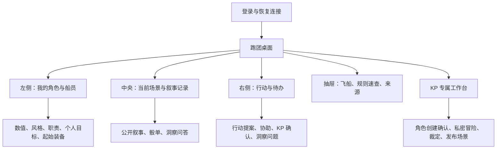
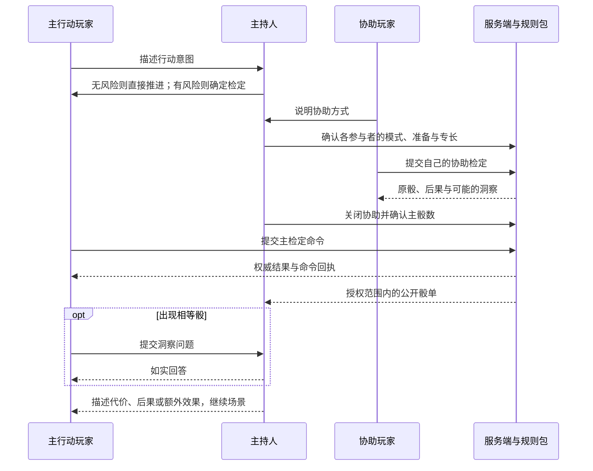
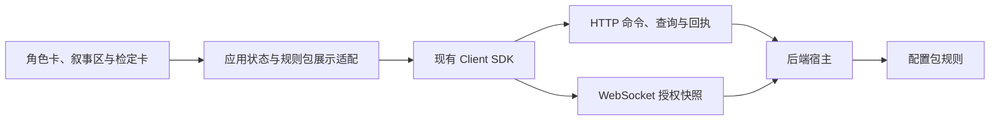

# 轻量叙事跑团前端方案

- 文档类型：计划
- 状态：草案
- 创建日期：2026-10-30
- 最后更新：2026-10-30
- 关联文档：[案例入口](README.md)、[规则整理](rules.md)、[配置包准备与能力边界](package-preparation.md)、[当前首测工程](../../../current/engineering/first-test.md)

## 1. 目标与范围

让主持人与玩家在同一场景中看懂角色、表达行动、组织协助、进行检定、讨论结果和继续故事。界面以角色与叙事记录为中心；地图不作为必要模块。游戏的规则由配置包负责，前端只解释和呈现其输入输出，不复制骰子计算作为权威实现。

本稿只提出方案，尚未实现。基于 2026-10-30 核查的首测 SDK 与后端；聊天室等同期变化必须在实施前重新核查。[后端适配文档](package-preparation.md)是能力映射与缺口的唯一详细来源。

## 2. 页面与信息层级

桌面端采用三列；窄屏切为“故事／角色／行动”三个页签，保持待办数量与连接状态可见。当前所有待处理检定使用卡片，避免重要问题淹没在聊天中。无需加入棋盘、回合条、D&D 式生命条或背包重量面板。

| 界面 | 使用场景 | 核心内容与权限 |
| --- | --- | --- |
| 入场页 | 登录、掉线后恢复 | 账号、连接状态、授权失败说明；当前仅展示已有房间，不假设已存在房间大厅 |
| 创建角色向导 | 新玩家入团 | 姓名、七种风格、七种职责、数值 2—5、目标；实时解释高数值擅长 LASERS；由 KP 确认保存 |
| 角色卡 | 玩家行动前查阅 | 数值与两个模式的比较方法、叙事身份、目标、装备文字；玩家只管理获授权的角色 |
| 共同建船 | 开场讨论 | 两项不同优势、一个问题；大家可讨论，KP 保存最终版本；不将共同阅读冒充共同写权限 |
| 叙事区 | KP 描述、玩家回应 | 场景标题与公开描述、消息历史、系统骰单；KP 私密笔记独立展示 |
| 检定卡 | 判断风险与参与者 | 主行动人、意图、模式、准备／专长、协助者、主持确认的骰数；每个阶段说明下一位操作人 |
| 洞察卡 | 掷出相等骰 | 关联骰单、提问者、问题、KP 如实回答；秘密回答只投递给获授权者 |
| 冒险工作台 | KP 开团准备 | 四张 d6 表、逐栏选择或随机、私密保存；发布经过整理的公开情报 |
| 规则速查 | 不熟悉机制时 | 成功比较、0／1／2／3 档后果、协助与洞察；注明本地裁定，提供完整原书入口 |

对创建向导，前端可先缓存尚未提交的个人输入；不能将本地缓存当作服务器已经创建角色的证明。风格和职责是叙事依据，不自动给专长判定打勾。

## 3. 一次合作检定的交互

这张图是目标交互，不表示当前后端已具备其中全部请求。特别是协助关联、多人确认、自由文本与公开骰单需按适配方案复用或补齐。协助者自己的洞察同样需要处理。

检定前展示骰数来源：基础、准备、专长、逐位有效协助。骰单逐颗显示点数与“成功／特殊洞察／未成功”，展示精确成功数和对应叙事等级。若角色数值为 3，LASERS 骰值为 1、3、6，应显示两次成功、一次洞察；同样的骰值使用 FEELINGS 也有两次成功、一次洞察。相等骰不能被重复算作两次成功。

角色归属或规则版本发生变化后，不悄悄替换待提交提案。重新取得服务端状态并要求重新确认；已提交的骰值不可因界面刷新而重掷。场景后果由 KP 表述，不由系统自动扣除原规则不存在的 HP。

## 4. 与现有 SDK 的对接

候选工程方式是一个独立浏览器前端，使用 Vite、TypeScript 与现有 JavaScript SDK；框架不作为规则包接口要求。具体目录在确认施工范围后再定，不修改测试操作台来充当正式产品。

| 已有入口 | 前端用法与限制 |
| --- | --- |
| `Client.login(loginName, password)`、`resume()` | 登录或恢复身份后取得授权状态；不在前端硬编码账号密码 |
| `view`、`connected`、`onChange` | 从 SDK 取授权快照和连接状态，渲染实体、进度、动作目录、等待；不假设存在 `Client.query()` 或 `subscribe()` |
| `command(op, args, id)` | 所有写操作走命令；先显示“提交中”，确认 committed 后显示已生效 |
| `receipt(id)` | 网络异常后查回执；unknown 表示尚不能确定，不能直接当作失败重新掷骰 |
| `calculate(rule, input)` | 只读预览，不能用于权威掷骰；随机操作必须走动作命令 |
| `transport.request(...)` | 只有在实际后端契约明确的情况下封装扩展接口，不凭方案创造现成 URL |

SDK 当前待处理命令保存在内存。正式前端如要支持整页刷新后的恢复，应增加持久化待决命令机制，保留同一命令 ID 与原始信封；这属于待实现能力。提交状态不明时冻结该次“掷骰”入口，恢复后查回执；不生成新 ID 自动重试。业务拒绝后才允许用户修正并创建新提案。

现有 WS 使用分片完整快照，不承诺聊天逐条增量订阅或事件回放窗口；前端交给 SDK 在快照完整时更新状态，不自行拼接半份实体数据。聊天历史如使用独立分页接口，应与快照生命周期明确对齐。

## 5. 自定义与安全边界

通用桌面提供实体卡、文字记录、动作表单、骰单和待办；本规则包提供字段说明、选项、比较语义、提示文字和结果呈现。首版不执行包内任意前端 JavaScript，不要求先设计通用低代码编辑器。

前端“选 LASERS”只是收集输入；服务端仍校验模式、角色数值、协助名单与主持确认。消息中的“同意”只是叙述，不能自动视作已批准规则操作。普通玩家不能通过改请求 ID 或实体 ID 操作他人角色。

私密冒险、隐藏角色数据和私信必须由服务端按读取者投影。不要把敏感资料放在所有人都能读到的数据里，再只用折叠面板隐藏。KP 操作与玩家操作使用相同命令校验体系，保留执行主体。

## 6. 交流与部署方案

建议首版支持文字跑团，并允许外部语音辅助。实施时优先对接已完成的项目聊天室；核验频道可见性、历史恢复、消息顺序、发言权限与私信，再接入结构化骰单和洞察关联。若聊天室仅有自由文本，仍需补检定状态，不能靠解析任意聊天文字驱动规则。

若希望完全不改后端，可先采用**外部语音＋KP 代录设定＋各自规则动作**的混合验证，但这不能算完整的产品内文字跑团；公开骰单和结构化协助也需人为协调。推荐将它作为规则验证步骤，不作为最终前端交付标准。

现有本机 HTTP/WS 可用于多账号联调；真正远程入团仍需独立网络方案、可访问地址及部署验收。前端通过 SDK 和可替换的连接配置访问宿主，不把中继、P2P 或公网监听硬编码进规则包。

## 7. 待确认与实施顺序

待讨论：是否接受包准备文档中的协助／洞察裁定；首轮是否先用外部语音验证；文字前端是否以同期聊天室为基础；角色创建是否先由 KP 确认；洞察回答默认公开还是允许私密。当前建议是 KP 确认建卡、文字交流为主、可选外部语音，秘密信息由 KP 选择受众。

确认后按顺序推进：

1. 复核最新后端、聊天室和 SDK，冻结本轮契约；确认规则版本与本地裁定。
2. 制作最小规则包并验证角色、双模式、协助、洞察和冒险生成。
3. 补齐被确认的公开骰单、协助关联、问答与文本写入能力；通过接口验收后接前端。
4. 实现角色向导、共同建船、跑团桌面、KP 工作台与断线恢复。
5. 主持人与至少两名玩家完成从建卡到结局的实际短冒险，再进行远程部署验收。

验收应覆盖：无需棋盘即可完整跑团；零／一／二／三及以上成功呈现；协助与洞察不丢失；私密真相不泄露；非本人角色操作被拒绝；刷新和断线不重复掷骰；规则原书与许可可从界面找到。前端技术选型和后端补齐仍待讨论，不在本轮实施。
