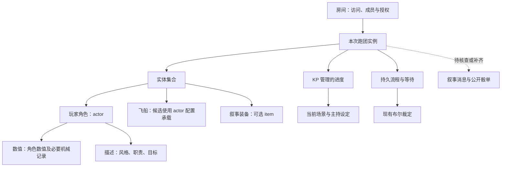
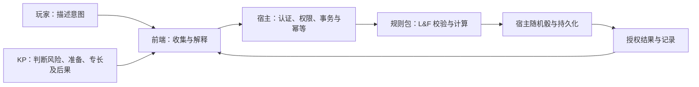

# 轻量跑团配置包准备与后端适配

- 文档类型：计划
- 状态：草案
- 创建日期：2026-10-30
- 最后更新：2026-10-30
- 关联文档：[规则整理](rules.md)、[前端方案](frontend-design.md)、[当前首测工程](../../../current/engineering/first-test.md)、[当前 Lua 编写接口](../../../current/engineering/lua-authoring.md)

## 1. 目标与基线

准备将 Lasers & Feelings v1.4 转为可加载规则包，检验轻量多人叙事跑团、角色卡、共同设定、协助掷骰和主持问答。当前只做设计，不创建 Lua、配置、接口或前端实现。

本稿依据 2026-10-30 核查的首测代码与 SDK，而不是将长期接口草案当作已实现能力。基线为本机 Python/FastAPI、文件数据管理、Lua 规则、持久流程、授权快照及浏览器 SDK。每个数据目录只有一个 demo 房间，监听本机；互联网访问、多人部署与正式 UI 仍需另行验证。

聊天室正有独立接入工作，本稿不预设其未验收的操作名或消息结构。实施前必须重新核查当时的频道、消息、历史和权限接口；如已具备能力，直接复用，避免重复建设。

## 2. 数据、容器与业务对象

以下区分规则包概念与现有存储承载。统一内核不需要认识“飞船”“洞察”等专有名词。



| 业务概念 | 候选结构与容器 | 现有约束与后续处理 |
| --- | --- | --- |
| 玩家角色 | `actor` 实体；单独的角色配置；角色数值是预定义数值字段 | `owner` 绑定玩家；风格、职责、目标属于描述信息，不能硬塞进纯数值接口 |
| 飞船 | 先用专用 `actor` 配置承载共享叙事对象 | 不新增未实现的 `ship` 类型；由 KP 保存团队最终选择，避免宣称玩家天然有共享编辑权 |
| 起始装备 | 首版角色卡只显示原规则清单；需要单独授予或转交时再实例化为 `item` | 不强制创建背包、重量、弹药或伤害值；它们不是原书必需机制 |
| 场景与冒险 | KP 管理的进度或约定的描述数据 | 原始生成结果、公开描述、秘密真相分离；不能将秘密放入公开资料后仅靠 UI 隐藏 |
| 主检定与协助 | 业务操作记录，关联发起人、角色、协助者、确认骰数和结果 | 不是现有内核支持的新实体类型；是否需要独立操作存储，应按下面缺口决定 |
| 洞察问答 | 关联某次检定的玩家问题与 KP 回答 | 当前布尔等待不能表达自由文本问答；需复用消息能力或增补结构化问答 |

候选包内容用层级表示，不规定存储文本格式：

```text
Lasers & Feelings 包
├─ 来源与许可：原书、版本、译注、署名
├─ 静态资料：风格、职责、目标、飞船特征、四张冒险表
├─ 配置：玩家角色、飞船；可选叙事装备
├─ 规则：角色数值校验、协助、主检定、冒险生成
├─ 流程：主持确认、结果展示、洞察问答衔接
└─ 界面描述：角色卡字段、动作入口、帮助文本
```

## 3. 约束由谁负责



| 层次 | 应负责的约束 | 不应承担的判断 |
| --- | --- | --- |
| 通用内核 | 身份、角色归属、可见性、引用合法性、有限数值、事务、持久化、命令重试和随机记录 | 什么叫准备充分、某职责是否适用、失败造成何种剧情 |
| 自定义规则包 | 角色数值为 2—5 整数、合法模式、d6 与成功比较、相等骰标记、受认可协助的加骰、合法选项、飞船选项数量 | 为了方便流程而绕过所有权，或把未定义的伤害值当成原规则 |
| KP | 是否需要掷骰、准备／专长是否成立、协助是否合理、代价与额外效果、洞察的真实回答 | 擅改已经提交的骰值以配合预写剧情 |
| 前端 | 提供选择与解释、显示待办及权限、组织多人操作、预先提示非法输入 | 生成权威骰值、用按钮隐藏代替权限校验、只在浏览器校验规则 |

KP 批准流程不会自动赋予玩家修改他人实体的权限。若由 KP 执行一次主检定，规则仍需校验目标角色与本次请求；若由玩家执行，则只能更新自己有权修改的数据。

## 4. 实际接口映射与缺口

| 操作 | 基线已具备 | 本案例需要准备或补齐 |
| --- | --- | --- |
| 创建角色 | KP 使用 `configuration.put`、`entity.create`；支持 owner、visibility、数值等 | 新建角色配置与白名单校验；首版玩家提交创建意向，由 KP 确认创建。自助创建不假设已存在 |
| 读取角色 | SDK 授权快照；Lua `r.read`、`r.number` | 卡片解释、LASERS／FEELINGS 成功条件；展示字段要经过服务端授权 |
| 修改数值 | Lua `r.set` 修改已有普通数值字段；KP 有管理操作 | 新规则验证 2—5，避免玩家直接把自定义数值当作可任意编辑的普通字段 |
| 保存描述 | KP 管理操作可写描述数据；Lua 数值写接口不适合任意文本 | 玩家自述、目标、行动与洞察问题需走经授权的文本接口；可先用外部语音与 KP 代录 |
| 掷骰 | `r.roll(6)` 在服务端执行，随机结果持久记录；动作命令有回执 | 编写独立 `lf.*` 规则；不要调用绑定 demo 百分骰逻辑的 `r.check` |
| 输入选择 | 规则输入可为 actor、text、布尔 choice 等 | 模式等选项在前端提供下拉选择，但规则端仍需白名单校验；不能假设已支持任意枚举 UI 描述 |
| KP 裁定 | 持久流程可用 `ask` 等待 KP 或发起者的布尔答案，必须有超时 | 一次“是／否”无法携带准备、专长、协助者列表及自由回答；应先收集明确提案，再确认，或扩展结构化裁定 |
| 多人协助 | 各玩家可执行自己的动作 | 无内建“收齐全部协助者答案”流程；需要关联主检定、关闭协助窗口、防止重复计数和过期结果复用 |
| 共享掷骰记录 | 命令回执和内部随机记录可追踪执行 | 回执按账号隔离，不等于全员可见的骰单；需要服务端发布经过授权的结构化骰单 |
| 叙事与洞察 | 规则可返回结果；现有等待只收布尔值 | 核查同期聊天室成果；聊天自由文本可以承载交流，但不能未经校验转成规则批准或数值修改 |
| 安装包 | 可使用现有配置与规则加载机制 | 一键导入、版本迁移和任意第三方 UI 插件不视为已实现 |

规则动作候选契约：

| 候选动作（不是现成 API） | 输入与校验 | 输出 |
| --- | --- | --- |
| 协助检定 | 自有协助角色、主检定关联、模式及 KP 认可条件；同一参与者不可重复计入 | 原骰、成功数、是否授予 +1d、是否触发洞察 |
| 主检定 | 角色、模式、主持确认的准备／专长、已关闭的协助集合；拒绝过期或重复消费 | 逐骰结果、成功数、洞察标记、规则版本及参与者 |
| 冒险生成 | KP 权限；四栏选择或服务端随机 | 四栏结果；默认 KP 私密，另行发布公开描述 |

协助者自己的检定也按原规则产生结果与可能的洞察，不要只记录一个“协助成功”的布尔值而丢弃其他信息。

## 5. 需要确认的本地裁定

以下是候选约定，**不是原书明文规则，也未获用户确认**：

- 协助在主掷骰前关闭；每个不同角色最多协助一次，不自助、不递归协助。主持人确认实际参与者，应用的总骰数不默认为最多三颗。
- 三次及以上成功统一按关键成功展示，同时保留精确成功数。
- 每次检定只建立一个洞察问答待办，多颗相等骰全部显示；是否允许多个问题交由开团约定。
- 洞察默认在已掷出结果后处理，不引入重掷。协助中的洞察也建立独立待办。
- 产品如设置资源上限，应明确是运行保护；不得截断已认可协助或静默改变骰数。

## 6. 实施顺序与验收

先确定上述裁定和文字交流路径，再核查后端最新状态；完成静态资料与最小规则包，随后实现公开骰单、协助关联与角色创建流程，最后对接正式前端。聊天室如已满足需要则直接复用其能力。

验收场景包括：角色数值边界；两种模式与相等成功；准备和专长各加一骰；协助成功只加骰且不能重复；超过三次成功的约定；洞察如实问答；KP 私密冒险；断线不重复掷骰；玩家不能操作别人的角色。完整多人线上验收还依赖可访问的网络部署，本机多账号验证不能替代。
