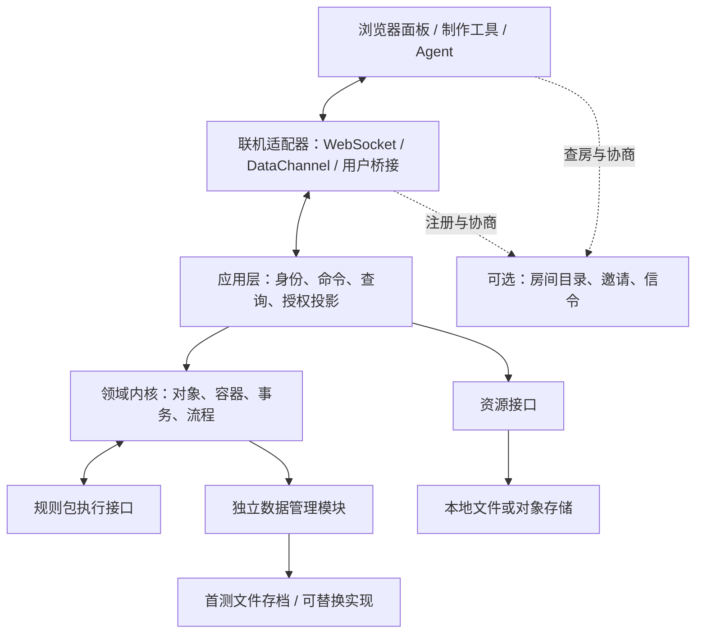

# 后端、自定义能力与联机方案分析

- 文档类型：计划
- 状态：草案
- 创建日期：2026-10-29
- 最后更新：2026-10-30
- 关联文档：[计划索引](../README.md)、[跑团工程构成调研](../coc-online-trpg-research.md)、[项目概况](../../current/design/project-overview.md)、[目录与施工登记](../../current/engineering/hierarchy.md)、[模块职责](module-responsibilities.md)、[数据与容器](data-container-model.md)、[前后端对接](frontend-backend-contract.md)、[首测工程设计](first-test-engineering-design.md)、[首测施工计划](first-test-construction-plan.md)

2026-10-30 范围更新：聊天室后端已作为追加任务实现，实际数据结构、权限和命令以 [聊天室后端](../../current/engineering/chat-backend.md) 为准；聊天页面仍待制作。完整 COC 等规则归配置包实现，地图/逻辑图/2D/3D 空间及地图战斗暂不作为必要实现。本文保留相关候选设计作为按游戏需要扩展的参考，不列为本次必交能力。

## 首测实现对照（2026-10-30）

本主题已有本机首测实现子集，实际接口和限制见 [当前工程](../../current/engineering/first-test.md) 与 [Lua 编写](../../current/engineering/lua-authoring.md)。本文仍保存通用设计和后续扩展讨论，不将所有候选字段、接口或运行方式视为已实现。验收状态统一见 [首测报告](../../current/engineering/first-test-acceptance.md)。

## 1. 目标、范围与结论边界

本工程目标是提供一套线上多人跑团工具，并让制作者与 Agent 能以较低成本自定义数据、规则和编排流程。工程上要求前端、后端、文件资源管理解耦；联机服务与后端保留替换边界，允许用户选用或桥接其他联机方案。

本阶段优先分析后端基础模型、容器与管理规则、增删查改、自定义开发方式、联机协议和部署。前端面板仅分析数据与交互契约；完整地图渲染、音视频、插件市场、跨主机自动迁移、离线多人合并不纳入首轮原型。

本文包含已确认的语言约束与待验证的候选设计：规则及流程使用 Lua，其余技术栈尚未确定；已实现同步宿主实验子集，完整接口、容量、连接成功率及学习成本仍待验证。用户本次文字需求是目标依据；附图作为模块意图参考，其中箭头不直接解释为继承、调用顺序或数据库外键。

2026-10-30 新增[首测工程设计](first-test-engineering-design.md)和[施工计划](first-test-construction-plan.md)，细化本分析的首测子集：优先本机真实 HTTP/WebSocket、多身份与长期存档恢复，之后再验收 LAN/公网。首测推荐技术栈需通过 E0 探针，并非已经实现或用户已确认的长期选型；本文保留更大范围的分析。

### 1.1 依据与适用条件

| 依据 | 已有内容 | 本次如何使用 |
| --- | --- | --- |
| [跑团工程构成调研](../coc-online-trpg-research.md) | 公开规则、工具对象、内容类型；完整规则与平台实测仍未完成 | 从角色、物品、状态、Token、秘密线索与人工裁定提炼模型；不宣称已兼容全部 COC 或其他系统 |
| [联机调研总览](../../../../Projs/联机方案调研/README.md) | LAN、公网服务、房主 P2P、部署与成本研究 | 沿用路线比较；没有把文档研究当作网络实测 |
| [本地推荐架构](../../../../Projs/联机方案调研/01-本地联机方案/02-推荐架构与部署路径.md) | 局域网主机、浏览器加入、身份恢复与离线验证步骤 | 作为本地后端原型的部署输入 |
| [服务器架构比较](../../../../Projs/联机方案调研/02-基于服务器的联机方案/01-架构与部署比较.md)、[房主 P2P](../../../../Projs/联机方案调研/02-基于服务器的联机方案/03-房间发现与P2P主机联机.md) | 中心服务与 DataChannel 星形连接的职责、回退和生命周期 | 区分后端运行位置与传输方式，提出可替换适配器 |
| [计费口径与预算](../../../../Projs/联机方案调研/03-服务器提供商与价格/02-计费口径与预算.md) | 消息扇出、资源流量、TURN 计量与优惠限制 | 使用成本模型，不沿用具体套餐价格作为长期结论 |
| 用户 2026-10-29 文字需求及模块图 | 全局、规则、对象、地图/地点、Driver、日志、计时与面板 | 在独立模块职责文档逐项映射，保留待确认解释 |

外部调研位于相邻工作区，链接依赖当前目录布局；本文保留必要结论以便独立阅读，但不复制原调研作为第二份有效正文。下列技术资料于 2026-10-29 查阅，未锁定依赖版本；实际原型需另行锁定版本并验证。

### 1.2 建议优先验证的组合

- 用“稳定的通用内核＋规则包”表达跑团，内核处理身份、对象、权限、事务、流程持久化和审计，规则包定义属性、检定与特殊行为。
- 规则与流程现阶段统一使用 Lua，支持运行时读取文件、游玩中新增和按修订加载。后端实现语言单独评估，TypeScript 仍只是候选；新增 Lua 规则不应要求重新构建后端。暂不维护另一套规则脚本语言。
- 采用单个权威后端处理房间写入，先按首测计划完成本机 HTTP/WebSocket，再分别验证 LAN 与公网部署，最后加入房主 P2P 适配器对照；业务模型与消息语义保持一致。
- 数据管理与素材存储分别解耦。2026-10-30 用户确认首测实现并使用文件数据管理模块；数据库是否引入在后续按需求评估，不作为首测依赖。

Lua 选型已由用户确认，当前设计决策见[项目概况](../../current/design/project-overview.md#已确认的技术决策)。其余为候选优先级，需通过第 10 节原型验证；本计划整体仍为草案，不代表全部架构已接受或实现。

## 2. 系统模块分层与职责设计入口

原“从模块图拆分责任”已于 2026-10-29 拆为独立计划文档[《系统模块分层与职责设计》](module-responsibilities.md)，由该文统一维护模块层级、职责边界、调用关系及业务场景映射。本节仅保留入口，不再重复职责表。

## 3. 架构边界：先模块解耦，再按需要拆进程

前后端消息、SDK、授权投影及快照恢复的具体契约见[前后端对接与同步契约设计](frontend-backend-contract.md)，业务 CRUD 仍由[数据与容器设计](data-container-model.md)维护。



图表示依赖与交互，不是必须部署的独立服务数。第一版可以一个后端进程加载多个模块，数据与素材分别挂载目录。前端可以暂由同一进程提供静态文件，仍通过公开契约访问业务；后续单独部署不应要求重写规则。

| 边界 | 接口应负责什么 | 不应依赖什么 |
| --- | --- | --- |
| 领域内核 | 接受已绑定身份的业务请求、校验不变量、产生事务性变更 | HTTP 请求对象、Socket ID、文件绝对路径、DOM |
| 联机适配器 | 连接、编码、分帧、背压、心跳、应用层握手 | 规则计算、直接写库、对所有用户无差别广播 |
| 身份与房间控制 | 邀请兑换、参与者会话、撤销、房间在线租约 | 把连接地址/Peer ID 当作玩家权限 |
| 数据管理模块 | 快照查询、受控 CRUD、版本与索引、成组提交、回执、导入导出及恢复；首测文件实现 | 游戏算法、联机厂商 SDK、面板框架 |
| 资源服务 | 资源 ID、元数据、授权读取、上传完成与回收 | 把素材二进制塞进每次状态更新 |
| 自定义执行器 | 在规定输入和能力下计算结果、返回效果提案 | 直接获取数据库连接、网络凭据或整个房间秘密 |

解耦验收必须包含替换实验：同一规则包和核心操作，在两种联机适配器上得到相同已提交状态；资源后端切换后保持资源 ID 和权限语义不变。

## 4. 抽象数据结构与容器设计入口

原“基础数据结构与容器”已于 2026-10-29 抽出为[《抽象数据结构与容器设计》](data-container-model.md)，分别维护数据结构、容器能力和跑团业务组合。包含实体/组件/引用关系、作用域与生命周期、持有/引用/空间放置语义，以及容器操作不变量和场景验收。

该文已纳入用户提出的账号/房间业务数据聚合、配置与实例分离、五类对象统一结构及集中登记/引用组织草案，见[第 3.4—3.7 节](data-container-model.md#34-账号房内人员与房间业务数据)。2026-10-30 已确认房间为长期存档单位、主机数据与计算始终权威，个人事件记录附于玩家/角色容器，共享剧情进度唯一；此决定替代旧的临时 Room 划分，见该文第 3.3 节。

本文件后续章节维护事务、权限、运行时加载、流程及联机等协作约束；数据/容器结构正文以独立文档为准。

## 5. 增删查改、权限与状态一致性

### 5.1 将编辑请求与业务动作区分

数据准备可用 `entity.create/update/archive`、`container.add/remove`、`query` 等通用入口；进行中的消耗、转移、检定和结算使用显式动作，如 `action.invoke`（引用授权动作目录）、`flow.respond`。这些名称均为候选契约，首测字段以工程设计为准。

通用更新只允许类型定义声明可编辑的路径。授权字段、拥有者、版本号、日志和派生结果不得由普通补丁写入。`action.invoke` 的输入也不能被视为可信，调用者只声明动作；权限与合法性仍在后端验证。

建议命令处理链：

```text
解析与限额 → 绑定服务端身份 → 检查包/协议版本 → 查询已有命令回执
→ 权限与对象版本校验 → 执行规则/检查效果 → 原子提交状态、日志、回执
→ 返回提交结果 → 按接收者生成投影并发送
```

首测命令 ID 在账号与长期房间范围内唯一，不以连接或运行场次作为去重身份；同 ID 携带不同内容要报冲突。回执与状态在同一事务保存；断线后重发可取回原结果，防止重复扣血、发物品或重掷。不能仅凭传输层重连推断关键操作已交付：Socket.IO 默认也只提供 at-most-once 交付，额外恢复需应用实现。[交付文档](https://socket.io/docs/v4/delivery-guarantees/)

### 5.2 并发、审计与恢复

首轮采用每房间串行命令队列，命令带相关实体预期版本；涉及背包双方等多对象操作在一个短事务提交。冲突返回最新授权数据及原因，由用户重新确认；资源扣减不采用最后写入覆盖。

审计记录命令 ID、身份、对象版本、规则/流程版本、输入、骰面、裁定原因与效果。持久状态是首轮恢复依据，审计不是自动具备重演能力的事件溯源系统。日志包含秘密内容时有独立访问限制；对玩家的聊天投影不等于完整审计。

若提交后广播前崩溃，重连从已提交状态恢复；可以将待发送通知与状态同事务写入，再允许重复投递，由客户端按事件 ID 去重。回执保留期要覆盖支持的重试窗口，过期旧命令拒绝或要求重新确认。对外承诺“在规定窗口内避免重复执行”，不承诺网络端到端 exactly-once。

### 5.3 权限与秘密信息

候选默认角色为主持人、玩家、观察者，允许包定义附加能力。实际判断基于战役成员身份、实体权限、字段/动作能力与当前场景条件。玩家可以控制角色，不自动取得编辑规则包或查看 NPC 秘密的权限。

- 后端按接收者生成快照、增量、聊天及错误，秘密字段从发送前移除；前端隐藏按钮不足以构成授权。
- 暗骰、未公开线索、主持人备注、资源原件和调试轨迹同样过滤；不发送整个战役再由客户端筛选。
- 权限撤销后推送投影失效与重新取数，清理应用缓存；已经展示或下载给参与者的内容无法保证收回。
- 公开连接序号与内部事件序号分开，可使用每个授权订阅的不透明游标，避免公开序号缺口暴露暗骰等隐蔽活动。
- Agent 使用受限身份与同一命令入口；预览可以无写入运行，正式操作仍受权限、校验和审计约束。

## 6. 自定义规则：成熟语言与有限宿主 API

### 6.1 已确认的 Lua 选型与实施边界

2026-10-29 用户确认：现阶段自定义规则和自定义流程统一使用 Lua。该决定替代此前 JS/Lua 并列选型的安排；当前有效决策及范围统一见[项目概况](../../current/design/project-overview.md#已确认的技术决策)。本节说明后续实施如何遵守该约束。

规则与流程文件均采用 `.lua`。宿主需要在房间运行中读取、校验、加载和注册文件，允许新增此前不存在的规则 ID 与流程定义；不要求重启房间或重新构建后端。流程的条件、转换和小型规则函数均使用 Lua，不额外引入另一套通用表达式语言。

选择依据是前述动态文件加载、临场扩展、低成本编写短脚本的目标。Lua 提供运行时加载与环境传入机制，可作为该方案的基础；版本切换、依赖、持久化和安全边界仍需宿主实现，不能将语言选型写成已经通过热更新验证。[Lua 加载机制](https://www.lua.org/manual/5.4/manual.html#pdf-load)

此前考虑过 JS/TS、Python 与完整自研 DSL：前两类存在各自的模块缓存、引用和工具链管理成本，自研 DSL 则增加语言与工具维护范围。保留这些取舍作为背景，现阶段不再将多语言对照作为实施前置条件，也不承诺同时支持多套脚本生态。

待原型确定的是 Lua 版本、解释器/嵌入实现、后端实现语言、宿主绑定及加载器细节。现有 Lua 手册链接只作为已查阅资料，不代表已锁定依赖版本。对这些实现选项的比较应围绕 Lua 宿主兼容性开展。

### 6.2 作者接口与宿主 API

作者编写方向统一见[Lua 宿主 API 与简化方案](lua-authoring-facade.md#3-lua-宿主-api-与分层职责)：回调接收本次执行绑定的 API，常用业务调用由宿主收集效果，普通作者不手写效果返回协议。`r` 是样例的局部参数名，实际函数及运行限制见[当前工程说明](../../current/engineering/lua-authoring-prototype.md)。首轮显式协议说明已归档，旧文件仅供对照。

规则包包含类型、业务算法、流程及可选视图/迁移等定义；最小制作单位可为单个规则文件加宿主维护的元信息。包声明身份、兼容范围、依赖和所需能力；来源和修订由加载器保存，按本节后续规则激活，不在文件导入时产生业务写入。

结构化输入/输出契约仍用于运行时校验、表单和 Agent，但由共享类型或短声明生成/复用。生成方式由编写方案维护，本分析不再另列一套作者函数和返回格式。业务效果由内核按真实身份、类型、引用及不变量检查后提交。

JSON 等数据格式只保存数据和规则引用，不隐式执行任意 Lua 字符串；脚本统一经加载器注册。骰子表达式保留有界解析和复杂度限制，复杂业务计算使用 Lua。

### 6.3 自定义执行的信任边界

首轮可只支持主持人主动安装并信任的规则包，明确它相当于本机扩展程序，不向玩家开放上传任意服务端脚本。包缺陷仍需超时、取消和独立执行环境，避免一次死循环拖垮所有房间。

若要支持陌生人上传包并在共享服务器执行，应先实现具有 CPU/内存/时间限制、可终止、无默认网络/文件权限的隔离执行环境，跨边界只传可验证的数据。Lua 的环境表与受控宿主 API 只是能力边界的一部分，不代表已完成不可信代码隔离。文件、网络、动态库及调试等能力由宿主明确决定是否暴露；进程拆分本身也不代表已完成权限隔离。

这项能力分级属于架构约束：未验证隔离前，不开放公共任意代码托管。自托管用户自行信任规则包与公共平台运行第三方代码是不同交付范围。

### 6.4 区分文件读取、脚本加载和运行中生效

| 能力 | 具体需求 | 候选边界 |
| --- | --- | --- |
| 读取数据文件 | 临场加入表格、配置、线索或规则参数 | 宿主读取后校验 schema，保存内容版本；规则可通过限定的文件/资源 API 读取已授权内容 |
| 加载脚本文件 | 从 `.lua` 文件得到规则函数/流程定义 | 宿主控制源码读取、依赖解析、编译/加载与注册；加载阶段不直接产生业务写入 |
| 运行中新增 | 游玩时增加之前不存在的规则或流程 | 注册新 ID，在命令边界激活，新增动作可在客户端刷新后使用，不重启房间 |
| 修改已有规则 | 同一逻辑规则替换为新实现 | 发布新修订，保留旧修订用于进行中流程、回执和恢复 |
| 临时裁定 | 本次行动或本场采用一条附加房规 | 使用有作用域和期限的覆盖层，可保存、撤销或另行发布为长期规则 |

文件目录扫描、手动选择文件、编辑器提交或文件监听都可以作为入口。监听事件只表示存在候选变更，不等于立即执行；编辑器可能分多次写文件，应在暂存区取得完整文件集合并验证后再激活。首轮优先提供“重新加载/应用到本场”操作，自动监听可后置。

源码与数据的动态读取由宿主能力接口提供，不要求规则脚本直接取得整个操作系统文件权限。候选接口可以表达包内文件、场次临时文件或资源 ID；是否允许外部目录由主持端配置。一次执行固定输入内容摘要，同一文件之后改变不能使该次执行重试时读到不同输入。路径解析、大小限制和错误行号由宿主统一处理。

### 6.5 游玩中新规则的发布与版本策略

建议分为已安装基础包、战役覆盖层、场次临时层及单次动作参数。有效选择顺序为：显式单次选择 → 场次覆盖 → 战役覆盖 → 基础包；权限、类型不变量和内核校验始终保留。首轮不允许任意字段自动合并，覆盖对象和冲突需要可见。

临场新增示例：KP 发现需要“环境恐惧检定”，创建一份规则文件，加载后注册新 ID；当前场次发布该动作，下一次调用即可使用。若要影响一个已经等待玩家回应的旧流程，主持人需显式插入新步骤或迁移流程，不能靠替换同名函数暗中改变其余步骤。

候选发布过程：

```text
读取源码与依赖 → 建立不可变内容快照 → 编译/解析和契约检查
→ 独立暂存执行环境及无业务写入的预览 → 显示新增/覆盖/数据迁移影响
→ 主持人或有权 Agent 提交激活命令 → 原子切换活动注册表 → 通知可用动作变化
```

所有脚本均在暂存环境加载，导入阶段禁止业务写入；第一版仍沿用主动信任包的范围，环境传参本身不构成不可信代码隔离。语法错误、依赖缺失、能力不符或预览失败时保持原活动版本；多文件依赖作为整体生效，避免新规则配上旧辅助函数。

| 项目 | 候选处理 |
| --- | --- |
| 标识 | 逻辑规则 ID 表示用途；不可变修订 ID、内容摘要和依赖锁表示具体实现；包版本与会话活动规则集修订分别保存 |
| 新命令 | 接收时固定规则集修订与依赖闭包，之后即使发布更新也不混用版本；旧界面命令如有版本冲突则提示重取动作 |
| 进行中流程 | 固定创建时的流程及所引用规则/数据修订；默认继续旧版；需新规则时在明确等待/步骤边界迁移并记录映射与原因 |
| 旧命令重试 | 先查询已提交回执；返回原结果；未提交的已接受命令按已保存修订重试，不跟随最新规则重新掷骰 |
| 状态存放 | 世界数据和流程进度留在宿主存储，不以脚本全局变量、闭包或协程栈作为唯一状态 |
| Schema 变化 | 纯新增独立动作可直接注册；修改字段类型/含义先做显式数据迁移，必要时暂停受影响对象的操作；撤销代码不自动撤销数据迁移 |
| 撤销 | 恢复活动注册表或移除临时覆盖，影响后续调用；已经提交的扣减/授予通过业务补偿，不自动倒转历史 |
| 保存与恢复 | 激活记录、源码快照、依赖及摘要先持久化；即使原文件被移动/删除，重启仍能恢复旧流程。临时层默认保存至场次归档，另设单次或明确截止条件 |
| 版本回收 | 只有未被活动注册表、进行中流程或支持期内的重试/恢复引用时，才释放执行环境；需要追溯的源码按保留策略归档 |
| 客户端同步 | 后端负责激活权威规则，客户端收到动作/schema/视图目录修订后刷新；普通规则更新不要求把可执行脚本发给每位玩家 |

新 revision 改变派生值时，需要按依赖修订使缓存失效，并通过授权投影更新显示；不能仅替换函数而继续复用旧结果。纯行为规则新增不强制迁移实体数据，但也不能绕过已有权限。

### 6.6 Lua 宿主与动态加载验证

由宿主读取源码文本，使用 `load` 的文本模式和显式环境取得导出定义，受控解析依赖后注册；可评估按修订建立独立环境或解释器。不要让规则作者通过修改全局表或清空共享缓存发布更新。`require` 的缓存、旧函数引用和环境回收应由加载器管理，`load` 不会自动迁移运行状态。[Lua load](https://www.lua.org/manual/5.4/manual.html#pdf-load)、[Lua require](https://www.lua.org/manual/5.4/manual.html#pdf-require)

SDK 需明确 Lua 表与宿主结构化数据的转换，包括空列表/对象、缺失值、数值范围及字符串键。作者侧输出与宿主自动生成的效果分别校验；脚本全局变量和协程不能成为恢复的唯一依据。当前实验仅接受简单标量结果，完整转换契约仍待实现。

原型验证顺序：运行房间 → 等待中的旧流程 → 新增 Lua 规则/流程文件 → 新调用使用新版 → 旧流程继续旧版 → 语法错误不影响旧版 → 修改公共依赖整体发布 → 重启恢复 → 撤销临时层。另测试新增属性类型时的数据迁移、持续更新后的解释器/环境数量与内存回收。

记录源码量、安装步骤、错误文件及行号、制作者/Agent 修改耗时、加载到可用耗时、宿主集成复杂度与内存变化。用这些证据确定 Lua 版本、嵌入实现与 SDK 细节；不再以选择 JS 或 Lua 作为阶段验收目标。

## 7. 自定义流程、计时与人工裁定

规则函数解决一次计算，流程定义解决“谁先做什么、何时等待、怎样继续”。建议先采用显式状态与步骤，暂不引入重型工作流平台，也不要求制作者编辑庞大节点 JSON。

作者侧阶段、输入绑定和提交语义统一见[简化方案第 6 节](lua-authoring-facade.md#6-流程少量命名阶段与独立等待)。旧 05/07 的显式步骤写法保留在[对照索引](lua-script-reference/README.md)，旧协议细节见[归档正文](../../history/2026-10-29-lua-script-reference.md#5-统一流程文件形态)，不再作为普通作者的现行要求。持久恢复仍待真实原型验证。

流程实例至少保存 ID、定义/包版本、规则集修订与依赖锁、当前步骤、参与者、已提交步骤结果、待回应请求 ID、超时、取消状态与重试计数。每步计算与效果绑定稳定步骤 ID，重复回应或服务重启不得重复发放、扣减或重掷。等待玩家时释放事务，不持有存储提交锁，也不依赖内存中的 Promise 作为唯一进度记录。

| 情况 | 候选处理 |
| --- | --- |
| 人工裁定 | 等待有权限者回应，保存决定及原因；可拒绝、修改或取消 |
| 等待期间对象变化 | 继续前检查相关版本；冲突时重新确认，不能按过期目标直接扣减 |
| 临场新增/替换规则 | 新流程使用新修订；运行中流程固定旧修订，明确边界上的迁移/插入步骤需校验并留痕，不修改已完成步骤 |
| 流程失败 | 保存失败步骤与诊断；已提交效果默认不自动回滚，通过显式补偿动作纠正 |
| 并行流程 | 首轮只允许独立步骤并存，同一资源的修改统一经过命令队列 |
| 规则触发规则 | 限制链深、触发次数与作用域，识别循环，避免事件无限递归 |
| 回合时间 | 保存轮次、行动者、阶段与暂停状态，按逻辑事件推进 |
| 真实时间 | 保存 UTC 截止时间；恢复时依据策略补执行一次、跳过或等主持人确认 |
| 后端停机/房主休眠 | 没有常驻调度端时不能保证准时触发；恢复后按保存策略处理 |

实时计时只在权威端产生业务效果，客户端倒计时仅作显示。语音、动画和音频播放可接受独立时间同步策略，不与存档每秒写入绑定。

## 8. 联机解耦、加入协议与运行位置

### 8.1 三种部署形态

所有路线遵循同一主机权威约束：承载房间权威后端的主机负责全部游戏计算和存档；联机适配器负责传输，玩家端负责输入与展示。房间可跨多日保存，目录在线租约和连接会话属于临时接入状态，不是房间存档本身。部署位置仍待选择，不能从支持 P2P 推导玩家各自维护权威状态。

| 路线 | 权威后端在哪 | 业务链路 | 成本与体验取舍 | 建议阶段 |
| --- | --- | --- | --- | --- |
| LAN 主机 | 主持人电脑上的常驻程序 | 浏览器 → 本地 HTTP/WS 或受信 TLS 服务 | 无公网业务转发费用；要求网络互通、主机不睡眠，证书/防火墙需验证 | 首轮 |
| 公网自托管 | 云主机或用户自有公网机器 | 浏览器 → HTTPS/WSS 后端 | 玩家主要使用链接加入；有持续运维、备份和出网成本 | 首轮，对照同一核心 |
| 房主 P2P | 主持人电脑，或另行验证的浏览器宿主 | 浏览器 → DataChannel → 房主端点/桥接 → 后端 | 直连可减少云端业务流量；需信令、穿透与可选 TURN，房主承担在线责任 | 第二轮 |

同一个 WebSocket 适配器可用于 LAN 与公网，这先验证“部署位置变化不影响核心”；真正的第二种传输需再用 DataChannel 验证。

P2P 首轮扩展建议保留常驻本地后端，通过实现 WebRTC 端点的适配器或受控桥接进程接入。普通 Node HTTP/WS 服务不会自动成为 DataChannel 端点。桥接增加的进程、身份绑定、安装步骤和依赖需要实测，不能把全部复杂度隐藏在“换协议”三个字里。

浏览器同时承担权威规则、存储和后台运行的路线另行评估，不能直接承诺与常驻权威后端相同的持久化与计时保证。首轮不自动选主；权威主机停止运行时暂停该次在线执行，房间存档保留；重新启动后由主机从权威存档恢复共享状态与个人事件记录。

### 8.2 联机适配器的最小契约

建议统一 `hello/join/resume/command/query/ack/projection/error` 消息语义，具体命名待原型确认。消息封套包含协议版本、房间/场次 ID、请求 ID、类型和载荷；命令另含幂等 ID、预期对象版本及权威实例代次。

业务身份由服务端凭据绑定，客户端不能通过填写 `actorUserId` 选择执行者。联机适配器声明最大消息、是否有序可靠、分片、背压与恢复能力；大快照分块传输。首轮业务控制消息要求可靠有序通道；位置指示、光标等临时信息可单独丢弃，不写入持久状态。

第三方桥接必须实现握手、版本协商、身份绑定、限额和快照恢复；只提供发送/接收字节的接口不算完整兼容。桥接配置通过受控宿主安装，不让普通房间消息执行桥接程序。

### 8.3 身份、加入与恢复

1. 主持端启动权威后端，创建新房间或从存档重建已有房间；若有目录服务，注册带过期租约的可达信息。
2. 展示邀请链接、二维码和手输入口；二维码只是编码入口，网络可达性仍需独立解决。
3. 参与者兑换独立会话身份，校验协议和包兼容性；房间 ID、短码、邀请和会话凭据分别管理。
4. 建立连接，确认当前权威实例代次并获取授权快照/游标；快照期间的后续事件缓存或从同一边界续传，避免漏更新。
5. 断线后以原身份恢复，从主机取得当前共享进度与获准的玩家/角色个人事件记录；权限变化、游标过期或代次变化时重取授权快照。重试复用命令 ID，过期操作提示重新确认，不上传个人旧快照覆盖共享状态。
6. 后端迁移必须停止旧写入、备份并从新代次启动，拒绝旧代次请求；首轮不做无人值守的主机故障切换。

WebRTC 需要单独信令交换；STUN 不承担业务中继，TURN 回退会转发数据。DataChannel 建立不证明业务直连成功。[WebRTC 连接说明](https://webrtc.org/getting-started/peer-connections) 若界面提供“仅直连”和“允许中继”，失败提示及实际路径应与选项一致，不能暗中回退到另一种收费路径。

### 8.4 低运营成本的选择方式

建议产品提供本地主机、公网自托管与后续 P2P 的部署配置，而非强制所有团依赖唯一官方服务。起步阶段先维护一套后端制品与可替换配置，降低多套实现的维护成本。托管状态平台、现成多人框架可作为适配候选，但需要证明其房间模型没有侵入规则核心后再采用。

```text
持续成本 = 主机/运行时 + 状态存储与备份 + 资源存储与下载
         + 业务消息出网 + 信令/中继 + 域名及其他服务 + 运维时间
业务广播出网估计 = 客户端数 N × 每人消息频率 f × 平均消息字节 b × (N-1) × 时长 T
```

公式只适用于每条消息广播给其余所有客户端的合成场景，实际授权投影、批处理和压缩会改变数据量。假设 N=8、f=0.1/秒、b=600 字节、5 场各 4 小时，纯载荷约 0.242 GB；若每场每客户端重新下载 200 MB 素材，则为 8 GB。两者都不是实测，也未计协议开销；算例说明资源分发可能比低频业务消息更影响费用，需分别计量。

P2P 不天然是最便宜方案：需按实际中继字节、房主上传、安装排错和在线负担综合比较。试用额度与学生优惠仅作短期预算条件，不作为长期架构前提。不在此锁定云厂商和固定月费。

## 9. 存储、资源及管理能力

### 9.1 状态仓储

2026-10-30 用户决定将数据管理独立为可替换模块，首版先使用文件实现，替代原先优先评估 SQLite 的建议。模块统一管理逻辑数据、版本、查询索引、成组提交和备份恢复；首测采用 JSON 完整版本快照，数据库留待规模、检索或并发需求出现后再评估。

数据模型不依赖物理文件布局；Lua、应用业务和联机适配器通过端口读写。事务表示一组数据变化共同生效的应用契约，文件存储同样必须保证状态、回执、流程和审计一致。具体接口、发布提交点、失败恢复、容量代价及备份协议统一见[首测工程设计第 5.3 节](first-test-engineering-design.md#53-独立数据管理模块与文件实现)。

### 9.2 资源服务

实体只保存稳定资源 ID、语义用途和必要元数据，不直接保存本机绝对路径。资源接口至少覆盖上传准备、完成验证、元数据查询、授权读取、引用检查和回收；后续可以替换成本地文件、对象存储或用户桥接实现。

上传先进入暂存区，完成后确认大小、类型和内容摘要，再登记可引用状态。数据提交失败留下的文件作为孤立候选延迟回收；引用中的资源不立即删除。相同内容可以共享物理存储，但访问权限仍按逻辑资源引用判断，内容哈希不是秘密资源的访问凭据。

大文件独立下载，支持缓存和适当的断点策略；短期授权链接也受有效期约束。用户导出仅包含自己有权导出的内容，完整主持人备份与玩家角色导出分开。包导入要核查路径越界、资源大小、引用和 schema，缺件给出清单，不悄悄丢失素材。

### 9.3 管理功能的最小范围

- 长期房间及内容/运行场次：创建、跨日存档与重建、成员加入/撤销、个人事件记录、暂停/归档、在线状态与只读维护模式。
- 内容和规则：运行中读文件、新增/重载规则与流程、按执行锁版、依赖检查、干跑预览、激活差异、临时覆盖和失败回退；卸载前列出引用。
- 数据：授权查询、对象与容器管理、批量导入预检、完整备份与恢复、迁移报告。
- 运行：健康状态、版本、存储占用、连接路径、队列与失败命令、流程卡住位置、计时任务。
- 配额：按战役/房间限制资源大小、事件频率和日志保留，导出诊断时脱敏会话凭据与秘密内容。

首轮管理可先用命令行或最小页面，不要求先完成所有面板。关键是管理接口和日常操作共用校验与审计规则。

## 10. 实施步骤与验收条件

下表为完整方向的路线分组，具体首测任务顺序、依赖及验收统一见[首测施工计划](first-test-construction-plan.md#5-与原计划的对应关系)，不将 P0—P5 机械当作首测串行工序。已存在同步 Lua 实验代码，实际范围见工程说明；本文的产品接口、持久流程、联机与算例仍待原型验证。

| 阶段 | 工作与交付物 | 验收条件 |
| --- | --- | --- |
| P0：Lua 宿主与脚本契约 | 定义实体、命令、效果、流程与动态注册契约；用 Lua 完成百分骰及无骰样例与第 6.6 节加载实验 | 无需重启房间即可新增 Lua 规则/流程；新旧版本并存、失败保留旧版、依赖整体发布和环境回收可验证；确定 Lua 版本与宿主绑定实现 |
| P1：本地后端 | 对象/容器 CRUD、权限投影、原子转移、幂等回执、文件数据管理模块、资源接口 | 重试转移/扣减不重复；并发冲突可解释；删除有引用检查；伪造身份/跨战役访问被拒绝 |
| P2：流程与管理 | 人工裁定、持久等待、回合/实时计时、包锁版、备份恢复 | 在等待、提交后回执前、提交后广播前分别强制终止；恢复后无重复效果，已提交骰面一致；能还原规则版本、状态和资源 |
| P3：LAN 与公网 | 同一制品及 WebSocket 适配器部署到两处，加入/恢复、最小面板 | 两种位置完成同一场景；外网与 LAN 分别记录网络条件、链接/短码步骤、断线与睡眠行为；不以进程启动代替端到端通过 |
| P4：第二传输与资源替换 | DataChannel 房主适配，明确是否用桥接；替换资源存储实现 | 核心和规则包不变；同一操作序列得到相同持久状态；直连、强制 TURN、失败路径均有证据；资源 ID 与权限保持一致 |
| P5：学习成本与发布材料 | 让制作者/Agent 依据文档独立修改规则、添加流程和桥接样例 | 记录耗时、报错与求助次数；无核心代码改动；权限/恢复/备份测试通过后整理已验证结论到当前文档 |

### 10.1 场景测试清单

- 自制调查场景：创建人物、物品和秘密线索 → 邀请玩家 → 检定 → 等待 KP → 授予物品/公开线索 → 结算 → 归档 → 恢复。
- 规则差异：百分骰资源消耗与无骰线索授予使用同一实体/动作机制；再以经核对的 COC 规则片段验证，不把自制样例宣称为 COC 兼容。
- 数据边界：一个角色多个 Token、物品转移/拆分、状态叠加、循环容器、缺失资源、模板升级、流程中途升级、包缺失。动态规则另测文件未写完、同 ID 覆盖冲突、旧文件删除后恢复、等待中迁移、临时规则撤销及 schema 迁移失败。
- 一致性：双端同改一个资源、重复命令 ID、同 ID 不同载荷、快照期间继续写入、回执丢失、日志截断后的旧游标。
- 权限：暗骰、隐藏字段、NPC 资料、聊天、资源链接、查询数量和错误；撤销后重新连接不得继续取得旧权限数据。
- 网络：一台主机、另一台电脑、Android 与 iPhone；同 LAN、不同 Wi-Fi、蜂窝、断网/切网、信令故障与房主退出分别记录。
- 部署：空数据启动、数据目录权限、无 WAN 冷启动、版本升级失败回退、从备份重建，验证无个人开发机隐含依赖。

### 10.2 需要测量的指标

首轮建议以单房间 8 个客户端作为测试档位，再扩展 3/20 个客户端；这些是实验配置，不是支持人数承诺。记录消息大小与频率、权限投影后字节数、p50/p95 命令提交耗时、入房/重连耗时、内存与队列峰值、素材下载和实际云出网。

P2P 另外记录选中候选路径、持续的中继字节、房主上传与 CPU、连接失败原因。比较同一操作、同一资源集和同一网络条件；学习成本先测首次完成时间与修改次数，获得基线后再制定可接受目标。

## 11. 自定义与运维文档的拟议交付

以下是未来文档主题，不提前登记为已经存在的文件。

| 面向谁 | 需要的文档 | 完成标准 |
| --- | --- | --- |
| 初次制作者 | 快速开始、最小规则包、字段与类型、常见报错 | 复制样例即可在测试场景创建类型并调用一个动作 |
| 规则作者 | 宿主 API、效果清单、骰子、权限、文件读取、运行中加载与版本兼容 | 每个 API 有输入/输出 schema、能力要求、正反例与错误码；有一份临场新增规则并撤销的完整样例 |
| 流程作者 | 步骤、等待、裁定、计时、取消、重试与补偿 | 示例说明重启时停在哪里、哪些效果已经提交 |
| Agent | 可机读 schema、命令/查询协议、包检查与预览、操作样例 | 与人类文档来自同一契约；不需要绕过权限或直接修改数据库 |
| 前端作者 | 授权投影、动作描述、视图元信息、增量与缓存失效 | 能替换面板实现，不能推导获取秘密字段的后门 |
| 联机/资源扩展作者 | 适配器接口、能力协商、身份绑定、分块/背压、恢复测试套件 | 用户桥接通过同一一致性与授权验证 |
| 自托管用户 | 安装、LAN/公网入口、配置、备份恢复、升级回退、流量诊断 | 在干净机器复现，知道数据存放位置和停止服务后的行为 |

文档应以可运行的自制样例、完整最短路径和错误解释降低门槛。是否需要可视化编排器，留到语言/SDK 样例学习成本验证之后决定。

## 12. 待确认问题与当前建议假设

| 问题 | 本草案用于推进分析的假设 | 何时必须确定 |
| --- | --- | --- |
| 初期主要使用方式 | 浏览器参与、文字及低频状态交互，音视频可先使用外部工具 | UI 与带宽原型前 |
| 首批规则范围 | 自制小规则验证内核，再验证公开且已核对的 COC 片段 | 规则兼容验收前 |
| Lua 运行时与宿主实现 | 规则/流程语言已选 Lua；仍需确定版本、嵌入实现、数据转换与动态加载细节，后端语言单独评估 | P0 后，正式锁定依赖前 |
| 规则包信任 | 主持人主动安装可信包；暂不提供公共任意代码执行 | 规则加载器实现前 |
| 权威端可信程度 | 主持人可查看完整战役数据；不承诺对房主隐藏秘密或抗房主作弊 | 身份与权限设计前 |
| 房主是否持续在线 | LAN/P2P 必须在线，退出暂停/结束；异步常驻需求使用公网后端 | 部署体验验收前 |
| 房间存档与共享进度 | 已确认房间长期保存且主机权威，只有一个共享剧情进度；仍需定稿存档格式、恢复器与房间/内容作用域编码 | 持久化与恢复原型前 |
| P2P 回退偏好 | 用“仅直连”和“允许中继”分别实验，尚未选择默认项 | P4 产品默认项确定前 |
| 成本约束 | 优先减少固定服务与资源转发，尚无月预算、目标地域和总房间数 | 购买/部署公网资源前 |
| 自定义主要面向谁 | 能阅读短函数的制作者与 Agent；纯无代码体验未作为首轮承诺 | 学习成本验收后 |

上述假设不覆盖用户已明确的目标，出现新约束时据此调整方案。原型完成前保持本文件为计划；只有已核实的模型、接口和操作步骤才进入当前设计/工程文档。
