# 抽象数据结构与容器设计

- 文档类型：计划
- 状态：草案
- 创建日期：2026-10-29
- 最后更新：2026-10-30
- 关联文档：[计划索引](../README.md)、[系统模块分层与职责设计](module-responsibilities.md)、[后端与联机分析](backend-network-analysis.md)

2026-10-30 范围更新：聊天室后端已作为追加任务实现，实际数据结构、权限和命令以 [聊天室后端](../../current/engineering/chat-backend.md) 为准；聊天页面仍待制作。完整 COC 等规则归配置包实现，地图/逻辑图/2D/3D 空间及地图战斗暂不作为必要实现。本文保留相关候选设计作为按游戏需要扩展的参考，不列为本次必交能力。

## 首测实现对照（2026-10-30）

本主题已有本机首测实现子集，实际接口和限制见 [当前工程](../../current/engineering/first-test.md) 与 [Lua 编写](../../current/engineering/lua-authoring.md)。本文仍保存通用设计和后续扩展讨论，不将所有候选字段、接口或运行方式视为已实现。验收状态统一见 [首测报告](../../current/engineering/first-test-acceptance.md)。

## 1. 目标、范围与迁移关系

将后端分析原第 4 节“基础数据结构与容器”的设计抽出，分开描述通用数据结构、容器管理能力与跑团业务映射。本文件作为该主题的正文来源；原文改为导航。当前以概念关系图、信息层级树和约束表说明设计，暂不展开具体配置、存储文本或可执行代码。2026-10-29 的拆分保留原有候选设计，并补充关系图和场景对照。

本文件不确定数据库表、网络传输编码或 UI 框架；规则与流程沿用已确认的 Lua 约束。所有结构和操作均为计划草案，需由后端原型验证。抽象层不固化“角色只能有 HP”“容器必然是背包”等业务限制。

2026-10-29 纳入用户提出的房间数据与统一实例草案：账号与房内成员区分，房间业务数据集中组织配置、实例、记录和资源；角色、武器、道具、技能、状态使用统一实例结构。本文仍为方案草案，尚未实现；此次整合保留原有权限、版本、引用和事务不变量。

## 2. 三个层次的分离

实线表示定义到实例化/组合的方向，不表示数据库外键。

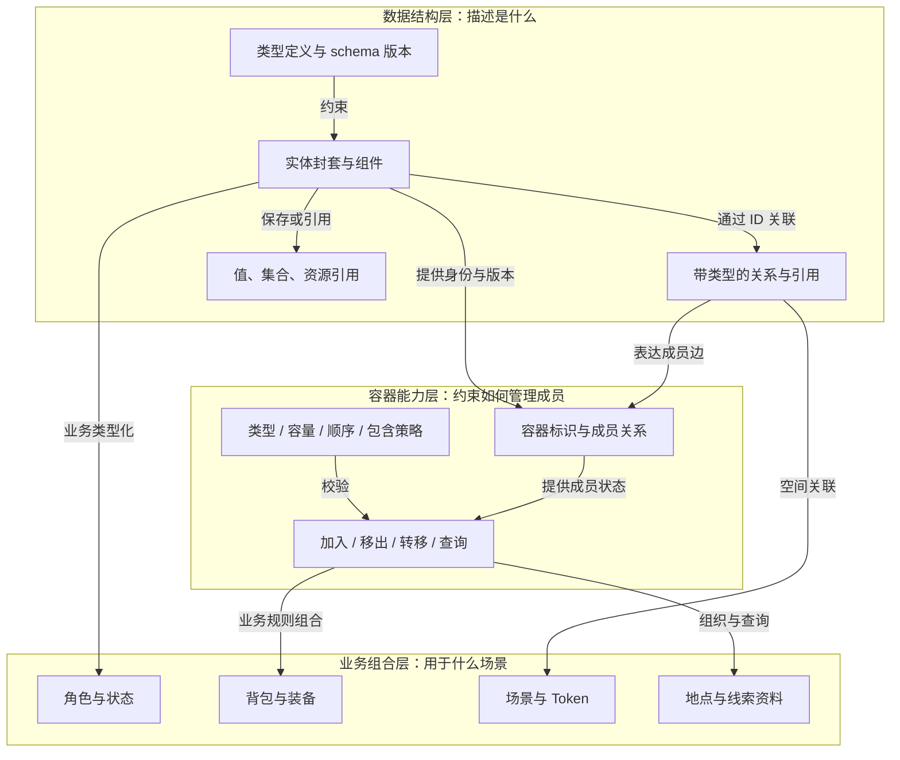

数据结构层负责可表示与可校验的形状；容器能力层负责成员操作的不变量；业务层决定“什么可放入背包”“负重如何计算”“地图里显示什么”。业务策略可以扩展，但不能破坏身份、作用域、版本和事务约束。

## 3. 抽象数据结构

### 3.1 结构与语义

| 抽象 | 最小语义 | 明确不承担的职责 | 跑团对应 |
| --- | --- | --- | --- |
| TypeDefinition | 命名空间、字段 schema、版本、可编辑路径、索引声明 | 不直接代表某个运行实例 | 调查员类型、物品类型 |
| Configuration | 配置 ID、定义内容与固定修订，具体字段受类型约束 | 配置身份与通用类型身份分别管理 | 洛阳铲配置、技能或状态定义 |
| Entity | 实例 ID、配置 ID、名称、元数据、作用域、类型、版本与策略；统一业务部分见第 3.6 节 | 不依赖面板、Socket ID 或物理文件位置 | 角色、武器、道具、技能、状态实例 |
| Component | 有命名空间且受 schema 约束的数据块 | 不要求每个数值属性都有独立实体身份 | 标签、数值属性、引用和规则组织的数据块 |
| Value | 数字、文本、布尔、列表、记录等受约束值 | 列表本身不自动获得容器权限/事务能力 | HP 当前值、人物姓名 |
| Relation | ID、关系类型、源/目标引用及可选元数据 | 引用不自动意味着所有权或级联删除 | 人物认识、地点通路、模板来源 |
| AssetRef | 稳定资源 ID 和用途 | 不承载素材字节或本机绝对路径 | 立绘、地图底图、线索音频 |
| RuntimeRecord | 可恢复的流程/时钟等运行记录及版本 | 不默认和角色共用同一编辑权限 | 等待 KP 的流程、回合状态 |

以下类图表达概念关系，未指定编程语言继承体系。`*--` 表示组合，`-->` 表示引用；业务实体间的所有权另由容器策略决定。

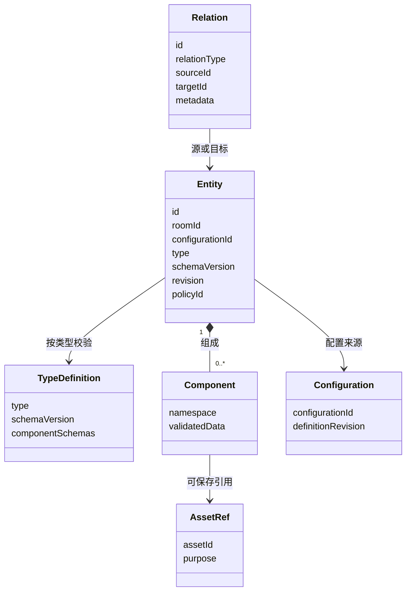

### 3.2 实体信息的层级

以下树表示信息分组，不规定配置语法、字段编码或数据库布局。跨对象关系只保留引用，不将目标实体完整嵌入树中。

```text
实体
├─ 身份与作用域
│  ├─ 稳定标识
│  ├─ 所属长期房间（战役为房内内容）
│  ├─ 类型引用
│  └─ 配置引用：配置 ID 与所用修订
├─ 版本与生命周期
│  ├─ 结构版本
│  ├─ 数据修订
│  └─ 活跃 / 已归档
├─ 权限策略引用
├─ 名称与元数据
├─ 统一业务结构：标签、数值属性、引用、规则关联
├─ 组件集合
│  ├─ 宿主组件：容器、放置等通用能力
│  └─ 业务组件：身份、资源、技能等规则包定义的数据
└─ 扩展信息：命名空间与可解释状态
```

稳定标识不因改名或移动改变，显示名称可本地化，不能作关联键。数据修订由内核维护；结构版本与包版本分别记录，不将版本号当作可自由编辑的业务数值。

数值定义需说明整数/小数、单位、上下界与取整。基础值、当前资源、派生值及状态修正分开；派生值缓存带依赖版本，不能与基础数据分别随意编辑。

组件使用命名空间，记录包和结构版本。结构校验与权限、跨对象关系及业务不变量校验分开。JSON Schema 仍是候选定义格式，依据见 [JSON Schema 对象定义文档](https://json-schema.org/understanding-json-schema/reference/object)（2026-10-29 原分析已核查，本次仅保留引用），本文件暂不展开具体配置文本。

未知扩展在备份往返时保留并标记为不可解释；缺少必需包时不运行相关行为，已知字段拼写错误则明确报错。

### 3.3 房间存档、运行场次与连接生命周期

2026-10-30 用户确认：房间是长期存档单位，可跨多日运行并从主机保存的数据重建。房间始终以主机数据为权威，所有游戏规则、流程、随机检定和派生数值计算均在主机执行；玩家端提交业务意图并展示授权结果。主机指运行该房间权威后端的宿主，具体部署与联机传输方案仍按后端分析评估。

本节替代原先将 `Room` 仅视为临时联机入口的划分。房间有持久身份和存档，临时性由连接会话、在线租约和运行场次分别表达；战役/世界可继续作为房间内容组织上下文，不构成另一个玩家独立推进的权威世界。首测接口细化采用 `roomId` 作为唯一事务与去重作用域，`runId` 表示运行场次，登录会话另用 `authSessionId`；不再将 `campaignId` 用作并列的权威作用域，见[首测工程设计第 4 节](first-test-engineering-design.md#4-标识版本与生命周期)。

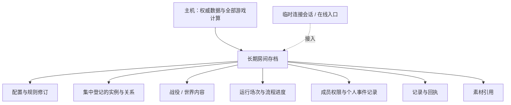

| 生命周期对象 | 含义与边界 |
| --- | --- |
| 房间 | 长期存档与共享游戏进度的管理单位，跨多日保留，由主机重建 |
| 战役/世界内容 | 房间中的持久内容与组织上下文，沿用既有作用域校验 |
| 运行场次 | 房间一次运行或开团片段；结束不删除房间及其持久状态 |
| 连接会话/在线入口 | 连接、邀请兑换、在线租约等临时接入信息，可失效和重建 |
| 配置与规则 | 保存定义及所用不可变修订，恢复时能定位原执行依据 |
| 实体与关系 | 保存当前状态、配置身份、成员边和引用，按主机权威数据恢复 |
| 流程/时钟记录 | 保存阶段、等待者、已提交结果与期限，继续执行时不重掷或重复生效 |

同一房间只有一套共享剧情和世界进度，不保存每位玩家各自推进的剧情副本。主机重建后，从已提交的权威状态、流程记录、规则修订、必要日志/回执和资源引用恢复；玩家凭原身份重连后取得当前授权视图。客户端缓存不作为恢复权威，也不能以个人旧快照覆盖房间当前状态。

事件对某位玩家或角色的解锁、触发、知情和待办记录，分别保存于房内玩家相关容器或角色相关容器，属于该房间的个人进度，由主机计算、提交和恢复。玩家记录通过房内成员身份关联账号；角色记录随对应角色保存，不把玩家与其控制角色的进度默认合并。恢复个人记录不回退共享剧情，也不产生独立世界分支。

首轮继续采用单个权威写入端和串行命令处理；具体存档格式、恢复器和持久化实现仍待验证。

### 3.4 账号、房内人员与房间业务数据

账号属于玩家/KP 的基础身份，具有稳定账号 ID、昵称和密码认证信息。KP 与玩家是其参与房间时的角色与权限，账号身份与房内权限分别表达。密码认证信息留在账号域，房间人员记录通过账号 ID 关联账号，不复制到房间元数据、日志或玩家可见投影；本次不展开认证存储方案。

用户草案中的“联机房间”聚合如下业务数据：

```text
房间业务数据
├─ 联机人员信息
│  └─ 成员 ID、账号 ID 关联、房内元数据、权限与玩家个人事件记录
├─ 记录
│  ├─ 行动日志：记录 ID、执行者与相关行动
│  ├─ 数据变化日志：记录 ID、关联对象及变化依据
│  └─ 聊天记录：已实现独立 chat 结构，见当前《聊天室后端》文档
├─ 配置容器
│  └─ 游戏涉及的属性、角色、道具、武器、技能、状态及规则定义
├─ 实例容器
│  └─ 按实例 ID 统一登记本房间业务范围内的实例数据
└─ 素材资源表
   └─ 资源标识、元数据及素材引用，实际文件继续由资源服务管理
```

这里的集中组织表示逻辑管理范围，不要求一张物理表、一份巨大文档或一次全量下发。房间查询仍按身份、对象及记录的权限生成投影；资源表不把素材二进制嵌入实例。日志与聊天保持原有分工，聊天服务结构按用户要求另行设计。

房间业务数据根属于第 3.3 节确定的长期房间存档。临时接入会话、连接 ID 和目录在线租约不替代持久房间身份；断线、房主退出或结束一次运行场次均不隐式删除房间、实例或个人事件记录。

### 3.5 配置容器、实例容器与两种身份

配置容器存放游戏对象和规则所用的配置/定义；实例容器存放运行中的具体对象。通用类型决定结构可表示什么，配置决定实例对应哪份业务定义，实例保存自身当前数据，三者不混用身份。

| 身份 | 本文统一用语 | 作用与例子 |
| --- | --- | --- |
| 具体对象身份 | 实例 ID | 区分两把不同的洛阳铲，即使它们使用相同配置 |
| 对应配置身份 | 配置 ID | 表示这些实例均来源于“洛阳铲”配置；对应用户草案中用于判断同一物品定义的“物品 ID” |
| 数据结构类别 | 类型引用 | 区分角色、武器、技能等结构类别；不能代替具体物品配置 ID |

例如耐久度为 85% 与 95% 的两把洛阳铲：实例 ID 不同，配置 ID 相同，当前耐久度分别保存在各自的数值属性表。当行动条件要求“对应洛阳铲配置”时，两者均满足该配置身份条件；若行动还有耐久、标签等条件，继续由规则判断。配置 ID 相同不意味着实例数据完全相同，既有堆叠相容和数量守恒约束继续生效。

配置/规则定义沿用已有不可变修订与运行中锁版约束；创建新实例、读取定义或执行规则时仍需明确所用修订。此次不确定配置默认值与实例修改之间的具体继承/合并算法。

### 3.6 五类对象的统一实例结构

角色、武器、道具、技能、状态使用相同的公共结构。它们通过类型、配置内容与所关联规则表达业务差异；各字段仍有类型和权限约束。原有实体身份、作用域、版本和策略封套继续保留，组件是实现这些信息分组的组织方式。

```text
统一实例
├─ 基本信息
│  ├─ 实例 ID、配置 ID
│  ├─ 名称、元数据
│  └─ 既有公共封套：作用域、类型、修订、生命周期、权限策略
├─ 标签容器
│  └─ 供规则条件判断与检索使用的标签，如 melee
├─ 数值属性表
│  └─ 实例当前数值或特殊附加数值，如耐久度、附加中毒加成
├─ 引用容器
│  └─ 指向其他实例的引用及既有关系信息，不嵌入目标实例数据
└─ 规则容器
   └─ 与本实例相关的规则项，执行时沿用规则定义及修订约束
```

标签用于筛选或提供规则判断依据。例如 `melee` 可以用于筛选近战武器，或判断事件中的近战武器选项是否满足条件；具体是否触发仍由相应规则判断，标签本身不授予权限。

数值属性表保存原始数值及当前持久状态，名称、文字与其他结构化元数据仍在相应字段中。规则容器仅保存规则引用；规则本身定义相关计算或流程，不另存实例属性和实例参数，这些数据由数值属性表、引用容器及本次执行上下文提供。事件到规则入口的绑定见第 3.8 节，具体编码与宿主 API 尚待定稿。

角色引用武器、道具、技能或状态，武器也可以引用状态。这里的引用统一指向实例容器中的目标实例；原有带类型的 Relation/Membership 表达其关系语义，持有、装备、受状态影响等关系继续按相应策略处理，不能把每条引用都解释为排他持有。

### 3.7 集中登记与按引用组织对象

所有本房间业务范围内的实例在实例容器中统一登记；角色、武器等实例的引用容器只保存引用。独立背包、地图放置等已采用实体身份的数据同样沿用集中登记原则，业务访问不另维护一份完整对象副本。

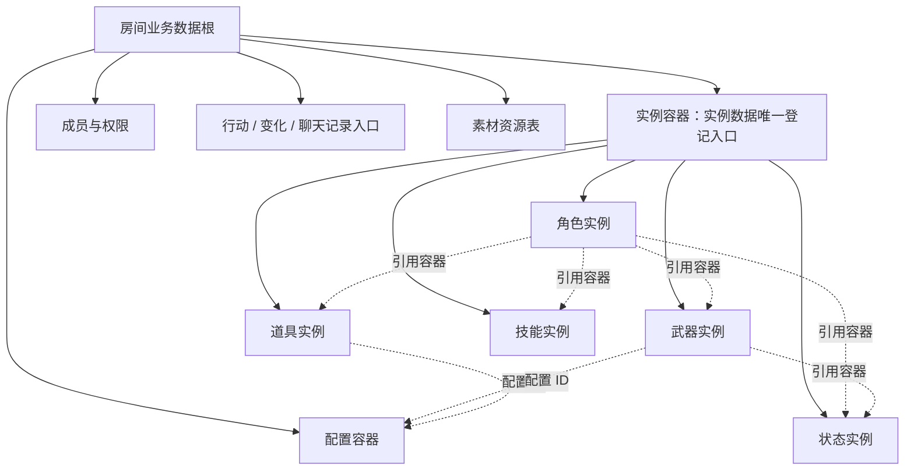

集中登记关系负责“实例存在并可被查找”，背包持有关系负责“实例当前被谁持有”；二者可以同时成立，不能把登记到实例容器算成第二个物理持有者。配置容器同样是定义登记范围，不等同于背包的容量/持有语义。

引用容器使用已登记的关系/成员边组织引用，反向检索使用同一关系来源的索引；不要求引用两端分别保存可独立修改的数据副本。更新实例时只修改权威实例数据，转移时修改相关关系及必要实例数据；归档、引用清理、并发和原子性继续遵守后续章节约束。

### 3.8 数值计算、引用语义与事件入口

以下方向于 2026-10-30 经用户确认纳入方案；本节定义目标行为，尚未作为完整后端能力实现。

**数值与计算。**数值属性表保存原始数据，也包含当前 HP、剩余弹药和耐久等需要持久保存的当前状态，不限于初始配置值。最终攻击力等组合值在需要使用或显示时，由主机调用规则计算，不作为另一份可独立编辑的原始数值保存。若实现缓存，缓存绑定实际数据依赖和规则修订，失效时重算；已完成行动的结果、骰面和审计仍需保存，不因重新显示而改写。

规则按执行用途区分只读计算与行动流程：只读计算允许读取数据、调用其他计算规则并返回结果，不修改状态、不消耗资源、不产生新的随机业务结果；行动流程处理检定、消耗、伤害和状态变化，效果进入宿主事务。界面显示组合值也通过主机计算接口取得，避免刷新界面触发业务操作。

组合算法保存为 Lua 规则文件，允许规则调用/引用其他规则。应用顺序与优先级通过流程配置明确表达；加载阶段检查可解析依赖环，运行阶段检查实际调用链和调用深度，拒绝递归成环。一段执行固定规则及依赖修订，不允许一次行动混用更新前后的计算依据。此处的禁止成环针对规则调用，不等于禁止所有业务引用成环，包含/持有约束仍按各自策略执行。

**引用与标签。**持有、装备、技能归属、状态承受和状态来源，优先通过带类型的引用关系表达；关系可以附加标签或元数据描述主手等进一步信息。`melee` 等对象类别放在对象标签中；伤害、耐久等数值属性的分类放在对应属性定义或分类信息中，不能用目标对象的全局标签代替某个角色与它之间的关系。内核根据关系类型检查持有、装备和引用约束，附加标签不授予额外能力。

**规则引用与事件入口。**规则容器保存引用，规则文件不维护实例的可变属性或第二份参数。对象配置对应的行为定义建立事件到规则/流程入口的映射，可用更高一级的独立 Lua 规则文件组织。入口流程再引用对象关联的计算/动作规则，按明确顺序、条件与分支执行。

```text
对象配置对应的行为定义
├─ 攻击时 → 攻击流程入口 → 按流程应用相关计算与动作规则
├─ 闪避时 → 闪避流程入口 → 按流程应用相关计算与动作规则
└─ 进入房间时 → 入场流程入口 → 判断并记录玩家或角色的触发情况
```

事件绑定表达“何时从哪个入口执行”，属于对象使用规则的关联信息，不是规则内部的实例状态。首轮优先由一个事件入口流程显式组织顺序；同一事件的独立多监听器、取消传播等更复杂调度语义不在此次定稿。调用所需实例与参数从既有容器、数值属性和主机绑定上下文取得，不要求作者重复拼装一套实例数据。

## 4. 容器能力：与普通列表、组件和关联分开

容器是“对成员集合施加管理规则的能力”，不是所有对象共同继承的业务父类。它可由一个具有身份和版本的实体承载；容器成员边保存成员引用和容器内元数据。一个组件中的普通数组不自动成为容器。

| 抽象 | 定义 | 不变量或扩展点 |
| --- | --- | --- |
| Container | 容器 ID、作用域、revision、策略引用 | 成员范围可授权查询，操作可参与事务 |
| Membership | 成员边 ID、容器 ID、目标 ID、角色/顺序等关系元数据（物品数量见第 6 节） | 按关系类型规定唯一性，不仅按显示名称去重 |
| ContainerPolicy | 允许类型、容量、顺序、嵌套和持有/引用语义 | 容量和叠加等业务计算通过规则包扩展 |
| ContainerOperation | 加入、移出、转移、重排、查询 | 校验成员和容器版本、权限及策略 |

下图实线表示操作依赖，虚线表示按 ID 引用。成员边保存在何张表不由本图决定。

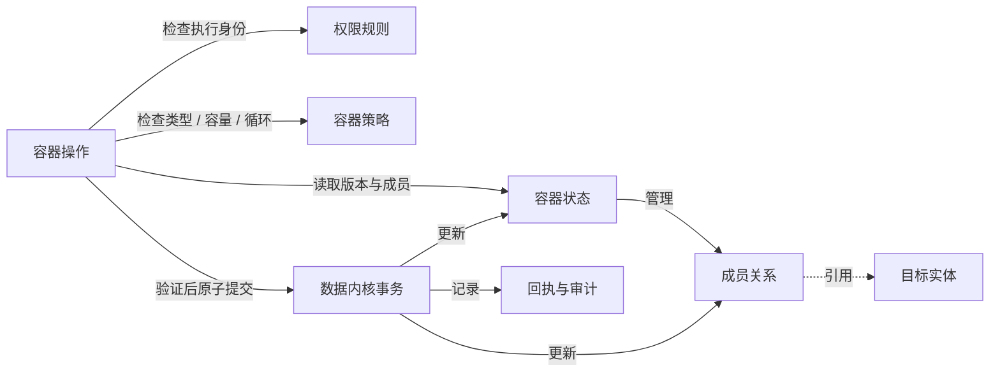

### 4.1 成员语义

- **持有/包含**：按策略约束排他归属，如某个物品实例当前位于一个持有容器；包含嵌套不允许形成循环。
- **引用集合**：同一目标可以出现在多个集合，如线索同时出现在多个资料目录；移除引用不等于删除目标。
- **空间放置**：通过放置实例关联目标实体；同一角色可以有多个 Token，每个 Token 保存局部空间数据。
- **展示列表**：仅作为排序/筛选投影时不建立权威容器，不让 UI 列表移动隐式变成所有权转移。

排他性只作用于同一种持有语义，不禁止实体被其他关系引用。背包持有物品与面板展示物品可以同时成立。

### 4.2 管理规则与业务对照

| 操作/约束 | 抽象层规则 | 跑团场景 |
| --- | --- | --- |
| 加入 | 同作用域、允许类型、容量和成员唯一性检查；包含边禁止成环 | 背包接收道具，资料目录加入线索 |
| 转移 | 同事务校验源/目标权限、版本和策略，失败保持原状 | 两个角色交换物品，不能复制或丢失 |
| 堆叠/拆分 | 仅合并模板与可变属性相容实例，数量守恒并保留来源 | 拆分弹药、合并同类消耗品 |
| 装备/消耗 | 由规则包给出槽位、条件与效果；内核保证原子性、幂等 | 装备武器、开枪消耗弹药 |
| 模板实例化 | 记录来源 ID/版本；改模板不静默重写已有实例 | 根据道具模板生成独立持有物 |
| 引用中对象删除 | 默认归档或拒绝，返回授权引用清单；显式替换/解除 | 删除正在被 Token 引用的角色 |
| 容器删除 | 明确移出、归档还是拒绝；仅引用对象不跟随删除 | 删除资料目录，保留原线索 |
| 状态叠加 | 状态实例记录来源、持续类型、层数和解除条件 | 同名状态来自不同技能，按规则叠加 |
| 包升级 | 备份、试迁移、差异检查；运行中流程锁版或显式迁移 | 游玩中新增规则，不追改已完成检定 |
| 分页与索引 | 作用域、类型、标签和声明索引过滤；稳定 ID 排序；结果与计数授权 | 搜索玩家有权查看的线索或物品 |

### 4.3 包含、持有、引用与放置的区别

四个分组是不同关系语义，实线和虚线的具体含义以边标签为准。它们可以同时存在，不要求把业务对象塞进同一棵所有权树。

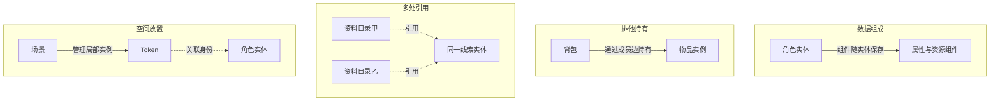

删除资料目录仅解除目录成员关系，移除 Token 仅结束局部放置；二者都不自动删除被引用的实体。删除背包则必须先明确处置其持有物，不能照搬引用目录的删除策略。

## 5. 业务组合示例

| 业务概念 | 数据结构组合 | 容器/关系语义 | 不应直接等同于 |
| --- | --- | --- | --- |
| 角色 | 统一实例＋属性/资源数值＋武器/道具/技能/状态引用 | 可关联背包；通过 Token 被场景引用 | 一份角色面板或地图图标 |
| 背包 | 容器承载实体＋成员边＋容量策略 | 排他持有、允许嵌套时防循环 | 物品数据的任意嵌套复制 |
| 武器/道具 | 统一实例＋配置身份＋当前数值与规则关联 | 在实例容器登记，通过持有/装备/其他引用组织 | 仅有物品名称或配置定义 |
| 技能 | 统一实例＋技能配置＋实例数值与规则关联 | 角色引用技能实例，相关列表为授权查询结果 | 每个角色内重复嵌入完整技能定义 |
| 状态表 | 对统一状态实例的引用集合；实例保存来源和到期数据 | 按承受者、来源等关系组织，刷新/叠加按规则处理 | 状态名字符串数组 |
| 地图/地点 | 场景/地点实体＋资源引用＋地点关系 | 地点连通是关系网，Token 是放置实例 | 所有地点只能组成一棵包含树 |
| 线索资料目录 | 线索实体＋文本/资源引用＋目录容器 | 引用集合；目录访问与线索授权分别校验 | 把整个目录内容无差别下发 |
| 流程进度 | 运行记录＋步骤结果＋版本引用 | 数据内核持久化，不能当作可随意拖拽的业务成员 | 一段仅保存在内存的 Promise |

以物品从 A 背包转入 B 背包说明“通用容器＋业务策略”的组合，箭头表示命令处理次序：

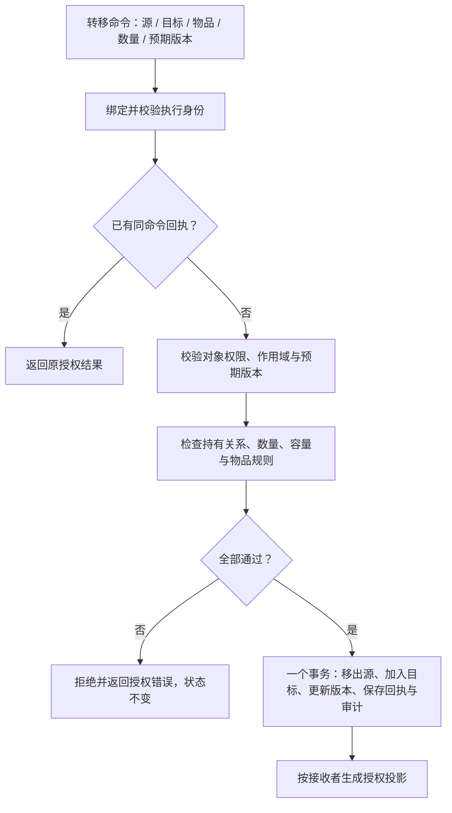

例如 A 持有 3 件相容物品、转移 1 件，业务结果应为 A 剩 2 件且 B 增加 1 件；命令重试不能再转移一次。涉及不同物品实例时，堆叠/拆分规则需同时说明目标实例 ID 的生成与来源。事务、回执保留和恢复细节由后端分析第 5 节维护。

## 6. 五类业务的信息层级与关系

### 6.1 统一约定

以下使用自制跑团场景说明角色、背包、物品、状态与地图放置，不代表 COC 完整规则。层级树表示需要管理的信息，关系图表示对象之间的联系；均不确定实际配置、存储和传输格式。

类型定义应声明组件结构、引用目标类型、可编辑信息、受动作保护的信息与所需能力。内核保留信息和宿主组件不能被规则包重新注册或降级为普通可写字段。客户端不能伪造对象版本或通过更改业务主人引用取得权限。

| 对象 | 可普通编辑的信息示例 | 必须走业务动作的信息 |
| --- | --- | --- |
| 角色 | 显示名、背景文字 | HP、状态效果、规则计算的最大值 |
| 背包 | 备注 | 主人、容器语义、容量规则和成员 |
| 物品 | 个人别名 | 数量、装备位置、耐久、模板版本 |
| 状态 | 主持人备注 | 承受者、层数、期限、效果与移除 |
| 地图放置 | 非业务展示标签 | 场景/角色绑定、位置、朝向、可见性 |

“可编辑”仍受能力校验，不表示所有玩家都能修改。KP 纠正通过管理动作并记录原因，仍不能破坏引用、版本和容器结构。

### 6.2 五类对象的信息层级

每个独立对象都具有第 3.2 节的实体公共信息，下树只展开各自的业务部分。树中的“引用”不是目标数据副本。

```text
业务对象
├─ 角色
│  ├─ 身份：显示名、背景
│  ├─ 数值属性与技能实例引用
│  ├─ 资源：当前值、最大值
│  ├─ 引用/关联查询：背包、武器、道具、技能、承受的状态及各场景放置
│  └─ 角色个人事件记录：解锁、触发、知情与待办
├─ 背包
│  ├─ 主人引用
│  ├─ 容器能力：持有域、允许成员类型、嵌套策略
│  ├─ 业务容量：重量、槽位或规则计算依据
│  └─ 成员关系：成员标识、物品引用、顺序、关系修订
├─ 物品
│  ├─ 定义来源：模板引用与不可变修订
│  ├─ 实例信息：别名、品质、耐久、装备信息
│  ├─ 数量：本实例的数量唯一来源
│  └─ 计量依据：单位重量等业务信息
├─ 技能实例
│  ├─ 技能配置引用与实例数值
│  └─ 标签、相关规则与其他实例引用
├─ 状态实例
│  ├─ 状态定义与修订
│  ├─ 承受者引用与来源记录
│  ├─ 层数与规则参数
│  └─ 持续条件
│     ├─ 回合型：逻辑时钟引用、到期轮次、阶段
│     └─ 实时型：UTC 截止时间、停机恢复策略
└─ 地图放置实例
   ├─ 场景引用与目标角色引用
   ├─ 局部位置：坐标、朝向、所在层
   └─ 展示与访问：可见性、局部覆盖、显示资源引用
```

物品数量只存于物品实例，成员关系不重复保存数量；负重从规则指定的数量和计量依据计算。角色的引用容器只组织目标引用，不嵌入背包、技能、状态或 Token 的完整数据；反向关联使用同一关系来源的已声明引用索引查询。

成员关系与容器各自维护修订；加入、移出、重排更新对应关系和容器修订。数量或重量变化也使所属容器修订递增。内核根据登记的依赖跟踪修订，规则计算业务重量；提交时还要校验实际读集，不能只信任客户端提交的依赖列表。

### 6.3 同一跑团场景的关系

例如角色甲有一个背包和一叠补给品，同时受到迟缓状态，并在地图上放置 Token；角色乙有另一个背包。实线表示管理/持有，虚线表示引用。

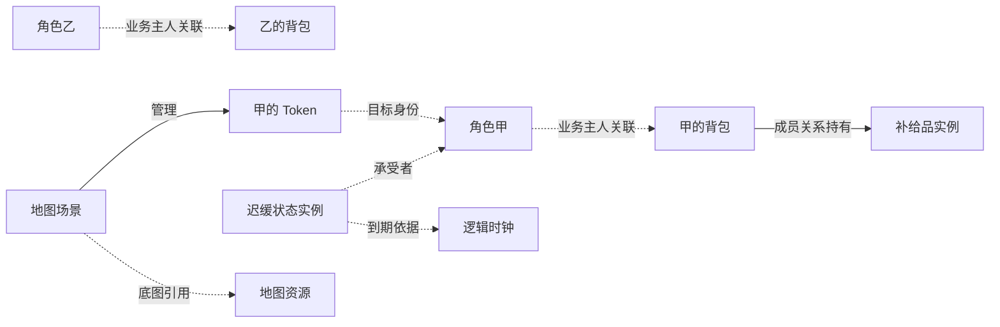

业务主人关联不等于实际授权。解除状态、转移物品、移除 Token 是不同动作，不会自动删除角色，也不会隐式修改其他资源；需要额外效果时由规则明确提出。

### 6.4 状态与放置的独立性

下图说明同一角色可以关联多个来源状态和多个场景放置，不能用一个状态名或一组全局坐标替代这些实例。

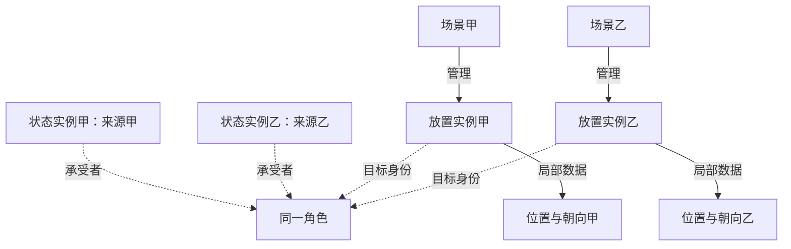

| 主题 | 约束 |
| --- | --- |
| 排他持有 | 同一战役、同一持有域内，活跃物品最多一条持有关系；其他引用不受此排他约束 |
| 部分/整叠转移 | 部分转移生成新物品实例；整叠转移保留物品身份，只迁移成员关系 |
| 堆叠相容 | 由规则声明需相同的定义修订、品质及其他行为字段，不能只比较名称 |
| 状态来源 | 同名状态可有多个实例；覆盖、叠层、刷新期限由规则选择 |
| 时间语义 | 回合状态依据逻辑时钟和阶段，实时状态依据截止时间，不混用轮次与秒数 |
| 地图移动 | 内核检查有限坐标及有效引用；网格、距离、阻挡和行动额度由规则决定 |
| 归档 | 归档对象不再参与活跃业务计算，历史可引用；硬删除属于单独维护流程 |

## 7. 增删查改的概念接口

### 7.1 请求与回执的信息层级

本节只描述接口需要的信息与行为，不给出配置、存储文本或网络报文示例。通用对接语义由接口契约维护；首测字段、文件快照分组、事务与恢复边界统一见[首测工程设计](first-test-engineering-design.md#5-数据结构与仓储布局)，机器契约及 fixtures 按 E1 实施。

```text
接口请求
├─ 写入命令
│  ├─ 命令标识：幂等与结果查询
│  ├─ 作用域：长期房间、运行场次、权威实例代次
│  ├─ 执行依据：活动规则修订、对象预期版本
│  └─ 操作意图：动作、目标引用、业务输入
└─ 只读查询
   ├─ 请求标识与房间作用域
   ├─ 查询目标：单实体、容器成员、反向关联
   └─ 查询范围：允许的字段、过滤、排序、分页

命令回执
├─ 关联命令与终态：提交成功 / 拒绝
├─ 成功信息：授权业务结果、受影响对象及修订
├─ 拒绝信息：错误类别、可公开原因、下一步建议
└─ 恢复信息：是否重放、授权投影游标
```

执行身份来自已认证会话，不由请求自由指定。预期版本是客户端前置条件，内核还需跟踪实际读集；创建对象不携带该对象的旧版本。活动规则与权威代次由后端确认，客户端不能选择旧规则绕过限制。

同一账号、同一长期房间内，相同命令标识及相同内容重试返回原提交结果；相同标识携带不同内容则拒绝。生成的新对象标识与回执一起保存，重试不再次创建。返回回执时仍按当前权限过滤，撤销权限后不能借旧回执取得秘密内容。

| 错误类别 | 后续处理 |
| --- | --- |
| 结构或输入不合法 | 修正输入并使用新命令标识 |
| 不存在或无权访问 | 不区分秘密对象是否存在，仅给授权范围内的提示 |
| 对象版本冲突 | 获取新授权数据，重新确认，不能无条件覆盖 |
| 规则修订冲突 | 刷新可用动作及执行依据后重做 |
| 业务规则拒绝 | 显示可公开原因，如容量或行动额度不足 |
| 引用冲突 | 显示授权引用，由相应业务动作明确处置 |
| 幂等内容冲突 | 保持状态不变，检查命令标识是否被错误复用 |

拒绝不产生业务效果；已记录的终态拒绝固定关联原输入和规则修订，改输入后使用新标识。提交状态未知时先用原标识查询或重试，避免新标识导致重复执行。

### 7.2 五类对象的操作语义

各行是独立用例，不表示需要依次执行。创建对象的引用目标需已经存在，或在同一受控原子动作中创建。表中的接口为概念分类，不是已实现 API。

| 对象 | 增加 | 查询 | 修改 | 移除/归档 |
| --- | --- | --- | --- | --- |
| 角色 | 按类型创建，内核补齐公共信息和默认权限 | 查询授权身份、属性、资源；关联信息按引用查询 | 显示名等普通编辑；HP 等通过规则动作 | 存在背包、状态或 Token 引用时先明确处置，禁止隐式级联 |
| 背包 | 用主人引用和容量依据创建，绑定容器能力 | 查询授权成员、目标摘要与允许公开的容量汇总 | 备注可普通编辑；主人、容量和成员走受控动作 | 非空默认拒绝；先转移成员，空容器再检查其他引用 |
| 物品 | 授予动作原子创建物品与持有关系 | 查询实例信息、数量和授权来源 | 别名可普通编辑；转移、拆分、消耗、装备走业务动作 | 明确丢弃或消耗；数量归零时解除持有并归档，不允许负数 |
| 状态 | 按目标、来源和定义执行施加动作 | 按承受者查询活跃状态及授权来源 | 叠层、刷新期限由规则动作计算 | 有权解除或到期触发只处理指定实例，保留其他来源 |
| 地图放置 | 根据场景及目标身份创建独立实例 | 按场景查询授权 Token 及局部位置 | 移动动作检查源位置、状态、距离和额度 | 归档放置实例，保留角色及其他场景放置 |

普通编辑入口同样经过类型、能力、字段、版本和不变量校验，不能直接更改受保护的数量、状态、位置或成员关系。多对象初始化和删除使用效果范围明确的业务动作，不能由玩家提交无限制事务脚本。

### 7.3 查询结果与反向关联

```text
授权查询视图
├─ 角色视图：身份、属性、资源及允许的关联入口
├─ 背包视图
│  ├─ 容器身份与修订
│  ├─ 成员项：成员标识、成员修订、物品授权摘要
│  └─ 分页状态与允许公开的汇总
├─ 物品视图：定义来源、实例信息与数量
├─ 状态视图：指定承受者的活跃实例
└─ 场景视图：指定场景的可见放置实例与局部数据
```

反向关联使用类型注册的引用索引，字段选择不等于授权。过滤、排序和字段均走允许列表，不提供任意 SQL 或脚本字符串查询。分页游标绑定作用域、过滤、排序及授权上下文；本草案采用集合变动后游标失效并重查，不承诺跨页快照一致性。

秘密信息不能通过总条数、排序占位或聚合值泄露；只有获准的汇总才能下发。查询结果的层级只是视图结构，不表示把所有目标实体嵌入主对象保存。

### 7.4 部分转移的对象变化

下面表示角色甲将一叠补给品中的一部分交给角色乙。实线表示转移前后持有关系，虚线表示来源追溯；图中不展开网络请求或存储编码。

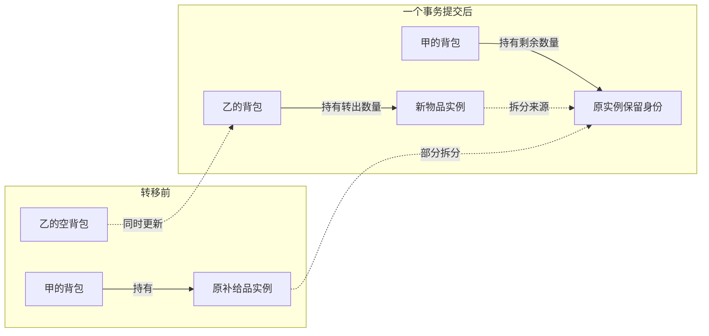

提交时同时更新物品、相关成员关系、两个背包修订、回执和审计；任一约束失败则全部保持原状。未改变的源成员关系不必递增修订。整叠转移则不拆出新物品，只迁移原实例的持有关系；守恒、权限和并发约束保持相同。

## 8. 通用内核与 Lua 规则的责任界线

作者通过每次执行绑定的 Lua 宿主 API 提出业务操作，宿主自动收集拟效果；API 参数 `r` 的含义与最终分层统一见[主方案第 3 节](lua-authoring-facade.md#3-lua-宿主-api-与分层职责)。本节只维护数据不变量及规则责任，不另定义作者 API。

| 约束 | 定义者 | 内核负责 | Lua 规则负责 |
| --- | --- | --- | --- |
| 身份/权限 | 宿主策略，包可声明所需能力 | 绑定身份、检查成员/对象/动作能力、生成授权投影 | 请求能力、在授权范围内判断业务条件，不授予自己额外权限 |
| 字段形状与范围 | 类型 schema；`core.*` 由宿主固定 | 运行时验证、拒绝未知受保护路径、有限数值与大小限额 | 声明 HP/重量等业务字段及静态范围 |
| HP 上下限 | 规则包 | 验证最终写入满足已声明范围与事务条件 | 决定伤害、治疗、溢出、临时最大值和修正规则 |
| 排他持有/引用/循环 | 宿主容器语义 | 检查同域唯一持有、引用有效、禁止包含成环 | 选择允许的业务组合，不能放松核心持有不变量 |
| 数量守恒 | 宿主数量效果契约＋包的数量字段声明 | 转移/拆分不增发，消耗/赐予需不同能力与明确数量账目 | 判断可否拆分/堆叠及相容字段，计算合法数量 |
| 负重/槽位/装备 | 规则包 | 固定读集、依赖版本检查、失败全撤销 | 计算重量、容量、装备槽和例外 |
| 状态叠加/到期 | 规则包＋宿主调度协议 | 持久化时钟/触发回执、避免重复，验证目标引用 | 选择覆盖/叠层/刷新、计算期限与解除效果 |
| 地图移动 | 规则包/场景能力 | 场景/目标引用合法、控制权、有限坐标、版本与事务 | 单位、网格、距离、阻挡、行动额度；KP 传送是独立能力 |
| 并发与规则版本 | 宿主 | 固定执行修订与读集、检查冲突、原子提交和回执去重 | 保持有界执行，只返回可校验结果和效果提案 |
| 归档/删除 | 内核引用策略＋业务动作 | 列出授权引用、阻止悬空/隐式级联、保留审计 | 决定解除、迁移、丢弃等业务处置，并提出显式效果 |

内核不必理解“迟缓”的含义，但不能仅因 Lua 返回了一个补丁就无条件提交。数量守恒等跨对象约束需要宿主能理解的效果类型，不应藏在任意字段替换中。规则输出超出声明效果范围、读取未获准数据或违反内核约束时，整条命令拒绝；宿主默认不给规则直接数据库、文件系统或网络写入能力。

### 8.1 候选效果与调用能力

| 效果类型 | 用途 | 宿主提交检查 |
| --- | --- | --- |
| `entity.patch` | 已声明普通字段或受规则保护的数值效果 | 路径、执行模式、规则能力、schema、对象版本与引用 |
| `inventory.transferQuantity` | 物品整叠/部分转移 | 源数量、目标容器、守恒、唯一持有、拆分 ID 与依赖版本 |
| `inventory.grant/consume` | 显式增发或扣除数量 | 独立授予/消耗能力、正数量、来源与审计，不冒充转移 |
| `status.apply/refresh/remove` | 管理来源状态及持续时间 | 实例/目标/时钟引用、类型和受保护字段授权 |
| `placement.create/move/remove` | 管理地图放置实例 | 场景、目标、有限坐标、归档与受保护操作能力 |

这些是效果提案原语，不是额外开放给客户端的免校验接口。宿主从动作注册信息得到可用能力上限，再与当前执行身份取交集；不能由 Lua 自报自己拥有 `grant` 权限。

### 8.2 容量判断中的内核与规则协作

下图实线表示判断和提交顺序，虚线表示受控读取。不包含 Lua 源码或具体宿主函数名称，辅助查询 API 待原型确定。

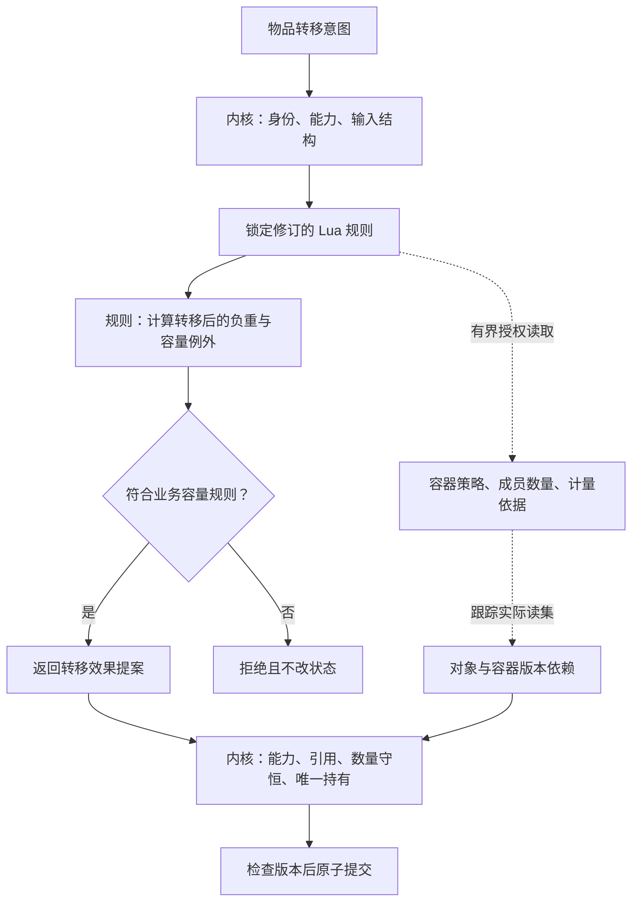

内核强制负责身份、引用、实际读集版本、源数量足够、持有唯一性和原子性；Lua 负责重量公式、容量限制、堆叠相容与业务例外。规则可以使用受控的汇总查询或遍历有界成员，但不能直接写数据库。

规则判断绑定执行修订和读集。提交前物品重量、数量或容器策略若已改变，内核拒绝冲突，不提交旧判断。业务拒绝不经过提交节点，内核检查不通过同样不得产生部分效果。

## 9. 从界面动作到提交的验证顺序

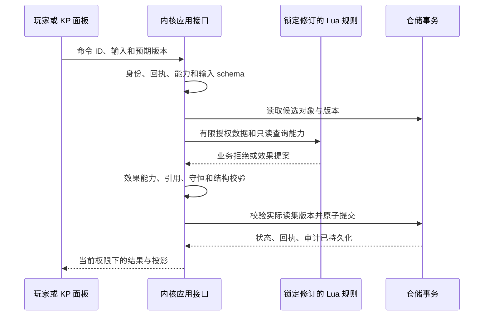

数据读取与规则执行可以在短写事务之外进行，但提交时必须重新检查完整读集版本及数据库约束；跨对象操作不能先改源再异步改目标。图表示成功路径，任何检查失败都不得产生部分业务状态；脚本超时也按未提交处理。崩溃发生在提交之后时，用持久回执与快照恢复。

## 10. 实施、验收与待确认问题

实施顺序：确定实体/组件/关系 schema → 定义持有与引用两种容器策略 → 实现原子转移和授权查询 → 用 Token、多来源状态和资料目录验证表达能力 → 补充迁移与恢复验证。

| 验收用例 | 应观察到的结果 |
| --- | --- |
| 同一角色被两个场景放置 | 角色 ID 不变，两个 Token 的位置独立 |
| 同一线索加入两个目录 | 只有两个引用，删除一个目录不删除线索 |
| 物品转移遇到版本/容量冲突 | 双方成员和数量不变，错误不泄露秘密 |
| 重试转移、拆分或消耗 | 在规定幂等窗口内不重复产生效果 |
| 容器嵌套形成循环 | 提交前拒绝，原结构不变 |
| 未知扩展与包升级往返 | 备份不丢字段，缺包不执行，迁移报告明确 |

补充验收：按第 6 节共同业务场景逐项验证第 7 节 CRUD；验证数量只存一处、部分转移返回稳定新 ID、数量变化使父容器版本失效、状态按来源解除、地图移除不删除角色，以及通用补丁不能绕过受保护动作。角色、武器、道具、技能与状态实例均按第 3.6 节统一结构登记，业务列表按引用与授权查询组织。

待确认：容量查询助手的最终 API；堆叠相容字段的注册格式；容器权限是否允许显式继承；跨作用域复制/迁移是否纳入首轮；统一实例中各类配置字段与关系的具体 schema。未决定的问题不通过图示默认定案。

本次草案补充验收：五类对象具有统一公共结构；两把耐久不同且配置 ID 相同的洛阳铲能通过相同配置身份条件；标签可查询并供规则判断；角色/武器的引用不复制状态数据；集中登记不导致第二条持有关系；成员投影不包含账号认证信息；聊天记录不在本次臆定内部结构。
确认方向的补充验收：跨日重建房间后共享进度一致，玩家/角色的个人事件记录各归其容器；客户端无法提交自算派生值或骰面；重复显示组合值不修改状态；规则调用成环被拒绝；事件按配置入口与流程顺序执行；规则引用不保存第二份实例参数。
