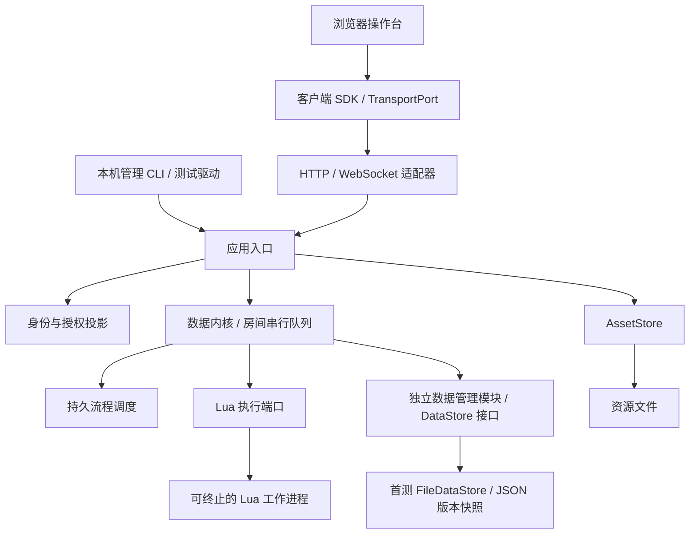

# 首测版工程设计

- 文档类型：计划
- 状态：进行中
- 创建日期：2026-10-30
- 最后更新：2026-10-30
- 关联文档：[施工计划](first-test-construction-plan.md)、[后端分析](backend-network-analysis.md)、[数据与容器](data-container-model.md)、[前后端契约](frontend-backend-contract.md)、[Lua 编写方案](lua-authoring-facade.md)、[当前原型](../../current/engineering/lua-authoring-prototype.md)

2026-10-30 范围更新：聊天室后端已作为追加任务实现，实际数据结构、权限和命令以 [聊天室后端](../../current/engineering/chat-backend.md) 为准；聊天页面仍待制作。完整 COC 等规则归配置包实现，地图/逻辑图/2D/3D 空间及地图战斗暂不作为必要实现。本文保留相关候选设计作为按游戏需要扩展的参考，不列为本次必交能力。

## 实施状态（2026-10-30）

用户已授权按计划实施。本机首测工程及自动验收已落地，实际技术版本、接口、运行和限制以 [当前工程说明](../../current/engineering/first-test.md)、[Lua 编写说明](../../current/engineering/lua-authoring.md) 与 [验收报告](../../current/engineering/first-test-acceptance.md) 为准。下文保留工作包与验收目标作为追溯，不再代表“所有功能均未施工”。

E0—E5 的首测实现已有代码与验证；E6 的自动故障、离线安装和浏览器验收已有证据。E6-03 独立作者试写仍待真实参与者，未以开发者自测替代，ISSUE-001 不关闭。计划保持进行中以跟踪该剩余验收。

实现采用首测允许的替换边界：本机 WS 用有界完整授权快照替换和重连，不提供跨连接增量 replay；数据管理以不可变全量文件代提交，不依赖数据库。配置/实例、规则/流程、资产和网络均有独立职责，详见当前工程说明。

## 1. 目标、依据与交付边界

将已有设计细化为可施工的首个测试版：同一台电脑运行一个权威宿主，KP 与玩家通过真实 HTTP/WebSocket 连接，使用 Lua 规则操作同一长期房间，并验证跨进程重启后的恢复。浏览器只提交意图、管理表单和展示授权结果，全部游戏计算在宿主进行。

已确认的长期房间、统一实例、原始数值、类型化引用及事件入口约束，以[项目概况](../../current/design/project-overview.md#房间与规则的数据设计决策)和[数据模型](data-container-model.md)为准。本文新增的是首测工程基线，尚未实现；不将候选技术栈写成用户已确认的长期选型。

| 首测必须交付 | 首测之外 |
| --- | --- |
| 房间创建/打开/暂停，账号登录、成员权限、个人事件记录 | 账号自助注册、密码找回、中心账号服务 |
| 通用实例与关系、配置修订、受控 CRUD、检索 | 全规则系统兼容、复杂内容编辑器 |
| 检定、伤害、物品整叠/部分转移、只读组合值 | 完整战斗、地图交互、状态叠加与回合系统 |
| 检定—KP 裁定—后果、一个限时选择流程 | 任意协程持久化、自动改写脚本、独立多监听器 |
| 运行中导入/激活 Lua，旧流程锁版、失败保留旧版 | 自动监听文件即生效、旧流程自动迁移、多层临时覆盖 |
| 授权视图、回执、真实本机多身份连接、备份恢复 | LAN/公网正式发布、P2P、TURN、自动主机迁移 |
| 素材表、授权导入/读取和备份，最小管理页面/CLI | 大文件断点续传、素材市场、正式聊天页面 |

首测采用自制小规则验证工程能力，不宣称 COC 规则兼容。五类对象共用数据结构需要样例验证；其中状态/技能可以完成实例与引用管理，但完整业务行为按后续计划扩展。日志显示行动与数据变更；聊天室作为独立模块已追加实现，现行结构见本文范围更新链接。

2026-10-30 用户确认：数据管理抽离为独立模块，首测先实现并使用文件存储，数据库仅在后续需求明确时评估。本决定替代本文此前的 SQLite 首测建议；文件提交协议仍待实现验证。

## 2. 技术基线与选型关口

推荐先用以下组合施工，以减少从同步 Lua 实验转向持久宿主的验证成本。E0 必须完成依赖锁定与运行探针，才能开始依赖该组合的正式实现；失败时修改本节和任务依赖，不能静默更换语言或 Lua 语义。

| 部位 | 首测推荐基线 | 理由与验证要求 |
| --- | --- | --- |
| 宿主语言 | CPython 3.14，Windows x64 首验 | 本次本机读取为 3.14.2；便于使用文件处理、进程管理及已有 Lupa 验证路径。不是最低支持版本或跨平台承诺 |
| 规则执行 | Lua 5.4，经 `lupa.lua54` 显式加载；Lupa 2.8 作为起始验证版本 | 保留现有样例语义；禁止用未指定实现的 `import lupa` 随依赖变化升级 Lua |
| HTTP/WS | FastAPI + Uvicorn，单个服务工作进程 | 同一应用入口承载 HTTP 与 WS；应用层通过数据管理模块持久化，不依赖框架示例中的内存连接表恢复业务 |
| 数据管理与持久化 | 独立 data-management 模块，首测使用 FileDataStore：本地 JSON 版本快照与受控提交 | 房间和账号分别管理；业务通过统一接口访问。数据库实现后续按需求评估 |
| 契约 | JSON Schema Draft 2020-12 + 对应校验器；HTTP 描述从同一源生成 | 静态消息与动态动作使用同一校验路径，不能另维护一套宽松 Pydantic 模型 |
| 账号 | 本地账号仓储、`pwdlib[argon2]`、服务端会话 | 首测只由管理 CLI 创建账号；不引入 JWT、云账号或邮件服务 |
| 客户端 | 原生 HTML/CSS + JavaScript ES modules、框架无关 SDK | 最小操作台验证接口；将来换面板不影响协议，不预先锁定产品前端框架 |
| 资源 | 独立 `AssetStore` 接口、本地不可变文件 | 业务仅持资源 ID；大字节流不塞进 WS 消息 |
| 验证 | pytest、真实 HTTP/WS 客户端、浏览器隔离上下文 | 不以内存 mock 代替联机验收；开发依赖与运行依赖分别锁定 |

E0 产物记录所有直接/间接依赖的精确版本、摘要、许可证、Python/Lua 实际版本、存档格式版本与测试文件系统，以及 Windows 无编译器安装结果。本文件不虚构尚未解析的依赖锁。Python 与 Web 框架是首测实现建议，Lua 是已确认的自定义语言；二者决策层级不同。

资料于 2026-10-30 核查：[Lupa 2.8 文档](https://github.com/scoder/lupa/blob/lupa-2.8/README.rst)说明运行时选择、Python 访问控制与 Lua 内存限额；这些机制不等于不可信代码沙箱。[FastAPI WebSocket 文档](https://fastapi.tiangolo.com/advanced/websockets/)支持所选承载方式；密码哈希依赖参考其[认证教程](https://fastapi.tiangolo.com/tutorial/security/oauth2-jwt/)，本方案的会话方式由本项目决定。文件提交与恢复约束见第 5.3 节，具体平台文件操作在 E0 验证。结构契约采用 [JSON Schema 2020-12](https://json-schema.org/draft/2020-12)。

## 3. 模块、依赖与拟建目录



联机模块可以独立替换。首测中它与应用层同进程部署，Lua 工作进程用于取消失控执行；这不要求联机模块成为微服务。未来独立联机进程使用经过认证的消息边界调用应用入口，不能直接访问存档或把玩家自报身份当作可信调用上下文。

| 模块 | 最小接口/拥有的数据 | 依赖约束 |
| --- | --- | --- |
| `contracts` | 请求、回执、错误、实体/关系、投影与动作 schema | 不依赖运行时框架；校验版本明确 |
| `application` | `handle(context, request)`、`subscribe(context, scope, sink)`；登录、成员、目录、投影、管理 | context 由认证入口构造；不把 HTTP/WS 对象传入内核 |
| `core` | 暂存视图、类型化效果、实际读集、不变量、提交包 | 不导入 FastAPI、Socket 或资源物理路径 |
| `rules` | `stage(sourceSet)`、`execute(lock, snapshot, input, mode)` | 返回结果/读集/拟效果；不持仓储连接 |
| `workflows` | `start`、`respond`、`advance`、`recover` | 每阶段短事务；不保存协程栈 |
| `ports` | `RoomRepository`、`IdentityStore`、`AssetStore`、`RuleExecutor`、`Clock`、`RandomRecorder` | 输入输出为可序列化数据/受控本机接口；错误有稳定类别 |
| `data-management` | 快照查询、受控 CRUD、版本/索引、提交、回执查找、导入导出与恢复；首测 FileDataStore | 不依赖联网或 Lua；不决定游戏算法及调用者权限 |
| `adapters` | HTTP/WS、素材文件、Lupa 子进程 | 依赖内侧端口；业务算法不放在传输处理器中 |
| `client-sdk` | 查询、命令、回执追踪、订阅、目录、资源；TransportPort | 面板不直接调用 WebSocket；所有重试保持 commandId |

拟新增路径如下，仅在施工时创建，当前实际目录仍以 [hierarchy](../../current/engineering/hierarchy.md) 为准：

```text
engineering/
├─ lua-authoring-prototype/        # 保留 A0/A1 实验，不直接冒充正式后端
├─ contracts/                     # 静态 schema、动态动作生成规则、正反 fixtures
├─ data-management/               # 独立 Python 包：接口、模型校验、file_store、格式迁移、契约测试
├─ backend/
│  ├─ pyproject.toml / requirements.lock / requirements-dev.lock
│  ├─ src/onlinecoc/
│  │  ├─ application/ core/ rules/ workflows/ ports/
│  │  └─ adapters/                 # http_ws/ asset_files/ lua_worker/
│  ├─ tests/
│  └─ scripts/                    # 开发启动、账号/房间/备份管理
├─ client-sdk/                    # ES modules，传输接口与一致性测试
├─ test-console/                  # 最小操作台，不作为产品 UI
├─ rulepacks/demo/                # 自制验证包、类型、Lua 规则/流程、包内数据
└─ acceptance/                    # 跨进程故障驱动、场景与脱敏结果格式
```

运行数据使用用户指定的外部 `data-dir`：`identity/generations/`、`rooms/<roomId>/generations/`、`rooms/<roomId>/assets/`、暂存区和备份目录。源码目录不保存真实账号、房间秘密或运行存档；默认路径、排除规则在 E0/E1 配套落实。首测一个宿主同一时间仅打开一个可写房间，同一房间禁止第二个进程接管；使用操作系统文件锁并以双启动测试验证，不把可遗留的标记文件当作有效锁。

## 4. 标识、版本与生命周期

| 字段 | 唯一含义 |
| --- | --- |
| `accountId` / `memberId` | 全局本机账号 / 该账号在房间中的持久成员身份；成员角色不写回全局账号 |
| `roomId` | 长期存档的唯一业务边界；查询、命令、实体、关系和回执均归属该房间 |
| `runId` | 房间开团片段；宿主重启可继续同一未结束片段，另开一场才生成新 ID |
| `authSessionId` / `connectionId` | 登录会话 / 单次连接；不作为个人进度或命令去重身份 |
| `authorityEpoch` | 每次打开权威运行环境生成的新代次；用于拒绝旧缓存发起的新行动，不代替房间身份 |
| `configurationId` / `instanceId` | 稳定业务定义 / 具体对象；定义修订单独记录 |
| `requestId` / `commandId` | 一次传输请求关联 / 同一业务意图；重试只可更换前者 |
| `schemaVersion` / `revision` | 数据形状版本 / 内核管理的数据修订；均不放进数值属性表 |
| `rulesetRevision` / `catalogRevision` | 不可变有效规则锁 / 授权动作目录修订；目录还绑定权限代次 |
| `authorizationEpoch` / `viewToken` | 成员权限代次 / 当前身份下不透明的视图前置条件；均不是授权凭证 |

首测不用 `campaignId` 作为第二个事务或去重作用域：战役/世界是房间内内容。前期候选协议的业务 `sessionId` 统一改名 `runId`，避免与登录会话混淆；旧候选样例不作为首测线协议。当前只有独立实验原型，无需迁移正式线上客户端。

宿主创建实例 ID；外部命令 ID 为足够随机的字符串。房间内对象键及引用都包含/校验 roomId，配置和规则使用命名空间逻辑 ID，不以名称检索后自动选择。归档保留身份和历史引用；硬删除及跨房间复制不是普通编辑。

## 5. 数据结构与仓储布局

### 5.1 最小可持久模型

| 数据 | 首测字段与约束 |
| --- | --- |
| Account（账号存档） | accountId、唯一 loginName、nickname、passwordHash、disabled、revision；密码不进入房间存档 |
| Room / Run | roomId、name、schemaVersion、状态、活动规则锁、全局内容记录；runId、开始/结束时间 |
| Member | roomId、memberId、accountId、role、metadata、authorizationEpoch、授权策略；离线不删除成员 |
| TypeDefinition / Configuration | typeRef 及结构修订；configurationId、不可变配置修订、typeRef、名称、初始值、行为入口引用 |
| Entity | instanceId、roomId、configurationId/Revision、typeRef、schemaVersion、revision、lifecycle、policyId、name、metadata、tags、numbers、components |
| Relation | relationId、roomId、sourceId、targetId、relationType、revision、tags、metadata；对象两端必须存在 |
| Container | 由实体的 `core.container` 能力承载：允许类型、关系语义、策略引用；成员复用 Relation |
| EntityRuleRef | instanceId、slot、ruleId；仅引用，不复制算法、实例属性或输入参数 |
| ProgressRecord | ownerKind=`member/entity`、ownerId、eventKey、状态/次数/时间/获准结构化数据、revision；玩家与角色分别归属 |
| RuleArtifact / RulesetLock | 源码与包内数据原文、内容摘要、依赖、输入/输出契约、执行模式、API/执行器兼容版本；规则锁将逻辑 ID 解析到不可变修订 |
| Command / Receipt / Audit / Outbox | 见第 6 节；行动与数据变化审计分别关联同一提交，不代替当前状态 |
| Flow / Step / Wait | flowId、发起成员、固定输入/规则锁、游标、阶段结果；waitId、受理权限、deadline、状态/版本 |
| AssetRecord | assetId、roomId、内容摘要、大小、媒体类型、逻辑权限、ready 状态；不公开物理路径 |

角色、武器、物品、技能、状态都使用 Entity。背包同样使用实体身份和容器能力。首测检定中的 skill 输入使用技能实例 ID，通过 owns-skill 关联角色，技能当前值保存在该技能实例的数值表；不再在角色属性里维护一份独立技能值副本。现有实验原型的 actor.skills 只是旧实验布局，正式适配保留短调用形态而不照搬其存储结构。`numbers` 只含类型声明允许的有限数字，数量、质量优先整数并声明单位；文字/枚举/结构化扩展放在 metadata 或组件，不伪装成数字。

配置初始值在创建时经校验复制到实例；之后数值由实例独立维护。发布新配置不会自动覆盖既有实例，显式迁移另行设计。规则引用在一次行动开始时结合有效注册表解析为完整规则锁；旧流程保存旧锁。因此新算法可以用于后续行动，而既有实例不会因配置默认值变化被悄悄改写。

引用容器是 Relation 查询得到的权威关系视图，规则容器由 EntityRuleRef 组装；实体 JSON 不再保存两份可独立修改的完整目标或关系数组。反向检索复用同一关系集合的可重建索引。实例登记本身不构成持有关系。

### 5.2 关系、不变量与修改入口

首测支持 `contains`（容器到物品）、`owns-container`（角色到背包）、`equipped`（角色到武器）、`owns-skill`（角色到技能）、`affects`（状态到承受者）、`source`（状态到来源）、`references`。方向在 schema 固定，不能由标签决定。

- 活跃物品在一个持有域最多一条 contains；实例可暂为未分配，但普通转移动作要求唯一合法源。装备不再增加物理持有者，装备目标须满足当前持有/控制策略。
- contains/owns-container 构成的包含链检查循环；其他引用是否允许循环按关系类型决定。关系变动增加相关集合修订，防止读取成员列表后漏检新增成员。
- 数量只存于物品的已声明数值字段；部分转移保留原剩余实例并创建新实例，整叠保留 ID；同配置不自动等于可堆叠。
- 名称/备注等普通字段允许受控 patch；HP、数量、成员权限、来源、派生值和关系语义通过专门动作修改。管理入口也不跳过引用、版本和审计检查。
- 归档前检查活跃入向引用，非空背包默认拒绝；不得以存储层级联删除隐式销毁物品或其他状态来源。

Entity、关系、成员、配置修订、命令、流程与资源记录按 ID 分组保存在同一房间快照；自定义 numbers/metadata/components 使用已验证 JSON。数据管理模块维护主键、引用有效性、集合修订及可重建的查询索引，内核检查业务授权、排他持有与数量守恒。结构不绑定文件路径或 SQL 表，未来存储实现须通过同一契约测试。

E1 须生成机器可检验的 schema 与 fixtures，覆盖两把不同耐久但同配置的洛阳铲、角色持有武器和状态引用、三件物品转一件、两份同名不同来源状态，以及成员/角色分别拥有事件记录。JSON 与 Lua 转换明确：nil 表示缺失；空对象/数组按声明类型判定；拒绝混合表、循环表、函数、userdata、非有限数和超出 JSON 安全整数范围的数字；超范围精度以声明的字符串类型处理。

### 5.3 独立数据管理模块与文件实现

模块提供与后端传输、Lua 和素材字节存储无关的接口。首测采用独立代码包、同宿主进程调用，不增加一个需要部署的服务。接口统一表达逻辑数据，外部模块不知道实际文件名：

| 接口 | 语义 |
| --- | --- |
| `open(scope)` / `close()` | 校验格式与完整性，取得单写锁，恢复最后提交代；scope 为账号域或单个房间 |
| `snapshot()` / `query(spec)` | 不可变版本快照；按声明字段/关系/分页查询，返回版本依据；调用方负责授权投影 |
| `commit(expectedGeneration, changeSet)` | 在同一 scope 内校验结构、引用及基准版本，将一组增改归档与相关记录一起提交；返回新代或明确冲突 |
| `getReceipt(accountId, commandId)` | 从同一存档取得持久回执；应用层按当前权限过滤 |
| `exportSnapshot()` / `restore(bundle)` | 固定提交代导出、完整性预检、向新目录恢复；不覆盖运行存档 |
| `inspect()` / `migrate()` | 格式版本、占用、错误诊断；停写后显式迁移，失败保留原件 |

RoomRepository/IdentityStore 是面向应用的视图端口，由数据管理模块实现；存储接口及传输无关的数据契约由独立模块/共享 contracts 导出，backend 依赖它们，数据管理模块不得反向导入 backend。业务内核仍决定哪些操作获准、如何执行规则及守恒约束；数据管理模块保证校验后的变更集能被一致读取和持久保存。Lua、联网、面板和 Agent 均不直接打开存档文件。素材模块独立提供字节存取，素材引用及权限元数据通过数据管理模块提交。

**首测文件布局。**账号域及每个房间各自有 `generations/`、`staging/` 和运行锁；一个 generation 是一份带格式版本、递增代号、前代标识、内容摘要和长度的完整 UTF-8 JSON 快照（摘要/长度针对规范序列化后的 payload 字节，排除包头自身）。房间快照同时包含配置/实例/关系、成员、个人记录、规则源码与数据快照、命令尝试、随机记录、流程、回执、审计及待通知记录。快照中的注册表负责按 ID 查找；内存索引启动时重建，不作为另一个权威来源。账号快照仅含账号及认证数据，与房间备份分开。

**提交协议。**首测优先完整快照，不做逐实体文件原地覆盖，不实现通用数据库引擎。每个 scope 单写；在内存副本应用变更并验证后，写入同一文件系统的唯一临时文件，完成序列化、校验、缓冲刷新和文件同步，再发布为唯一最终 generation 文件。最终文件发布是可见性提交点；只有平台提交步骤成功后才更新当前内存快照并返回 committed。发布后响应丢失时结果为 unknown，按原 commandId 查询。没有额外的可变 CURRENT 指针作为另一提交点；恢复扫描最终代文件，校验顺序和摘要后选择最新合法提交代。

T1 接纳、随机记录以及 T2 完成分别通过 commit 发布一代；T2 的状态、阶段、回执、审计和 Outbox 必须位于同一快照。随机记录提交后才能返回工作进程。备份期间固定已提交代；素材先写成已校验不可变文件，再提交 ready 引用，失败留下的未引用文件不影响存档一致性。

**失败与恢复。**临时文件未发布即不生效；磁盘满、写入失败、同步失败或发布失败时不得报告成功。重启忽略并隔离暂存残留，校验最终文件及代号链。最终文件损坏、缺代、重复分支或未知格式应进入维护模式并报告，不静默回退到更早快照而丢失曾确认提交；恢复备份是显式操作。保留上一代不等于允许悄悄回滚已提交命令。

E0 必须实测 Windows 本地文件系统上的最终文件发布、刷新、锁及中断窗口，明确进程崩溃与机器断电的保证区别；不得仅凭 rename 或 flush 就宣称断电耐久。首次仅支持验收过的本地文件系统，不支持共享网络盘和同步盘同时写入。实际平台操作与已验证保证在实现后写入工程说明。

**容量边界。**完整快照复制和每次随机记录的持久提交会增加 I/O。首测记录快照大小、提交耗时、代文件数量及总空间，设置存档/历史代总量上限并在耗尽前停止接纳新动作；预留完成进行中提交所需空间，失败仍按上述协议恢复。首测保留历史代、不自动回收，提供备份及占用诊断。素材二进制不嵌入 JSON。快照分片/日志压缩或数据库是否值得引入，依据后续数据规模、检索与并发需求评估，不能作为首测的隐性必装依赖。

制作文件可继续直接编辑；存档通过管理接口或导出副本修改后预检导入，运行期间不接纳绕过提交协议的手改文件。

未来数据库适配器须保持同一逻辑模型、提交/回执及恢复语义；导入导出携带格式版本，通过数量、引用、规则锁、流程与回执对照后才迁移。是否引入以及选择何种数据库均未预定。

## 6. 执行、事务、幂等与恢复

### 6.1 统一命令管线

```text
协议/限额校验 → 认证绑定 → 当前房间成员检查 → 查同身份旧回执
→ 新命令代次/目录/权限/前置条件检查 → 持久登记执行尝试
→ 固定规则与输入快照 → Lua 暂存执行 → 内核复核实际读集与效果
→ 原子提交状态、结果、阶段、回执、审计、Outbox → 生成授权投影
```

同一房间共用一个串行队列；成员改权、规则激活、调度触发及管理写入也进入该队列。数据管理模块使用专属文件 I/O 执行队列，不在异步网络循环中进行大文件读写；Lua 运行期间不持提交临界区。等待玩家回应不占用队列或工作进程。

命令唯一键为 `(roomId, accountId, commandId)`，不含连接、runId 或 authorityEpoch。同 ID 的规范化语义内容摘要必须一致，摘要包含原始业务作用域、代次、前置令牌、动作及参数，排除 requestId/网络凭据。已有命令在校验当前访问资格后优先查回执，因此跨重启携带旧代次重试已提交命令仍可取原结果；不存在旧记录的新行动才检查当前代次。撤权后最多返回允许的终态，不能返回原秘密结果。

首测回执随房间存档保留，不主动过期。结构非法、身份无效等入队前拒绝不创建业务回执；入队后终态拒绝持久保存。同 ID 不同内容返回 `COMMAND_ID_CONFLICT`。相同内容的进行中命令只关联同一尝试，不并行运行；超时返回 unknown/待查询，不能由客户端自动换 ID。

### 6.2 事务边界与随机结果

| 边界 | 原子保存内容 | 崩溃后的处理 |
| --- | --- | --- |
| T1 接纳 | commandId、摘要、执行身份/能力依据、规则锁、固定输入与有界执行快照、pending 状态 | 无记录可按新命令接纳；有 pending 则恢复同一尝试 |
| 随机记录短事务 | attemptId、随机调用序号/参数摘要、骰面；在返回工作进程前持久保存 | 重试命中原骰面；调用描述不一致则拒绝，不另掷 |
| T2 完成 | 全部业务变更、已用骰面/结果、流程阶段及下一游标、终态回执、审计、Outbox | 全部提交或全部不提交；提交后无论是否发回回执都不再执行 |
| 拒绝完成 | 尝试终态、可审计错误、拒绝回执；业务暂存效果丢弃 | 重试返回同一拒绝，已提交的早前流程阶段仍保留 |

固定快照为本动作授权执行范围的数据，不是整库无界复制；实际读取仍记录对象、字段或集合修订。容量检索、反向关系及“没有某成员”等查询须覆盖集合版本，不能只记录已返回的单个对象。提交时复查所有实际依赖、当前权限及模型不变量，冲突拒绝；恢复 pending 时按原快照执行并进行同样复查，不把旧命令套上新数据自动重做。

生产随机通过父进程 RandomRecorder 产生并记录，Lua 不开放 `math.random`、当前时刻、任意文件或网络作为隐式业务输入。工作进程经受限消息请求随机；正式结果提交前不对外展示。预览使用独立测试随机源且丢弃效果，不能消费正式骰面。恢复若随机调用轨迹不匹配，给出诊断并拒绝，禁止以重新掷骰掩盖执行差异。

一次无等待回调内持续读取暂存变化，任何拒绝会永久标记本段不可提交，即使 Lua 用 pcall 捕获也一样。业务算法可以由规则包调整，类型、数量守恒、唯一持有、权限和事务约束不能被覆盖。回执只确认结果，客户端缓存依授权投影更新，不能再应用一次回执中的扣减。

### 6.3 启动、停止与备份

启动依次：获取房间排他运行锁 → 检查存储版本/完整性 → 加载锁定规则和数据快照 → 建立新 authorityEpoch → 恢复 pending/阶段/待办 → 开放连接。缺必需包、源码或不支持的迁移时进入可诊断的维护模式，不默默换成最新规则。未知扩展可保留导出，但不运行依赖它的行为。

关闭时停止接纳新写入，排空或保存当前尝试，关闭连接；停止期间不推进游戏。重开后恢复相同房间和未结束 runId。客户端必须重取授权快照，不能上传旧缓存覆盖房间。进度附于 Member/Entity 的各自记录，恢复不会产生独立世界副本。

房间备份在维护窗口暂停新写入、规则/资源发布与回收，排空当前短任务后，由数据管理模块固定一个已提交 generation，复制完整快照及该代引用的素材并验证摘要，最后写入完整性清单；包源码和包内数据随快照保存。失败备份不能标记完成。导出清单明确记录选定代及其摘要，恢复器完成校验后以该代建立新的存储链基点，保留原代来源和全部业务 ID；后续代从基点继续，不能把缺少旧历史代误判为恢复损坏，也不能以此跳过运行存档中的断链。房间备份含原成员账号引用，不含密码；换宿主恢复先由管理者显式绑定账号，禁止按昵称自动继承权限。完整宿主备份另包含一致的账号存档，说明凭据范围。恢复先在新数据目录验证，再打开原房间；不覆盖正在运行的存档。

## 7. Lua 加载与可恢复流程

### 7.1 作者接口与规则发布

作者接口和简化方向只在 [Lua 编写方案](lua-authoring-facade.md)维护：常用动作仍是 `r.check(actor, skill)`、`r.damage(actor, amount)`、`r.transfer(item, bag, quantity)`；普通作者无需编写效果列表或复杂 return。本工程不另起一套作者 DSL，A2 的流程语法通过同题样例验证后在原方案定稿。

规则注册明确 `calculation/action/flow` 用途。calculation 只开放读取与其他 calculation 调用，主机查询派生值使用它；action 收集拟效果，flow 定义阶段。高层便捷算法属于 demo/后续规则包，通用宿主提供受控读写与不变量检查；当前 host.lua 里的示例算法不能不经拆分就变成产品内核规则。

配置级行为入口将受支持事件映射到一个主流程，公开动作目录只暴露经过授权的入口；玩家不能提交任意 ruleId 越过攻击/裁定流程。流程显式组织顺序，实例规则容器仅保存 slot/ruleId 引用。声明依赖在发布时检查环，运行时检查完整调用链和最大深度；覆盖规则不得隐式调用自己的高层入口。

发布链路：本机有权管理者导入源码/包内数据 → 整组快照、编译及契约/依赖检查 → 隔离预览 → 显示差异 → 激活命令在队列边界切换规则锁和目录。首测仅房间级显式激活，不实现全部覆盖层。失败保持旧锁；成功后新行动用新修订，等待中的旧流程继续使用原源码、数据、便捷库和输入契约。修改/删除原文件不影响已保存的不可变工件；仍被流程或回执引用的修订不回收。

### 7.2 工作进程边界

Lua 每个执行段使用全新环境，优先通过有界工作进程运行；发布检查也受同样限制。父进程提供执行快照和固定工件，只接收受限随机请求与结构化结果。工作进程没有仓储连接，Lua 全局不暴露 io/os/package/debug、动态 load、Python builtin/eval 或任意 Python 对象属性；只开放宿主白名单及经过选择的纯函数库。

执行能力与前端可见性分开：获准动作可按固定能力读取必要的秘密数据参与宿主计算，但其结果、错误和审计必须再次按调用者权限过滤；不能以“脚本能读到”作为玩家可见依据。执行范围超出快照或限额时明确拒绝，不把整库数据无条件交给脚本。

使用 Lua 内存上限、调用/效果/读集/输出限额和父进程硬截止；超时必须能终止并回收子进程，数据管理和网络服务继续响应。Lupa 的环境控制与子进程是可信规则包的故障边界，不宣称提供陌生人代码的操作系统级隔离。E0 必须验证 Windows spawn、死循环终止、进程退出及 Python 访问限制后再确定具体执行器。

### 7.3 流程状态机

首测流程图为有界无环图，节点有稳定 ID；不按代码行号、数组位置或协程栈恢复。运算节点的结果、下一节点和阶段完成状态同事务保存；进入等待时可同时建立稳定 waitId，崩溃后按相同唯一键补建，不重新执行已完成运算。

```text
check：保存检定结果
├─ 成功 → completed
└─ 失败 → ruling（持久待办）
   ├─ 拒绝 / 超时分支 → completed
   └─ 同意 → apply：重新检查目标与权限，提交后果 → completed
```

Flow 保存发起成员、固定参数和规则锁；Step 唯一键为 `(flowId, nodeId)`，Wait 保存唯一回应、版本、受理者策略与首次截止时间。回应和超时对同一版本进行条件更新，只有一个转换成功；重复回应取原回执，改变答案使用同 ID 被拒绝。

等待后恢复必须校验发起身份当前能力、目标及资源；KP 同意不提升后续权限。后果失败时标记 needs_attention 并返回可诊断原因，不自动撤销已提交检定；允许显式取消或获准重试，输入/目标发生变化则重新发起。定时任务停机期间不承诺准点执行；重开扫描过期待办并按原超时分支推进，记录计划截止和实际处理时间，与玩家回应竞争同一条件更新。

## 8. 联机、身份与授权同步

### 8.1 首测传输与身份

服务默认仅监听 `127.0.0.1`，同源提供页面/API/WS，不依赖外网、房间发现、云服务或端口转发。正式启动默认关闭代码自动重载，防止宿主被开发服务器重启改变。KP 与玩家使用不同浏览器配置或隔离 context；同浏览器普通标签会共享 Cookie，不能当成不同身份验收。

本机 CLI 创建账号与房间，登录后使用 HttpOnly、SameSite Cookie 绑定随机服务端会话；保存会话令牌摘要并支持登出/失效。所有变更请求校验 Origin 和 CSRF，WS 握手校验 Origin/登录；限制 Host 和允许源，拒绝非配置来源。localhost HTTP 仅用于首测，后续远程部署需 HTTPS 配置及独立验证。凭据不写 URL、脚本或诊断日志。

成员角色最小为 KP/player；玩家拥有显式角色控制授权，不能靠角色标签获得权限。策略同时检查动作、对象、字段、关系、流程回应和资源。账号禁用/登出由 IdentityStore 检查，房内权限变更在房间队列中提交；应用协调器将账号撤销代次与提交授权检查串行化，避免账号存档与房间存档之间的检查窗口。执行结束前复查授权，撤权使相关订阅和未完成执行失效。

### 8.2 消息与端口

| 逻辑能力 | 首测承载 |
| --- | --- |
| 能力/健康、账号登录/退出、当前身份 | HTTP；能力响应只公布允许的公共信息 |
| 加入房间、目录、授权查询、命令、回执 | HTTP `/api/v1/...`；全部复用 ApplicationGateway |
| 快照/订阅/更新/目录失效/连接心跳 | WebSocket `/api/v1/connect`；消息为版本化 JSON |
| 素材导入与读取 | 独立授权 HTTP 字节流/本机 CLI，不与业务更新混装 |

游戏命令的统一封套如下，具体 schema 和错误 fixtures 在 E1 生成；下面是设计示意，不是已可调用接口：

```json
{
  "protocolVersion": 1,
  "type": "command",
  "requestId": "req-01",
  "roomId": "room-01",
  "payload": {
    "commandId": "cmd-01",
    "runId": "run-01",
    "authorityEpoch": "host-epoch-01",
    "catalogRevision": "catalog-01",
    "rulesetRevision": "ruleset-01",
    "expectedViews": {"item-01": "opaque-item", "bag-02": "opaque-bag"},
    "op": "action.invoke",
    "args": {"actionId": "demo.item.transfer", "input": {"item": "item-01", "bag": "bag-02", "quantity": 1}}
  }
}
```

route 与封套的 roomId 不一致即拒绝；身份仅从认证上下文取得。公开首测操作最小包括 action.invoke、受控 entity 创建/普通编辑/归档、成员管理、规则暂存/激活、flow.respond 和备份管理；每种操作有独立 schema 与能力要求。不开放客户端原始效果、任意关系补丁、SQL 或脚本直接执行入口。

终态 committed/rejected、处理中 pending/accepted、客户端 unknown 含义沿用[接口契约](frontend-backend-contract.md)。错误至少覆盖 INPUT_INVALID、NOT_VISIBLE、PERMISSION_DENIED、VERSION_CONFLICT、STALE_AUTHORITY、STALE_CATALOG、RULE_FAILED、FLOW_ALREADY_RESOLVED、COMMAND_ID_CONFLICT、LIMIT_EXCEEDED、TEMPORARILY_UNAVAILABLE；公共错误与有权调试诊断分开。队列拒收返回可重试错误，不声称已经接纳。

TransportPort 最少提供 request/open/close 和消息/断线回调；服务端适配器输出经绑定的 context 与逻辑消息，接受投影 sink。第二传输可以在测试中实现内存适配器验证相同请求序列；首测实际浏览器始终通过 HTTP/WS。后续 DataChannel 或用户桥接必须重新验证身份、大小/顺序、重试、背压和资源可达；不能仅因报文是 JSON 就宣称兼容。

### 8.3 快照、更新与重连

建立订阅的工作进入同一房间队列：在同一边界生成获准快照并登记边界后缓冲，再分块发送；边界后的已提交变动按顺序生成完整对象投影和 remove/invalidate。单次事务在一个 batch 中应用；初始快照未完整接收前客户端不展示为已同步。

对外使用订阅私有的不透明游标/视图令牌，不广播内部全局提交序号或不可见对象数量；只有影响当前可见视图的变动才发送数据通知。视图令牌绑定身份、权限代次及宿主维护的前置读集，不是客户端可解析的版本或访问凭证；宿主还会单独校验实际规则读集。

首测将跨连接增量续传窗口设为 0：断线、宿主重启或权限代次变化后统一 reset 并重取快照，未知命令先查持久回执。游标只用于当前连接的顺序/重复检测；不承诺断线期间逐条事件重放。Outbox 保证已提交变化有可恢复的待通知依据，重启时重建当前授权视图，不原样转发旧秘密投影。

撤权时丢弃旧队列消息并移除旧缓存，重建订阅；字段撤权发送全量替换或 reset。慢连接缓冲超限则 reset/断开，客户端仍可查询提交回执。断线保留表单草稿，禁止自动积累离线游戏写入。

## 9. 配额、可观测性与验收依据

以下为首测配置起点，E0/E3 测量后可调整并记录，不是性能承诺：单房间 3 个隔离身份，扩展至 8 个测试连接；命令 64 KiB、单次 WS 帧 256 KiB、快照分块 128 KiB、每连接缓冲 2 MiB、房间排队 128 条。Lua 每段业务执行硬截止初值 2 秒、Lua 分配上限 32 MiB、调用深度 32、效果数 256、执行快照 8 MiB；进程启动/导入另设 10 秒截止，所有协议/API 保持可取消。资源首测每件上限 10 MiB，大于上限明确拒绝。

记录版本、room/run/command/flow 关联 ID、队列等待/执行/提交耗时、错误类别、工作进程退出、快照与缓冲字节、存储/素材占用及恢复结果。公共健康只显示必要状态；细节需管理权限。诊断日志不含密码、会话令牌、完整秘密快照；完整审计留在有权限的房间存档。

验收须保留固定初始数据、操作序列、环境/依赖版本、预期与实际终态、失败证据。核心成功标准是：真实多身份操作同一权威状态；秘密不可越权读取；重复命令和故障恢复不重复生效；旧流程锁定旧规则；备份可在新目录重建共享及个人进度。具体任务、依赖和故障矩阵统一在[施工计划](first-test-construction-plan.md)。

## 10. 待验证项与后续扩展

| 问题 | 首测处理 | 后续决定条件 |
| --- | --- | --- |
| 宿主技术栈、Windows 分发与 Lua 工作者成本 | 按第 2 节优先实现 E0，失败即修订基线 | 依赖安装、取消、数据转换和小样耗时证据 |
| 作者流程语法是否足够简单 | 沿用 A2 命名阶段方向，用相同任务试写 | E4/独立作者与 Agent 记录；不以行数代替完整制作成本 |
| 并发、容量与增量续传 | 首测单写房间、重连全量 reset，测量 3/8 连接 | 数据量与重连字节表明需要优化时再增加 |
| LAN、公网与用户桥接 | 沿用当前模块端口，首测不绑定云服务 | 首测通过后执行独立多设备与部署验收 |
| 完整状态/回合、可选地图与复杂规则集 | 保留类型、资源和模块边界；聊天后端已追加实现 | 按游戏确定后续业务契约，地图/空间不作为必要能力 |

本次制定工程设计和施工计划，不实施首测产品代码。下一步施工按 E0 开始，逐关交付；每关只将已实现并验证的内容写入当前工程文档。
