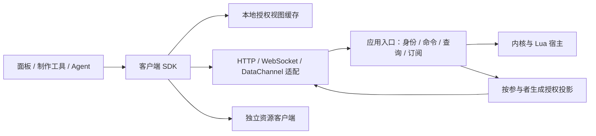
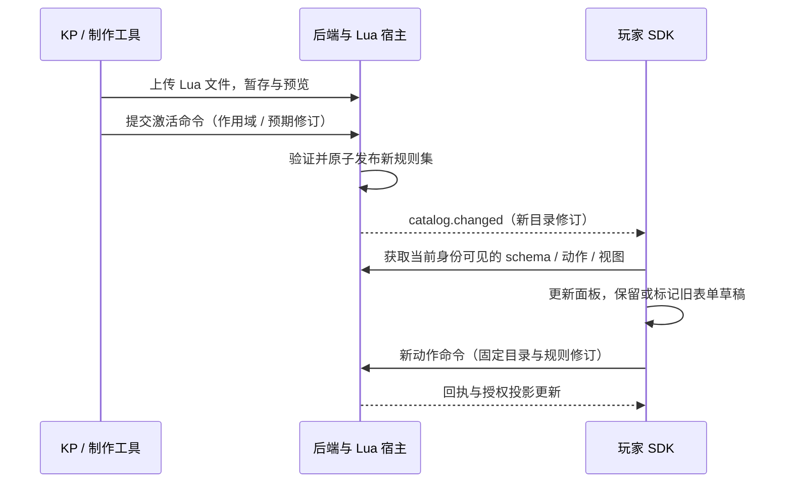

# 前后端对接与同步契约设计

- 文档类型：计划
- 状态：草案
- 创建日期：2026-10-29
- 最后更新：2026-10-30
- 关联文档：[计划索引](../README.md)、[项目概况](../../current/design/project-overview.md)、[模块职责](module-responsibilities.md)、[数据与容器契约](data-container-model.md)、[后端与联机分析](backend-network-analysis.md)

2026-10-30 首测实现范围、命令示例和字段定名由[首测工程设计](first-test-engineering-design.md#8-联机身份与授权同步)细化，施工顺序见[首测计划](first-test-construction-plan.md)。本文继续维护通用对接语义；首测采用本机 HTTP/WS、跨连接重取快照，LAN/公网、增量续传和第二真实传输后置。

2026-10-30 范围更新：聊天室后端已作为追加任务实现，实际数据结构、权限和命令以 [聊天室后端](../../current/engineering/chat-backend.md) 为准；聊天页面仍待制作。完整 COC 等规则归配置包实现，地图/逻辑图/2D/3D 空间及地图战斗暂不作为必要实现。本文保留相关候选设计作为按游戏需要扩展的参考，不列为本次必交能力。

## 首测实现对照（2026-10-30）

本主题已有本机首测实现子集，实际接口和限制见 [当前工程](../../current/engineering/first-test.md) 与 [Lua 编写](../../current/engineering/lua-authoring.md)。本文仍保存通用设计和后续扩展讨论，不将所有候选字段、接口或运行方式视为已实现。验收状态统一见 [首测报告](../../current/engineering/first-test-acceptance.md)。

## 1. 目标与范围

让前端面板、后端规则与联机方案可以独立演进，同时支持 Lua 规则/流程在游玩中加载和新增。本文负责跨边界契约，不重新定义内核对象或把数据库表直接作为前端接口。

Lua 作为规则与流程语言已由用户确认；本文协议、SDK、接口名称和示例均为待实现设计，未确定前端框架、后端语言或发布技术栈。首轮以浏览器客户端、单个权威后端为前提，不包含多人离线编辑合并。

建议采用“逻辑应用协议＋客户端 SDK＋传输适配”结构。首次部署用 HTTP 处理引导/查询/文件，WebSocket 处理持续订阅和业务交互；替换为 P2P 时复用命令、查询和授权投影语义。前端默认不执行权威 Lua 规则。

## 2. 分层与责任

| 层 | 职责 | 边界 |
| --- | --- | --- |
| 面板 | 展示、输入草稿、动作触发和失败解释 | 不直接修改共享缓存，不持有数据库/联机库对象 |
| 客户端 SDK | 连接状态、身份恢复、命令追踪、订阅、版本协商、资源接口 | 提供框架无关 API，避免业务组件依赖具体 Socket SDK |
| 视图缓存 | 保存当前身份可见的数据、动作目录及流程待办 | 与界面草稿、临时光标状态分开；权限改变时可整体失效 |
| 应用入口 | 身份绑定、请求校验、权限、事务命令与订阅 | HTTP 与实时入口共用处理器，不能形成两套校验逻辑 |
| 内核/Lua 宿主 | 规则与流程执行、数据不变量、版本和效果提交 | 不接收 DOM 或前端组件实例，不信任客户端计算结果 |
| 授权投影 | 将内部状态转为接收者可见的字段与事件 | 不先发送全部秘密数据再要求前端隐藏 |
| 资源客户端/服务 | 上传、授权读取、缓存和引用生命周期 | 状态协议只传资源 ID 与元信息，素材二进制另走数据通道 |

前端可以选择框架，后端可以选择宿主语言；二者以带版本的结构化数据对接，不以共享内存类或 Lua 函数引用对接。即使同一进程提供页面，也使用相同应用入口。

## 3. 逻辑接口与第一版传输映射

### 3.1 用什么接口表达操作

| 逻辑接口 | 内容 | 第一版映射 |
| --- | --- | --- |
| discover / capabilities | 服务标识、协议范围、可用传输及消息上限 | `GET /api/v1/capabilities` |
| join / resume | 邀请兑换、成员身份与连接恢复 | HTTP 加入后，在实时通道完成身份确认 |
| catalog | 授权后的类型、动作、输入 schema、视图和规则集修订 | HTTP 查询或实时请求；变更通过订阅通知 |
| query | 获取某视图、对象或分页结果 | `POST /api/v1/queries`，实时通道可映射同一请求 |
| command | 创建、修改、删除、动作调用、流程回应与管理变更 | `POST /api/v1/commands` 或实时 `command` 消息，共用幂等记录 |
| receipt | 查询命令是否提交及其结果 | HTTP 回执查询或实时 `receipt` 请求 |
| subscribe | 获取授权快照与连续更新 | `WS /api/v1/connect` 内发送订阅请求 |
| resources | 上传准备、完成、元数据和下载 | 独立 HTTP/资源提供方接口 |

这些路径是拟议接口。前端通过 SDK 调用逻辑接口，由连接配置选择承载通道；正常情况下同一命令只选择一条通道发送，重试跨通道仍复用原命令 ID。

首轮不引入 GraphQL、自定义二进制协议或共享内核对象序列化。使用 JSON 和统一 schema，先把契约与故障行为做清楚；以后编码优化保持业务语义不变。

HTTP 契约建议使用 OpenAPI，实时消息与共享数据使用版本化 JSON Schema。规范版本和校验工具需在实现时锁定，不能因为文档引用最新版就默认所有工具兼容。[OpenAPI 规范](https://spec.openapis.org/oas/latest.html) HTTP 状态码沿用标准语义。[HTTP Semantics](https://www.rfc-editor.org/rfc/rfc9110.html)

### 3.2 身份与部署配置

优先提供同源部署：页面、API 和实时入口经同一反向代理暴露，资源服务可以独立。前端运行时读取服务配置，不在构建产物里固定某个服务器地址。独立前端部署时显式配置允许的源、凭据策略及资源来源；不能把开放 CORS 当作授权。

同源 HTTPS 模式可使用 HttpOnly 会话 Cookie，并校验 Origin；变更 HTTP 请求配合 CSRF 防护。实时连接也检查 Origin，不能只依赖“浏览器有 Cookie”。跨源、原生客户端或 P2P 可通过已认证入口换取短期、单次使用且绑定房间/身份的连接凭据，在有期限的首条认证消息中兑换；认证前不允许查询或订阅。

浏览器 WebSocket 标准构造接口提供 URL 与子协议参数，不提供任意 HTTP 请求头参数，因此设计不能依赖浏览器自由附加 Authorization 头。[WebSockets 标准](https://websockets.spec.whatwg.org/#the-websocket-interface) 长期令牌不放查询串、日志或面板状态；连接凭据不能代替后续逐请求授权。

开发或封闭 LAN 的 HTTP 模式应单列配置，不宣称具备 HTTPS 的凭据保护；生产配置与 LAN 入口分别验收。房间 ID、邀请、参与者身份和临时连接 ID 分开管理，服务端从会话绑定执行者，忽略客户端自报身份。

## 4. 请求、命令与错误契约

### 4.1 封套与版本

首测消息封套包含 `protocolVersion`、`type`、`requestId`、`roomId` 和 `payload`；业务运行场次使用 `runId`，登录会话使用 `authSessionId`，不再混用 `sessionId`。`requestId` 关联一次请求响应；`commandId` 标识一次业务意图，在超时重发、切换通道时保持不变。断线重发可以使用新的 requestId，但不能重新生成 commandId。

版本至少区分：应用协议、类型 schema、活动规则集、动作目录、授权代次、权威后端代次和订阅视图版本。前端看到的是不透明视图令牌与游标，不能直接暴露可能泄漏隐藏活动的内部全局递增序号。

业务命令遵守[数据与容器设计第 7 节](data-container-model.md#7-增删查改的概念接口)的意图、幂等与前置条件约束；首测使用 roomId/runId 及 `commandId/authorityEpoch/rulesetRevision/op/args` 等字段，不另造面板专属 CRUD。若路由与封套或载荷同时带作用域，必须一致，否则拒绝；最终字段 schema 按首测 E1 生成。

协议中的 `expectedRevisions` 面向能够查看相关完整版本的调用者。有限授权视图可由应用网关接受 `expectedViews`，解析为同一内核前置条件，二者选择一种提交、禁止混用。网关映射绑定身份、对象、授权代次与读集，过期时要求重查；宿主仍另外收集实际规则读集，不能只依赖客户端声明。动作目录条目映射到 `op/args`，不是额外一套写入入口。

首测的完整命令示意见[工程设计第 8.2 节](first-test-engineering-design.md#82-消息与端口)。该示意采用 `action.invoke` 和授权动作目录，不允许任意内部 ruleId 绕过配置行为入口；旧 campaignId/sessionId 示例由该示意替代。

视图令牌由后端映射到相应读集与并发前置条件。它不作为权限凭据，也不允许客户端覆盖版本；具体映射需与内核事务模型一致。批量操作的原子性由动作定义声明，不能把客户端连续发出的多条请求自动当作一个事务。

### 4.2 命令生命周期

客户端状态建议为 `draft → pending → committed/rejected`，连接超时则进入 `unknown`，表示结果未知，不表示失败。`accepted` 只说明进入处理队列；只有 `committed` 才能显示业务完成。HTTP 返回 202 时要提供回执查询方式；同步提交可返回 200 与 committed 回执。

后端先按身份、作用域与 commandId 查询已有回执：同 ID 同内容返回原结果，同 ID 不同内容返回冲突。已提交回执不重新执行 Lua；读取旧回执时仍检查当前身份与结果可见性，避免权限撤销后通过回执取得秘密数据。

提交后实时更新可能先于 HTTP 回执到达。SDK 按 commandId 关联状态，界面不能再次应用回执中的数值修改。回执用于确认结果，授权投影用于更新共享缓存；单独查询回执不会自动标记全部面板已同步。

### 4.3 编辑、动作和错误

数据准备场景可以提供 schema 允许范围内的 CRUD；消耗、转移、掷骰和流程回应使用专门动作。前端不上传最终血量或骰面作为权威结果。通用编辑入口必须限制可编辑字段，不能通过任意路径补丁写入权限、拥有者、日志或派生值。

错误统一包含 `code`、可读消息、`requestId`、字段路径和是否可重试，不返回堆栈、SQL 或秘密对象名称。建议最少区分：输入无效、身份失效、权限不足/目标不可见、版本冲突、动作已过期、规则失败、限流、服务暂不可用和结果未知。

HTTP 可分别使用 400/401/403 或统一不可见的 404、409、429、503 等标准状态，再附应用错误码。版本冲突要求刷新授权数据并确认；自动重发只用于同一命令的交付恢复，不把旧输入套上新版本静默再提交。

### 4.4 与五类业务模型的对接

结构与效果以[数据与容器设计](data-container-model.md)为唯一来源，下表只说明面板如何调用；状态与地图为后续业务对接目标，不属于首测必交功能：

| 界面操作 | 对接入口 | 更新方式 |
| --- | --- | --- |
| 修改角色名字 | `entity.patch` 仅提交允许的身份字段 | 接收新的角色授权投影；HP 等受保护字段仍走规则 |
| 查看背包 | `container.list` 返回成员边及物品投影 | 成员关系与物品分别按 ID 识别；数量只取物品实例，不另在面板成员边保存一份 |
| 转移一个物品 | `action.invoke` / `demo.item.transfer` | 依据源物品、两容器和成员边的前置条件提交；拆分后的新 ID 从回执/投影取得 |
| 解除一个状态 | `action.invoke` / `demo.status.remove` | 用状态实例 ID 操作，只移除该来源；不按状态名称清空全部来源 |
| 拖动地图 Token | `action.invoke` / `demo.placement.move` | 前端先显示本地拖拽预览，提交目标坐标；后端验证距离/阻挡/额度，失败恢复权威位置 |
| 移除地图 Token | `action.invoke` / `demo.placement.remove` | 仅移除对应放置投影，角色和其他场景放置保留 |

物品转移样例沿用数据文档基线：源 3 个补给品，转移 1 个后源为 2、目标新实例为 1，关联变化在同一订阅 batch 中应用。客户端不自行生成第二份权威物品实例，也不自行计算最终负重作为提交结果。

### 4.5 房间聚合与统一实例的视图边界

账号、房内人员、配置容器、实例容器、记录和素材资源表的结构统一见[数据与容器设计第 3.4—3.7 节](data-container-model.md#34-账号房内人员与房间业务数据)。接口按认证会话关联账号与房内成员权限，不把密码认证信息作为房间成员元数据发送。

角色、武器、道具、技能、状态沿用统一实例身份与业务结构。前端通过实例 ID 定位具体对象，通过配置 ID 识别相同业务配置，通过允许的标签查询筛选如 `melee` 的对象；不以名称或配置 ID 代替实例 ID 执行修改。

实例容器的集中登记不表示向每位参与者发送完整房间数据。引用视图只返回获准的引用和目标投影，授权、字段筛选与分页规则继续生效。配置/规则内容、行动日志、数据变化日志、聊天记录和素材访问分别受相应权限约束；聊天室现行内部结构及具体报文见 [聊天室后端](../../current/engineering/chat-backend.md)，本文不重复维护。

## 5. 查询、快照与实时同步

### 5.1 前端读取的是投影视图

房间为长期存档，数据与全部游戏计算以主机为权威。最终攻击力等派生数值由主机调用只读规则计算后下发；玩家端不自行执行游戏计算，也不提交自算结果。界面渲染、表单草稿和光标显示不改变房间游戏数据。

查询面向角色面板、背包列表、场景、聊天分页和流程待办等授权视图，允许按已声明可索引字段过滤。投影包含稳定 ID、类型、可见数据、可用动作引用和视图令牌；不直接暴露仓储对象。

可用动作用于帮助界面展示，实际执行仍由后端再次授权。分页结果使用稳定排序和游标；条件与权限进入游标绑定。对象更新可能改变筛选或排序，首轮对复杂列表发送失效通知并重查当前页，避免前端自行猜测成员和总数。

### 5.2 没有丢更新窗口的订阅

1. 客户端提交订阅范围，后端先授权并建立订阅上下文。
2. 在一致的读取边界捕获快照，并开始收集边界后的更新；记录授权代次、规则目录修订和服务代次。
3. 以 snapshotId 分块发送初始数据，携带基准游标；客户端先暂存，完整校验后一次替换缓存。
4. 后端从同一边界续发增量。客户端只按该订阅的顺序应用，并记录已应用游标。
5. 快照期间权限变化、数据量超限或缓冲溢出则明确取消该快照并重新同步，不能将前后两个授权范围拼在一起。

后端需保证“快照＋边界后更新”覆盖完整，不允许先独立 HTTP 查询、过一段时间再开始 WS 监听且不补齐空档。大场景可以拆成多个订阅，声明彼此的一致性范围；不承诺不同订阅天然拥有同一时刻快照。

### 5.3 更新形式与撤权

首轮优先对小对象使用完整授权投影替换，对分页列表使用 invalidate/requery。增量消息最少支持 `upsert`、`remove`、`invalidate` 和 `reset`；同一订阅内的一次事务作为一个 batch 原子应用，避免背包转移出现半个结果。后续若增加字段 patch，要同时检查基准令牌和目标令牌。

remove 既可表示对象删除，也可表示当前身份不再能见；默认不公开具体原因。字段撤权不能只发送变更后的剩余字段补丁，应替换完整授权投影或重置视图，保证旧字段从缓存移除。权限代次变化后丢弃旧代次排队消息、废弃相关订阅和缓存，并按新权限重建。

### 5.4 断线、背压和恢复

房间共享同一剧情进度。主机从存档重建后，参与者以原身份恢复，接收当前授权共享数据与关联玩家/角色的解锁、触发和待办记录；个人记录不形成独立剧情副本。临时连接代次可变化，持久房间身份与记录关联保持可追溯；客户端旧缓存只用于显示恢复，不作为权威存档。

客户端恢复原身份并提交游标；在相同服务代次、授权上下文且保留窗口有效时续传，否则返回 reset 并重取快照。重放数据仍须满足当前权限，不能原样发送曾经可见的历史秘密数据。

SDK 限制待发送请求数、订阅缓存与消息大小，快照支持分块/取消。慢客户端可合并派生视图通知，必要时关闭并要求重同步；已经提交的命令回执仍保留查询渠道。心跳、重连退避及抖动由 SDK 统一管理。首轮断线时禁止新的共享业务写入，可保留表单草稿；不自动排队执行离线期间的扣减、转移或掷骰。

## 6. Lua 自定义与前端面板如何接入

### 6.1 规则执行与表现分开

对象的规则容器仅保存规则引用；攻击、闪避、入场等事件通过对象配置的行为定义定位入口流程，由主机按顺序、条件与固定依赖修订执行。客户端选择动作或提交事件意图，不能自行指定另一条规则绕过入口流程。具体绑定结构统一见[数据模型第 3.8 节](data-container-model.md#38-数值计算引用语义与事件入口)。

Lua 包通过共享类型或短声明提供动作契约、名称、帮助文本及可选视图描述；宿主据此生成或复用完整输入/输出 schema；规则计算在权威后端执行。作者通过[Lua 宿主 API](lua-authoring-facade.md#3-lua-宿主-api-与分层职责)表达业务意图，宿主收集效果并经内核校验提交；前端只接收权限过滤后的结果和状态变化。

默认视图描述采用结构化数据：字段绑定、控件类型、分组、顺序、只读状态、动作按钮与本地化键。Lua 可以生成描述，但输出仍要过 schema；描述中不包含任意可执行前端字符串。表单校验仅用于即时提示，后端保持相同 schema 校验和业务校验。

角色卡、地图和聊天可以是不同前端模块，共用相同 SDK 与资源引用。字段未知时采用只读通用展示或明确提示，控件不支持时给出降级方式；不能把未知 schema 当作写回时可以删除的字段。

### 6.2 游玩中新增规则的端到端路径

新规则新增按钮不应要求刷新整页或重新构建前端。旧表单若引用已变化 schema，保留输入草稿并提示重新确认，不能直接按新版语义提交。正在等待的流程继续使用已固定的旧修订，待办消息携带对应输入 schema/动作版本；旧版 schema 可能需要与新目录并存至流程结束。

规则 ID、动作 ID 与具体修订分别管理。角色面板允许更新为最新目录，但回应旧流程时必须使用该流程指定契约。旧客户端不支持新控件时降级为通用输入或明确不可操作，不触发未经用户确认的替代动作。

### 6.3 高级前端扩展与预览

第一版支持声明式表单和固定面板扩展点，暂不允许规则文件直接执行浏览器 JS。若未来需要自定义复杂地图或角色卡控件，另设前端插件协议、独立信任及权限边界，仍通过 SDK 发起命令。不得把 Lua 脚本语言选择扩展解释为已经确定前端语言。

制作端可调用后端 dry-run，使用快照输入与独立测试随机源，返回拟议效果、诊断和版本；预览不提交，不作为正式骰面。秘密轨迹只向具有制作/调试权限的身份返回。

## 7. 资源与 P2P 的对接边界

上传流程为准备上传 → 传输文件 → 完成校验 → 得到资源 ID → 在业务命令中关联。未完成资源不能被正式引用；取消或失败留下的暂存文件按独立回收策略清理。下载先授权，再返回可读流或短期资源地址，前端不拼接宿主磁盘路径。

资源提供方与业务通道分别协商：公网部署可使用对象存储或独立 HTTP，LAN 可由本机资源服务提供。P2P 下必须另提供可达资源来源，或实现带授权、分块和背压的资源传输适配，不能假定浏览器能够访问房主的 localhost HTTP 地址。

DataChannel 适配只要满足同一逻辑消息、身份、顺序、限额和恢复契约即可替代业务通道。能力声明包括业务传输和资源传输支持情况；缺失时在加入前说明限制，不偷偷依赖未配置的官方服务。第三方桥接需通过和原生通道相同的契约测试。

## 8. SDK、文档与前后端并行开发

SDK 的拟议 API 为 `connect`、`query`、`subscribe`、`command`、`getReceipt`、`getCatalog`、`respondWorkflow` 和 `resources`。调用返回结构化结果与取消方式；面板只依赖这些逻辑能力，不依赖 HTTP 状态或 Socket 对象。

契约维护一个规范源，生成或复用请求校验器、客户端类型及文档。生成类型不代替运行时校验；Lua 的空表、空数组、缺失值及数值范围由宿主转换契约明确。首轮只支持 JSON 可表达的数据，ID 用字符串，不跨边界传函数、协程或运行时 userdata。

前端可使用严格按契约运行的 mock 服务，覆盖秘密信息、多用户、冲突、延迟、重复消息与重连，而不只返回静态成功样例。后端可用无界面客户端跑相同请求序列；双方以固定样例包、命令和投影记录核对，减少依赖页面手工联调。

协议主版本不兼容时在握手阶段拒绝；新增可选能力通过 capabilities 协商。未知消息不能自动当作成功，未知必需字段/能力则明确失败；已知请求中意外字段由 schema 拒绝或按声明处理。SDK 和后端至少用一个明确的版本兼容矩阵发布，支持范围在实现时决定。

## 9. 实施步骤与验收

| 阶段 | 交付物 | 验收条件 |
| --- | --- | --- |
| C0：契约 | 最小类型/动作目录、请求/回执/错误 schema、授权投影样例 | 一份契约同时供前端 mock、SDK 和后端验证器使用；身份不能由载荷伪造 |
| C1：纵向链路 | 角色视图、物品转移、等待 KP、资源关联的最小页面 | 查询、提交、回执和投影完整闭环；重复提交不重复发物品，冲突可解释 |
| C2：同步恢复 | 快照、订阅、reset、分页失效、权限代次 | 快照期间持续写入不漏更新；重复/断序可恢复；撤权后缓存不再含秘密字段 |
| C3：Lua 动态扩展 | 上传预览、激活、目录变化和通用表单 | 不重启房间、不重建前端即可显示新动作；旧流程仍可按旧 schema 回应 |
| C4：部署与替换 | 同源 LAN、公网独立部署、第二通道及资源适配验证 | 相同命令产生相同权威结果；浏览器鉴权、资源可达和重连均端到端验证 |
| C5：开发者交付 | SDK、mock、版本矩阵与快速开始 | 新面板作者只读契约即可完成一个查询和一个动作，不需要查看数据库与 Lua 内核实现 |

必须覆盖的故障案例：提交成功但回执丢失、投影先于回执、权限在快照中途改变、重连时目录已升级、流程旧 schema 仍被引用、资源下载授权失效、宿主代次改变、慢客户端缓冲溢出和重复 commandId 携带不同载荷。

建议测量首次入房到可交互时间、目录更新到按钮出现时间、命令提交与界面同步的 p50/p95 延迟、快照大小和重连重同步字节数。先取得固定场景基线，再制定预算，不在未实测前承诺容量或延迟。

## 10. 待确认事项

- 首测推荐 JavaScript ES modules 的框架无关 SDK 与最小操作台；产品前端框架及长期 SDK 发布语言矩阵仍待选择，契约本身保持独立。
- 首测 HTTP/WS、配额起点、分块和回执随存档保留策略见工程设计；具体数值需 E0/E3 实测锁定，不代表已支持。
- 首轮自定义面板控件清单、复杂地图接口及无代码制作体验待验证。
- 独立前端部署与 P2P 的认证、资源可达方式需按实际网络选择并验收。
- 本文只设计对接，不把 Lua 动态加载、CRUD 或同步方案写作现有能力。
