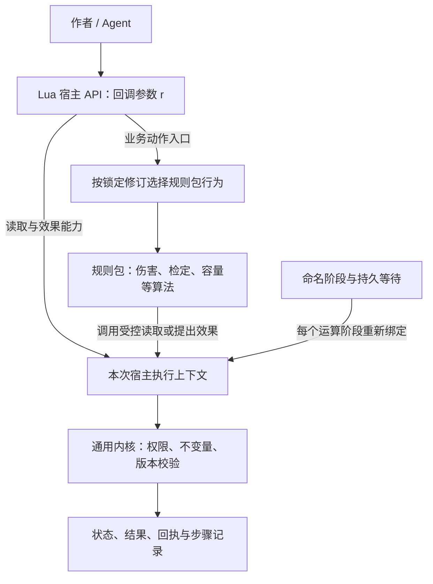
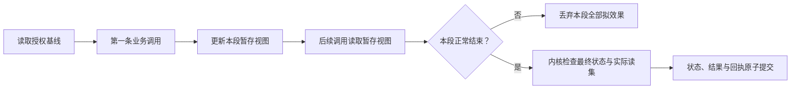
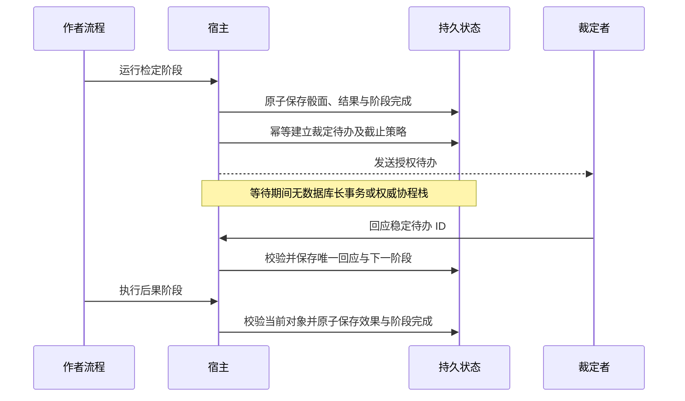

# Lua 简化编写接口与可恢复流程方案

- 文档类型：计划
- 状态：进行中
- 创建日期：2026-10-29
- 最后更新：2026-10-30
- 关联文档：[ISSUE-001](Issue/lua-authoring-simplification.md)、[Issue 索引](Issue/README.md)、[计划索引](../README.md)、[首轮 Lua 参考](lua-script-reference/README.md)、[数据与容器](data-container-model.md)、[前后端契约](frontend-backend-contract.md)、[后端分析](backend-network-analysis.md)

## 首测实现对照（2026-10-30）

本主题已有本机首测实现子集，实际接口和限制见 [当前工程](../../current/engineering/first-test.md) 与 [Lua 编写](../../current/engineering/lua-authoring.md)。本文仍保存通用设计和后续扩展讨论，不将所有候选字段、接口或运行方式视为已实现。验收状态统一见 [首测报告](../../current/engineering/first-test-acceptance.md)。

## 1. 问题核查与方案范围

本方案回应 ISSUE-001 的作者体验问题。首轮 01/02/03 样例将输入结构、注册元信息、计算逻辑、结果及效果写在同一个文件；05/07 还要求作者了解步骤结果路径、输入映射和流转目标。问题不是 Lua 无法简写，而是作者同时承担了业务、契约和执行协议三层工作。

建议采用“高层业务调用＋宿主效果收集＋少量显式持久步骤”的分层方式。普通作者不写效果载荷、版本号或复杂返回表；内核继续使用原有结构化效果与事务模型。复杂规则仍可使用 Lua 函数、分支和有界循环。

用户已同意按建议推进；本文的分层方向进入实施。已完成三份可运行简化规则和同步内存实验宿主，正式 SDK、加载器、持久恢复器尚未完成，也未改变已选定的 Lua 语言。旧样例保留为对照，不因新方案成文而关闭 Issue。本文以关系图、信息树和操作语义说明方案，暂不增加完整配置或脚本文件。

## 2. 候选路线与取舍

| 路线 | 作者体验 | 恢复/一致性代价 | 建议 |
| --- | --- | --- | --- |
| 只封装效果构造函数 | 少写几层返回表 | 注册、输入、流程映射的负担仍在 | 作为底层能力，不单独作为解决方案 |
| 全局短函数、调用后立即提交 | 常见动作很短 | 后续失败可能已扣血，预览与原子组合困难；默认上下文易歧义 | 不采用即时提交语义 |
| 高层调用收集效果、显式步骤持久化 | 单步操作通常一行，复杂流程保留少量结构 | 需要宿主暂存视图、类型描述和步骤记录 | 首轮优先原型 |
| 全过程脚本自动重放到等待点 | 剧情写法自然 | 需约束所有非确定性、循环位置、源码修订和外部读取；普通代码重排可能改变恢复 | 后续独立研究，不作为首轮前提 |
| 仅保存 Lua 协程栈 | 看起来像同步等待 | 未设计可移植、可版本化的持久恢复契约 | 不作为权威恢复依据 |

简化的单位是“业务操作”和“连续不等待的一段逻辑”，不是强制把复杂流程压成一行。稳定步骤是为恢复保留的必要信息；不要求作者给每句 Lua 代码命名。

## 3. Lua 宿主 API 与分层职责

### 3.1 r 的定义与生命周期

Lua 宿主 API 是规则脚本访问后端能力的统一入口。样例将这个入口参数命名为 `r`；它是普通 Lua 参数名，可改为 `game` 等名称，不是语言关键字，也不代表角色对象。接口名称与能力契约保持稳定，局部变量名不参与规则身份或权限判断。

每次命令或流程运算阶段开始时，宿主为本次执行绑定身份、作用域、规则修订和数据上下文，并把 API 对象传给规则回调。当前原型用“包含函数的 Lua 表＋闭包”实现；最终宿主也可通过嵌入绑定提供同等调用能力，生产后端语言和绑定实现尚未锁定。

```text
一次执行
├─ 作者可见：业务输入、对象引用、Lua 宿主 API
├─ 宿主上下文
│  ├─ 执行者、作用域与能力上限
│  ├─ 命令/步骤标识、规则与依赖修订
│  ├─ 基线、实际读集和暂存视图
│  └─ 骰面、效果、结果与失败状态
└─ 执行结束：返回回执，释放本次上下文
```

作者只通过授权能力访问上下文，不直接取得其中的可变表或数据库连接。API 对象及运行时引用不作为持久流程状态保存，也不能跨等待或命令沿用；恢复时根据持久业务标识和锁定修订创建新上下文。注册/加载规则仅建立定义，不启动这些业务操作。

### 3.2 作者入口、规则包与内核

| 部分 | 责任 | 变化边界 |
| --- | --- | --- |
| Lua 宿主 API | 提供读取、动作调用、结果访问及效果提案的简洁入口 | 名称与参数受 API 兼容版本约束，不自行定义所有游戏规则 |
| 规则包 | 定义技能检定、护甲减伤、容量、状态及移动等业务算法 | 可自定义与覆盖；执行固定不可变修订和依赖 |
| 宿主执行上下文 | 绑定身份与规则，管理读集、暂存效果、随机记录和步骤结果 | 每次命令/运算阶段独立创建；不把协程栈当作权威状态 |
| 通用内核 | 强制执行能力、类型、引用、数量守恒、版本和提交约束 | 规则包不能通过简写放松内核不变量 |



图为目标设计，正式规则包绑定和持久等待尚未实现。当前原型把示例默认算法放在 API 实现中，并允许宿主注入伤害/容量策略，只验证简短调用和执行语义。不能据此认定已具有可发布、覆盖与锁版的完整业务规则库。当前函数清单和返回值统一见[工程说明](../../current/engineering/lua-authoring-prototype.md#宿主-api-与三个样例)。

### 3.3 高层调用与底层效果

普通作者使用高层操作，宿主自动收集类型化效果。高级规则仍可通过有限原语扩展，但必须进入同一上下文和内核验证路径。业务动作的实现不能再次调用它自己的高层入口；覆盖原实现时需显式绑定基础实现的修订，宿主检查递归和调用深度，具体绑定 API 待实现。

首轮不在一个执行段混用手工 effects 返回和自动收集。旧规则协议若需兼容，应由独立适配层转换一次，不能收集后再重复应用旧返回效果；兼容层当前未实现。

### 3.4 只读计算、规则依赖与事件入口

2026-10-30 确认的数值、关系和事件绑定设计统一见[数据模型第 3.8 节](data-container-model.md#38-数值计算引用语义与事件入口)。Lua 作者可以通过普通规则引用组合算法，但组合值由主机按需计算；只读计算上下文不开放写入、资源消耗或新随机业务操作，行动上下文继续采用本方案的效果收集与原子提交。

规则容器保存引用，实例属性与参数保留在对象数值/引用容器和执行上下文中。事件由配置级行为定义映射至入口流程，流程明确优先顺序和分支；依赖环在加载时与实际调用时检查，一次执行固定依赖修订。这些是已确认目标约束，现有同步实验宿主尚未实现完整的计算模式隔离、事件绑定或版本化依赖加载。

## 4. 对象、参数与上下文

### 4.1 作者看见的信息

```text
一次规则执行
├─ 业务输入：角色、物品、目标背包、数量等
├─ 授权对象引用：只代表身份，不是可直接写入的数据对象
├─ 业务操作：读取、检定、伤害、转移、授予、状态
└─ 可选输出：一个简单值或有名称的小型结果

宿主负责的信息
├─ 真实执行者与能力上限
├─ 战役、场次、权威代次、规则修订
├─ 命令/步骤身份、随机记录与依赖读集
├─ 暂存效果、事务与回执
└─ 发布、动作目录、日志和授权投影
```

引用来自输入类型声明或授权选择器，不以显示名称查找。删除、归档、撤权或转移后，在每次操作/提交时检查当前有效性。引用不能携带自报权限，不能跨场次随意复用，也不能序列化宿主运行时对象；持久化时只保存合法业务身份与必要的版本引用。

### 4.2 常用操作的候选形态

下表说明目标接口；已有同步子集见工程说明，其他操作仍待实现。统一以 `r` 表示本次宿主 API，名称与参数尚未作为正式 SDK 锁定。

| 操作 | 一行表达的意图 | 必需参数与默认值 | 作者得到的结果 |
| --- | --- | --- | --- |
| 检定 | `r.check(actor, skill)` | 角色明确给定；技能引用必须在该包定义中存在 | 小型检定结果，可读取 `.passed` 及公开的等级/骰面 |
| 伤害 | `r.damage(actor, amount)` | 目标与原始伤害明确给定；护甲等从锁定规则读取 | 本段拟造成的有效伤害等小型结果，可忽略 |
| 授予 | `r.give(bag, itemType, quantity)` | 数量显式给定；赠予理由可从已声明动作说明取得，需要时补充 | 暂存物品引用，提交后才成为持久实例 |
| 转移 | `r.transfer(item, targetBag)` | 源容器按唯一合法持有关系解析；默认整叠，部分转移显式给数量 | 暂存的目标实例引用或转移结果 |
| 状态 | `r.applyStatus(actor, statusType, duration)` | 目标、类型与期限明确；期限区分指定逻辑时钟的回合数和真实时长 | 状态引用或规则定义的刷新结果 |
| 文件读取 | `r.readData(fileRef)` | 只能读取已声明的包内/授权数据引用 | 校验后的只读数据，内容摘要固定在本次执行 |
| 主持人纠正 | 通过专门管理动作提出纠正 | 对象、目标值、理由显式给定 | 普通规则不能借此取得额外权限 |

业务算法与内核边界按第 3 节维护；本表列出的动作不会自行取得额外能力。

默认值只限与业务无歧义的内容，如整叠转移。首轮不默认“当前角色”：面板选择只能作为可见且显式绑定的输入。多目标时必须提供目标集合并逐项授权；多个时钟时不能擅自挑一个时钟。缺省值的来源、实际选择和修订进入诊断记录。

检定失败是正常业务结果；无权限、容量不足、对象冲突和脚本异常不是一次“失败检定”。作者判断 `.passed`，不能对整个结果对象做真假判断来代替检定结论；宿主文档和编辑器应明确提示这种易错写法。

## 5. 一行调用何时真正生效

### 5.1 同步执行段：先暂存，正常结束后统一提交

一个不含等待的规则回调是一个执行段。调用记录类型化效果，并更新本段授权的暂存视图；后续调用能读取前面拟产生的变化。例如连续两次扣减看到的是第一次扣减后的拟值，不会都基于同一旧 HP 计算。外部客户端在提交前看不到这些拟变更。



预览使用同一执行路径，展示拟结果和差异后丢弃暂存效果，不改变业务数据。预览随机源与正式随机记录区分；正式调用按命令/步骤及受控随机操作标识保存固定骰面和数据内容，不因重试换输入或再掷一次。

暂存新对象可在本段内引用，失败则不留下持久物品或状态。提交回执保留实际对象身份，重试不另发一份。首轮不支持在本段中访问任意外部网络，所有业务读取都经过宿主记录依赖。

### 5.2 返回与失败

普通作者可以不写 return：效果由宿主收集，宿主生成标准提交结果。确需对调用者给结果时，可返回简单布尔、数字、文本或符合简短输出类型的小记录；不再返回 effects/rejected 嵌套协议。客户端仍等待权威 committed 回执，回调中的临时返回值不等于已经提交。

业务拒绝由高层操作报告可解释原因，并将整个执行段标记为不可提交；即使 Lua 局部捕获异常，也不能清掉该标记并提交之前的效果。预期的二选一判断使用无副作用的条件查询；判断通过后正式操作仍重新校验，不把条件查询当成写入授权。

脚本错误返回文件、行号与操作名；拒绝返回业务原因；版本冲突要求重新确认。公共错误消息按接收者过滤，详细轨迹只对获准调试者开放。第一版不提供任意嵌套事务/回滚点，避免为了隐藏效果列表又引入更复杂的事务语法。

## 6. 流程：少量命名阶段与独立等待

### 6.1 首轮选择

建议采用阶段模板：运算阶段只写普通 Lua 回调；裁定、输入与计时是单独的等待阶段。编辑器或模板补齐步骤表和常规连线；文本作者保留简短稳定的阶段名与必要分支，不必手写 state.steps 路径及每条输入映射。

阶段名在创建时保存为稳定逻辑身份，不按源码行号或数组位置重新计算。源码行号仅用于诊断。纯文本作者也需能给阶段命名，不能只有编辑器创建的流程才可恢复。

```text
检定—裁定—后果流程
├─ 输入：目标角色、技能、预先声明的后果
├─ 阶段「检定」：一条检定调用，保存检定结果
│  ├─ 成功：结束
│  └─ 失败：进入「裁定」
├─ 阶段「裁定」：等待获准 KP 回应
│  ├─ 拒绝：结束
│  └─ 同意：进入「后果」
└─ 阶段「后果」：一条伤害调用，然后结束
```

模板提供具名结果访问与输入绑定，宿主转换成相同的内部步骤结构。基础模板复用同一角色输入，作者只在真的变更目标时增加明确映射。对未完成、跳过或不存在的结果引用，发布时检查或运行时明确拒绝，不能默认为 false 偷偷选一条分支。

### 6.2 提交与等待边界



从阶段完成到待办建立之间崩溃，可从已提交的下一节点重新建立同 ID 待办；不重做检定。回应与超时竞争同一待办版本，只允许一个转换提交。截止时间首次持久建立时确定，重启不重新计时；没有常驻宿主时按明确策略补执行或等待主持人，不能承诺停机准点触发。

跨等待不保持整条流程的单一事务。早前阶段已提交的结果不因后果阶段失败而自动回滚；需要撤销时用有理由的显式补偿动作。后果阶段重新读取当前对象并校验授权与资源，不能盲用等待前快照。重要参数在发起时固定，改变目标或后果需重新确认/重新发起。

一个运算回调内不能突然调用阻塞式询问或等待计时；此类误用应指出需要独立等待阶段。复杂等待流程通过组合阶段扩展，过程式自动转换与全程序重放留待单独验证。

### 6.3 版本与权限

流程实例固定源码、阶段定义、业务便捷函数库版本、规则依赖及输入/输出契约。新插入一行普通计算不改变旧阶段身份，但发布新修订后，旧流程仍继续旧源码；插入、删除、重命名阶段必须显式迁移或只对新实例生效。

KP 批准只表示允许继续既定流程，不自动提升后续执行权限。若未来需要审批授予额外能力，应另设计绑定对象、参数、有效期与用途的授权，不让便捷函数隐式提权。

## 7. 减少注册与输入声明的负担

```text
作者最小制作单位
├─ 稳定规则身份：首次创建/导入时确定并保留
├─ 少量业务输入：复用角色、数量、技能、物品等已有类型
├─ 规则正文：普通 Lua 回调或命名阶段
└─ 可选结果类型与说明

宿主维护的派生信息
├─ 注册模块表与执行入口
├─ 完整校验 schema、前端动作目录与 Agent 契约
├─ 不可变修订、内容快照、依赖与能力清单
└─ 编辑器提示、操作说明和预览轨迹
```

建议采用短注册构造器或模板生成入口，作者仍需明确稳定身份、输入类型与正文；不要求作者拼装模块字段或自己算修订。文件首次导入生成的身份必须持久保存为制作元信息，移动文件不换身份，也不能每次加载随机生成。元信息可以与源码一起编辑/导出，但不把负担转移成每次手工维护多个配套文件。

内置/包内共享输入类型支持角色引用、物品引用、正数量、技能引用与限长文字；一次短输入声明供宿主验证器、面板表单和 Agent 使用。不能依赖猜测 Lua 函数参数名、运行一次猜 schema，或让 UI 和宿主各自维护定义。新增业务字段仍需简短声明其语义；静态数值类型不能替代对象权限与运行规则校验。

普通作者可选使用现有动作模板；高级作者能展开完整输入/输出定义，二者生成相同契约。编辑器应显示默认绑定与生成内容，支持导出后纯文本继续维护；避免编辑器成为唯一制作入口。

## 8. 与现有同题样例逐项对照

| 现有样例 | 建议作者层简化 | 宿主仍需保留 | 验证重点 |
| --- | --- | --- | --- |
| 01 百分骰 | 共享角色/技能输入，一条检定调用，读取 passed | 骰面记录、范围校验与结构化结果 | 成功/失败与运行错误分开 |
| 02 伤害 | 一条伤害调用，无 effects return | 包内伤害规则、受保护字段、回执与事务 | 护甲/伤害差异可扩展，连续扣减读取拟值 |
| 03 转移 | 一条转移调用，默认整叠，部分数量显式 | 源关系解析、容量规则、守恒、唯一持有 | 歧义来源拒绝，数量并发变化不重复转移 |
| 04 读文件 | 授权数据引用＋普通 Lua 计算 | 文件约束、schema、不可变内容快照 | 不将动态磁盘读变成重试时不同输入 |
| 05 KP 裁定 | 检定/裁定/后果三个阶段，具名结果与默认输入绑定 | 持久步骤与修订、回应权限、重新校验 | 两个崩溃窗口不重掷、不重复扣血 |
| 06 回合状态 | 一条状态调用，明确时钟与期限 | 来源约束、到期调度和幂等 | 相同来源刷新，不影响其他来源 |
| 07 限时选择 | 一个输入等待阶段，明确超时分支 | 首次截止、回应/超时竞争与恢复 | 重启不重置倒计时，只一条分支生效 |
| 08 授予 | 一条授予调用，参数只含业务意图 | 赐予能力、模板锁版、数量账目和新 ID | 无权者不能借高层接口发物品 |
| 09 临时覆盖 | 高层调用仍按作用域选择有效修订 | 显式发布/撤销、旧源码与便捷库锁版 | 撤销只影响新调用，不改旧流程结果 |

01—03 已有独立简化实现，05 已有纸面流程稿；旧脚本未改写，其他样例和兼容层尚未实现。各阶段进度与正文入口见第 10 节，不把本表中的目标能力当成已支持接口。

## 9. 实施步骤、成本与验收

### 9.1 建议分期

| 阶段 | 交付物 | 推进条件 |
| --- | --- | --- |
| A0 纸面试写 | 01/02/03/05 的简化稿、短输入描述、各调用语义卡片 | 作者可解释目标、返回、提交和失败，未把成本转嫁到多份配置 |
| A1 同步最小宿主 | 对象引用、检定/伤害/转移、效果收集和暂存视图 | 多调用原子性、预览无写入、拒绝污染提交状态测试通过 |
| A2 可恢复阶段 | 一个检定—裁定—后果流程与限时选择 | 持久恢复、截止竞争和锁版通过真实存储故障测试 |
| A3 输入与发布 | 共享类型、动作目录、Agent 描述、修订依赖 | 同一声明生成表单与验证；动态发布不影响旧流程 |
| A4 试写及迁移评审 | 独立用户/Agent 任务记录、新旧对照及后续决策 | 体验和正确性均通过后决定采纳范围，再安排样例迁移 |

首轮增加的实现成本集中于暂存视图、效果合并/顺序、类型化引用和步骤结果绑定。暂不实现自动源码改写、协程栈序列化、嵌套事务或任意网络副作用，以控制原型范围。单个执行段读集、循环次数、效果条数和输出大小均需限额，不能用“一行接口”掩盖全库扫描。

### 9.2 正确性与故障验收

- 单条常见动作通常一条业务调用即可表达；不强制效果列表及复杂 return。注册和输入信息按总制作文件数、人工维护字段数统计，不只数正文行数。
- 同段连续操作读取暂存变化；第二条操作失败时第一条也不提交；即使局部捕获宿主拒绝也不能提交残余效果。预览前后持久状态一致。
- 权限不足、隐藏对象、跨战役引用、数量不足、容量变化、同名角色、多个时钟均有明确拒绝/重新选择行为，不依赖模糊默认值。
- 提交后回执前崩溃：相同命令不重掷、不重复生成对象。阶段完成后待办建立前崩溃：恢复同一待办。等待回应与超时并发：只有一个分支。
- 等待时改源文件/升级便捷库：旧流程保持原修订；修改目标数据后继续：重新校验。移除原文件后仍可从保存的内容快照恢复。
- KP 批准不提权，授予能力不能由脚本自报，错误和审计按权限投影。高级扩展与普通便捷接口必须经过同一内核验证。

### 9.3 编写体验验收与未决项

让用户和 Agent 分别完成“新增技能检定、修改伤害规则、部分物品转移、失败后问 KP、增加限时分支”。比较旧写法与候选写法的首次完成时间、显式概念数、重复声明量、错误次数和求助点；当前没有基线，不预设虚假的耗时改善百分比。

待确认：业务命名空间和点/方法调用风格；伤害/检定通用能力如何绑定具体规则包；短输入声明的最终形式；具名结果访问的最短写法；哪些模板进入首批；便捷函数库如何与宿主版本分别锁定。它们不影响本草案先明确的事务、权限及持久恢复边界。

## 10. 进度与文档分工

2026-10-29 用户同意按分层方案推进，并确认将宿主 API 的解释整合到本文。A0 已有检定、伤害、转移简化样例及裁定流程稿；A1 的同步内存宿主已有验证。A2 持久等待、A3 输入目录与动态发布、A4 独立试写及正式迁移仍待完成，ISSUE-001 保持进行中。

| 主题 | 唯一正文入口 |
| --- | --- |
| 作者侧宿主 API、分层设计、执行语义与后续计划 | 本文 |
| 首测模块/事务工程细化及 A2/A3/A4 的实际施工次序 | [工程设计](first-test-engineering-design.md)、[施工计划](first-test-construction-plan.md#5-与原计划的对应关系)；尚未施工 |
| 实际函数、三个样例、测试结果与实现限制 | [当前工程说明](../../current/engineering/lua-authoring-prototype.md) |
| 问题、进度和验收入口 | [ISSUE-001](Issue/lua-authoring-simplification.md) |
| 加载、规则修订和部署边界 | [后端分析](backend-network-analysis.md) |
| 首轮显式效果协议与旧样例决策背景 | [归档说明](../../history/2026-10-29-lua-script-reference.md)、[旧样例索引](lua-script-reference/README.md) |

当前原型不是正式 SDK；已有代码和运行说明见[原型目录](../../../engineering/lua-authoring-prototype/README.md)。计划中的状态、授予、数据读取与完整流程等能力仍需分别实现，不能由已存在的 API 参数表推导为已支持。
