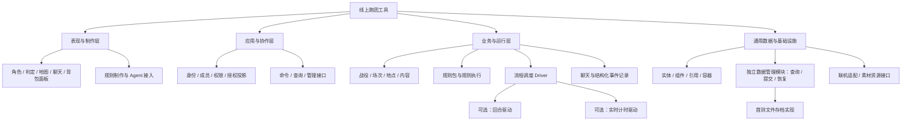
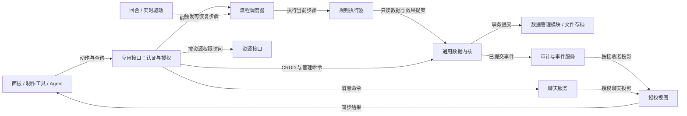
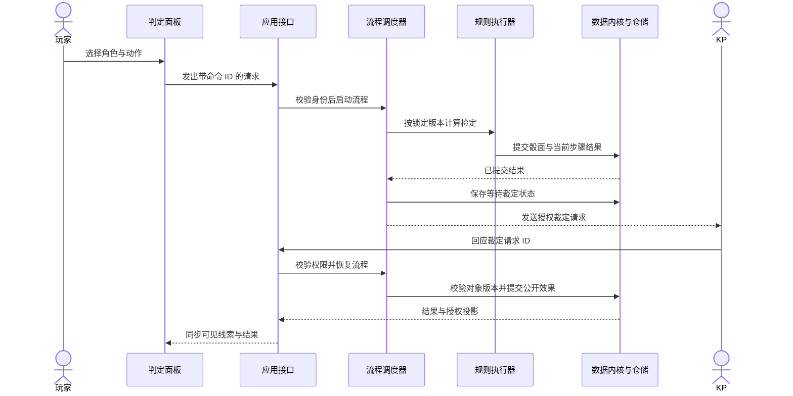

# 系统模块分层与职责设计

- 文档类型：计划
- 状态：草案
- 创建日期：2026-10-29
- 最后更新：2026-10-30
- 关联文档：[计划索引](../README.md)、[后端与联机分析](backend-network-analysis.md)、[抽象数据结构与容器设计](data-container-model.md)、[前后端对接](frontend-backend-contract.md)

2026-10-30 范围更新：聊天室后端已作为追加任务实现，实际数据结构、权限和命令以 [聊天室后端](../../current/engineering/chat-backend.md) 为准；聊天页面仍待制作。完整 COC 等规则归配置包实现，地图/逻辑图/2D/3D 空间及地图战斗暂不作为必要实现。本文保留相关候选设计作为按游戏需要扩展的参考，不列为本次必交能力。

## 首测实现对照（2026-10-30）

本主题已有本机首测实现子集，实际接口和限制见 [当前工程](../../current/engineering/first-test.md) 与 [Lua 编写](../../current/engineering/lua-authoring.md)。本文仍保存通用设计和后续扩展讨论，不将所有候选字段、接口或运行方式视为已实现。验收状态统一见 [首测报告](../../current/engineering/first-test-acceptance.md)。

## 1. 目标与范围

将用户模块图中的概念整理为系统模块、职责边界及协作关系，为后续实现和接口设计提供依据。本设计仍待原型验证，正式命名不代表已经实现或接受全部方案。

2026-10-29 从《后端、自定义能力与联机方案分析》原第 2 节“从模块图拆分责任”拆出并扩展。本文件替代该节的职责正文；后端分析保留入口，避免重复维护。原始依据为用户同日提供的模块图和需求，箭头含义由下文明确，不直接把原图箭头当成继承或数据库关系。

抽象实体、数据类型和容器不绑定角色、背包等业务名称，统一在[抽象数据结构与容器设计](data-container-model.md)维护。本文负责解释这些能力如何服务于跑团模块。

## 2. 模块层级

下图实线只表示职责分组，不表示部署进程、对象所有权或执行顺序。同一后端进程可以包含多个分组。

Driver 在本文命名为“流程调度器”，负责推进和恢复流程；回合与实时计时是其可选驱动能力。“全局”收敛为有作用域的上下文，避免形成任意模块均可直接读写的万能对象。

## 3. 原始模块到正式职责的映射

| 原图模块 | 正式职责/模块名 | 边界 | 对应使用场景 |
| --- | --- | --- | --- |
| 全局 | 长期房间存档与共享游戏上下文 | 主机负责权威数据和全部游戏计算；运行场次与连接会话独立于长期存档 | 跨日重建同一房间，恢复共享及个人事件记录 |
| 对象 | 统一实例、配置与类型定义 | 角色/武器/道具/技能/状态共用结构；区分实例 ID 和配置 ID | 不同耐久的洛阳铲对应同一配置 |
| 属性＋状态表 | 角色数据与状态能力 | 分开基础值、当前资源、派生值、修正与状态实例 | 扣除 HP、计算加成、处理状态持续时间 |
| 背包 → 物品 | 持有与物品管理 | 模板和实例分开，转移/堆叠/装备/消耗走命令 | KP 发物品，角色交换装备或消耗弹药 |
| 空间信息、地图 → 地点 | 场景、地点与空间放置 | 地点可组成关系网；角色与 Token 分离 | 同一角色在不同场景拥有不同放置实例 |
| 规则 | 规则引用、配置级行为入口与规则执行器 | 只读计算与行动流程分开，事件入口组织顺序；全部由主机执行 | 攻击时调用组合计算，入场时检查个人解锁 |
| 规则语法 | 自定义语言与宿主 API | 规则与流程使用 Lua 和有限宿主接口；已确认选型见[项目概况](../../current/design/project-overview.md#已确认的技术决策)，实施方案见[后端分析](backend-network-analysis.md#6-自定义规则成熟语言与有限宿主-api) | 作者编写短规则函数，不处理 SQL 和联机 |
| AI 编辑接入 | 制作工具与 Agent 接口 | 共用校验、预览、版本与授权入口 | Agent 添加字段/动作，先干跑再发布 |
| Driver | 流程调度器 | 保存步骤、等待输入/裁定、超时与恢复 | 检定后等待 KP 确认，再修改对象 |
| 回合计时器＋驱动 | 回合驱动 | 按轮次/行动/阶段推进，与秒数分开 | 状态持续三轮，到指定阶段解除 |
| 实时计时器＋驱动 | 实时任务驱动 | 保存截止时间与触发状态，处理重启及重复触发 | 限时选择、休眠恢复后提示过期任务 |
| 聊天室/聊天记录 | 聊天服务与聊天投影 | 区分公开、私聊和暗骰；聊天不是唯一业务状态 | 玩家交谈，主持人接收秘密检定结果 |
| 事件记录 | 结构化事件与审计 | 关联命令、身份、规则版本、骰面和变更 | 追溯一次伤害由何规则和裁定产生 |
| 各类面板 | 客户端视图与动作入口 | 使用授权数据与动作描述，不写死后端实体结构 | 更换角色卡布局而不迁移角色身份 |
| KP 修改指令/赐予物品/定义伤害加成 | 授权管理命令与规则扩展 | 同样走校验、事务和审计；人工覆盖记录原因 | 临时纠正 HP、发放道具、启用场次修正 |

数据定义、运行规则、流程状态和面板表现分别维护契约，共享 ID、类型及能力描述，不互相嵌入框架对象。房间业务数据聚合和统一实例的详细结构统一见[数据与容器设计第 3.4—3.7 节](data-container-model.md#34-账号房内人员与房间业务数据)；集中登记和业务持有分别表达，引用容器只关联实例。

玩家与角色的个人事件记录分别附于房内成员或角色相关容器，由主机维护解锁、触发和待办；它们不构成独立剧情进度。数值、引用和事件绑定的详细边界见[数据模型第 3.8 节](data-container-model.md#38-数值计算引用语义与事件入口)。

数据管理模块统一提供快照、查询、受控 CRUD、版本/索引、提交、回执及备份恢复，首测使用 FileDataStore。游戏规则及授权由应用/内核决定，素材字节存取由 AssetStore 承担；数据管理只维护素材引用和权限元数据。数据库是后续可选实现，不是首测依赖。接口与文件提交协议见[工程设计第 5.3 节](first-test-engineering-design.md#53-独立数据管理模块与文件实现)。

## 4. 模块依赖与协作关系

规则执行器向作者注入每次执行独立的 Lua 宿主 API（样例参数 `r`）。API 提供受控入口，规则包定义业务算法，宿主上下文收集读集和拟效果，通用内核执行强制校验；详细契约统一见[主方案第 3 节](lua-authoring-facade.md#3-lua-宿主-api-与分层职责)。

实线标注调用或数据交互方向；虚线表示可选扩展。箭头不表示模块可以绕过权限直接改动其目标的数据。

联机适配器位于客户端与应用接口之间，承载同一命令/查询语义；图中省略传输细节。规则执行器产生效果提案，由数据内核重新验证和提交。流程调度器不能把“步骤完成”仅保存在内存，事件也必须与提交结果一致。

## 5. 业务场景中的模块协作

以“玩家检定后由 KP 确认并公开线索”为例；这是工程用例，不是任何特定规则系统的完整规则。

骰面、流程步骤和效果的事务边界及去重由后端分析定义；图中调用用于解释职责，不要求每条箭头独立一次事务。等待期间不持有存储提交临界区，继续时必须再次检查权限和对象版本。

| 场景 | 入口与主要模块 | 使用的数据/容器抽象 | 应检查的结果 |
| --- | --- | --- | --- |
| 准备团本 | 制作工具 → 管理接口 → 数据内核 | 类型、实体、引用、资料集合 | 内容归属正确，缺失引用可诊断 |
| 交换物品 | 背包面板 → 转移命令 → 数据内核 | 持有容器与成员关系 | 源目标原子修改、数量守恒 |
| 公开秘密线索 | 判定面板 → 规则 → 流程 → 授权投影 | 线索实体与访问策略 | 玩家只取得获准字段和资源 |
| 回合状态结束 | 回合驱动 → 流程 → 规则 | 状态实例与逻辑时钟 | 指定轮次只解除一次 |
| 临时修正规则 | 制作工具/Agent → 包管理 → 规则执行器 | 版本化定义、运行实例引用 | 新旧流程版本边界明确，不改已提交结果 |
| 更换地图 | 地图面板 → 场景管理 → 资源接口 | 场景引用、放置实例、资源 ID | 角色身份不变，局部位置各自保存 |
| 断线后重入 | 联机适配 → 身份恢复 → 授权投影 | 场次状态、流程实例、恢复游标 | 恢复原身份，不重复执行操作 |

## 6. 后续步骤、验收与待确认事项

首测的具体模块接口与拟建目录见[工程设计](first-test-engineering-design.md#3-模块依赖与拟建目录)，任务依赖和阶段退出条件见[施工计划](first-test-construction-plan.md)。下列内容保留业务职责验证方向，不替代首测工序；完整地图、回合与聊天等模块后置。

1. 以本文件的模块边界核对后端契约，确定各模块输入、输出、错误和拥有的数据。
2. 先实现物品转移与“检定—裁定—公开线索”两条纵向用例，再验证回合驱动和断线恢复。
3. 通过原型后，将已确认职责整理到当前设计；实现相关入口再进入当前工程文档。

验收要求：每个原图模块都有明确归属；职责层级、调用关系和数据包含关系不混用；业务场景能对应到入口、模块、抽象数据和观察结果；替换面板或联机方式不改变核心业务不变量。

待确认：跨战役内容库是否独立；回合驱动是否支持同时行动；实时任务停机后的默认策略；制作工具是否需要可视化流程编辑。以上均未视作现有能力。
