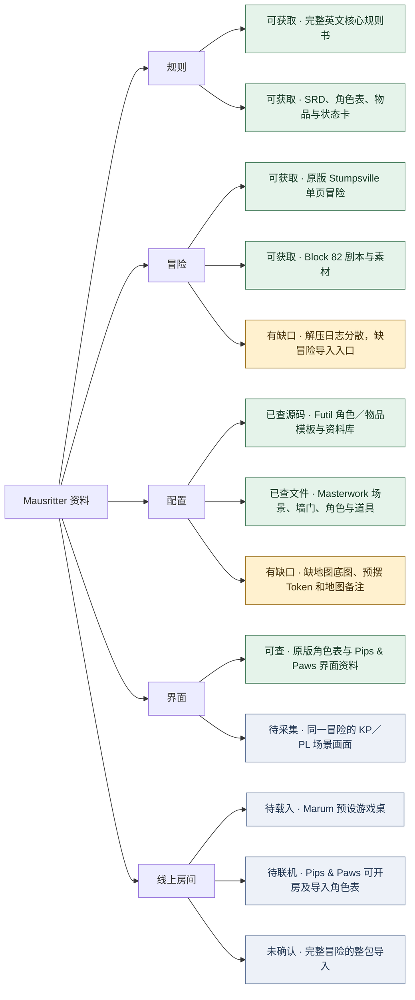

# Mausritter 资料树与完整性核查

- 文档类型：计划
- 状态：进行中
- 创建日期：2026-11-09
- 最后更新：2026-11-09
- 关联文档：[计划索引](README.md)、[样本调研与适配计划](reference-research.md)、[铃蔓回转录](../../../mini-detective-pack/README.md)

## 1. 资料与完整性树

本计划汇总 2026-11-09 查到的公开资料与本地解压文件，用于选定 Mausritter 的试配范围。**核心规则书和单页冒险可获取，角色与道具配置已查。完整线上冒险的整包导入仍未确认。**



绿色表示有公开入口或已经核查。黄色表示样本中有明确缺口。蓝色表示缺少实测或公开证据。系统模板、资料库、可开房的桌面和完整冒险分别验收。

## 2. 本地解压样本

2026-11-09 静态检查了 [Masterwork VTT Bundle 发布页](https://gm-copilot-studios.itch.io/mausritter-stumpsville-core-rules-masterwork-vtt-bundle)对应的本地解压样本。证据位于包内 `temp/Mausritter_neural_link_export_Masterwork_Bundle/masterwork-export-neurallinkexport/`，共 8 个文件。以下结论以实际文件为准，尚未在 Foundry 导入或运行。

```text
temp/Mausritter_neural_link_export_Masterwork_Bundle/
└── masterwork-export-neurallinkexport/
    ├── module.json                         模块及资料库清单
    ├── masterwork_payload.json              305 个导出实体
    ├── Masterwork_Verified_Certificate.json  随包校验记录
    ├── LEGAL_MANIFEST.md                    随包许可与来源声明
    └── packs/
        ├── scenes.db                        1 个场景
        ├── journals.db                      138 条日志
        ├── items.db                         106 条物品记录
        └── monsters.db                      60 条 Actor 记录
```

| 检查项 | 已有内容 | 缺失项 | 待验证项 |
| --- | --- | --- | --- |
| 安装与系统 | `module.json` 声明模块 1.0.0、Foundry 11–14（自报验证 13）和四个资料库。角色与物品标为 `worldbuilding` | 无 `world.json`，无 Foundry `Adventure` 资料库 | 四个 `.db` 在声明版本中能否打开，数据与 Mausritter 专用系统的字段如何转换 [S16][S20] |
| 场景与地图 | `scenes.db` 有 1 个场景、240 段墙线（其中 12 段标为门）、58 个地点和 2 个危险自定义标注 | 无地图底图、预摆 Token 或原生地图备注。自定义 `entities` 尚未转换为原生场景对象 | 用原版地图校正比例和墙门坐标。检查门、视野和地点标注能否正确呈现 |
| 冒险与规则 | `journals.db` 有 138 条文本日志，含 Stumpsville 概况、守卫蛇、陷阱与被困村民 | 无完整规则书，无将日志、场景与角色连成可主持冒险的入口 | 对照原版 Stumpsville 复核开局、地点关系、遭遇、GM 信息与 PL 可见资料 [S13][S19] |
| 角色、道具与数值 | `monsters.db` 有 60 个 Actor 条目，`items.db` 有 106 个物品条目。电提灯标价 200p，说明提到 6 格用量 | 未见预设玩家角色。电提灯没有独立用量字段，角色和物品使用通用图标 | 抽查三项属性、背包槽位、道具用量、状态和投骰能否按原版工作 [S14][S16] |
| 界面与提取质量 | 有结构化导出和随附校验记录。`Entrap` 标注的框与整个墙体范围重合，说明混入其他能力和生物条目 | 无自定义界面，也没有 KP／PL 截图 | 校对错位文本和标注后，再采集建角、背包、场景和主持端画面 |

这份导出可作为场景坐标与对象字段的参考。完整房间的验收要求是实际载入后同时可用地图、角色与道具、冒险主持资料和玩家视图。单个资料库能打开，只计对应资料库通过。

## 3. 房间与替代方案

2026-11-09 补查了 Mausritter 官方入口及资源库、Foundry、Steam Workshop、浏览器工具和 Quest Portal，也用 Stumpsville、The Estate 检索了独立房间或冒险包。**本轮仍未找到能依据公开证据确认整套导入的 Mausritter 冒险房间。** 以下候选按实际可载入的范围区分，未做平台实测。

| 候选 | 可载入或直接开桌的范围 | 仍缺的冒险配置／验证 |
| --- | --- | --- |
| Marum 的 Tabletop Simulator 游戏桌 | **预设桌面。** Workshop 条目有订阅入口，作者列出脚本化角色表、道具／状态牌、随机表、GM 回合追踪、玩家同步时钟和六角地图工具 [S21][S22] | 页面未列出预置 Stumpsville 或 The Estate。仍需确认 Steam 客户端能否订阅和载入，并检查素材是否完整 |
| Pips & Paws | **浏览器联机房间。** GM 可创建房间，PL 用代码或链接加入。作者文档有角色表 JSON 导入／导出、可拖动背包、主持面板、回合日志和公开界面图 [S23] | 已公开的是角色表导入，未找到完整冒险房间的导入入口或预置 Stumpsville。联机同步与双端权限待实测 |
| Quest Portal | **在线角色表模板。** 可从 Mausritter 系统页打开 SRD 和现成角色表，表内已有属性投骰、用量格和库存槽位 [S24] | 系统页未列出具名的 Mausritter 预制冒险房间。地图和剧本仍需准备 |
| Futil 的 Foundry 适配 + 原版 Stumpsville | **游戏系统与资料库。** Futil 的 `0.3.3` 声明 Foundry v12 验证。Stumpsville 可从原版核心规则书获得 [S13][S16][S19] | 地图、场景和主持日志仍需组装。Masterwork 的 `worldbuilding` 资料不能视为已验证的同系统配套 |
| 2-Minute Tabletop《Block 82》 | **已写好的另一套冒险素材。** 提供公开地点描述、遭遇和素材入口，可作为原版之外的组装对照 [S25] | 未找到可直接载入的整桌导出，场景和 Token 仍需摆放 |

## 4. 后续核查与验收

已完成第一轮原版地点和解压字段的对照。后续按 [Stumpsville Foundry 导入与界面方案](stumpsville-foundry-plan.md) 执行。

| 顺序 | 工作 | 通过条件 |
| --- | --- | --- |
| 1 | 用原版 Stumpsville 建立场景对照表 | 核对开局、地点、墙门、遭遇、道具和可见范围。逐项登记 Masterwork 的缺项与错位 [S19] |
| 2 | 在隔离 Foundry 世界验证资料库与字段 | 记录平台及系统版本，分别核对四个资料库的载入结果，以及角色、道具和场景的字段映射。单个资料库载入只计该项通过 [S16][S20] |
| 3 | 走查 KP／PL 界面 | 用两端记录建角、背包、主持操作和状态同步。核对主持信息与玩家可见内容，保留截图 [S23] |
| 4 | 验证完整冒险导入 | 从空白世界导入。地图、角色、道具、主持资料与玩家视图同时可用，才标为整包通过 [S20] |

待确认优先产出 Foundry 可导入的 Stumpsville，还是先完成浏览器双端的界面对照。前者先补地图和场景关联，后者可从 Pips & Paws 开始。

## 5. 来源索引

查阅日期为 2026-11-09。

| 编号 | 来源与定位 |
| --- | --- |
| S13 | [Losing Games Mausritter 规则书下载](https://losing-games.itch.io/mausritter) |
| S14 | [Mausritter 库存章](https://mausritter.com/srd/inventory/) · 卡位、耗损与武器 |
| S15 | [适配作者 v10 数据模板](https://raw.githubusercontent.com/Futil/foundry-mausritter/v10/template.json) · [配置条目目录](https://github.com/Futil/foundry-mausritter/tree/v10/packs) |
| S16 | [Mausritter Foundry 适配](https://foundryvtt.com/packages/mausritter) · 卡片操作、条目类型及平台版本 |
| S17 | [作者原版角色表 PDF](https://mausritter.com/assets/static/mausritter-character-sheets.DRBL-AQl.pdf) · [适配仓库截图区](https://github.com/Futil/foundry-mausritter#screenshots) |
| S19 | [Losing Games 扩展规则书发布说明](https://losing-games.itch.io/mausritter/devlog/194667/expanded-pdf-rulebook-print-edition-out-today) · 原版 Stumpsville 入门冒险 |
| S20 | [Foundry Adventure Documents](https://foundryvtt.com/article/adventure/) · 整包导入机制及媒体引用边界 |
| S21 | [Mausritter 官方资源入口](https://mausritter.com/) · 线上适配与第三方资料库 |
| S22 | [Marum 的 Tabletop Simulator 游戏桌](https://steamcommunity.com/sharedfiles/filedetails/?id=3310630224) · 预设桌面、脚本工具和订阅入口 |
| S23 | [Pips & Paws 作者文档与界面图](https://github.com/DonDavis-vibe/pips-and-paws) · [浏览器入口](https://dondavis-vibe.github.io/pips-and-paws/) |
| S24 | [Quest Portal 的 Mausritter 系统页](https://www.questportal.com/library/systems/mausritter) · [在线角色表模板](https://www.questportal.com/character-sheets/Mausritter-1gqnionvm2hv) |
| S25 | [2-Minute Tabletop《Block 82》](https://2minutetabletop.com/block-82-mausritter-adventure/) · 地点、遭遇与素材 |
