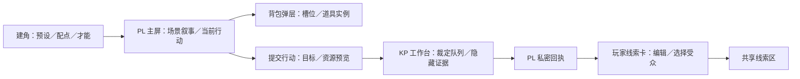

# 调查型线上跑团样本调研与适配计划

- 文档类型：计划
- 状态：进行中
- 创建日期：2026-11-09
- 最后更新：2026-11-09
- 关联文档：[计划索引](README.md)、[铃蔓规则](../../../mini-detective-pack/docs/plans/rules.md)、[铃蔓配置](../../../mini-detective-pack/docs/plans/configuration.md)、[铃蔓场景](../../../mini-detective-pack/docs/plans/scenario.md)、[铃蔓前端](../../../mini-detective-pack/docs/plans/frontend-design.md)

## 1. 目标与筛选范围

为独立配置包找一套能复核**规则、具体配置和界面**的线上跑团参考。以调查、有限行动、道具卡和主持裁定的重合程度排序。首轮查阅日期为 **2026-11-09**，证据来自出版方、平台和适配作者。商业模组依据公开清单核查，购买后的字段、实时操作和双端权限待实测。

| 证据 | 记录方式 |
| --- | --- |
| 完整规则 | 标明完整核心规则的获取方式。只覆盖某剧本的入门规则单列 |
| 具体配置 | 优先记录可查看的字段和实际条目。平台内预制模组记对象清单与获取条件，另记是否能查看原始配置 |
| 界面图 | 区分线上界面截图、开发预览、纸面表单和源码模板。标明平台及画面用途 |

## 2. 样本筛选

**首选 COC 七版 Roll20 的《The Haunting》作为免费走查入口，完整规则和配置结构以同平台 Keeper Rulebook 套装核对。** 如果重点是四人调查、证据物料与时段管理，则优先看 Blade Runner 的《Electric Dreams》。Mausritter 提供可直接查看的背包与物品配置，CCFOLIA 样本补叙事主屏。

| 线上跑团 | 规则 | 具体配置 | 界面图与访问条件 |
| --- | --- | --- | --- |
| **COC 七版 · The Haunting / Crimson Letters（Roll20）** | 免费 Quick-Start 含完整《The Haunting》冒险及所需入门规则。付费 Keeper Rulebook 提供完整核心规则 [S1][S2][S3] | 免费冒险可作为建房模板。付费套装含《Crimson Letters》《Amidst the Ancient Trees》、NPC／怪物、预设角色、投掷表、宏及带 GM 图层的地图。原始配置未公开核查 [S2][S3] | 官方帮助页有线上角色表截图，含属性区、难度切换、PC／NPC 模式和投骰展示。商品与角色表在 Roll20 内使用 [S3][S4] |
| **Blade Runner RPG · Electric Dreams（Foundry / Roll20）** | 有完整核心规则商业版。案件首发套装提供精简规则及完整案件 [S5][S6][S7] | Foundry 案件模组列有 22 个 Actor、96 个 Item 和 10 个随机表。Roll20 套装列有 4 个预设角色、26 份证物资料及时间追踪表。配置对象按平台分别记账 [S6][S7] | 官方角色表 PDF 可看属性、技能、装备与伤势分区。Roll20 官方角色表发布帖用于定位线上表单及投骰反馈，当前版本的案件桌面图待实测补采 [S8][S9] |
| **Vaesen · The Dance of Dreams（Foundry）** | 官方付费 Core Rulebook 模组提供核心规则与该调查剧本 [S10] | 清单列有 50+ 个角色／生物对象、300+ 个物品等条目、38 张随机表、5 个场景。场景数量为整个核心模组总计 [S10] | 官方系统提供人物表、物品和公开源码。另有实玩者提供 Alchemy 版检定弹层截图，平台需分开标注。Foundry 剧本画面待补 [S11][S12] |
| **Mausritter（Foundry 社区适配）** | 作者发布完整规则书、角色卡和物品／状态卡，可自行定价获取。库存章可直接阅读 [S13][S14] | 公开 v10 分支可查看 `template.json` 的 Actor／Item 字段及 `packs/` 中装备、生物、武器和随机表。系统数据与冒险分开。另已核查 Masterwork 场景和资料库，整套冒险房间尚未验证。见[独立核查](mausritter-completeness.md) [S15][S16] | 适配说明列出人物表与可拖动、可转移卡片。角色表 PDF 给出背包格原图，在线画面可从适配项目的 Screenshots 段进一步核对 [S16][S17] |
| **新 COC · 終末セッションを君と。（CCFOLIA）** | 两人无 KP 剧本，在流程中提供本剧本所需判定说明。完整核心书另行提供 [S18] | 两名玩家各自使用角色数据与专用房间配置。官方 FAQ 说明预设探索者、房间生成及自建角色导入入口，商业房间内字段待验证 [S18] | 官方 `PLAY IMAGE` 有 5 张开发预览，适合比对叙事画面与选项呈现。成品截图待复核 [S18] |

## 3. 铃蔓逐项匹配

以下是结构对照。铃蔓基线中的候选规则与实际落地情况，以原包文档各自的状态标注为准。

| 铃蔓基线 | 外部证据 | 后续试配需要保留的差异 |
| --- | --- | --- |
| 六维分配、才能、预设、属性检定 | Roll20 CoC 角色表将属性、难度和骰面分开显示。Electric Dreams 提供四名预设角色 [S4][S6] | 铃蔓六维、总点数、窄专长及判定公式独立配置 |
| 地点邻接、逐玩家探索与两日事件 | Vaesen 模组提供多地点场景。Electric Dreams 提供地图和时间追踪。CoC 套装标明 GM 图层 [S3][S7][S10] | 地点相邻、发现范围、行动轮、游戏日和报备时间分别建字段 |
| 体力、智力额度与战斗 | Blade Runner 角色表区分 Health、Resolve、武器、护甲和伤势。Mausritter 把物品使用与战斗行动相连 [S8][S14] | 保留铃蔓资源各自的用途和恢复条件。记录消耗发生在哪个阶段 |
| 真道具、持有上限、道具卡、转交 | Mausritter 的卡片格、状态卡、跨角色转移和用量点能直接对照。其公开字段含物品类型、尺寸、用量与摆放位置 [S14][S15][S16] | 铃蔓四槽、耗材叠放和审核单列。卡面显示与真实实例关联，拖放仍需验证归属 |
| 主持私密反馈、可公开的玩家线索卡 | Electric Dreams 的案件记录和玩家证物适合对照内容分发。CoC 的 GM 图层可作可见性参照 [S3][S6][S7] | 另测“原始私密反馈 → 玩家自写卡 → 选择受众”。是否允许玩家虚构线索及是否需要审核按本包规则决定 |
| 建角、背包弹层、叙事及行动选择 | CoC 角色表、Mausritter 背包、CCFOLIA 开发预览分别提供三类参考 [S4][S17][S18] | KP 裁定队列和 PL 私密回执需要各自的状态图及权限用例 |

### 可直接查对的配置样例

| 来源对象 | 实际可见内容 | 可抽取的配置形态 |
| --- | --- | --- |
| Mausritter 武器和库存 | 轻型近战武器示例为 d6 伤害。公开模板的武器对象分开记录 `weapon.dmg1`、`weapon.dmg2` 和是否可切换。物品基础字段另存用量点和尺寸 [S14][S15] | 区分物品定义、装备方式、实际持有实例及 UI 位置 |
| The Haunting 免费模组 | Quick-Start 中已有调查地点、可查资料、房屋及遭遇，可用纸面规则与 Roll20 预置房间逐项核对 [S1][S2] | 从剧本节点分别登记地点、调查入口、线索、条件与 GM 提示 |
| Electric Dreams 案件资料 | 商业模组区分 Actor、Item、Journal 和随机表。公开清单同时列出照片、数据文件、地图和时间表 [S6][S7] | 角色、物品、证物、场景和时间事件分层，证物可引用多种媒介 |

## 4. 界面设计取样

| 图位 | 可看原图／页面 | 采样内容 |
| --- | --- | --- |
| U1 建卡与人物表 | [Roll20 CoC 人物表图示](https://help.roll20.net/hc/en-us/articles/360052637253-Call-of-Cthulhu-7E-by-Roll20#the-pc-sheet) | 固定角色头部、属性与技能、切换难度、显示投骰 |
| U2 卡片与背包 | [Mausritter 原版角色表 PDF](https://mausritter.com/assets/static/mausritter-character-sheets.DRBL-AQl.pdf) · [Foundry 适配与截图区](https://github.com/Futil/foundry-mausritter#screenshots) | 分区格、卡片尺寸、可用状态和跨容器转移 |
| U3 叙事与选项 | [CCFOLIA 剧本官方开发预览](https://product.kadokawa.co.jp/p01/cthulhu/scenario/shuumatsu-session.html) | 在页面 `PLAY IMAGE` 查看 5 张图。记录叙事区域、画面切换和按钮组织 |
| U4 状态与检定反馈 | [Vaesen 实玩者截图](https://ndumas.com/2024/10/first-vaesen-game-retrospective/) | Alchemy 检定弹层。用于对照按钮可读性，标注为实玩观察 |
| U5 案件桌面与 KP 工位 | [Electric Dreams 模组清单](https://foundryvtt.com/packages/blade-runner-starter-set) · [Blade Runner 角色表 PDF](https://freeleaguepublishing.com/wp-content/uploads/2023/09/Blade_Runner_Character_Sheet_220811.pdf) | 已有角色表与预制对象清单。完整案件桌面及 KP／PL 同场截图待授权实测 |

下面是本包的**候选界面关系图**，用于安排实测图位。

## 5. 实施步骤与验收

| 步骤 | 交付 | 验收条件 |
| --- | --- | --- |
| 1. 选主样本 | 版本、平台、规则范围及访问条件 | 同一主样本的规则来源、可打开的房间或实例和界面证据齐全。逐项标明公开、需登录、需授权或待确认 |
| 2. 抽取最小场景 | 一个房间、两名 PL、两个地点、一道线索、一个有槽位限制的道具 | 配置表写明角色值、地点关系、进入条件、体力变化、道具归属、隐藏范围。每项标清原样本证据或自制 |
| 3. 绘图及走查 | 建角、PL 主屏、背包、KP 裁定图；一次从报备到分享的记录 | 同一行动显示 KP／PL 不同视图。公开卡保留玩家叙述，私密原文不随卡流转。检查满包、无权限及撤销等失败路径 |
| 4. 确认包级适配 | 引用清单、配置字段映射和差异记录 | 优先使用现有宿主能力。外部内容只链接或依许可引用，自制样例与原始配置分开。实际运行结果单独登记 |

| 待确认 | 当前取法 |
| --- | --- |
| 主样本选型 | 零采购走查先看 The Haunting 与 Mausritter。完整付费对照候选为 CoC Keeper 套装、Electric Dreams 或 Vaesen |
| 完整规则的边界 | 主样本区分核心规则完整与单剧本可玩，商用原始配置能否导出单独核查 |
| 界面目标 | 优先覆盖铃蔓已有的建角、背包和叙事，补一张 KP／PL 双视图 |
| 后续包形态 | 待确定做外部样本适配，还是依据匹配结果制作原创短场景 |

## 6. 来源索引

| 编号 | 来源与定位 |
| --- | --- |
| S1 | [Chaosium 七版 Quick-Start PDF](https://www.chaosium.com/content/FreePDFs/CoC/CHA23131%20Call%20of%20Cthulhu%207th%20Edition%20Quick-Start%20Rules.pdf) · 入门规则与 The Haunting |
| S2 | [Roll20 免费 Quick-Start 模组](https://marketplace.roll20.net/browse/module/4880/quick-start-rules-call-of-cthulhu) · 建房模板和角色表 |
| S3 | [Roll20 Keeper Rulebook 套装](https://marketplace.roll20.net/browse/bundle/4536/call-of-cthulhu-keeper-rulebook/) · 完整规则、两套冒险及对象清单 |
| S4 | [Roll20 CoC 七版人物表帮助](https://help.roll20.net/hc/en-us/articles/360052637253-Call-of-Cthulhu-7E-by-Roll20) · 截图与线上操作 |
| S5 | [Free League Blade Runner Foundry 核心规则](https://freeleaguepublishing.com/shop/blade-runner-rpg/foundry-vtt-module-core-rules/) |
| S6 | [Foundry Electric Dreams Starter Set](https://foundryvtt.com/packages/blade-runner-starter-set) · 案件、物品及随机表 |
| S7 | [Roll20 Blade Runner 核心套装](https://marketplace.roll20.net/browse/bundle/20344/blade-runner-the-roleplaying-game-core-package) · 预设、证物和时间表 |
| S8 | [Free League Blade Runner 角色表 PDF](https://freeleaguepublishing.com/wp-content/uploads/2023/09/Blade_Runner_Character_Sheet_220811.pdf) |
| S9 | [Roll20 Blade Runner 官方角色表发布帖](https://app.roll20.net/forum/post/11225278/new-official-blade-runner-rpg-character-sheet) · 角色表与社区实操反馈 |
| S10 | [Foundry Vaesen 官方核心模组](https://foundryvtt.com/packages/vaesen-core) · The Dance of Dreams 与配置清单 |
| S11 | [Foundry Vaesen 官方系统](https://foundryvtt.com/packages/vaesen/) · 人物表、物品及源码入口 |
| S12 | [Vaesen 实玩复盘](https://ndumas.com/2024/10/first-vaesen-game-retrospective/) · Alchemy 截图与 Foundry 操作观察 |
| S13 | [Losing Games Mausritter 规则书下载](https://losing-games.itch.io/mausritter) |
| S14 | [Mausritter 库存章](https://mausritter.com/srd/inventory/) · 卡位、耗损与武器 |
| S15 | [适配作者 v10 数据模板](https://raw.githubusercontent.com/Futil/foundry-mausritter/v10/template.json) · [配置条目目录](https://github.com/Futil/foundry-mausritter/tree/v10/packs) |
| S16 | [Mausritter Foundry 适配](https://foundryvtt.com/packages/mausritter) · 卡片操作、条目类型及平台版本 |
| S17 | [作者原版角色表 PDF](https://mausritter.com/assets/static/mausritter-character-sheets.DRBL-AQl.pdf) · [适配仓库截图区](https://github.com/Futil/foundry-mausritter#screenshots) |
| S18 | [KADOKAWA 終末セッションを君と。](https://product.kadokawa.co.jp/p01/cthulhu/scenario/shuumatsu-session.html) · PLAY IMAGE 与房间生成 FAQ |
