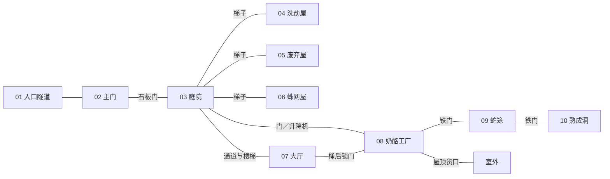

# Stumpsville 原版对照、Foundry 导入与界面方案

- 文档类型：计划
- 状态：进行中
- 创建日期：2026-11-09
- 最后更新：2026-11-09
- 关联文档：[Mausritter 资料树](mausritter-completeness.md)、[界面参考图集](stumpsville-interface-reference.md)、[计划索引](README.md)

## 1. 地图来源与选型

2026-11-09 新增 [OnlineCOC 树桩镇界面设计](../../../stumpsville/docs/plans/interface-design.md)，沿用本计划的地点与资料对照，单独规划 OnlineCOC 页面的导航、功能与美术。该设计属于新包的待实施方案，本页继续维护 Foundry 目标的导入与核查依据。

已找到原版冒险和发行方地图预览。**首个可导入版本采用原创无网格地点图，编号和通路以原版为准。** 原版剖面可供主持参考，适合授权范围内的单独使用。若后续取得清洁底图并确认使用范围，再试做墙门版。查阅日期为 2026-11-09。

| 来源 | 本次核对结果 | 用法 |
| --- | --- | --- |
| 英文扩展规则书，第 40–41 页 | 作者发布页确认收录 Stumpsville。出版预览目录确认第 40 页起。公开文字转录可核对 1–10 号地点、通路和遭遇。本次未从 itch.io 取得可检查像素的带编号原页 [A1][A2] | 以正版单页 PDF 作为最后校对依据。页码按书内印刷页码找 |
| 听枫馆树桩镇官方预览 | 已查看公开图。可辨树桩剖面、架屋、池塘和地下空间。该图不带编号、比例尺和门坐标 [A3] | 用于确定空间层次和视觉方向。无法据此对齐解压包的像素坐标 |
| 中文 SRD 与冒险地点工具箱 | 提供生物数据、探索回合、地点与陷阱设计的规则。书籍插画不在 SRD 许可内 [A4][A5] | 图形自己绘制，数值按 SRD 或原版场景复核。原图另行记录来源及使用条件 |
| 社区《The Woodshed》 | 写的是村民被带走后的另一处据点，有自己的地图和遭遇 [A6] | 只作后续追踪地点参考，独立于本轮 10 个场景节点 |

## 2. 十个地点与解压数据对照

本地比较对象为 `temp/…/masterwork-export-neurallinkexport/packs/` 的四个资料库及 `masterwork_payload.json`。**导出中找不到这十个地点的一套同名位置记录。** 多数场景标注只是 `Chamber / Sector N`，地点名散见日志或物品描述。重建时保留原版的编号和通路，为每个编号新建日志页，并将已核对的角色、道具和门绑定到该编号。

| 原版编号／地点 | 原版通路与关键内容 | 解压结果与补齐动作 |
| --- | --- | --- |
| 01 Entry tunnel／入口隧道 | 通向 02。入口里有大石机关，诱饵为一轮奶酪 | `Mousetrap (Grand Hall)` 的效果指向这里。迁到 01，保留 d12 伤害与 100p 诱饵，删去误导的地点名 |
| 02 Main gate／主门 | 石板门通向 03。转动把手会引发倾倒机关 | `Mousetrap (Cheese Factory)` 的效果对应 02。迁到 02，保留 d20 伤害及 DEX 豁免减半，门与陷阱分开配置 |
| 03 Courtyard／庭院 | 通 07、08。梯子通 04–06。池底有金叶鼠像和钱袋 | 核对到 600p／4 槽鼠像及 140p 钱袋。`Ancient mouse statue` 的 500p 是另一条目。庭院不摆 Jack |
| 04 Ransacked house／遭洗劫的屋子 | 经梯子连 03。散落 d6 件铜锅盘，每件 10p | `Copper pots and pans` 说明保留了 d6，数量字段却是 1。首次搜查掷一次并记录库存 |
| 05 Abandoned house／废弃屋 | 经梯子连 03。旧节庆画可提示雕像原来的位置 | 补独立地点页、可分享的线索摘要和主持真相 |
| 06 Infested house／蛛网屋 | 经梯子连 03。有两只蜘蛛与被困的 Roquefort、Paneer | 村民在一条日志里，蜘蛛是通用 Actor。拆成两个村民记录，生成两枚蜘蛛 Token，初始由 KP 管理 |
| 07 Grand hall／大厅 | 经 03 的通路进入。背后锁门通 08。2d6 只 Dedratz 和蛇笛在此 | 补人数生成、三次战利品表抽取和蛇笛归属。蛇笛的导出 5p 未在此场景文字中找到依据，标为待定 |
| 08 Cheese factory／奶酪工厂 | 与 03 有门和升降机，锁门通 07，铁门通 09，屋顶货口通室外 | Jack、搅拌桨、滤布归 08，纠正导出写成庭院的条目。升降机和屋顶货口先由 KP 裁定 |
| 09 Snake cage／蛇笼 | 位于 08 和 10 之间。铁门与守卫蛇 | `Guard Snake` 是日志，`Snake` 是通用 Actor。建一个场景蛇实例。随机遭遇复用该实例，避免同一条蛇重复生成 |
| 10 Cheese aging cave／奶酪熟成洞 | 经 09 铁门进入。Ernie 熟睡，另有奶酪及宝箱 | Ernie 只有日志。奶酪说明为 8 轮、每轮 100p，数量字段却是 1。补库存 8 和宝箱两次抽取 |

地点编号、通路及场景数值依据原版第 40–41 页文字对照。通用蛇、鼠和蜘蛛的数据另按 SRD 核对 [A2][A4]。

### 墙门与自建地图

`scenes.db` 的 240 条墙线包围范围是 `x=108…2272`、`y=104…3162`。60 个自定义标注的起点却都在 `y≤872`。12 条候选门线中，有 4 条正好围出 `[302,736]–[347,783]` 的矩形。再加上覆盖全图的 `Entrap` 标注与混入的生物正文，这些迹象足以把抽取结果降为候选，不以数量代替原版门表。

若做原创图，先按下列拓扑布置 10 个编号节点。原版未指定的尺寸和网格比例由制作时决定。图中标出主持信息，**玩家版从入口开始，按探索揭示通路和可见地点**。

如果拿到可用底图，先在同一裁切版本上用三个不共线的地标校对比例和偏移。只有独立地标与门洞也吻合时才复用个别线段。墙门首测用 v12 手工建出的墙、门和锁门导出作为模板，重建 `light`、`sight`、`move` 和门状态。原数据的 `sense` 不能直接替代 v12 的字段 [A7]。

## 3. Foundry 导入方案

目标基线选 **Foundry v12 + Futil Mausritter 0.3.3**，这是适配清单声明的验证组合。Masterwork 的 Actor 和 Item 面向 `worldbuilding`，逐项转换或在目标世界重建。先做小样再做整包 [A7][A8]。

| 顺序 | 要做的事 | 可验收产出 |
| --- | --- | --- |
| 1. 导出目标样本 | 在隔离世界手工建一张含底图、墙门、日志钉与 Token 的小场景。创建一名玩家小鼠、一条蛇、一张武器及一张道具卡并导出 | 获得目标版本实际的 Scene、Actor、Item 字段和值域。核对 HP、当前／最大 STR、DEX、WIL、护甲、伤害表达式和用量 |
| 2. 整理角色和道具 | 从目标系统已有 Actor／Item 拷贝并按 SRD 修订。生成两张标明自制的测试玩家卡。补 06 村民与蜘蛛、07 鼠帮、08 Jack、09 守卫蛇、10 Ernie。只迁入本冒险用到的物品 | 通用 Snake 的说明是 STR 12，结构化导出却给六项 10。目标按 STR 12、DEX 10、WIL 10、12 HP、护甲 2、d8 咬击复核。Dedratz 的通用导出 HP／AC 不作依据，按原版场景及 SRD 大鼠条目核对 [A4] |
| 3. 建场景与日志 | 创建一张原创无网格节点底图和 10 个地点页。按编号绑定地图钉。墙门版另验收：石板机关门、锁门、铁门与屋顶出口。陷阱、宝藏和真相先仅 KP 可读 | 入口、楼梯和通道可走查。日志钉能打开对应页。PL 只看到已公开内容。隐藏 Token 不因关联 Actor 而泄漏位置 |
| 4. 加主持流程 | 建原版 d6 遭遇表、战利品表引用、探索回合和火把用量记录。先手工裁定蛇笛、升降机、陷阱和揭示 | KP 能从开局线索推进到庭院、救援与追踪北方据点。可用一条避战路径走查。PL 领取道具、判定、耗损和记录均可核对 |
| 5. 打包和重导入 | 在内容模块的 Adventure Compendium 中生成一个 Adventure Document，包含 Scene、Actor、Item、JournalEntry、RollTable。随模块附原创或已获授权的底图和 Token 素材并使用模块内路径 | 在第二个空白同版本世界启用模块，从资料库选择 Import Adventure。核对媒体、日志钉与 Token 引用。再用 KP 和 PL 两个身份验证开局与可见性。v12 使用冒险资料库入口 [A9] |

目标字段和操作以隔离世界导出为准。现阶段交付的是方案和对照表，尚未生成或验证 Foundry 导入文件。

## 4. 界面参考与需补线框

以 **Pips & Paws 同一应用的四张截图**作为成套参考，其中浅色和深色为同一角色表。这套截图用于对照建角、背包、主持和地图。Foundry 方案以原生角色表和场景为载体 [A8][A10]。

| 界面 | 已有参考 | 需要补的 Stumpsville 状态 |
| --- | --- | --- |
| 角色表与背包 | [同套角色表](https://github.com/DonDavis-vibe/pips-and-paws/blob/main/docs/screenshots/character-sheet.jpg)，有属性、检定、双手／身体／背包、物品用量、状态卡。原版角色卡用于核对布局 [A11] | 补开团预设选择和玩家归属确认。沿用原版三属性及 2／2／6 槽位 |
| 主持面板 | [同套 GM 面板](https://github.com/DonDavis-vibe/pips-and-paws/blob/main/docs/screenshots/gm-dashboard.jpg)，有队伍、骰子、回合与 NPC。官方资源另有主持追踪表 [A11] | 补地点索引、遭遇、真相与分享前预览。公开回执与主持笔记分区 |
| 场景地图 | [同套 GM 战术图](https://github.com/DonDavis-vibe/pips-and-paws/blob/main/docs/screenshots/gm-battlemap.jpg)，可见地图、Token 列表和公开开关 | 补同一地点的 KP／PL 双端图。玩家地图只显示可见地点和自己的 Token，允许阅读公开资料 |

本地截图、纸面表单和三张原创线框统一收录于 [Stumpsville 界面参考图集](stumpsville-interface-reference.md)。主持端与玩家端使用同一庭院状态，可对照公开范围。

## 5. 待确认与验收记录

### 制作前完整性评估

**现有资料足够启动人工主持原型。可直接导入开团的配置包仍需制作和实测。** 本次按 Foundry v12 + Futil Mausritter 0.3.3、原创无网格地点图、原生界面、KP 人工裁定评估。首版覆盖树桩镇 10 个地点，收束到发现北方据点线索。

| 核查项 | 现有资料能支撑的工作 | 可开团前要补齐或验证 |
| --- | --- | --- |
| 核心规则与角色 | 原版规则与 SRD 可查。角色表和 Futil 模板可作三属性、库存槽位、耗损与状态的基准 [A4][A8][A11] | 用目标世界导出核对字段。建两张可分配的测试角色卡，实测投骰、物品占用和用量 |
| 冒险与主持材料 | 已有 10 个地点的通路、机关和条目对照，可先搭建日志结构 | 核对原版第 40–41 页，补齐开局、地点日志、遭遇与战利品表、出口线索。把公开内容和主持真相分开 |
| 地图与场景 | 已有原版剖面参考和十节点拓扑。Masterwork 的 240 段墙线与 12 条候选门缺少匹配的底图 | 绘制实际无网格底图，布置日志钉、Token、门和揭示状态。首版用节点和 KP 揭示走查通路，像素墙门另验 |
| NPC 与物品 | 解压的 60 个 Actor、106 个 Item 可供查找；字段面向 worldbuilding，已有数值和归属冲突 | 按目标系统重建实际用到的角色和道具。核对数量、槽位、用量、触发地点，以及日志与 Token 的关联 |
| 界面与双端 | 九张本地图已覆盖入场、建角、背包、主持和同场景玩家视图，可据此走查原生界面 | 用实际账户验证角色归属、骰子与用量同步、隐藏地点及私密日志。自定义界面和自动化可留到后续 |
| 打包与安装 | 本地只有第三方样本清单及四个资料库。它们没有单一 Adventure 导入入口 | 制作目标系统的内容模块与 Adventure Document。媒体用模块内路径。导入第二个空白同版本世界，检查依赖、资源和文档引用 [A8][A9] |
| 素材与分发 | 本地九张图用于参考。地图可自绘，Token 可用原创简图 | 发布前逐项核对随包文本、图像和署名。把研究截图与运行素材分开。原版地图和冒险正文的使用范围按作者许可或另获授权 [A12] |

先做 **01 入口隧道 → 02 主门 → 03 庭院** 的小样。两名测试玩家分别拿到自己的角色，完成一次检定和一次物品耗损。KP 推进一回合并揭示庭院，玩家只看到公开内容。小样从空白世界导入通过后，再补齐 04–10 和完整主持流程。本轮结论来自资料和文件核查，尚无 Foundry 运行记录。

### 验收记录

- [ ] 获取正版英文单页 PDF，在主持图上校核编号、通路与线索，记录 PDF 版本。候选门线只保留通过对齐检查的段。
- [ ] 绘制首版原创节点底图。取得许可的清洁底图后，再评估墙门版。
- [ ] 在隔离 v12 世界完成资料、冒险重导入与 KP／PL 实测。保存建卡、背包、主持面板、同场景双端截图各一组。
- [ ] 确认首轮范围止于调查树桩镇和发现北方据点线索。若加入营救，另评估社区《The Woodshed》。

## 6. 来源索引

| 编号 | 来源 |
| --- | --- |
| A1 | [Losing Games 英文规则书下载](https://losing-games.itch.io/mausritter) · [作者扩展版说明](https://losing-games.itch.io/mausritter/devlog/194667/expanded-pdf-rulebook-print-edition-out-today) |
| A2 | [发行版目录预览](https://d1vzi28wh99zvq.cloudfront.net/pdf_previews/383482-sample.pdf) · [书页公开文字转录](https://www.scribd.com/presentation/608589586/mausritter-rules-2-3-1)（定位文字，页图以作者发布版为准） |
| A3 | [听枫馆授权中文版页面](https://maplewhisper.com/mausritter/) · [树桩镇剖面预览](https://maplewhisper.com/mausritter/assets/promo-stumpsville.jpg) |
| A4 | [中文 SRD 生物](https://maplewhisper.com/mausritter/srd/creatures/) · [英文物品栏](https://mausritter.com/srd/inventory/) |
| A5 | [中文 SRD 目录与许可范围](https://maplewhisper.com/mausritter/srd/) · [原版冒险地点工具箱](https://mausritter.com/srd/adventure-site-toolbox/) |
| A6 | [The Woodshed 作者页面](https://ekobor.itch.io/the-woodshed) |
| A7 | [Foundry v12 SceneData](https://foundryvtt.com/api/v12/interfaces/foundry.types.SceneData.html) · [WallData](https://foundryvtt.com/api/v12/interfaces/foundry.types.WallData.html) · [NoteData](https://foundryvtt.com/api/v12/interfaces/foundry.types.NoteData.html) |
| A8 | [Futil v12 系统清单](https://raw.githubusercontent.com/Futil/foundry-mausritter/v12/system.json) · [字段模板](https://raw.githubusercontent.com/Futil/foundry-mausritter/v12/template.json) |
| A9 | [Foundry Adventure Documents](https://foundryvtt.com/article/adventure/) · [地图钉与权限](https://foundryvtt.com/article/map-notes/) |
| A10 | [Pips & Paws 截图目录](https://github.com/DonDavis-vibe/pips-and-paws/tree/main/docs/screenshots) · [作者文档](https://github.com/DonDavis-vibe/pips-and-paws) |
| A11 | [Mausritter 官方角色卡与主持追踪表入口](https://mausritter.com/) |
| A12 | [Mausritter 第三方许可](https://mausritter.com/third-party-licence/) |
