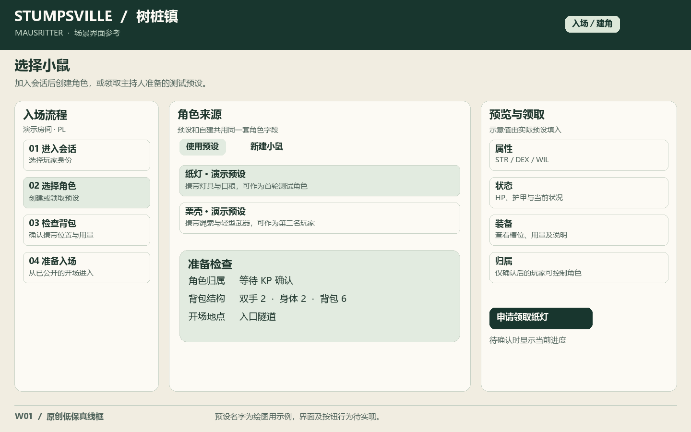
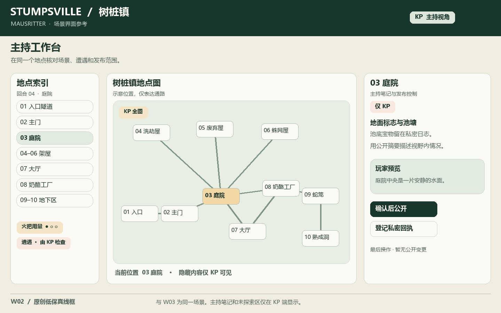
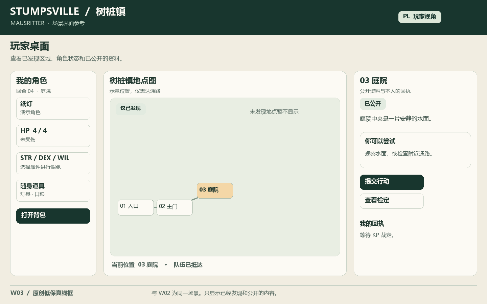
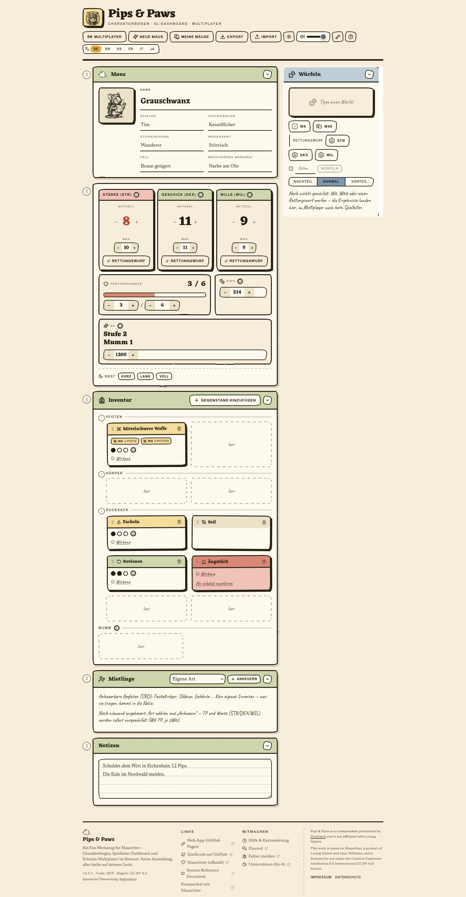
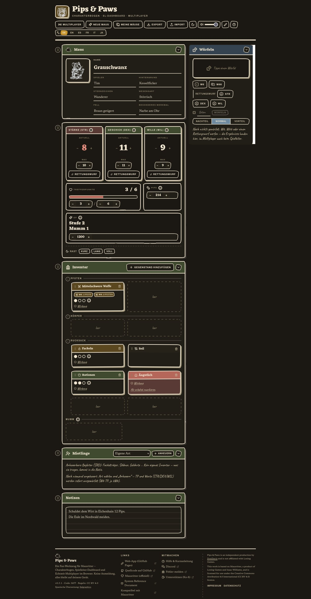
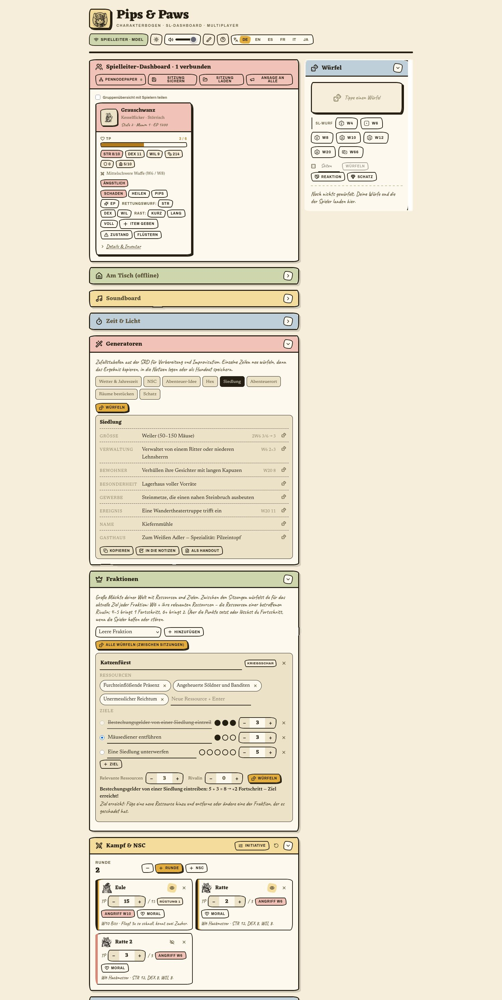
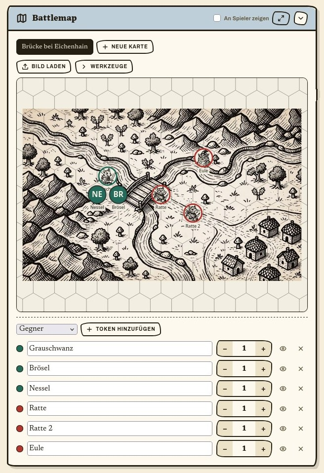
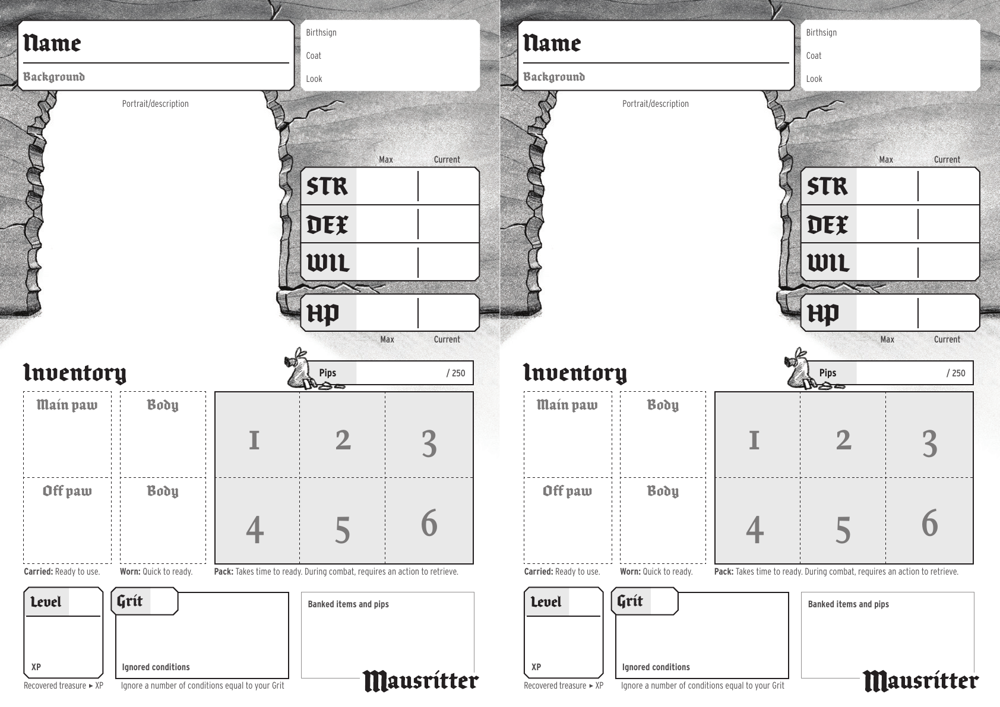
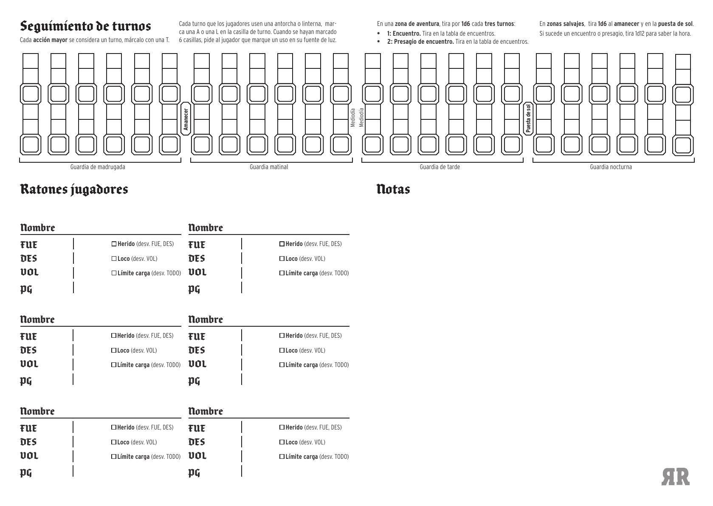

# Stumpsville 界面参考图集

- 文档类型：计划
- 状态：进行中
- 创建日期：2026-11-09
- 最后更新：2026-11-09
- 关联文档：[Foundry 导入与界面方案](stumpsville-foundry-plan.md)、[计划索引](README.md)

本图集汇总 9 张本地图。Pips & Paws 的四张截图用于对照同一应用的组件和布局，两张纸面表单用于核对规则字段，三张原创线框用于说明 Stumpsville 的入场与双端操作。线框中的角色、回合与操作记录是演示数据。

| 编号 | 界面或表单 | 用途 |
| --- | --- | --- |
| R01–R02 | Pips & Paws 角色表（浅色／深色） | 对照三属性、检定、状态和库存槽位。两张为同一界面的主题变体 |
| R03 | Pips & Paws 主持面板 | 对照队伍、骰子记录、回合计数和 NPC 管理 |
| R04 | Pips & Paws 主持战术地图 | 对照地图编辑、Token 列表和显示控制 |
| R05 | Mausritter 原版角色卡 | 核对生命、属性、双手 2 格、身体 2 格、背包 6 格 |
| R06 | Mausritter 主持追踪表（西语版） | 核对探索时间、光源、遭遇和队伍记录 |
| W01 | Stumpsville 入场与建角 | 新建或认领预设角色，核对归属和物品栏后入场 |
| W02 | Stumpsville 主持端 | 管理十个地点、回合、火把和遭遇，预览玩家可见内容 |
| W03 | Stumpsville 玩家端 | 查看已发现地点、角色状态、公开线索和自己的操作回执 |

## Stumpsville 原创线框

### W01 · 入场与建角

主持端可审核角色认领。角色表同时展示属性、装备和库存，便于在进场前核对。后续需在 Foundry 中验证认领、分配权限与进场的实际步骤。

### W02 · 主持端

以庭院为当前地点。主持可见完整地点索引，右栏区分主持笔记与拟公开内容。回合、火把和遭遇放在同一工作区。

### W03 · 玩家端

同一庭院状态下，玩家只看到已发现的 01–03 号地点、公开线索及本人回执。可与 W02 对照检查地点名称、地图和日志的披露范围。

## Pips & Paws 成套截图

四张图来自 DonDavis-vibe 发布的同一应用。归档保留截图原图，用于本地研究。截图和第三方素材的再分发以各来源条款为准。[作者项目与截图目录](https://github.com/DonDavis-vibe/pips-and-paws/tree/main/docs/screenshots)

### R01 · 角色表（浅色）

### R02 · 角色表（深色）

### R03 · 主持面板

### R04 · 主持战术地图

## Mausritter 纸面规则参考

### R05 · 原版角色卡

作者 Isaac Williams／Losing Games。本地图取自官方 PDF 第 1 页，页内是两张相同的角色卡。[Mausritter 官方资源页](https://mausritter.com/) · [角色卡 PDF](https://mausritter.com/assets/static/mausritter-character-sheets.DRBL-AQl.pdf)

### R06 · 主持追踪表（西语版）

本地图取自西语发行方 El Refugio de Ryhope 的追踪表第 1 页。[发行方下载页](https://www.elrefugioeditorial.com/zona-de-descarga-mausritter) · [西语追踪表 PDF](https://www.elrefugioeditorial.com/s/Hoja-de-seguimiento-de-turnos.pdf)

## Foundry 实测清单

| 场景 | 实测时检查 |
| --- | --- |
| 入场与角色 | 用两名玩家测试角色归属。完成新建或认领流程，并核对物品占用、用量和 2／2／6 槽位 |
| 主持推进 | 在庭院推进一回合，核对时间和火把记录，并检查遭遇结果与主持笔记的可见范围 |
| 玩家揭示 | 用玩家身份打开同一场景，核对公开后的地图、日志和回执，检查隐藏地点和私密条目未泄露 |

当前已归档参考图和静态线框。实际 Foundry 界面与权限待按关联方案实测。
