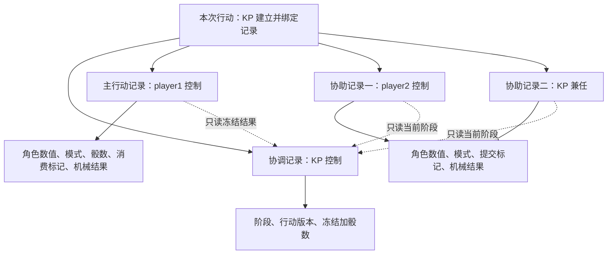

# 多人协助最小方案验证

- 文档类型：历史
- 状态：已归档
- 创建日期：2026-10-31
- 最后更新：2026-10-31
- 原路径：rulepacks/lasers-and-feelings/docs/cooperation-validation.md
- 原状态：进行中
- 归档日期：2026-10-31
- 归档原因：固定名单样例已被可复用的关系绑定规则及完整前端替代
- 替代文档：[当前使用说明](../usage.md)、[当前规则设计](../package-preparation.md)
- 关联文档：[ISSUE-003 及工程回复](../../../../docs/plans/Issues/issue-003-rulepack-cooperative-ruling.md)、[包准备方案](../package-preparation.md)、[验证入口](../../tests/README.md)、[机器结果](../../tests/cooperation-results.json)

## 1. 目标与结论

按工程回复，在不修改工程的前提下检验“KP 预建记录、各账号独立提交、KP 冻结集合、主行动人原子消费”的受限方案。本轮通过文档公开的 CLI、HTTP 和命令协议使用真实宿主，不导入后端内部类，不修改工程代码、契约、配置或存档。

**最小路径的 27 项检查通过**。这表明已有实体数值、规则原语与事务可以承载本样例的防重复协作，不应仅因存在多人需求就要求新增宿主功能。当前不是完整配置包或前端验收，ISSUE-003 保持开放，继续评估复用性与作者成本。

## 2. 记录层级与权限

本样例使用每个行动独立的公开 `actor` 记录，数值字段由 KP 预定义；这是实验性承载方式，不代表这些记录是叙事中的角色。主行动人使用 player1，第一协助者使用 player2；KP 在实验中兼任第二协助者，用于验证两份协助聚合。因此本轮没有验收“三个普通玩家各自操作”的完整场景。



```text
行动样例
├─ KP 控制的协调记录：阶段、版本、冻结加骰数
├─ 主行动人控制的记录：角色数值、模式、消费标记、成功数、洞察数
├─ 各协助者控制的记录：角色数值、模式、提交标记、成功数、洞察数
├─ 固定规则修订：协调记录 ID、主行动记录 ID、合法协助记录集合
└─ 主机记录：各动作回执与随机轨迹；聊天卡片只负责展示
```

每个行动使用新记录，不复用已消费记录。合法记录集合保存在该样例的修订数据中，客户端不能通过传入另一个实体 ID 改换参与者。数值与标签等管理能力仍由 KP 掌握，普通玩家只能通过已发布规则改动自己有控制权的记录。

## 3. 操作与原子性

| 阶段 | 操作 | 必须成立的约束 |
| --- | --- | --- |
| 预建 | KP 创建四份记录、固定角色数值与模式，并导入样例规则及绑定数据 | 记录相互隔离且公开可读；玩家没有管理写权限 |
| 协助 | 协助者提交公开普通 action | 在合法名单内、仍开放、版本一致、尚未提交；写入自身提交标记及结果 |
| 关闭 | KP 执行专用 action | 两份协助均已提交；读取成功情况，将加骰数与关闭阶段一起提交 |
| 主检定 | 主行动人执行公开普通 action | 正确记录、已关闭、版本一致、尚未消费；标记消费并将冻结加骰用于随机检定 |
| 分享 | 各自另发 `chat.message.share` | 仅分享本人合格 action；不影响行动是否已执行或协助是否已计入 |

主检定的“消费标记＋掷骰结果”处于同一个动作阶段。相同命令 ID 沿用宿主回执；不同 ID 再次提交依靠持久标记拒绝。关闭与协助按宿主事务提交，迟到请求无法绕过关闭状态。KP 不替玩家修改记录，玩家也不写入 KP 的协调记录。

样例将协助检定拆为普通 action、关闭拆为 KP 专用 action、主检定拆为普通 action，不使用 flow 来冒充多人输入收集器。这样玩家的合格普通行动可分享为结果卡片；KP 专用关闭动作及任何 flow 均不作为可分享结果来源。

## 4. 已检查的范围

| 类别 | 本轮证据 |
| --- | --- |
| 业务准入 | 非参与者、冒用他人记录、过期行动版本、未关闭即主检定均被拒绝；聊天文字不能关闭协助 |
| 规则与回滚 | 两种模式按真实骰值核对成功数；非法角色数值被拒绝，提交标记回滚 |
| 防重复与关闭 | 同 ID 重试回原回执；换 ID 重复协助被拒绝；玩家不能关闭；冻结加骰与协助结果相符；关闭后不能追加 |
| 主检定事务 | 他人不能消费；并发两个新 ID 只有一个提交；骰数来自冻结集合；重复消费被拒绝 |
| 展示分离 | 分享失败不撤销行动；再次分享不改变业务状态；公共历史能读到主机 action 卡片 |
| 问答与受众 | 用私聊和同频道回复关联实验问题与回答，第三账号无权读取该私聊 |
| 恢复与撤权 | 重启后回执及骰值相同，消费防线保留；已排队命令在成员停用后被拒绝 |

洞察问答检查只验证文字交流、回复关联和受众隔离，不证明主持人的答案在语义上真实，也没有实现可恢复的“待回答／已回答／已关闭”结构化待办。实验提问可以主动提交，不是已实现的洞察自动触发 UI。

## 5. 尚未解决与下一步

本轮四个 Lua 文件仅为包内最小验证夹具。它们用固定修订数据绑定一次行动，角色数值与模式由 KP 写入实验记录，不是完整角色系统。准备／专长裁定、任意人数协助、取消、拒绝某位协助、完整洞察流程及正式 UI 尚未实现。样例因恰好两名协助者，将骰数保护范围限制为 1—5；这不是原规则的总骰数上限。

当前绑定方式每增加一场行动都要准备新记录和绑定数据；它证明路径可行，但不代表作者负担已经可接受。下一步先评估能否通过现有关系／配置表达可重复使用的行动绑定，避免每次重新生成规则修订，再决定是否需要向工程责任者申请最小通用协作记录接口。

继续保留 ISSUE-003，由工程责任者复核实验结论；本任务不代替其关闭 Issue，不修改宿主以迁就样例。完整多人场景、运行中规则升级、更多权限变更、进程强制退出阶段恢复及长期作者体验仍待专门验收。
