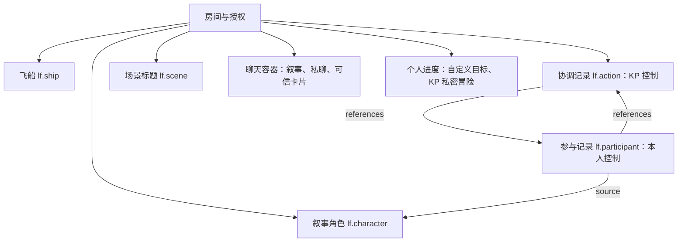

# 配置包数据、规则与权限设计

- 文档类型：当前
- 文档子类：设计
- 状态：有效
- 创建日期：2026-10-30
- 最后更新：2026-10-31
- 关联文档：[使用说明](usage.md)、[游戏规则](rules.md)、[前端设计](../ui/frontend-design.md)、[工程回复](../../../docs/plans/Issues/issue-003-rulepack-cooperative-ruling.md)

## 1. 当前设计

本包使用现有实体数值、关系、Lua、回执、进度和聊天室实现跑团，没有增加内核类型或修改工程。早期固定名单试验已由本页设计取代，原始验证见[历史记录](history/2026-10-31-cooperation-validation.md)。

## 2. 数据与容器



```text
玩法数据
├─ 角色：姓名、数值、风格、职责、目标
├─ 飞船：两项不同优势、一个问题
├─ 场景：公开标题、顺序和叙事消息
└─ 冒险：四表生成，默认 KP 私密

机械协作数据
├─ 每次行动的协调记录：阶段、版本、冻结加骰数
└─ 每位参与者的记录
   ├─ 角色快照、模式、准备、专长、分工
   ├─ 提交或消费标记、逐骰结果、成功、洞察
   └─ 问答状态：未提问、待回答、已回答
```

五种配置均以现有 `actor` 承载；通过 configurationId 分开叙事角色与机械记录。静态配置不是运行实例，运行账号和存档不进入包源文件。source 与 references 是内核管理的类型化关系，不用任意文本充当实体引用。

## 3. 约束职责

| 负责者 | 职责 |
| --- | --- |
| 宿主 | 认证、所有权与可见性、模型和引用校验、事务、随机持久化、回执、幂等、聊天室权限 |
| 本包规则 | 数值范围、配置类型、绑定与版本、参与者唯一、加骰、比较算法、关闭、业务防重复和消费、洞察状态 |
| KP | 判断风险、准备与专长、选参与者、描述后果、如实回答、管理角色及共享设定 |
| 前端 | 表单与解释、调用顺序、持久批次和未决命令恢复、频道与受众 |

`lf.open` 在记录及引用创建完成后开放行动；草稿期间不能掷骰。每个账号只能有一位参与者，不能自助或用多个角色重复协助。参与记录必须与源角色同属一个账号。

`lf.help` 在同一阶段写本人提交标记和结果，不同 commandId 也不能重掷。`lf.close` 由 KP 冻结已提交且成功的协助，未提交者不计入。`lf.main` 读取冻结加骰并原子标记消费，并发请求仅一个提交。规则通过已有关系查询绑定，因此同一修订可处理多个行动。

每次行动使用新记录，不重置旧记录模拟新事务。KP 直接管理操作属于可信管理行为，不宣称能防止主机运行者修改自己的存档。

## 4. 规则入口与使用场景

| 入口 | 场景 | 权限 |
| --- | --- | --- |
| `lf.profile` | 数值、风格、职责、目标索引 | KP |
| `lf.ship` | 两项优势、一个问题 | KP |
| `lf.adventure` | 四表选择／随机 | KP，结果不自动公开 |
| `lf.open` / `lf.close` / `lf.cancel` | 开放、关闭、取消未完成行动 | KP |
| `lf.help` / `lf.main` | 协助和主检定 | 普通 action，宿主核验控制权 |
| `lf.question` | 问题进入持久回执，推进提问状态 | 自有参与记录 |
| `lf.answer` | 发送回答后标记完成 | KP |
| `lf.library` | 绑定校验与 d6 算法 | 非公开内部库 |

洞察文本保存在动作回执及所选频道的可信卡片中，回答保存在同频道回复中，数字状态保存在参与记录中。两者是独立事务，前端用可恢复批次衔接，不假装存在自由文本 ask 或跨账号回执写原语。主持人的回答是否在叙事上真实无法由程序判断。

普通 action 可由本人明确分享；所有 flow 和 KP 专用 action 都不能作为可分享卡片来源。聊天中的批准文本不改变规则状态。个人冒险进度引用真实成员 ID，不把账号 ID 与成员 ID 混用。

## 5. 保护范围与验证

最多 30 位参与者、32 颗骰，超出时明确拒绝，不截断协助。这是实现保护而非原书限制。每次行动固定角色数值快照，角色后续变化不重算已发生的骰值。

当前验证见[测试说明](../tests/README.md)。更多作者试用、大型历史及远程网络部署仍需独立验证，不能用现有自动测试替代。
