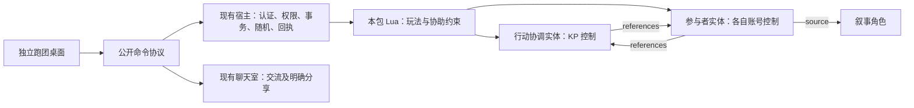

# 配置包安装、使用与验证

- 文档类型：当前
- 文档子类：工程
- 状态：有效
- 创建日期：2026-10-31
- 最后更新：2026-11-02
- 关联文档：[配置包入口](../README.md)、[游戏规则](rules.md)、[接口与数据设计](package-preparation.md)、[验证入口](../tests/README.md)、[来源与许可](../LICENSE.md)

## 1. 已实现范围

本包提供可导入的 Lua 规则与静态数据、五种对象配置、独立浏览器桌面、启动入口和导出工具。支持角色申请与 KP 建卡、自定义目标、共同建船、四表冒险生成、公开场景、频道文字与私聊、协助及主检定、可信骰单分享、洞察提问和回答状态、取消、刷新后恢复未决操作。

规则通过现有宿主执行，包的文件、界面和测试均在 `engineering/` 外维护。主机和前端适配器当前都绑定 `127.0.0.1`；本轮完成的是现有本机宿主上的可操作版本，未新增公网、LAN、P2P、语音视频或远程部署能力。

## 2. 启动

Windows 用户可以直接双击配置包根目录的 **[启动激光与情感.exe](../启动激光与情感.exe)**，无需执行 PowerShell 脚本。它调用原有启动流程，首次启动仍在控制台设置密码，随后自动打开桌面；按 Ctrl+C 停止。关闭启动器会清理其启动的前端与宿主。

exe 依赖项目已有的 Python 环境和本包其他文件，不是单文件独立发行版。可传入原有命令参数，例如 `启动激光与情感.exe --port 8878`。源码、重新编译与摘要见[工具说明](../tools/README.md)。

使用项目已准备好的 `engineering/.venv` 运行环境，从项目根目录执行：

```powershell
.\rulepacks\lasers-and-feelings\start.ps1
```

也可以直接运行：

```powershell
engineering/.venv/Scripts/python.exe -B rulepacks/lasers-and-feelings/tools/launch.py
```

首次启动调用工程公开 CLI 初始化**本包自己的** `runtime/room/`，按提示设置至少 8 位的密码；初始化账号为 `kp`、`player1`、`player2`。随后启动宿主和浏览器，默认桌面地址为 `http://127.0.0.1:8877`。Ctrl+C 停止，本包数据保留。再次启动恢复同一存档，不重复初始化。

新增账号前先停止本包服务，再按工程文档使用 `account-create`，其 `--data-dir` 必须指向本包独立存档；密码交互沿用宿主方式。重启后，如成员列表尚未出现该账号，由 KP 调用既有 `member.add` 管理操作完成绑定。同机测试使用下面的独立入口，无需切换浏览器配置。

### 同一浏览器测试多个账号

在登录页或桌面上点击“KP 测试窗口”“玩家1 测试窗口”“玩家2 测试窗口”，分别在新标签页登录。默认地址如下；自定义端口时使用实际端口：

| 入口 | 地址 | 建议账号 |
| --- | --- | --- |
| KP | `http://127.0.0.1:8877/sessions/kp/` | `kp` |
| 玩家1 | `http://127.0.0.1:8877/sessions/player1/` | `player1` |
| 玩家2 | `http://127.0.0.1:8877/sessions/player2/` | `player2` |

三个入口连接同一房间，各自保存登录 Cookie、CSRF 和操作日志，刷新和退出互不影响。入口名只是浏览器会话槽位，不能赋予账号权限；仍需输入实际账号密码。登录后标签页标题显示实际账号。相同入口的多个标签页仍共享同一登录，测试时每个入口使用一个标签页即可；默认 `/` 入口也独立于这三个入口。

已在默认入口产生的未决操作，应先在原入口恢复完成；原日志不会迁移到新入口。更新后需要先 Ctrl+C 停止旧启动器，再双击 exe 启动并刷新页面，不重新初始化存档。

已启动独立宿主时，可以只运行本包前端：

```powershell
engineering/.venv/Scripts/python.exe -B rulepacks/lasers-and-feelings/tools/launch.py --backend http://127.0.0.1:8765 --port 8877
```

此方式不初始化或停止外部宿主。`--data-dir` 允许选择其他独立存档位置，但拒绝写入 `engineering/`。环境已安装在其他位置时，连接现有宿主的前端适配器可用标准 Python 运行，不依赖后端内部类。

## 3. 一次完整跑团

1. KP 登录后点击“导入并激活本包”。该操作将本包完整规则组暂存、激活，再登记五种配置；会替换该房间原先激活的规则组，所以应使用上述独立存档。重复导入不会删除既有角色。
2. 玩家填写“申请角色”，向当前频道发送申请。KP 点击消息中的“填入建卡表”，核对真实发送账号、姓名、数值、风格、职责与目标，再确认创建；KP 也可直接建卡。自定义目标的个人资料由角色所有者及 KP 读取；申请消息按所选频道可见，私密目标应先切到主持人私聊申请。
3. 大家讨论飞船优势与问题，KP 在“共同创建飞船”选择两个不同优势和一个问题并保存。起始装备以规则文字列在桌面左侧，不添加原书没有的数值重量或伤害。
4. KP 可使用四张表逐项选择或随机生成冒险。生成结果保存为 KP 私密个人记录，不自动发给玩家；KP 在“发布场景与叙事”手工填写玩家可知的标题与描述，向公共频道发布。
5. 玩家描述意图。需要检定时，KP 在“建立风险检定”指定主行动人、模式、准备与专长，再选择协助者并确认开放。一个账号每次只能使用一个角色；每次行动使用独立的机械记录，规则组不变。
6. 协助者点击自己的“进行协助检定”。成功只授予主行动额外一颗骰。KP 选择“关闭协助窗口”后，尚未掷骰的协助者不再计入，也不能迟到补投；主行动人随后进行主检定。
7. 各人可把自己的主机结果分享到当前频道。行动与分享是独立事务，重复分享不再次计入协助；分享失败也不会撤销已经完成的检定。
8. 出现相等骰时，自己的待办中会出现洞察提问表单。默认向其他 KP 私密提问，也可取消勾选发到当前频道。系统用普通 action 保存问题回执并分享为可信问题卡片，随后切换到对应问答频道。KP 在问题卡片下如实回答并标记完成。
9. KP 根据成功档位描述变化和后果，继续发布场景，直至故事结束。没有强制网格、HP、轮次或背包重量系统。已完成主检定不能取消或重掷；取消未完成行动会阻止后续协助和主检定，但不抹除已经产生的骰值。

## 4. 恢复与失败处理

前端把未完成的操作批次和原命令封套保存在当前浏览器的入口与账号专属日志中。每步先保存命令 ID，再提交；提交确认后将结果和批次位置一并保存。刷新后出现“操作待处理”，点击恢复会先查原回执，不用新 ID 重掷。

结果未知时不允许放弃，避免误把已执行动作当成未执行。主机明确拒绝后，可修正外部条件并用新 ID 重试当前失败步骤；也可以放弃尚未执行的步骤，已经提交的步骤仍保留。建行动中途放弃会留下准备中的草稿，KP 可取消后重新建立。不要在未决操作存在时清除站点存储或更换浏览器；即使浏览器记录丢失，服务端骰值和消费标记仍在，但原回执的手动分享需要保留的命令 ID。

文字消息、权限变化和规则数值仍由宿主校验。网络中断后清空聊天历史缓存；重新连接时取得完整授权视图，再查频道历史。前端采用 HTTP 快照轮询；未实现本包自己的 WebSocket 重连协议，也未修改现有 SDK。

## 5. 包数据与职责



| 承载 | 用途 |
| --- | --- |
| `lf.character` | 角色数值、风格、职责、预设目标索引；个人说明为授权进度记录 |
| `lf.ship` | 两项优势和一个问题 |
| `lf.action` | 机械行动的准备／开放／关闭／取消、版本和冻结加骰数 |
| `lf.participant` | 本次行动的角色数值快照、模式、准备／专长、角色分工、提交或消费状态、骰值、成功数、洞察及问答状态 |
| `lf.scene` | 公开场景标题、顺序和发布标记；详细叙事保存在公共聊天 |
| 原有 source / references 关系 | 固定参与者与行动、角色的双向绑定，由 KP 创建 |

机械记录使用现有 `actor` 类型承载；它们与叙事角色有不同配置，不能把协调记录当作玩家角色。普通 action 只写本人可控制的记录。KP 的关闭操作冻结加骰，主检定读取该值并在同一阶段原子标记消费。规则不根据聊天文本判断是否批准，客户端隐藏按钮也不构成权限控制。

## 6. 自定义与导出

作者修改 `config/lf.json` 中的说明和选项、`config/configurations.json` 中的对象配置、`rules/` 中的 Lua，以及 `ui/` 中的展示。游戏算法使用 `lf.*`，不调用 demo 的百分骰算法。修改后通过包级测试，再重新导入规则；进行中的行动应先完成或取消，本包不提供跨版本的自动数据迁移。

界面上“每次检定一个问题”“三次及以上成功”“每账号一位参与者”等是本包的明确裁定，原书区别见[规则整理](rules.md)。最多 30 名参与者、32 颗骰是运行保护限制，超出时拒绝，不静默截断。

导出包含原始规则书、许可、规则、配置、前端、工具和文档，不包含运行账号、存档、日志或浏览器数据：

```powershell
engineering/.venv/Scripts/python.exe -B rulepacks/lasers-and-feelings/tools/export.py
```

默认输出到本包 `exports/`；若已存在同名文件，工具拒绝覆盖，可用 `--output` 选择新位置。压缩包内的 `bundle.json` 是本包工具使用的完整源集合，不能声称宿主已经提供一键 ZIP 安装；网页中的导入按钮负责转成现有管理命令。使用项目内启动脚本时，将包解压到项目的 `rulepacks/lasers-and-feelings/`；连接现有宿主的前端适配方式允许包单独部署在其他目录。

验证命令与结果见[测试说明](../tests/README.md)。自动化验证不会证明主持人的回答在故事意义上真实，也不替代真实远程部署及独立制作者试用。
