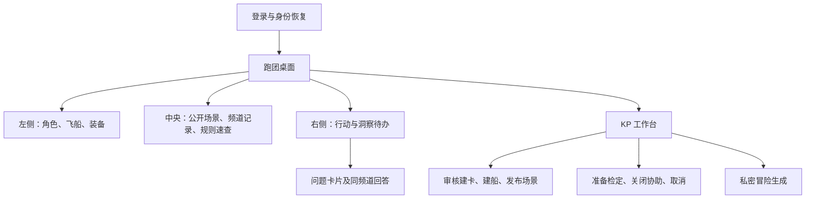
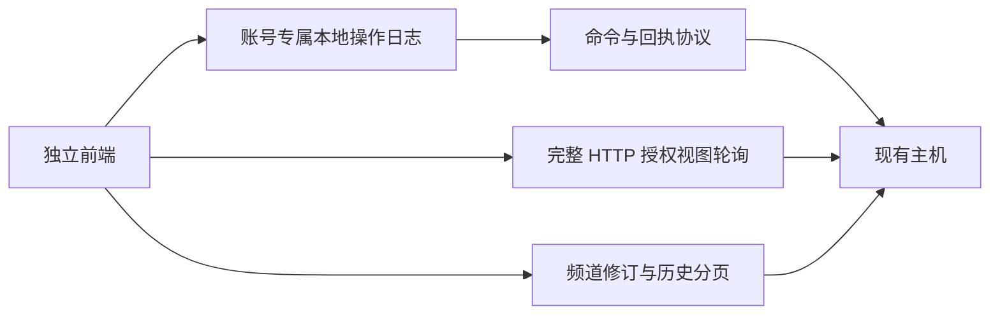
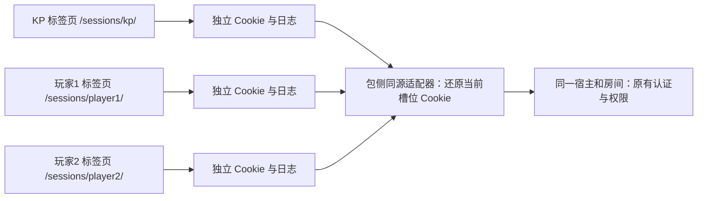

# 跑团桌面前端设计

- 文档类型：当前
- 文档子类：设计
- 状态：有效
- 创建日期：2026-10-30
- 最后更新：2026-11-02
- 关联文档：[使用说明](../docs/usage.md)、[规则与数据](../docs/package-preparation.md)、[测试](../tests/README.md)

## 1. 已实现页面

采用无构建依赖的 JavaScript、HTML 和 CSS，独立于工程操作台。早期 Vite／TypeScript 候选未采用；当前源文件直接由包侧适配器提供。

桌面三列，窄屏依次排列；不用横向棋盘。私聊、回复、编辑、撤回、角色代言、已读和历史分页均调用已有接口，可信行动卡片按主机返回的 kind/card 呈现。所有文字转义，不能把消息当作可执行 HTML 或裁定命令。

## 2. 用户流程

玩家提交角色申请，KP 核验消息真实发送人后创建。KP 管理的角色与飞船配置、场景和冒险，不因客户端的显示状态获得额外权限。

KP 选取参与者并确认准备／专长后，前端创建草稿、独立记录和引用，再调用 lf.open。普通玩家只看到自己可执行的检定按钮；已提交骰值从授权实体状态恢复，分享卡片是另一次明确操作。

洞察由普通 action 保存文本回执及提问状态，再分享至公共频道或 KP 私聊。KP 回复消息后标记完成。卡片分享与状态更新属于不同事务，由客户端恢复批次协调，不能将其宣称为宿主单次原子问答。

## 3. 协议与恢复

前端直接实现公开机器契约的薄客户端，不修改或复制工程 SDK。每个批次持久保存步骤、结果、当前位置和未决原封套。恢复先按原命令 ID 查询；未知则重发原封套，明确拒绝后才允许用户以新 ID 重试失败步骤。已确认步骤不重做，不能换 ID 盲目重掷。

登录 Cookie 与 CSRF 使用原宿主流程。按入口与账号隔离操作日志，退出只清除当前入口的本账号日志；存在未决批次时限制新的写操作。浏览器站点数据被清空后，主机状态仍存在，但本地保存的命令 ID 不能凭空重建。

授权快照或频道修订变化才更新画面，保留正在输入的表单与滚动位置。断线、撤权及身份变化会清理消息缓存；频道修订变化使历史页失效，再查询当前授权内容。HTTP 轮询不宣称提供事件回放。

## 4. 独立适配器

`tools/launch.py` 提供本机静态页面与同源 HTTP 转发。只接受本机 Host、匹配的 Origin 和指定路由，转发认证 Cookie、CSRF 和原请求；宿主仍负责最终权限和模型检查。静态路由不开放本包运行存档或测试输出。

`/sessions/kp/`、`/sessions/player1/`、`/sessions/player2/` 是同一房间的三个独立会话槽位。适配器为各槽位的 Cookie 加独立名称前缀并限定 Path，保留 HttpOnly、SameSite、有效期和退出删除语义；上游请求只还原当前槽位的 Cookie，忽略默认入口或其他槽位的 Cookie。CSRF 仍由宿主校验。浏览器不读取或保存认证令牌，入口名不参与账号授权。默认入口保留原有 Cookie 与日志，避免中断已有的恢复记录。

槽位隔离用于避免同机多账号测试中的意外覆盖，页面仍属于同一个站点；不是对不可信脚本的安全隔离。相同槽位的标签页共享会话，更多并行账号可使用独立浏览器配置。

可自行启动现有宿主并连接，也可按公开 CLI 以本包独立目录初始化和启动宿主。没有修改服务器、安装依赖、公开工程运行存档或提供互联网监听能力。

## 5. 验证与限制

真实浏览器验证在同一个浏览器上下文中打开默认页和三个槽位标签页，覆盖登录、刷新、退出及日志隔离、Cookie 属性、跨槽位 CSRF 拒绝、Origin 检查，另覆盖安装、建卡、飞船、场景、协助、丢回包后的刷新恢复、主检定、私密问答和窄屏。详细结果见测试入口。冒险数据默认 KP 私密，公开叙事须由 KP 手工发布。

浏览器验证中的洞察状态可能使用明确的合成夹具，以免测试依赖随机碰巧相等；骰值比较和随机轨迹由独立规则测试验证，不把合成状态当作自然发生的随机证据。
