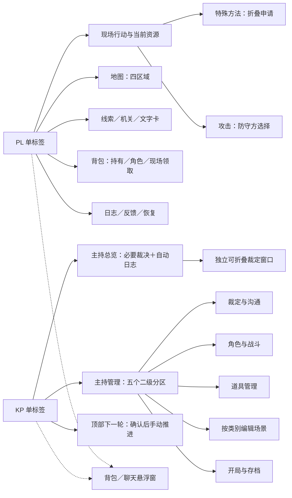
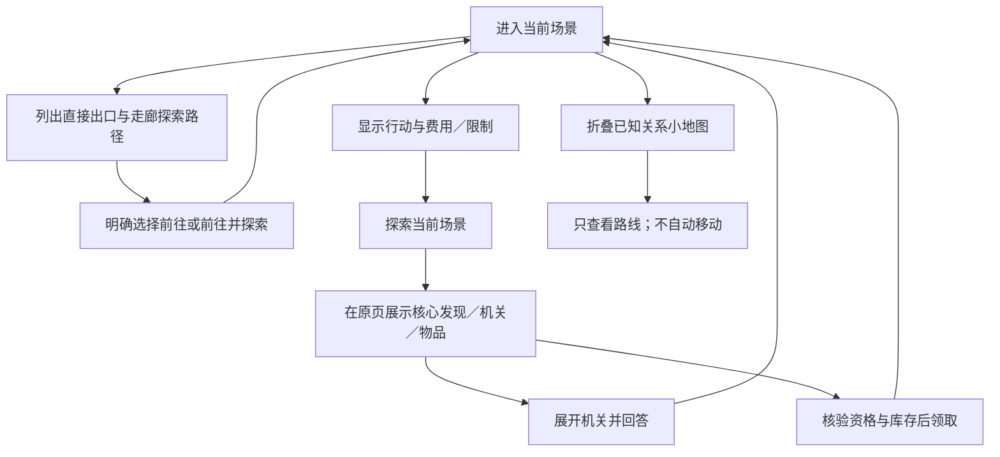
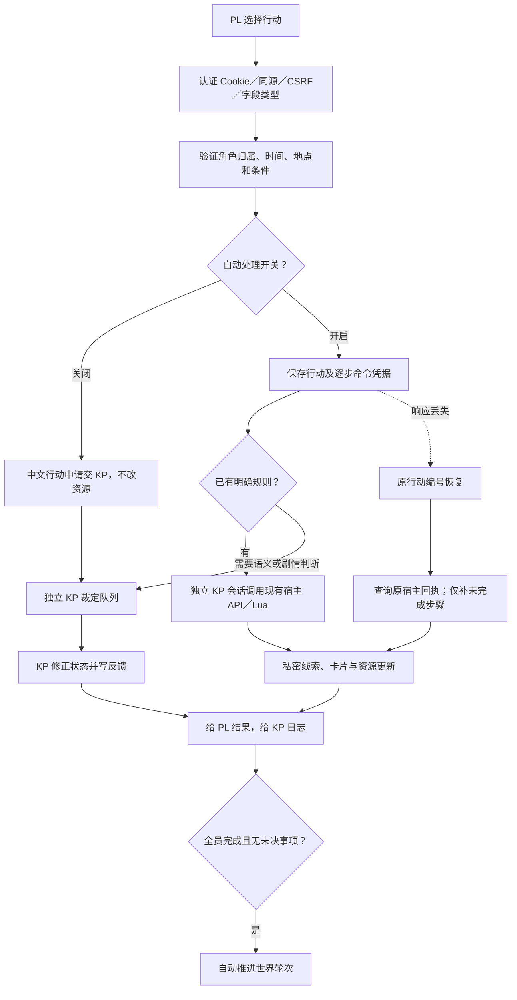

# 自动行动与桌面分区

- 文档类型：当前
- 文档子类：工程
- 状态：有效
- 创建日期：2026-11-02
- 最后更新：2026-11-02
- 关联文档：[实现与运行](implementation.md)、[配置](../config/scenario.json)、[验收](../tests/README.md)、[原界面设计计划](plans/frontend-design.md)

## 1. 当前操作分区

0.2.0 保留桌面浏览器单标签与暗金样式。首次页面只展示当前任务相关信息；背包、聊天和 KP 裁定队列仍是可拖动、折叠和关闭的独立页内窗口。队列状态在切换分页时保留，不增加浏览器标签页。

| 使用者 | 主导航 | 二级导航或折叠内容 |
| --- | --- | --- |
| PL | 场景、线索与机关、背包、记录与设置 | 场景内包含当前行动、出口、机关、物品和折叠小地图；特殊方法折叠 |
| KP | 主持总览、场景、主持地图、场景资料、人物道具、主持管理、日志与设置 | 管理分裁定沟通、角色战斗、道具、场景、开局存档；文件导入导出与人工修正默认折叠 |

KP 主持地图保留区域分页。PL 小地图直接嵌入场景页，不再使用独立地图分页。场景编辑先选资料类别，再选对象与中文字段名。资料卡中的谜底仅 KP 可见。

聊天行动卡、骰子结果、历史 JSON 计划和队列详情显示中文摘要。备份只显示完成提示，技术回执不再作为正文展示。JSON 仍用于通信、内部持久化及 KP 配置文件导入导出。

## 2. 场景中的导航与交互

场景页显示当前角色、位置、调查重点、资源和处理模式。主要操作集中在三处：

- “在这里做什么”：探索当前场景、休息、等待、提示、已探索后的追加侦察，以及当前地点特有的安抚、维修、船或阵法操作。每项显示费用、是否可用及不可用原因。
- “可以去哪里”：列出从当前位置直接相邻的出口，提供前往或前往并探索；室内允许经走廊一次探索的路径单独折叠。已知地点不等于可以直接移动的地点；入口、悬崖暗道、轮次和遭遇条件会参与计算。
- “现场调查与发现”：探索后直接在原页展开本地机关、输入答案和领取物品。已解机关显示完成状态；未获资格、缺钥匙、卡槽满、库存分配完或全队达到日上限时显示原因。

小地图是场景侧栏中的独立折叠小窗，默认折叠，可按 M 展开／收起。每个 PL 使用自己的成员探索记录：只显示该 PL 已完成探索的房间，以及这些房间一跳相邻、允许显示的房间，不递归展开邻居，不因初始公开或其他玩家探索而扩张。当前房间在尚未探索时仅作定位点，本身不扩张周边。金色为当前位置、绿色为已探索、灰色为周边未探索，虚线为未开放通路；未探索房间之间的额外连接不提前绘制。

探索信息随该 PL 的存档记录持久保留，跨轮次、换场景和服务重启不重置。KP 主持地图仍可查看全图，KP 场景页所选角色的小地图则按该角色所属 PL 的记录预览。旧记录中的单纯“已知地点”和 KP 单独揭露的远处地点不作为探索种子；秘密入口只有满足该 PL 的探索邻域且已开放或明确揭露时才显示。地图开合状态另按账号保存在当前浏览器；点选节点仅查看路线，明确点“前往”或“探索”才提交行动。

`tools/scene.py` 生成逐角色的 `scenes` 投影。角色归属、当前世界、相邻关系、入口条件、侦察额度、领取资格和库存均来自宿主与包服务；前端不再通过全量地点下拉框猜测可达性。场景文案优先读取宿主活动修订，避免在线修改后仍展示本地旧配置。23个地点的公开调查重点配置在 `automation.scenes`，旧活动工件缺少此展示段时可使用本地同 ID 的展示配置，不重建存档。

未发现的秘密入口、答案和其他玩家的场景投影不发送给 PL。地图和可用状态是导航提示，执行时服务仍重新校验实际条件。

## 3. KP 主动推进轮次

KP 可在任意分页点击顶部“下一轮”，原“主持管理 → 开局与存档 → 人工结束本轮”入口也保留并使用相同流程。确认框列出尚未完成主要行动、处于遭遇中的角色及待裁决事项数量。

确认后推进一次世界时钟，将时间落后的角色同步到新日／新轮并重置主要行动；新日按规则刷新智力额度。此操作不要求自动处理开关开启，也不要求全员先行动完毕。未决裁定与遭遇不会被删除或自动判定完成。第二日最终轮结束时只关闭调查时钟，玩家仍可作最终选择。

服务端验证真实 KP 身份，PL 无权推进；手动推进同样保存原请求和逐步宿主回执，恢复同一请求不会跳过第二轮。存在结果未明的行动时需先恢复再推进。

## 4. 自动处理总开关

KP 页面顶部提供唯一的“自动处理”开关，所有分页均可访问；PL 只看到当前处理模式。默认关闭，状态保存在自动化数据库，重启后保持。

- 开启：后续常规行动直接结算，普通结果仅写日志；特殊方法和语义分歧仍进入裁决队列。
- 关闭：后续行动以中文说明提交 KP，不自动掷骰、扣费、发放道具或推进时间。KP 使用管理表单结算，再完成反馈。
- 重新开启不追溯执行已排队的人工事项。切换前必须恢复结果未明的行动；先前已经发出的转交／防御选择仍允许接收者完成，避免遗留悬空请求。
- 首次开启时，如果兼容的旧场景缺少 `automation`，自动补齐该段并发布修订，保留活动场景文字、规则来源和角色资源，不再要求手动导入整个配置包。场景结构不兼容时保留关闭并提示 KP 检查。

只有实际 KP 身份且携带正确 CSRF 的请求可以切换；登录只是建立执行会话，不会自动打开开关。

## 5. 自动化边界

| 行为 | 已实现处理 | KP 接收内容 |
| --- | --- | --- |
| 移动、探索、休息、安抚、等待 | 检查归属、批准、HP、世界时间、邻接、隐藏入口和轮次；探索自动扣体力／疲劳并检定 | 行动日志 |
| 现场侦察 | 每人每地点每日前两次免费，之后每次扣1智力额度；判定属性由配置指定；核心信息不因失败消失 | 行动日志 |
| 标准机关 | P1—P7 的明确答案自动校验；P4 三句原样答案可自动通过，其他表达进入语义裁决；P5 亦可填写“使用档案钥匙” | 普通解题记日志；P4 非标准表达进入队列 |
| 道具领取 | 只允许配置地点及领取资格；检查总库存、全队同地点每日3件、四槽；自动创建实例、双向关联并确认 | 行动日志 |
| 装备、消耗、丢弃 | 核验持有者及双向关系；药物、口粮、解药按现有规则结算；面具消耗自身和1智力额度，记录庇护 | 行动日志 |
| 转交 | 同地发出请求；接收者确认后检查容量、转移归属和关系，卸下原武器 | 日志；确认请求只给接收者 |
| 玩家战斗 | 攻击请求交给防守方选择对抗／闪避，再由宿主掷骰、扣参战体力和结算伤害 | 日志；防御请求只给防守方 |
| 机关互动 | 管家房维修拉杆、船舱／地下启动船、地下停追踪、出示证据并承诺不再互杀获得船使用权 | 行动日志 |
| 轮次 | 有效在场 PL 全员主要行动完成且无遭遇、未决裁定时自动推进并同步；新日／招募发布写公告 | 场景日志 |
| 海岸追踪 | 第二日凌晨携钥匙牌抵岸，未停追踪且无面具庇护时创建必要剧情裁决 | 队列及日志 |
| 结局 | 玩家明确选择后校验时间、地点、船、证据或招募条件；时钟关闭后仍允许选择结局 | 行动日志 |
| 特殊方法与未定义剧情 | 保留玩家描述，由 KP 判断；修正状态后写反馈、关闭事项 | 裁定队列 |

领取地点、钥匙依赖、判定属性、谜题标准答案及奖励在 `scenario.json` 的 `automation` 段中明确列举，不从自然语言效果中猜测权限。场景文字表单不自动改写这一段；需要变更自动条件时更新可信配置文件并重新导入。

## 6. 身份、恢复与存档

包服务提供 `GET /package/automation`、KP 专用 `POST /package/automation {enabled: boolean}` 与 `POST /package/action`，会话路径同样支持 `/sessions/<slot>/`。读取接口按真实账号裁剪日志、线索和待确认事项；开关接口保存房间模式；行动接口只接受固定行动类型，不接受任意规则名、管理命令、文件路径或自报身份。宿主仍是规则、骰子和实体数值的权威。

首次准备或 KP 成功登录后，服务建立独立 KP 会话。密码只在本次认证中使用，不保存在配置、日志或自动化数据库。Windows 用当前系统用户的 DPAPI 加密会话 Cookie；非 Windows 仅保存在进程内。KP 关闭页面或退出自己页面的登录，不会注销此独立会话。会话到期后需要 KP 再登录。

默认宿主存档为 `runtime/room/`，工作流凭据、线索获取记录、日志与队列在 `runtime/room-automation/`。自定义 `--data-dir X` 时，自动化目录为同级 `X-automation/`。两个目录属于同一套游戏进度，应一起保留。网页“主机备份”仍只备份宿主；自动化目录需在停服后随整套存档一起复制，不能仅恢复其中一部分。

命令在发往宿主前持久化。已提交但响应丢失时，恢复会先查询原回执，不重新掷骰或扣费。未确认的多步骤行动会阻止新行动插入，提交者应使用“恢复原行动”。这保证顺序恢复，不把多个工程 API 命令宣称为原子事务。恢复期间不要人工改动同一批实体。

## 7. 升级与仍需人工的事项

已有服务需要重启一次以载入新增适配器。KP 登录后直接打开顶部“自动处理”开关即可；兼容旧存档的缺失自动配置会自动补齐，已有角色、资源和在线场景文字保持。完整本地配置导入仍保留为作者的高级管理功能。

手工发放、NPC 决策、自定义方法、逃跑追击、倒地救援、组队速度调度和未配置的物品特殊用途仍需 KP。其数值操作保留在分区管理工具中。自动化按全体有效 PL 计算日地点产出，尚无独立多队调度模型。已有原始 Lua/API 仍保留人工管理能力，自动服务的终局与入口校验适用于这里的行动入口，并非工程全局冻结能力。
