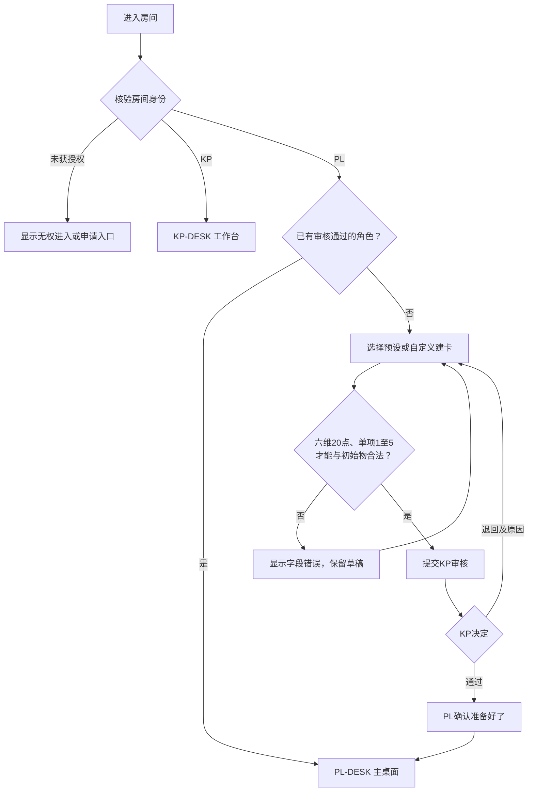
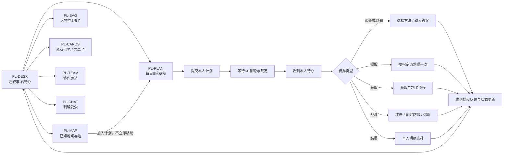
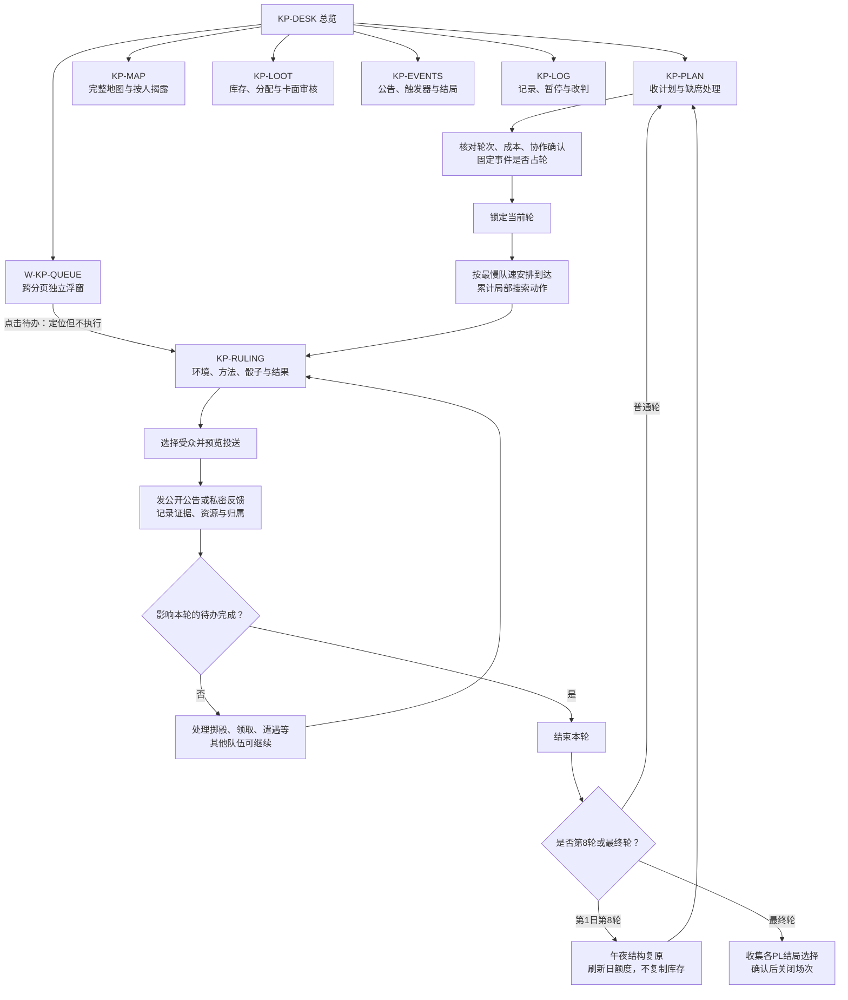
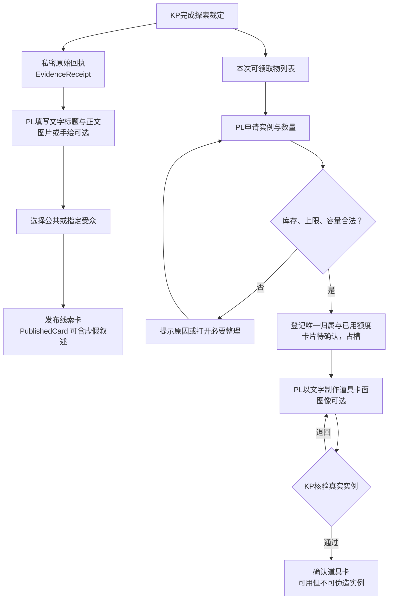
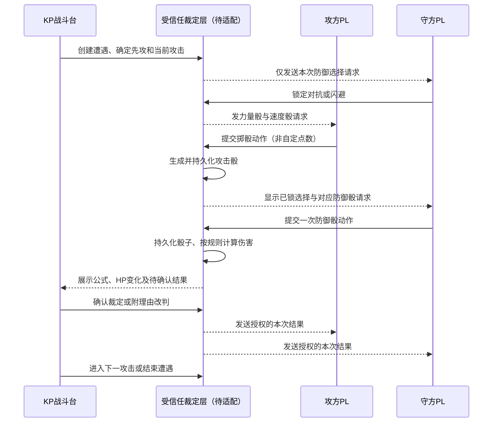
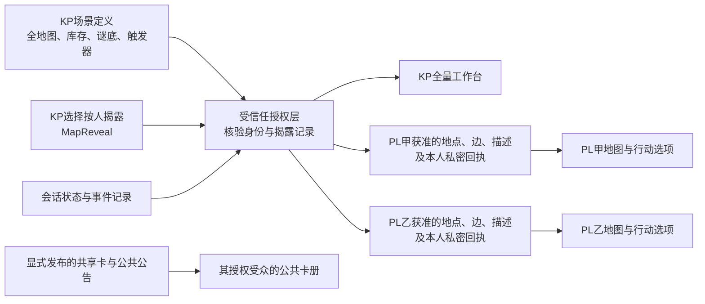
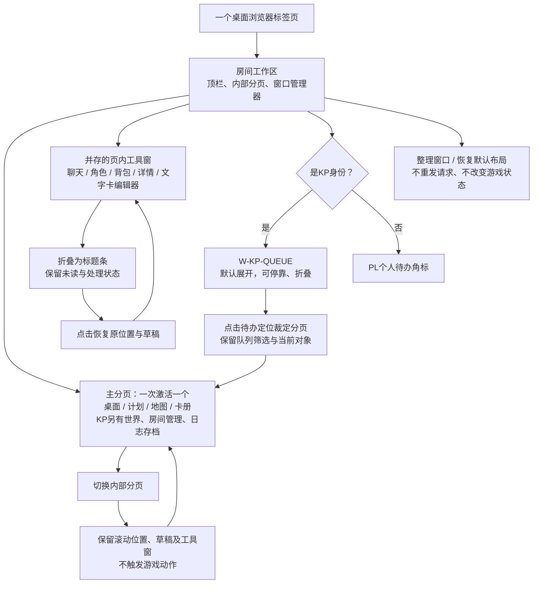
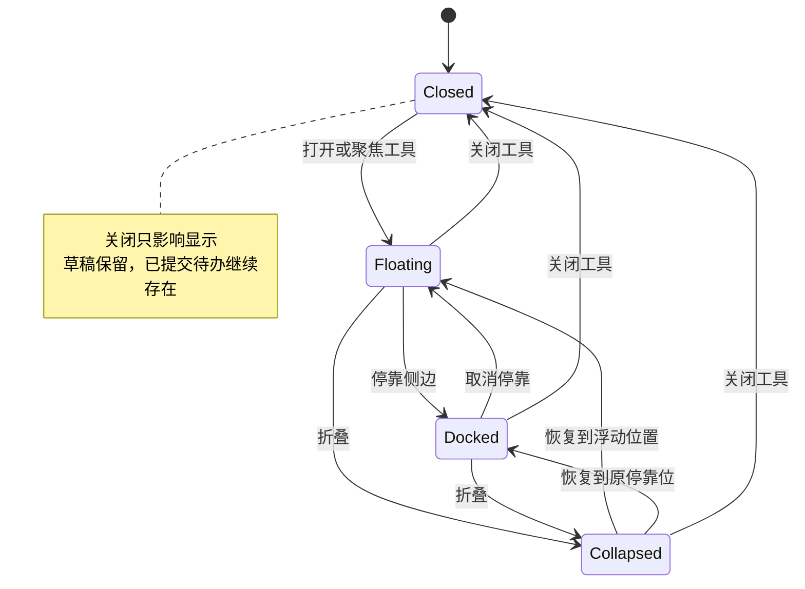

# KP与PL界面逻辑图

- 文档类型：计划
- 状态：草案
- 创建日期：2026-11-02
- 最后更新：2026-11-02
- 关联文档：[界面计划](frontend-design.md)、[配置规格](configuration.md)、[地图与道具（剧透）](map-and-items.md)、[规则](rules.md)

## 1. 范围与约定

本文件表达界面导航、待办流转和信息边界，这是目标流程图，部分已由本机包实现；防守方选择已接入，停靠及在线恢复等仍待实施；当前导航与自动流程见[自动行动与界面](../automation-and-ui.md)。2026-11-02用户已确认桌面单标签、页内独立KP队列、文字替代手绘与全员前端操作。下图的“分页／窗口”均在同一标签页内；不要求新浏览器窗口、终端、手改文件或外部群聊。规则与参数不在图内重新定义，详见规则／配置；页面ID与界面计划一致。图中动作箭头不表示API已经存在。KP完整地图含剧透，PL只接收按受众过滤的投影。

## 2. 入口与建卡

选择KP只来自授权核验结果，PL没有自行切换身份的路径；刷新页面不跳过审核。准备与KP开始场次是独立动作。

## 3. PL页面导航与行动

背包、卡册和聊天都是可随时查看的工具；能否执行具体操作由当前动作和授权决定。待办优先于普通行动菜单，但不会替玩家选择。各页面关闭后回到原日志位置和未提交计划。

## 4. KP工作区与一轮裁定

被退回修改卡面的物品保持已领取归属；只要该轮领取已完成，可留作跨轮审核。新道具未确认前不可使用。KP推进时不通过“一键完成”绕过尚未作出的防御、容量或结局选择。

## 5. 道具、回执与线索卡的不同路径

PL-CARDS可看到本人回执和有权限的共享卡，但二者不能合成一个“全部线索”接口。公开卡不向其他PL暴露原始clueId、真假比对结果、未公开地点或作者未授权的私聊内容。

## 6. 战斗界面时序

防御锁定前不显示攻击骰；NPC由KP操作对应请求。网络失败后查询原请求结果，不另开一组骰。逃跑与追击也先分别锁定地点、再揭示比较；不将对手秘密路线放在按钮提示中。战斗图的“裁定层”是职责名称，不表示工程已有该接口。

## 7. 地图与秘密信息投影

PL甲知道一条隐藏边不自动使PL乙知道；只有明确的共享或KP揭露才改变乙的可见范围。玩家自绘地图可作为不保真的共享线索卡，不自动写入官方可达边。KP预览某PL只查看该投影，不改变PL权限。

## 8. 实施与验收

阶段与页面验收以界面计划§8为准。先核对图中每条提交是否有待办来源，再以建卡→探索→获取卡→发布线索→KP推进的最小闭环制作静态样稿；后续才接服务和多人恢复。

KP裁定队列独立页内窗口已确认，不再待定；手机不在当前范围。其余待确认：多人协作是否增加明确授权的队长代填（默认只代填草稿、不代提交）、公共展示的最终样式。验收须检查越权、并行领取、满包整理、指定受众、断线重放和防御选择先后，并确保全流程从前端完成。交付文档不等于这些行为已通过工程验证。

已检查本地引用和Mermaid代码块的围栏与图类型声明，并人工核对状态先后；本地没有Mermaid渲染器，未完成渲染级语法或视觉验证。多人权限和恢复测试留待对应实现阶段。

## 9. 单标签分页与可折叠窗口

窗口状态独立于`PendingDecision.status`。恢复时根据保存的原停靠模式二选一，不同时走两条路径；同一个工具只保留一个实例，多次点击聚焦已有窗口。跨分页未读只更新角标，不抢焦点；游戏请求的提交、确认与资源消费仍按原业务流程执行。
