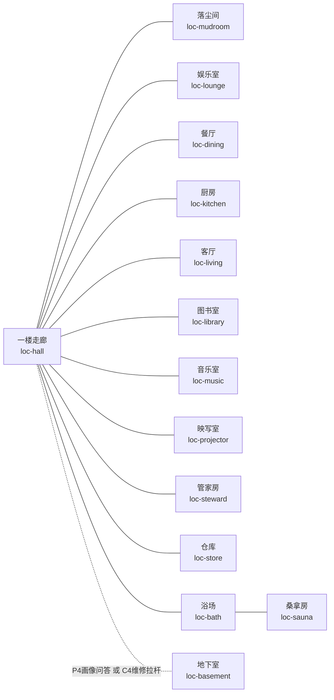
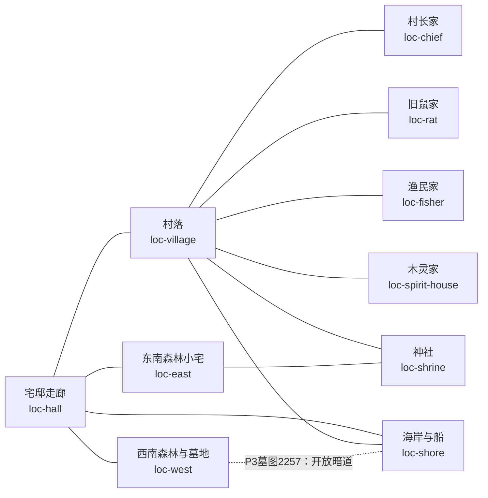
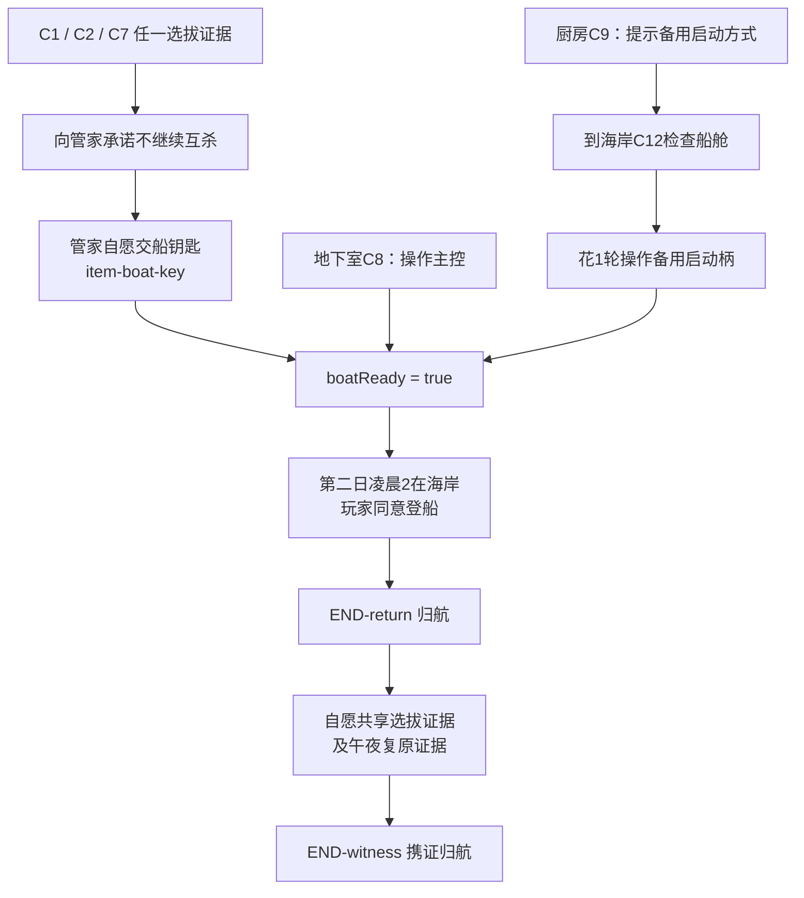
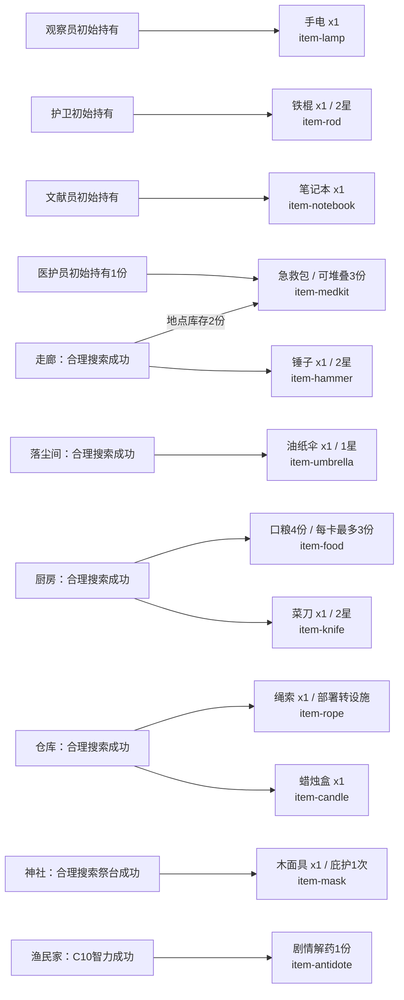
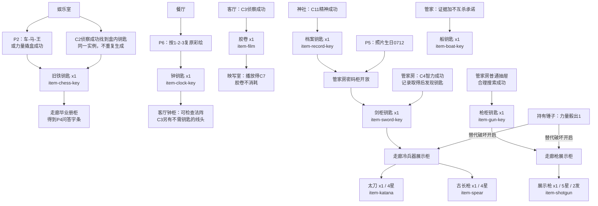
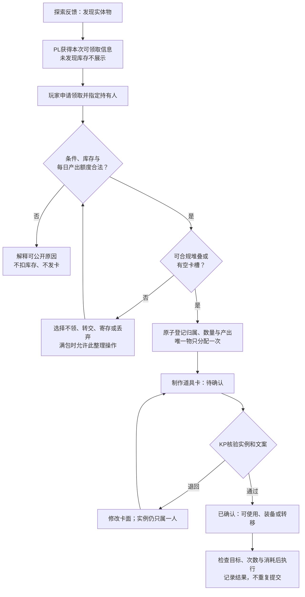

# 地图与道具逻辑图

- 文档类型：计划
- 状态：草案
- 创建日期：2026-11-02
- 最后更新：2026-11-02
- 关联文档：[主持场景](scenario.md)、[配置规格](configuration.md)、[界面计划](frontend-design.md)、[界面流程图](interface-flows.md)

## 1. 用途与读图约定

以`reconstruction-0.1`的[场景正文](scenario.md)为唯一数值及剧情来源，将地图邻接、22种道具定义及其获取条件绘为可核对的图。此文件是 **KP与配置作者的剧透视图**，不能原样作为PL地图下发。图不表示原作完整地图；所有邻接与补齐条件仍是H。

地图实线`---`表示双向通路，虚线带文字表示满足条件后双向开放；道具图箭头仅表示“获取／使用／解锁依赖”，不表示可移动路线。图中ID对应场景和配置，库存数字是初始数，实际余量来自会话。每个图内的短节点名只是绘图标识，框中文字的`loc-`／`item-`才是领域ID。

## 2. 宅邸地图

室内探索允许经hall中转，单轮最多跨2条室内边，只搜索终点；hall与basement的边必须先开放。打开毕业册柜、钟柜或展示柜只改变该地点内部的可操作目标，不开放新的地图房间。

## 3. 岛上地图与离岛条件

户外每轮移动1条边，公开hall→shore路线不依赖墓地解谜。P3决定暗道是否开放；绳索只消除走该暗道的危险检定，不可越过未开的通路。图不按真实方向或距离绘制。画室、天台、仓库1／3等未配置称谓仍不接入本图。

备用启动柄是固定场景操作物，不新增第23种携带道具。C9只给线头，不在厨房远程启动船；C12信息获得与“花1轮启动”是两步。拿船钥匙或成功操作C8则无需再做备用启动。夜间追踪是可绕开的遭遇，放弃普通钥匙牌不删除船钥匙等实体卡。

## 4. 初始与常规道具分布

本图覆盖12种定义；同一个item-medkit有角色持有和地点库存两个来源，合计3份。其余10种见§5，二者合计覆盖场景22种定义，不包含只有背景用途的原料物件。

初始卡已确认；其余领取均经过库存、次数、容量及制卡流程。口粮是4个份数，不是必占4槽；领取时按每卡最多3份拆分，但队伍当天单地点最多取得3份实体产出，不用合卡绕过产出额度。医疗包同样按份计产出。此处明确数量口径以避免图误导。

## 5. 谜题、钥匙与高价值道具

每条箭头代表一个可选的合法取得路径；例如“P5开柜”和“C4成功发现剑钥匙”指同一把钥匙，先取得后另一条不再发放。胶卷按C3成功奖励取得，不再增加原稿未定义的胶卷柜钥匙；映写室残存片段仍是C7保底替代。C2残页和C3最低信息即使检定失败也可取得，道具奖励与核心信息分开结算。

展示柜开锁后不自动把其中武器全塞给开锁者；逐件提出领取、指定实际持有人并占产出和槽位。原始图只写“玻璃箱”，本版依剑／枪钥匙分目标显示，但不增加额外箱体物理拓扑。

## 6. 统一获取与使用逻辑

领取与制卡是两个状态：归属已确定的待确认物仍占槽和产出；退回卡面不重复扣产出，放弃物品通过显式转移／丢弃处理。线索卡不走实体领取流程，也不占4槽。

## 7. 待确认、实施与验收

本次把“口粮份数与卡槽”“胶卷无额外钥匙”“双路径同一实例”明确为H口径；这些澄清同步写回场景。后续如改变玩法，只修改场景和规则正文，再同步本图，禁止独立维护第二套数值。

步骤：核对每条地图边→核对22种item定义与所有来源→人工走钥匙链和非钥匙归航→后续再从配置生成按权限过滤的玩家地图。

验收：23个配置地点均在两张地图出现；条件边不误作开放边；22种道具均有来源；初始急救包总量3；图内P/C编号能回到场景；每个关键锁有替代路径；未配置原料地点不显示为可用节点；午夜不复制唯一物。Mermaid语法与图文一致性需在交付前检查，运行时可见性另待实现验证。

本轮核对：23个地点ID与22种道具ID覆盖一致，所有本地链接可解析，Mermaid代码块围栏与图类型声明已检查；本地未找到Mermaid渲染器，尚未进行渲染级语法和视觉验证。
