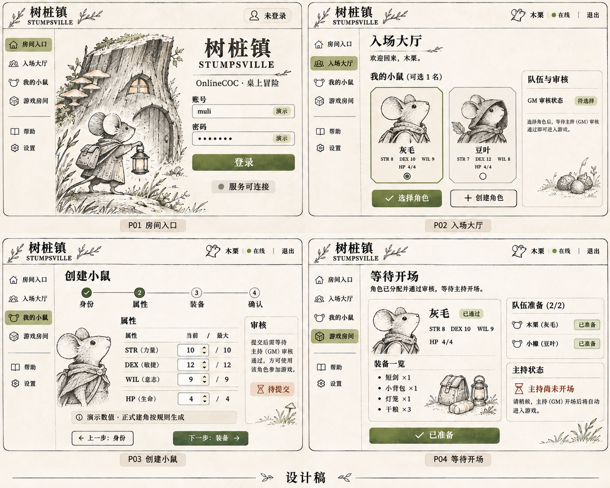
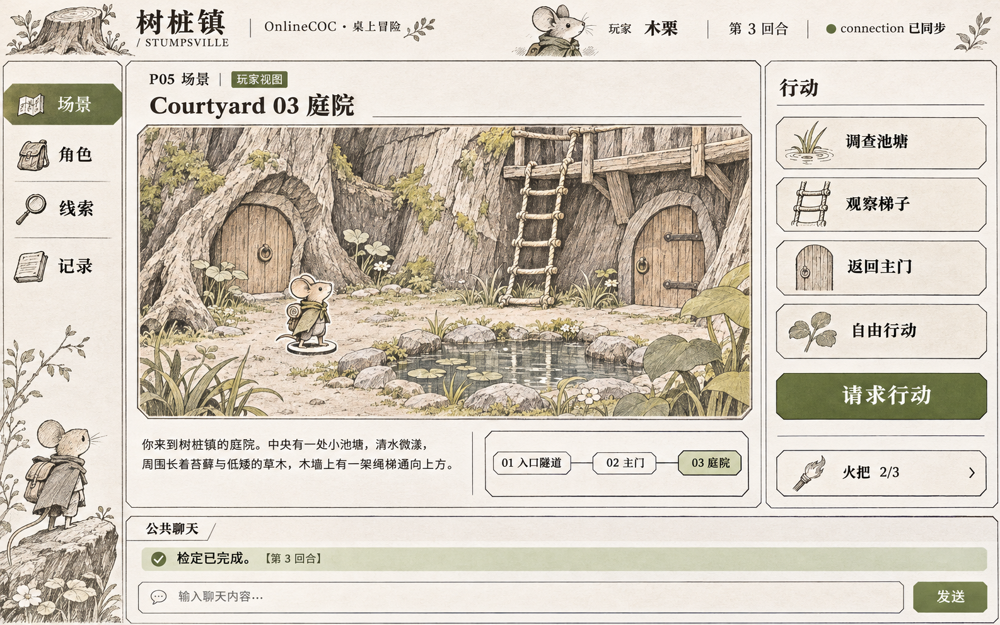
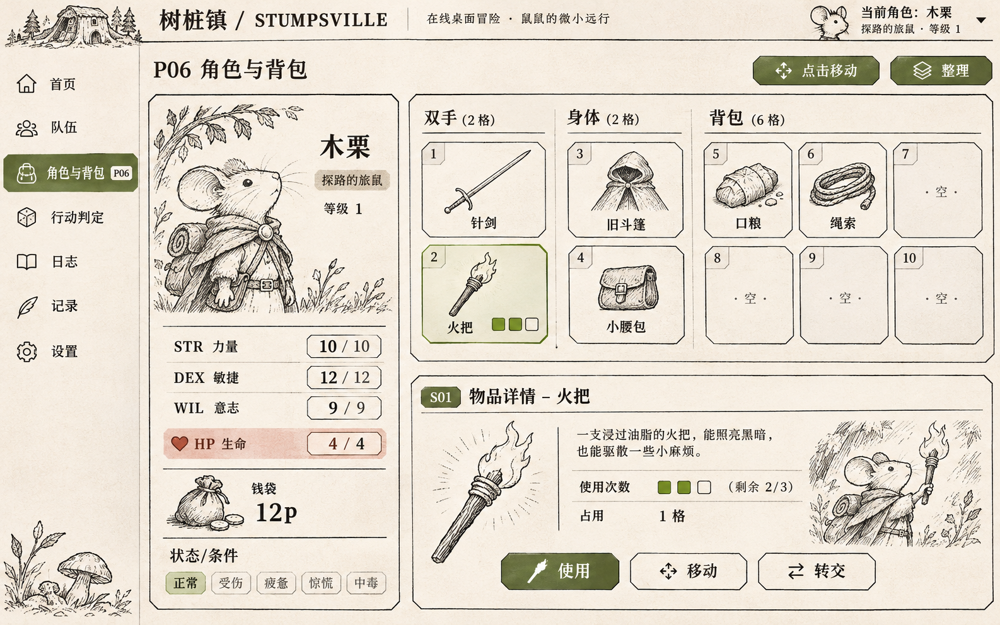
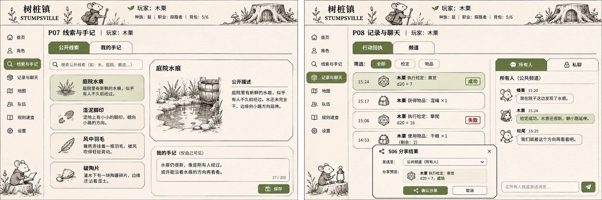
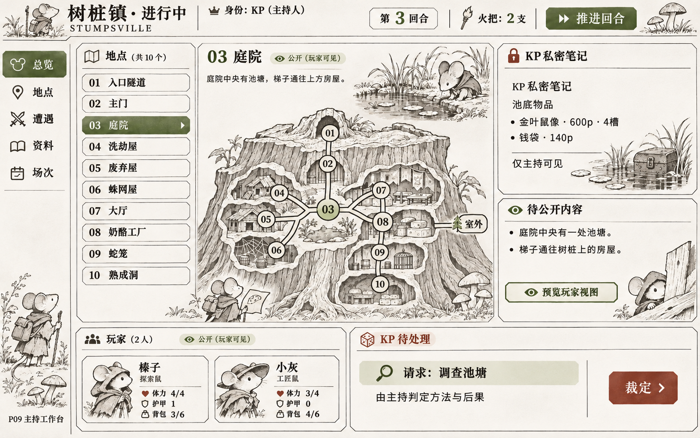
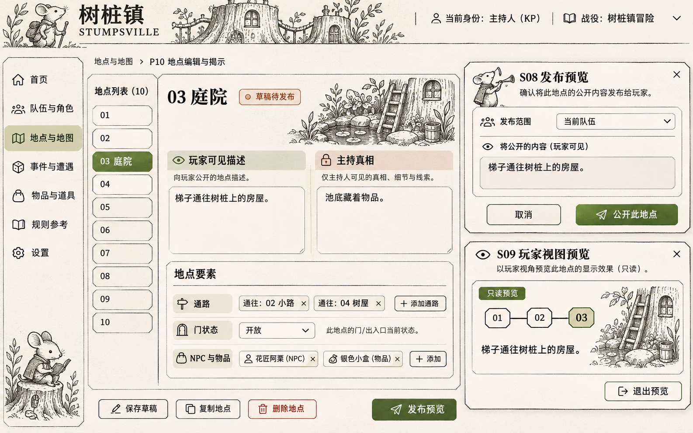
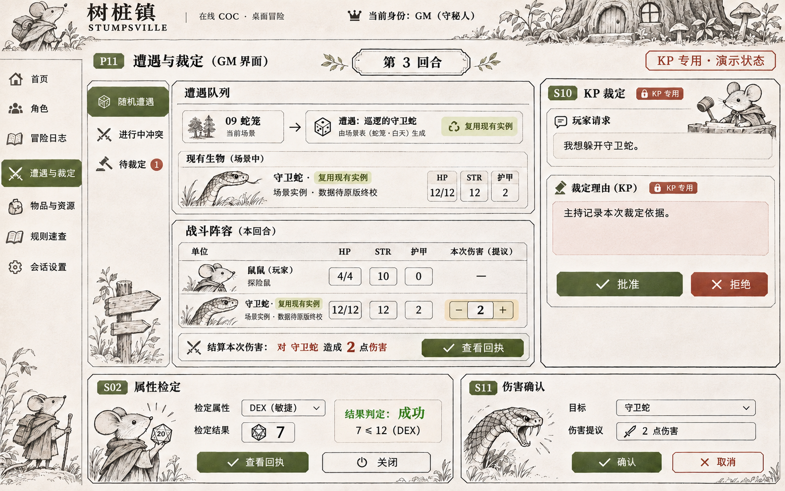
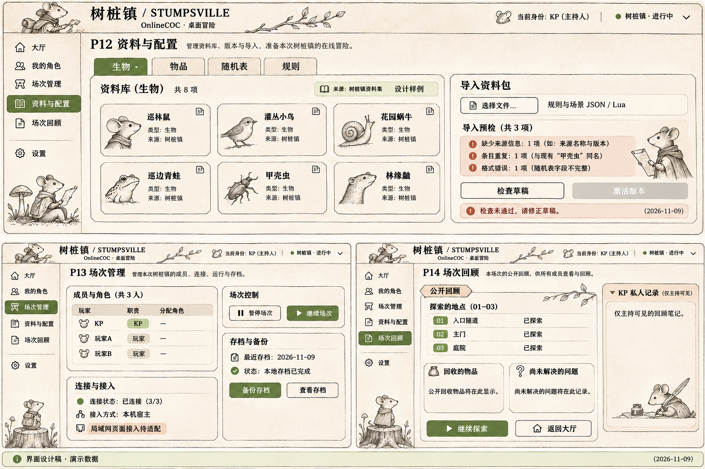
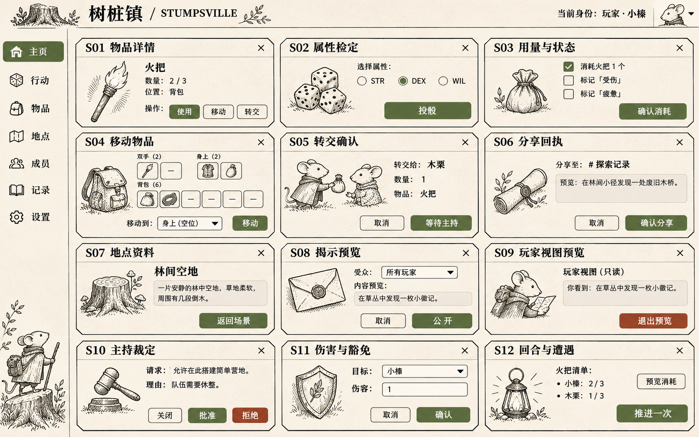
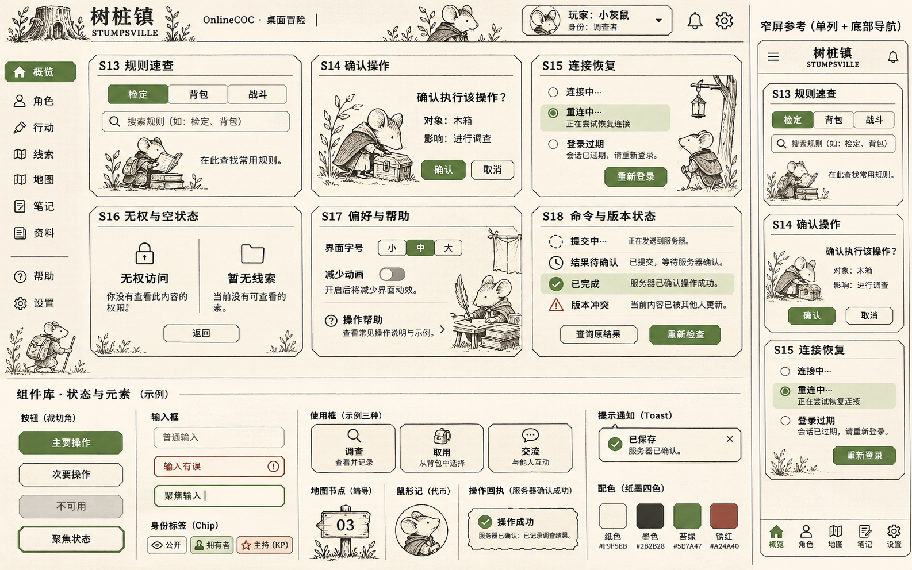

# 树桩镇界面图集

十张图覆盖 14 个页面与 18 类子 UI。采用内置 image_gen 生成并人工目视核查。当前页面、导航、组成树和权限以[场景桌面与主持控制台](../../docs/current/interface.md)为准；[原计划](../../docs/plans/interface-design.md)保留尚待完成的设计，完整提示词与修订提示词存于[prompts.json](prompts.json)。

图板属于美术与布局参考，并非运行截图。0.3.0 已将玩家角色/线索/记录合并为场景悬浮面板，主持总览/遭遇/消息合并为统一控制台；图板中的旧多页导航不再照搬。所有图均为 PNG，实际像素尺寸以文件为准。多页面图板用于总览，可直接打开原图放大。首版已把导航、文字、按钮、槽位和地图节点实现为可交互组件，实际实现见[当前说明](../../docs/current/implementation.md)，运行插画见[资源索引](../runtime/README.md)。

| 图板 | 覆盖 | 用途 |
| --- | --- | --- |
| [01 入场流程](01-entry.png) | P01–P04 | 登录、大厅、建角、准备 |
| [02 玩家场景](02-player-scene.png) | P05 | 庭院、已知地图、行动 |
| [03 角色与背包](03-character-inventory.png) | P06、S01 | 三属性、2/2/6 槽、物品详情 |
| [04 线索与记录](04-journals-records.png) | P07–P08、S06 | 公开线索、手记、回执和聊天 |
| [05 主持工作台](05-gm-workbench.png) | P09 | 完整地图、私密笔记、队伍与待办 |
| [06 地点与揭示](06-location-reveal.png) | P10、S08–S09 | 草稿、发布预览、玩家预览 |
| [07 遭遇与裁定](07-encounters.png) | P11、S02/S10/S11 | 遭遇实例、人工裁定、伤害确认 |
| [08 资料与场次](08-management.png) | P12–P14 | 配置、成员、备份、公开回顾 |
| [09 游戏子 UI](09-subui.png) | S01–S12 | 十二种弹窗与抽屉 |
| [10 系统状态与组件](10-system-states.png) | S13–S18 | 恢复、无权、冲突、帮助与组件 |

## 01 入场流程

## 02 玩家场景

## 03 角色与背包

## 04 线索与记录

## 05 主持工作台

## 06 地点与揭示

## 07 遭遇与裁定

## 08 资料与场次

## 09 游戏子 UI

## 10 系统状态与组件

## 图稿核查与实施差异

- 已核查 P05 仅展示 01–03 的已知地图，P06 保留双手 2 格、身体 2 格、背包 6 格。P09 有主持私密区，P10 公开预览未复制私密文本。
- 已修订建角图中的错误固定上限提示、庭院宝藏示例、检定结果 7≤12 的显示，以及资料检查失败时的激活按钮状态。
- 各图的侧栏名称存在生成差异。实施统一为 PL 的“场景／角色／线索／记录”和 KP 的“总览／地点／遭遇／资料／场次”。
- 人名、装饰性条目、示例线索、部分小字和地点编辑示例为视觉占位。06 的示例 NPC、09 的林间场景和 08 的资料库生物不会自动进入正式场景。
- 09 的 S01“数量 2/3”应在实现中写为“剩余用量 2/3”，S03 的消耗动作要区分用量与整件数量。S06 正式分享读取主机回执，图中文字用于表现预览布局。
- 图板同时排列多个弹窗便于核对，运行时每次只呈现当前任务需要的弹窗。图中的身份和示例状态也不表示组件对所有角色开放。
- 图稿中的完整地图仅供 KP 布局参考，通路与门的机器数据以设计计划的 Mermaid 拓扑为准。
- 本轮完成的是图稿与静态设计核查。真实界面、键盘操作、响应式、权限、回执恢复和 LAN 接入均按计划另行验收。

返回[配置包入口](../../README.md)。

