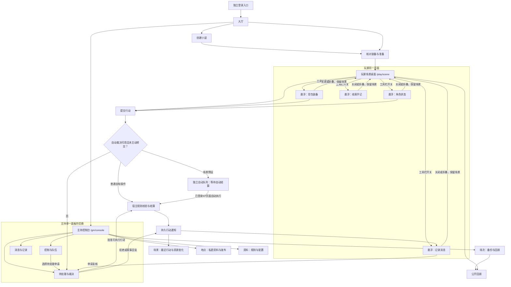

# 场景桌面与主持控制台

- 文档类型：当前
- 文档子类：设计
- 状态：有效
- 创建日期：2026-11-10
- 最后更新：2026-11-10
- 关联文档：[实现](implementation.md)、[使用](usage.md)、[原始设计计划](../plans/interface-design.md)、[验收](../../tests/README.md)

## 导航

0.3.0 将探索阶段的玩家场景、角色、背包、线索、记录合并在同一桌面。主持的现场控制、消息与裁决合并到一个控制台。沿用原有纸色、墨线、苔绿及运行插画；原图集继续作为美术参考，其独立页面布局不再代表当前导航。



旧的 `/play/character`、`/play/journal`、`/play/records` 地址回到场景并打开对应面板；`/gm/overview` 与 `/gm/encounters` 回到控制台的控制或裁决分区。KP 的旧聊天地址进入控制台消息分区。登录槽位和权限规则不变。

## 玩家界面组成

```text
场景桌面
├─ 场景基底
│  ├─ 当前地点、公开描述与已有插画
│  ├─ 已知地图、通路和移动
│  ├─ 18个场景预设与做法、自由行动、属性检定、请求 KP
│  ├─ 现场变化：已发现事实、剩余库存与自动执行端状态
│  └─ 最近行动：状态、骰点、结果、资源前后变化、主持回复
├─ 底部面板工具栏
│  ├─ 打开／置顶／关闭各面板
│  ├─ 记录与频道未读计数
│  └─ 收起全部
├─ 角色状态悬浮面板
│  └─ 三属性、HP、护甲、钱币、等级／XP／Grit、失能、光源
├─ 背包装备悬浮面板
│  ├─ 双手2格、身体2格、背包6格、超载区
│  └─ 详情、使用、点亮／熄灭、移动槽位、申请转交
├─ 线索手记悬浮面板
│  └─ 公开线索检索、来源地点、本人手记
└─ 记录消息悬浮面板
   ├─ 持久行动过程：提交→等待自动执行端／等待主持→检定与叙述→结算／拒绝／回复
   ├─ 骰点与判定、变化列表、申请复核
   ├─ 原始回执及文字摘要分享
   └─ 频道选择、未读、历史、发送、私聊、编辑／撤回
```

面板可分别关闭和折叠；工具栏可将被遮挡的面板置顶。打开、折叠及置顶偏好按登录入口与账号保存，刷新后恢复。窄屏面板采用接近全宽的浮层。尚未提供拖动面板或拖拽物品。

未保存的手记、消息、裁决表单不会因轮询被清空。当前表单未保存时，切换面板会提示先保存；导航离开需确认放弃。场景的最近行动区域继续接收结果，停止编辑后补绘其他状态。

## 主持界面组成

```text
主持统一控制台
├─ 常驻控制条
│  └─ 回合、开场／继续、推进回合、暂停／恢复、自动裁决开关／升级
├─ 控制与队伍
│  ├─ 角色资源、数值调整、授予物品、休息
│  ├─ 生物、伤害、士气、遭遇／反应／战利品骰
│  ├─ 完整地点图
│  └─ 待处理申请、建角审核
├─ 待处理与裁决
│  ├─ 队列：申请人、时间、行动类型、意图
│  ├─ 上下文：所在地点、角色当前资源、行动参数
│  ├─ 决定：批准／拒绝、给玩家的解释
│  └─ 近期人工裁决与自动行动记录
└─ 消息与记录
   ├─ 各可见频道未读数、消息收发、私聊与频道管理
   └─ 持久行动通知及已读标记
```

消息已读使用宿主提供的频道游标；行动记录已读只是本页的界面偏好。主持仍只能看到自己有权访问的聊天频道。

## 反馈语义与边界

提交中的状态是本页即时反馈；收到服务端结果后才显示结算完成。等待 KP 的申请不提前投骰或扣减资源。批准预设、检定、物品、移动和转交后显示实际宿主结果；自由行动及事件复核只记录回复，需要数值效果时由主持另行结算，不把“批准”误写成资源已变更。

场景预设的独立自动队列不计入KP人工待办。KP页面在线时自动执行固定做法，离线显示等待自动结算；玩家原提交卡完成后更新为真实结果。判定和叙述、机关／库存变化与本人资源变化分开显示，具体导航与行动树见[预设行动](scene-actions.md)。

每个账号的事件由包侧存档持久保存，最多保留最近200项。KP 能查看行动通知，PL 仅收到本人的事件、本人资源变化及公开的场次进度。转交双方分别收到自己的库存变化。重试同一行动不会重复投骰或重复增加通知。

升级前的回执继续保留，但没有可供重建的历史资源快照；前后变化仅对升级后通过本包提交的行动生成。直接绕过包侧操作宿主公共 API 不会生成包侧事件。网络结果不明时保留原行动恢复入口，不将超时当作已成功或已回滚。
