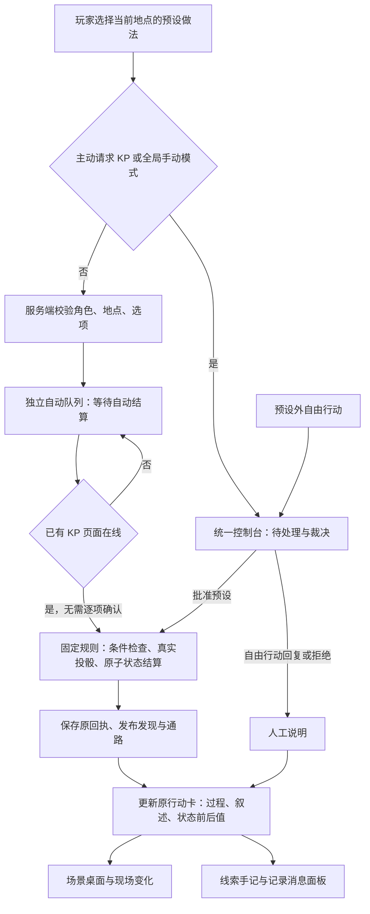

# 场景预设行动与自动结算

- 文档类型：当前
- 文档子类：工程
- 状态：有效
- 创建日期：2026-11-10
- 最后更新：2026-11-10
- 关联文档：[实现](implementation.md)、[使用](usage.md)、[界面](interface.md)、[来源边界](sources.md)、[验收](../../tests/README.md)

## 自动执行范围

十个地点的18个预设按钮均有固定做法、条件、叙述和实际状态效果。安全观察不强行检定；有风险的做法展示真实宿主骰点、采用值、属性阈值、成功或失败。资源、机关、门、发现和有限库存随结果实际更新。选项由 [scene-actions.json](../../config/scene-actions.json) 定义，事务由 [scene.lua](../../rules/scene.lua) 执行。

默认自动裁决下，预设行动进入独立自动队列，**不进入 KP 人工待办**。服务端校验角色归属、所在地点和固定做法；已登录的 KP 页面每2.5秒尝试执行队列，无需逐项确认。所有写入使用现有宿主权限，没有新增自动化账号或保存 KP 密码。至少一个 KP 页面需要保持登录在线；关闭、休眠或浏览器节流会延迟执行，玩家看见“等待自动结算”。重新打开原 KP 账号页面会继续处理。

玩家主动选择人工裁决、自由描述超出预设的行动，才进入人工队列。KP 明确关闭全局自动裁决时，新预设也按该设置转为人工申请；重新开启不会擅自批准旧人工申请。建角审批、场次开场与非预设管理功能仍沿用现有权限。



## 全部预设与结果

下表的固定做法属于本包自动游玩适配，**不是已核验的原版完整裁定**。机关伤害、地点基础资料沿用既有计划；潜水、交涉、救援、人物许可与蛇笛分支是明确的本包规则。除注明外不消耗探索轮。

| 地点／按钮 | 做法与检定 | 实际结果及失败后果 |
| --- | --- | --- |
| 01 观察地面 | 无骰观察 | 识别落石连接，保存个人线索，揭示02 |
| 01 检查奶酪 | 检查无骰；已识别后解除连接为DEX；直接拿取承担机关伤害 | 成功解除并领取唯一奶酪；解除失败受d12伤害，机关耗尽、奶酪留下；直接拿取在承受d12后仍能行动才领物；取用尝试1轮 |
| 02 检查把手 | 无骰检查 | 识别倾倒石板及绳索固定位置，保存线索 |
| 02 尝试开门 | 已检查且有绳索：耗1格用量；直接开门：DEX与d20伤害 | 绳索安全解除；直接开门成功豁免使伤害向下减半，再减甲；开放02–03并揭示庭院，1轮；已开门不重复收费 |
| 03 调查池塘 | 观察无骰；发现后打捞钱袋／鼠像为DEX | 成功领取唯一140p或四格鼠像；失败d4磕碰伤害且宝物保留；打捞1轮 |
| 03 观察梯子 | 无骰辨路 | 揭示04–08五处相邻地点 |
| 04 搜查器具 | 首次d6库存；领取一件 | 首次整理1轮，生成后不重掷；铜锅盘有限领取并入包 |
| 05 观察旧画 | 无骰阅读 | 保存节庆画与池底鼠像的个人线索 |
| 06 查看蛛网 | 无骰观察 | 发现两只蜘蛛与两名被困村民，保存线索 |
| 06 呼唤屋内 | 低声联系无骰；使用可用针剑救援为DEX | 联系得到回应；救援成功设置村民脱困并撤到庭院的场景事实；失败d6毒咬，HP溢出扣DEX并令蜘蛛警觉；救援1轮。未凭空创建未核数值的村民实体 |
| 07 观察厅堂 | 首次2d6鼠帮人数 | 人数固定，展示蛇笛与锁门线索，重复不重掷 |
| 07 交涉 | 首次口头WIL；或付1格口粮 | 成功／供粮取得通行许可，开放07–08并领取唯一蛇笛；口头失败令鼠帮戒备，可改用口粮，不重复刷口头骰；新交涉1轮 |
| 08 检查设备 | 无骰询问Jack；领搅拌桨／滤布 | 取得工具许可和线索，按有限库存入包；搅拌桨按两格占用安置 |
| 08 寻找出口 | 无骰辨路；拉本侧门闩；乘升降机 | 辨路揭示03、07、09并记录屋顶货口；首次开08–09门或移动本人回03各1轮；屋顶外部不在当前十地点范围 |
| 09 观察铁门 | 无骰检查；安抚后开门 | 识别守卫；蛇平静时开放09–10、揭示洞窟；不满足条件显示阻止原因 |
| 09 聆听 | 无骰聆听；持笛安抚；潜行绕过为DEX | 蛇笛使唯一守卫蛇平静；潜行成功开09–10，失败d8咬击且门保持关闭；安抚／潜行1轮，已开放的潜行不重掷 |
| 10 查看奶酪 | 清点无骰；未获许可时取用为DEX | 获许可后直接领取；潜行失败惊醒Ernie、不减少库存，先交谈才可再取；库存共8轮奶酪，取用1探索轮 |
| 10 观察睡者 | 无骰观察；温和唤醒交谈 | 显示熟睡／醒来状态；首次交谈1轮，取得奶酪许可与北方据点个人线索 |

有消耗的探索轮通过现有 `sv.world` 结算，因此会推进公开回合及已点亮光源的燃烧计数；每六轮消耗一格光源。伤害使用现有减甲→HP→属性→重伤豁免规则。超载及受伤的相关豁免显示劣势两骰。领取先检查普通槽位和超载卡片区；全满时不扣库存、不为领取额外投骰。

## 玩家可见内容

```text
场景预设行动
├─ 做法弹窗：固定选项、条件／风险说明、自动或主动请求KP
├─ 最近行动卡
│  ├─ 已提交／等待自动执行端／已结算／条件不满足
│  ├─ 检定：属性、阈值、原始骰、优势劣势、采用值、判定
│  ├─ 数量骰与伤害骰
│  ├─ 逐条叙述与失败后果
│  └─ 机关／门／库存变化、角色资源前后值与新线索
├─ 现场变化：当前地点已经发现的事实和剩余物资
├─ 已知地图：新地点与通路
└─ 悬浮面板：背包实际物品、个人线索、持久记录、申请复核
```

个人发现只交给该角色所属账号，KP可核查；已揭示地点和通路为全队共享。PL不会得到完整私密场景状态、隐藏地点真相或其他角色快照。观察重复时可再次显示线索，但不重复生成有限物品或随机数量。

## 恢复与边界

自动队列、原命令封套和已提交结果落盘。规则中的投骰、角色效果和场景有限库存同属一次宿主事务；随后的地点公开、门镜像与事件发布使用原命令继续。结算中断后锁住冲突操作，原 KP 账号恢复时查原回执，不重新投骰或发物。自动结果更新玩家原提交卡，避免留下永远“等待中”的旧卡片。不同 KP 账号不能接管已经开始的任务；同一账号的多个页面可以重试同一固定命令。

原始宿主 API 操作仍不生成包侧事件。对已完成行动申请复核只记录回复，修改数值须由 KP 明确操作。法术、完整战斗／追逐、原版未核表项、外部地图不属于这18个预设的自动范围。
