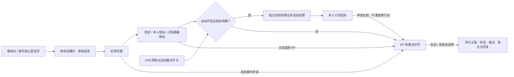
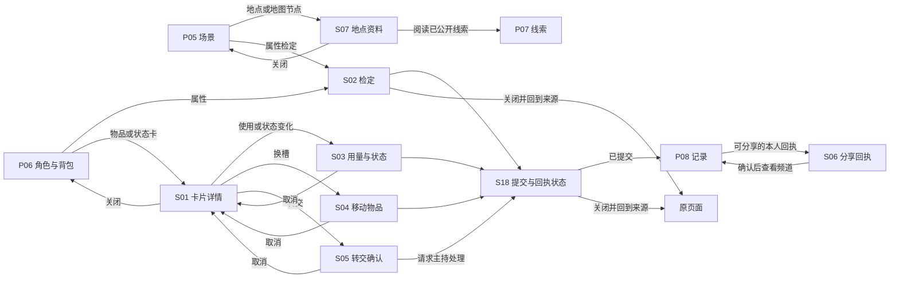
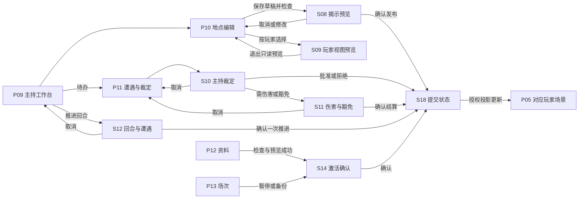
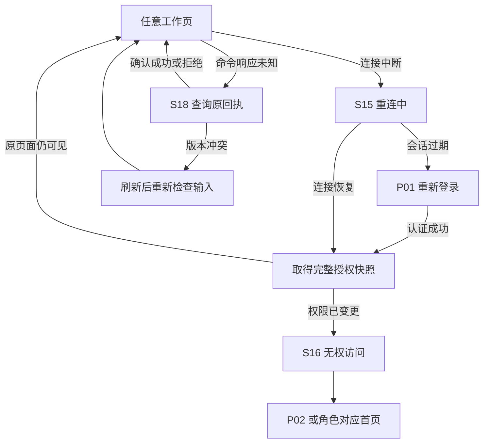
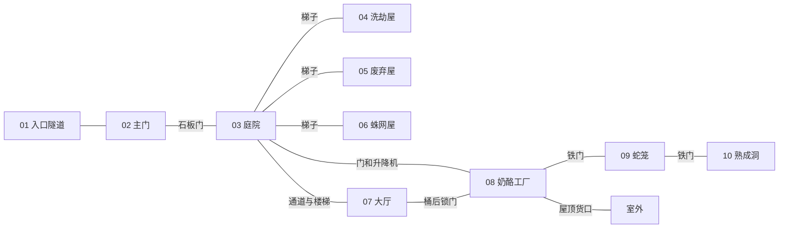

# 树桩镇页面、导航与界面组成

- 文档类型：计划
- 状态：进行中
- 创建日期：2026-11-09
- 最后更新：2026-11-10
- 关联文档：[计划索引](README.md)、[图集](../../assets/ui-design/README.md)、[原版与来源](../../assets/references/README.md)、[场景依据](../../../investigation-vtt-reference/docs/plans/stumpsville-foundry-plan.md)、[宿主能力](../../../../docs/current/engineering/first-test.md)

## 1. 目标、范围与设计假设

本设计服务于 OnlineCOC 新配置包。原 Foundry 计划提供十地点、角色物品对照和原版校对事项。本包采用自己的页面、JSON 数据与 Lua 规则接入现有宿主。

用户已确认按本设计与计划实施。2026-11-09 开始包内施工，完成度以当前实现说明与验收记录为准。

2026-11-10 用户追加要求已落地：自动裁决默认开启，玩家可主动申请KP裁决或关联回执复核；同设备多页面使用独立登录入口。自动范围与仍需主持判断的边界见[当前实现](../current/implementation.md)。18个预设已补齐自动检定、叙述、状态与有限库存结果，具体实现和现有KP页面在线条件见[场景预设行动](../current/scene-actions.md)。以下原有人工主持路径继续用于主动申请、自动关闭和未覆盖事件。

页面与子 UI 清单、组成树和十张视觉设计板已完成。2026-11-10 依据用户反馈，将玩家四页合并为场景桌面和悬浮面板，将主持总览、遭遇、消息和裁决整合为统一控制台；原14页方案的编号继续用于功能与图板对应，不再代表14个独立页面。当前导航 Mermaid 与功能树统一维护在[场景桌面与主持控制台](../current/interface.md)。实际行为和已验证范围见[当前实现](../current/implementation.md)及[验收](../../tests/README.md)，本文保留完整目标设计，不能将所有细节视为现有能力。首版探索范围止于树桩镇十地点和北方据点线索。

2026-11-09 实施记录：已接通真实宿主的登录、建角审批、准备、检定、库存、位置/门、揭示、裁定、回合/光源、聊天、配置修订与配对备份。S06 采用原回执派生的文字摘要，S09 为明确标记的包侧预览；法术、成长和冒险专属表内容由主持处理。尚待原版终校、完整背景表分配、拖拽/浏览器返回滚动细节和更完整的系统状态覆盖层，因此计划保持进行中。

设计默认中文桌面网页、一个 KP 与两名测试 PL、原创节点地图。账号身份由宿主认证。准备阶段允许选择预设或提交角色草稿，由 KP 确认归属。纸张与墨线来自原版观察，苔绿操作色、锈红警示色为本包设计选择。

图稿包含示例角色、示例物品和短文案。页面 ID 用于追溯图板；当前导航和已实现行为以[当前界面设计](../current/interface.md)为准，本文其余尚未实现的细节继续作为计划。地点内容以场景对照表及原版最终校对为依据。图稿不可作为物品数值表或规则来源。

## 2. 页面总清单

P 为沿用的功能/图板编号，合并后的 P06–P08 和 P11 已是主页面内的面板。S 表示弹窗、抽屉或系统状态。KP 可以只读预览玩家页面，授权身份始终保持 KP。

| ID | 页面与拟定路由 | 使用者 | 进入与返回 | 核心功能和完成条件 | 图板 |
| --- | --- | --- | --- | --- | --- |
| P01 | 房间入口 `#/entry` | 所有人 | 启动、退出、登录过期 → P02 | 服务状态、账号密码、登录错误。全新包可显示独立的首次准备状态，建立宿主成功后再登录 | 01 |
| P02 | 入场大厅 `#/lobby` | KP、PL | P01 → P03/P04/P09 | 房间摘要、本人角色、预设认领、审核状态。KP 进入主持台。角色归属确认后允许准备 | 01 |
| P03 | 创建小鼠 `#/character/new` | PL 草稿、KP 审核 | P02 → P04，取消回 P02 | 身份、属性、装备、确认四步。预设和按规则生成两种来源，提交草稿后等待 KP 创建或绑定实例 | 01 |
| P04 | 等待开场 `#/ready` | PL | P02/P03 → P05 | 本人角色、装备核对、准备状态、主持开场状态。允许返回大厅修改未锁定草稿 | 01 |
| P05 | 场景桌面 `#/play/scene` | PL | 准备页进入，工具栏切换悬浮面板 | 场景基底、公开地图、移动和行动；最近行动、骰点及资源变化；P06–P08 不离开场景 | 02 |
| P06 | 角色状态与背包装备悬浮面板 | PL 本人 | 场景工具栏打开；旧 `/play/character` 兼容 | 属性、HP、钱币与库存；折叠/关闭/置顶；详情、使用、换槽、转交 | 03 |
| P07 | 线索手记悬浮面板 | PL 本人 | 场景工具栏打开；旧 `/play/journal` 兼容 | 已公开线索检索、来源地点、私人手记 | 04 |
| P08 | 记录消息悬浮面板 | PL 本人 | 场景工具栏打开；旧 `/play/records` 兼容 | 过程、结果、变化、回复、未读、聊天与复核；KP 使用控制台消息分区 | 04 |
| P09 | 主持控制台 `#/gm/console` | KP | 大厅、主导航；旧总览地址兼容 | 同一面板整合控制与队伍、待处理与裁决、消息与记录；角色审核、回合、自动裁决、遭遇与资源管理 | 05 |
| P10 | 地点与揭示 `#/gm/locations/:id` | KP | P09/P12 → 原页面 | 十地点索引、公开描述/主持真相、通路门状态、NPC与库存、草稿与发布差异、玩家预览 | 06 |
| P11 | 主持控制台的裁决分区 | KP | 控制台页签；旧 `/gm/encounters` 兼容 | 待处理队列、上下文、批准/拒绝及理由、给玩家的结果通知；遭遇工具位于控制分区 | 07 |
| P12 | 资料与配置 `#/gm/library` | KP | 主持导航、详情编辑 → 原页面 | 生物、物品、状态、法术、随机表、规则资料。来源、配置修订、导入检查、预览、激活/回退 | 08 |
| P13 | 场次与存档 `#/gm/session` | KP | 主持导航 → P09/P14 | 配对备份、回顾与私密备注；现场控制与自动裁决移至 P09 | 08 |
| P14 | 场次回顾 `#/recap` | KP、PL 授权版本 | P13 发布、全局场次入口 → P02/上次工作页 | 已公开地点、回收物品、待办、经验核算草稿和下次开场摘要。KP 私密备注独立保存 | 08 |

P03 的属性输入代表创建草稿或主持确认，玩家实际角色的受保护数值通过规则或 KP 管理修改。图中的固定 HP、属性和装备均为演示数据。

P14 的“继续探索”仅在房间 active 且主持允许时可用，暂停时等待主持恢复，归档时只读。场次回顾可以先保存草稿，再按受众公开。

## 3. 页面导航

### 自动裁决与多页面登录补充



```text
自动裁决与登录
├─ 主持控制台：默认开启／关闭／旧存档升级
├─ 玩家行动：自动结算／主动请求KP／原行动幂等恢复
├─ 我的裁决申请：等待／已批准／已拒绝／原因／结算结果
├─ 回执复核：绑定本人回执／说明诉求／不重复执行
└─ 独立登录页：新建会话槽位／本页刷新保持／退出不影响其他槽位
```

### 3.1 当前完整导航

当前 Mermaid 和组成树见[场景桌面与主持控制台](../current/interface.md)，只维护一份现行导航。玩家主导航只有场景桌面，角色、背包、线索、记录在场景内开关；主持导航为控制台、地点、资料、场次。下列子 UI 图中的 P06–P08 指场景悬浮面板，P11 指控制台裁决分区。

浏览器返回的滚动细节仍属后续计划；当前面板开关/折叠/置顶偏好已保存，未保存表单的导航离开需确认放弃。

### 3.2 玩家行动与子 UI 导航



关闭弹窗恢复来源控件焦点。提交中的弹窗允许收起，但待处理状态继续显示。关闭窗口不等于取消已发送命令。结果不明时查询原命令，禁止自动换 ID 重复掷骰、领取、耗损或推进回合。

### 3.3 主持揭示与裁定导航



S09 必须取得所选玩家的授权数据，不能只在完整 KP 页面上遮挡秘密。初版若尚无可靠的玩家投影接口，使用真实 PL 隔离登录进行核验，并将页面内预览明确标为待接入。

### 3.4 恢复与错误导航



## 4. 页面功能组成树

每个页面使用同一外壳。首版以 1440×900 桌面为排版基线，主内容区域可滚动。

```text
全局外壳
├─ 顶栏
│  ├─ 树桩镇名称、当前场次、登录身份
│  ├─ 连接状态、未决命令数、回合摘要
│  └─ 聊天、规则速查、偏好、退出
├─ 角色对应主导航
├─ 页面内容区
├─ 上下文抽屉／模态弹窗
└─ 状态通知与焦点恢复
```

### 入场页面

```text
P01 房间入口
├─ 树桩与小鼠迎宾插图
├─ 服务可达性与配置包版本
├─ 账号／密码／显示密码／登录
├─ 首次准备变体
│  ├─ 独立数据目录与初始化说明
│  └─ 初始凭据设置、进度与失败重试
└─ 登录失败／服务不可用／会话过期提示

P02 入场大厅
├─ 当前房间与冒险范围
├─ 本人可用角色／可认领预设
├─ 认领申请／新建草稿／审核结果
├─ KP 入口与待审核摘要
└─ 返回入口／退出账号

P03 创建小鼠
├─ 身份步骤
│  └─ 名称、外观、背景、出生征兆与原版资料来源
├─ 属性步骤
│  └─ STR／DEX／WIL 当前与最大值、HP、生成来源
├─ 装备步骤
│  └─ 初始物品、钱币、2／2／6 槽、容量检查
└─ 确认步骤
   └─ 完整预览、草稿保存、提交审核、驳回原因

P04 等待开场
├─ 已分配角色与所有者
├─ 属性／装备／状态核对摘要
├─ 自己的准备切换
├─ 其他成员的公开准备状态
└─ 开场等待／返回大厅
```

### 玩家页面

```text
P05 场景探索
├─ 当前地点
│  ├─ 编号、公开名称与描述
│  ├─ 玩家版场景插图
│  └─ 本人 Token、已公开的可交互对象
├─ 已知地图
│  ├─ 已揭示节点与通路
│  └─ 当前地点定位／缩放／文字列表替代
├─ 行动区
│  ├─ 移动、观察、交互、请求检定
│  ├─ 自由行动文字请求
│  └─ 休息／法术等特殊行动转主持裁定
├─ 本人资源与火把摘要
└─ 公开叙事、聊天入口与最近回执

P06 角色与背包
├─ 角色身份与头像
├─ STR／DEX／WIL 当前／最大值、HP、护甲
├─ 钱币、等级、XP、Grit
├─ 物品格
│  ├─ 双手 2 格
│  ├─ 身体 2 格
│  └─ 背包 6 格
├─ 卡片
│  ├─ 物品／武器／法术／状态
│  ├─ 数量、占槽、用量、破损或消耗状态
│  └─ 详情、移动、使用、转交
└─ 临时状态、超载原因与规则入口

P07 线索与手记
├─ 已公开线索
│  ├─ 检索、来源地点、发布时间
│  └─ 正文、已公开图片和关联地点
├─ 我的手记
│  ├─ 标题、正文、保存状态
│  └─ 公开前预览
└─ 空列表、搜索无结果、内容撤权状态

P08 记录与聊天
├─ 行动回执
│  ├─ 本人结果、骰点、时间与处理状态
│  ├─ 检定／物品／移动筛选
│  └─ 可分享结果入口
├─ 频道
│  ├─ 公共／分组／私聊
│  ├─ 历史分页、未读、回复引用
│  └─ 发送、编辑本人文字、撤回
└─ 迟到响应隔离、频道撤权清缓存
```

### 主持页面

```text
P09 主持工作台
├─ 完整十地点图与地点索引
├─ 当前地点摘要
│  ├─ 公开内容
│  └─ KP 私密信息
├─ 队伍
│  └─ 归属、位置、HP、物品用量与准备状态
├─ 待处理行动／异常流程
├─ 回合、火把与遭遇提醒
└─ 地点编辑／裁定／玩家预览入口

P10 地点与揭示
├─ 01—10 地点索引与当前选择
├─ 公开描述和素材
├─ KP 真相、机关、隐藏库存
├─ 通路
│  ├─ 目标地点、类型、已知状态
│  └─ 门／锁／升降机／屋顶货口的主持状态
├─ NPC与物品
│  ├─ 实例绑定、数量、所在地点
│  └─ 首次生成标记、唯一实例复用
└─ 保存草稿／差异／发布预览／按玩家预览

P11 遭遇与裁定
├─ 请求队列
│  └─ 发起人、角色、地点、意图、状态
├─ 随机遭遇
│  └─ 表来源、骰点、结果、NPC 实例复用
├─ 当前冲突
│  ├─ 参与者、先后手与主持备注
│  ├─ HP／STR／护甲、伤害与豁免
│  └─ 反应／士气／逃跑／结束冲突
├─ 特殊裁定
│  └─ 蛇笛、升降机、屋顶出口、休息、法术
└─ 批准／拒绝／取消／处理结果及未完成步骤

P12 资料与配置
├─ 生物／物品／法术／状态资料
├─ 遭遇与战利品表
├─ 规则说明、来源与许可
├─ 配置／规则修订
│  ├─ 导入文件组、检查错误
│  ├─ 与当前版本差异、隔离预览
│  └─ 激活与回退确认
└─ 被场景引用的条目与跳转

P13 场次管理
├─ 房间状态与当前版本
├─ 成员／角色归属／建角审核
├─ 暂停与恢复
├─ 备份创建及结果
├─ 账号维护说明与本机工具入口指引
├─ 连接状态与配置包网页接入说明
└─ 回顾编辑与发布入口

P14 场次回顾
├─ 对当前身份公开的探索摘要
├─ 公开回收物与未决事项
├─ 经验核算草稿与主持确认
├─ KP 私密备注区
└─ 继续探索／返回大厅／主持工作台
```

## 5. 子 UI 与组件

| ID | 子 UI | 来源与返回 | 元素组成与交互约束 |
| --- | --- | --- | --- |
| S01 | 卡片详情抽屉 | P06、P10、P12，关闭回来源 | 名称 → 类型/来源 → 插图 → 数量/槽位/用量 → 使用/移动/转交。法术显示使用与充能说明，状态卡显示解除条件 |
| S02 | 属性检定弹窗 | P05/P06/P11 | 角色 → 属性与当前目标 → 主持要求 → 投骰确认 → 主机骰点与结果。结果态提供回执和关闭 |
| S03 | 用量与状态确认 | S01/P11 | 目标卡 → 当前值 → 拟变化 → 原因 → 确认。用量与物品数量是不同字段，状态卡单独选择 |
| S04 | 移动物品 | S01 | 当前槽 → 十槽选择 → 多格占用预览 → 不可放置原因 → 确认/取消。提供点击操作和键盘操作 |
| S05 | 转交请求 | S01 | 物品 → 数量 → 接收者 → 主持处理状态。首版由 KP 完成授权转交，多步骤失败显示进度 |
| S06 | 分享回执 | P08 | 本人可分享回执 → 受众频道 → 内容预览 → 确认/取消。自由叙事另走普通消息 |
| S07 | 地点资料抽屉 | P05/P07 | 可见地点标题 → 描述 → 公开线索 → 可见出口 → 回到场景。KP 从 P10 看完整编辑内容 |
| S08 | 揭示预览 | P10 | 待公开字段 → 实际受众 → 发布差异 → 确认。首版公开资料面向房间成员，定向资料另用授权频道 |
| S09 | 玩家视图预览 | P09/P10 | 玩家身份 → 只读标识 → 该玩家投影 → 退出。全屏预览与编辑态视觉分开 |
| S10 | 主持裁定 | P09/P11 | 原请求 → 当前状态 → 方法/理由 → 批准/拒绝 → 回执。批准不会自动给发起者 KP 权限 |
| S11 | 伤害与豁免 | P11 | 目标 → 骰点/伤害来源 → 护甲及 HP/属性变化 → 必要豁免 → 确认。公式按本包规则 |
| S12 | 回合与遭遇 | P09/P11 | 当前回合 → 拟推进 → 光源变化 → 遭遇检查 → 确认一次。重复点击复用同一命令 |
| S13 | 规则速查 | 全局 | 搜索 → 检定/背包/战斗/探索/休息/法术 → 来源与版本 → 返回 |
| S14 | 通用确认 | 离开草稿、P12/P13 | 操作对象 → 将发生的变化 → 风险/未保存内容 → 确认/取消。默认焦点在取消 |
| S15 | 连接恢复 | 全局覆盖层 | 连接中/断线/重连/登录过期 → 最近同步时间 → 状态说明 → 重试或登录 |
| S16 | 无权与空状态 | 各页面内容区 | 无权、对象消失、空列表、搜索无结果分开说明 → 合法返回动作。无权页不显示隐藏对象名称 |
| S17 | 偏好与帮助 | 全局 | 字号 → 减少动画 → 按键说明 → 连接帮助 → 来源与署名。偏好仅作用本人 |
| S18 | 命令与版本状态 | 所有写操作 | 待提交/提交中/结果未知/成功/拒绝/冲突 → 查询原结果或重新检查 → 来源页 |

```text
通用子 UI
├─ 标题栏
│  ├─ S 编号、任务名称
│  └─ 返回／关闭
├─ 上下文
│  ├─ 来源页面、对象名称、当前版本
│  └─ 公开／本人／KP 标识
├─ 内容
│  ├─ 只读摘要或可编辑输入
│  ├─ 校验说明
│  └─ 操作前后差异
├─ 操作栏
│  ├─ 单一主要动作
│  └─ 次要动作／取消
└─ 结果状态
   ├─ 提交中与重复提交锁定
   ├─ 成功回执
   └─ 失败、版本冲突或结果待确认
```

图板 09 是不同权限子 UI 的组件集合，实际 PL 页面只加载自己获准使用的组件和数据。图板中 S06 的叙事示例仅说明预览排版，实施时内容来自主机行动回执。S03 应显示“消耗 1 格用量”，用量 2/3 不得标为物品数量。

## 6. 地图与信息披露

玩家版场景图独立制作或按已授权节点绘制。完整剖面图只给 KP。浏览器收到整张含秘密区域的底图后盖雾，会暴露原图内容，因此玩家首次加载只包含当前公开的场景和节点。



以上为主持完整拓扑。玩家庭院示例只揭示 01—03。其余节点的名称、数量、坐标、隐藏 NPC 与库存从服务端投影中排除。KP 的发布草稿与世界真相使用独立数据。公开回顾也逐字段检查受众。

| 数据 | KP | 拥有者 PL | 其他 PL |
| --- | --- | --- | --- |
| 全量场景、秘密通路、隐藏库存 | 可见 | 按公开版本 | 按公开版本 |
| 本人角色与物品 | 管理可见 | 可见与授权操作 | 仅已公开摘要 |
| 私人手记 | 依宿主权限核查 | 本人可见 | 不可见 |
| 私聊 | 仅频道参与者 | 参与时可见 | 参与时可见 |
| 行动回执 | 按宿主权限 | 本人可查 | 通过允许的分享读取 |
| KP 规则资料与导出 | 可见 | 不返回 | 不返回 |

“私人”是应用内受众范围。宿主运行者持有本地存档。手记不得在尚未验证权限的通用配置或静态 JSON 中存放。

## 7. 原版美术与交付规则

参考观察来源包括官方角色卡的三属性、粗墨线框、剪角纸卡、2/2/6 格，以及官方树桩镇预览的铅笔排线、木纹、架屋、池塘和地下层次。原图来源及研究文件见[参考说明](../../assets/references/README.md)。

| 元素 | 拟定规格 |
| --- | --- |
| 色彩 | 纸白 #F9F5EB、墨黑 #2B2B28、苔绿 #5E7A47、锈红 #A24A40 |
| 字体 | 中文标题使用宋体/衬线，正文采用易读黑体；英文字标可用衬线。实际字体授权在实现时核对 |
| 排版 | 8px 基础间距，桌面左导航约 176px、上下文栏约 320px；内容不足时先折叠上下文栏 |
| 卡片 | 1–2px 墨线、轻微剪角、清楚的焦点边框；纸张纹理限背景 |
| 文字 | 正文建议 16px 起，辅助字 14px 起；图稿中压缩文字不作为实际字号 |
| 操作 | 图标同时附文字，主要动作苔绿，危险操作锈红且配文字说明 |
| 背包 | 精确十槽，多格物品显示跨度；拖拽另有点击移动和键盘路径 |
| 地图 | 节点与通路按数据渲染，玩家图按权限生成；美术图中的连线不作为坐标数据 |
| 响应式 | 1024px 以下上下文改抽屉，768px 以下单列及角色对应底部导航；窄屏需后续实际验证 |
| 可访问性 | 焦点可见、弹窗焦点约束、Esc 关闭、色彩附文字、插图替代文字、减少动画；实现阶段验证对比度 |

十张 PNG 为页面与组件的视觉参考，图片里的文字、按钮、地图节点在实现时拆成真实 DOM、样式和授权数据。研究原图、设计板和未来运行素材分目录维护。

## 8. 与工程能力的对应

| 界面需求 | 可利用的现有入口 | 包侧待实现与限制 |
| --- | --- | --- |
| 登录与身份 | login、me、完整授权 view | 包级登录页、首次准备、会话恢复 |
| 建角与分配 | configuration.put、entity.create/update、relation.set | PL 草稿审核、KP 分配编排、重复提交恢复 |
| 检定与耗损 | Lua rule、主机随机、action.invoke | Mausritter 算法、槽位规则与专属数值校验 |
| 主持等待 | flow.ask/respond/retry/cancel | 自由文本意图可先用授权聊天，结构化队列需包侧设计 |
| 地点揭示 | 实体权限、个人进度、授权查询 | 节点与通路模型、分离公开与私密数据、玩家预览投影 |
| 聊天与回执 | chat.*、receipts | 客户端分页、受众选择、共享资格提示、断线清理 |
| 资料导入 | rule.stage/activate、preview、configuration.put | 包格式校验、差异呈现。激活规则与配置写入是多个操作，需要进度与恢复 |
| 备份 | POST /backup、离线恢复 CLI | 页面显示备份结果。在线恢复不提供可点击执行按钮 |
| 局域网 | 独立 LAN 网关可用 | 配置包页面与包侧接口尚需适配，图稿只展示该状态 |
| 角色间转交 | 管理关系和已有搬移原语 | 槽位与权限需本包检查，KP 首版操作跨 API 时应保留恢复步骤 |

不得把 r.check、r.damage、r.transfer 的 demo 业务算法直接当作 Mausritter 规则。KP 批准不提升玩家权限。公开 action 的分享仍受主机对象可见性限制，私有角色的结果可能不具备分享资格，界面必须显示具体原因。

## 9. 实施顺序与验收

1. 建立 P01–P06、P09–P10，以及 S01–S04、S07–S10、S14–S18。跑通两名测试 PL 从认领角色到 01→02→03 的闭环。
2. 完成 P07–P08、P11–P14 和其余子 UI，补齐 04–10、遭遇、库存、回合、资料管理。
3. 对照原版终校规则和冒险内容，核查所有玩家可见接口与静态资源，记录 KP 与两名 PL 的真实画面。
4. 单独验证配置包网页的 LAN 接入、窄屏操作和长期断线恢复。

| 验收场景 | 通过条件 |
| --- | --- |
| 入场 | 两名 PL 各自控制自己的角色，申请与审核可恢复，重复认领不重复建卡 |
| 01→02→03 | 当前地点、可走通路与回执一致，未揭示地点和秘密文本不进入 PL 响应 |
| 物品栏 | 十槽准确，多格、超载、耗尽、状态占槽和转交均有合法/非法反馈 |
| 骰子与耗损 | 主机计算，重复命令只生效一次，结果未知先查询原回执 |
| 主持发布 | 草稿、公开预览、正式公开分开；预览不携带秘密字段 |
| 遭遇 | 守卫蛇复用同一实例，首次随机库存只生成一次 |
| 异常 | 权限撤回清缓存、重连取完整快照、冲突后重新检查，不丢失未决命令 |
| 资料与存档 | 导入错误禁用激活，旧规则流程保留原修订，备份失败不显示完成 |
| 交互 | 当前独立页面与场景悬浮面板可达，合并前地址兼容；所有子 UI 可关闭，键盘可完成主要动作 |

仍待确认或终校：原版内容使用范围、完整建角资料、分队及定向地点揭示、实际跨设备 LAN 和更完整的移动体验。包名、本人手记权限、场景单页与主持统一控制台已经确定。当前仍按单队、桌面优先处理。

