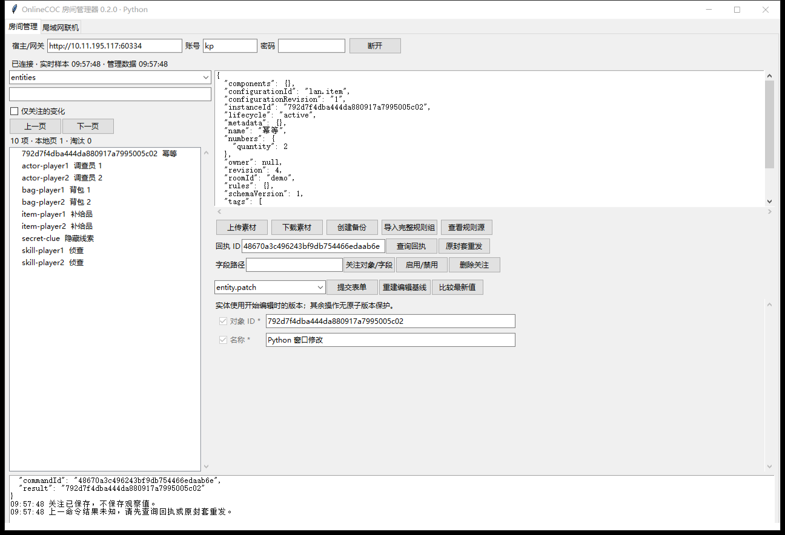
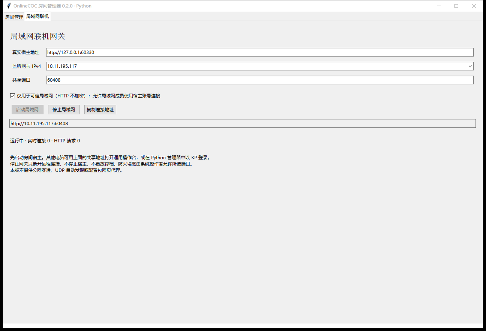

# Python 管理器与局域网验收

- 文档类型：当前
- 文档子类：工程
- 状态：有效
- 创建日期：2026-11-09
- 最后更新：2026-11-09
- 关联文档：[使用说明](usage.md)、[集成结果](../tests/python-results.json)、[独立发布结果](../tests/distribution-results.json)、[发布摘要](../dist/RoomManager/release.json)

## 结果

51 项 Python/真实宿主/LAN/GUI 检查通过，另有 4 项独立发布检查通过，0 失败。集成证据位于 `.test-output/python-20261109-095737/`。测试使用隔离存档与主机发现目录、随机端口，不读取真实玩家凭据，不更改宿主代码或防火墙。

验证环境为 Windows x64、CPython 3.14.2、Tk 8.6，网络依赖版本见锁文件。LAN 测试绑定本机实际 WLAN IPv4 `10.11.195.117`，两会话客户端也运行在本机；尚无第二台物理电脑参与，不能视为跨设备防火墙或公网验收。

| 范围 | 通过内容 |
| --- | --- |
| 协议与观察 | 地址限制、完整分片、缺片拒绝、路径转义、token 过滤、首基线、不再可见、记录上限 |
| LAN 边界 | 通用操作台、Host/Origin、请求体限额、私有 host-control 接口阻断、独立会话与玩家管理拒绝 |
| 业务集成 | 配置、实例创建/更新、关系、引用阻止归档/删配置、进度、最后 KP、房间状态、回执幂等、素材、备份、规则工件/激活、流程回应/取消/不可重试拒绝 |
| Python GUI | 真实 Tk 窗口登录、表单提交、关注保存、结果未知保护、LAN 面板启动/停止、清理草稿 |
| 生命周期 | 停止网关后宿主仍可访问；WS 断开清空视图，网关重启后建立新观察段 |
| 独立发布 | 从复制目录打开管理器和 --lan 原生窗口，各自正常关闭，无源码/工程运行时依赖 |

桌面控制插件初始化失败后，实际窗口测试采用 Tk 控件事件和目标进程窗口捕获，未向其他窗口发送输入。修复了启动网关尚未完成时立即停止的时序问题。HTTP 不加密、未知结果不自动重复、观察不等同完整历史、非实体写入无统一 CAS 等边界保持明确。

## 窗口证据

## 未覆盖范围

未进行物理双机、防火墙放行、长期压力、混合 DPI、TLS、公网穿透和配置包网页代理验收。旧 WinForms 的 107 项历史结果不算作 Python 版本测试结果；历史实现与报告仍保留在 legacy/winforms/。
