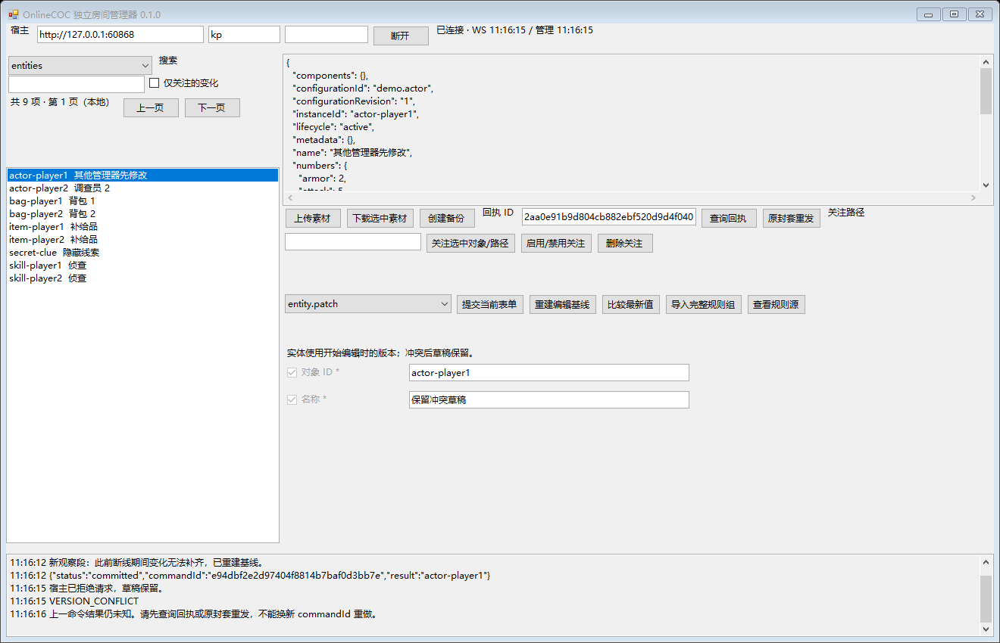
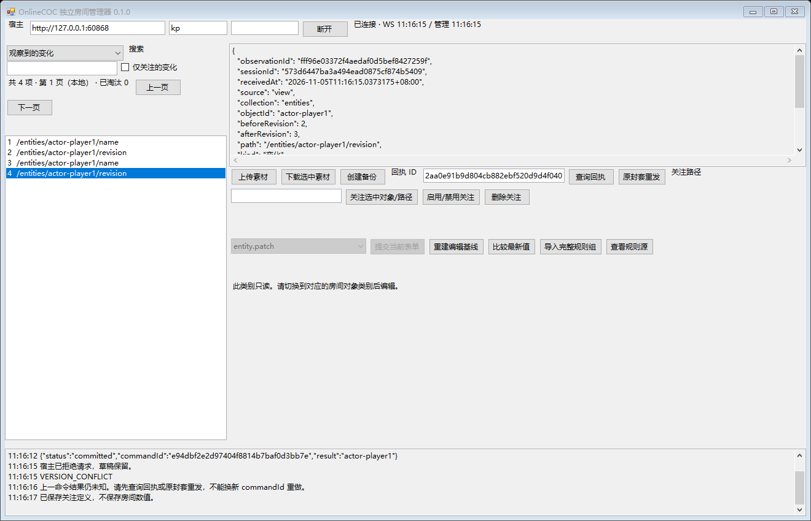
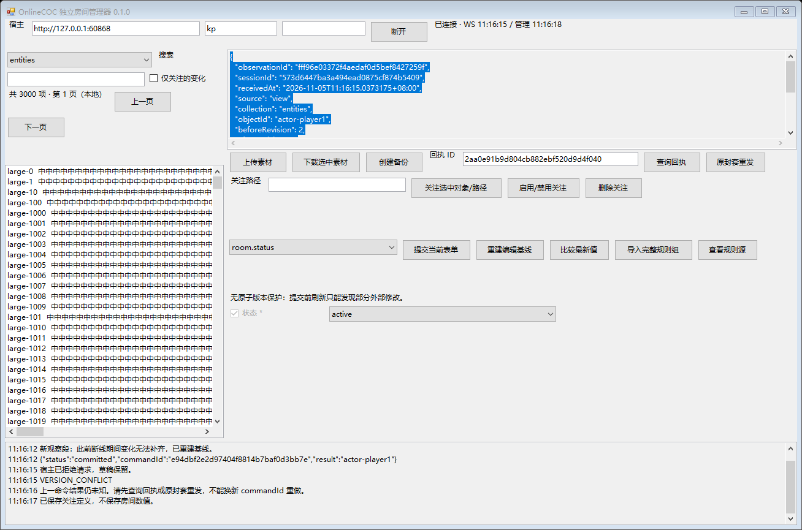

> 2026-11-09：WinForms 版本已由 [Python 管理器](../../../README.md) 替代。本目录保留历史实现和验收，旧测试脚本不作为当前施工入口。

# 独立房间管理器首版验收

- 文档类型：历史
- 文档子类：工程
- 状态：已归档
- 创建日期：2026-11-05
- 最后更新：2026-11-05
- 关联文档：[使用说明](usage.md)、[开发与验证](development.md)、[机器结果](../tests/results.json)、[发布摘要](../dist/release.json)

## 结果

首版 0.1.0 本机验收通过，共 107 项检查，0 失败。完整运行见 `.test-output/20261105-110336/`；随后只修改 UI 管理轮询的失败退避，对受影响界面、协议边界、重连和复制发布程序在 `.test-output/20261105-110646/` 做针对性复测。最终导航和结果未知保护在 `.test-output/20261105-111607/` 完成 GUI 定向复测，确认框测试只向自身进程发消息，不依赖前台窗口。协议层、观察层及管理操作实现未在上述 UI 复测前改变。

运行环境为 Windows x64、.NET Framework 4.8.09037（Release 533325）。测试宿主位于工具自己的隔离目录、随机回环端口，未操作真实游玩存档或修改宿主代码。

| 层次 | 通过检查数 | 覆盖 |
| --- | ---: | --- |
| 单元和真实宿主集成 | 70 | 分片乱序/缺失/重复/超限、观察语义、配置及实例 CRUD、两会话旧令牌冲突、引用约束、成员、进度、规则暂存/激活/回退、流程回应/取消/重试、素材、备份、回执幂等、降权 |
| 协议边界 | 6 | 缺 CSRF、错误 Origin、注销后读取、拒绝跟随跳转、服务不可达、配置限额 |
| 真实 WinForms 窗口 | 25 | 登录按钮、实际表单提交、中文、键盘焦点、冲突草稿及比较、关注增删/禁用、观察页、真实确认对话框取消及未知结果阻止新提交、125% 布局缩放、大列表、断开清理 |
| 真实宿主重启 | 3 | 断线清空视图、恢复后新观察段、新 authority |
| 复制发布目录 | 3 | 复制后的 EXE 独立启动、原生窗口可见、正常关闭；随后额外确认宿主仍可访问 |

两个管理会话使用独立 Cookie，真实验证先提交者成功、旧 viewToken 被拒绝。对已提交命令主动忽略首次结果，再查询回执及重发原封套，检查实体修订只增加一次；这验证幂等语义，不等同于覆盖所有网络丢包位置。

真实窗口测试调用原生控件事件并核查宿主状态，没有以接口测试替代 GUI。桌面控制插件启动失败后，改用已显示的 WinForms 窗口、原生窗口枚举和进程限定的确认框取消；截图通过窗口 DrawToBitmap 留存，不声称是多显示器视觉认证。

## 容量与响应

- 2,000,014 字节的合法分片快照组装并完成基线/重复样本处理：154 ms；测试进程峰值工作集约 79.1 MiB。此数据来自单次本机运行，不是长期容量承诺。
- 3000 个合成对象、1,830,781 字节的 JSON 数据，在真实窗口按 500 项本地分段呈现：146 ms。该窗口测试注入完整已接收样本，WS 大快照另由协议层测试覆盖。
- 观察记录上限 2000、关注上限 100；观察另限制估算 JSON 大小 16 MiB，超限按最旧记录淘汰。缺字段与 null、路径转义、令牌噪声、样本合并及“不再可见”均已检查。

## 窗口证据

编辑与冲突草稿：

观察到的变化：

大列表本地分段：

## 适用范围

当前验证为 96 DPI 原生窗口与 125% 布局缩放；未验证不同硬件的混合 DPI 跨屏拖动。未进行长期无人值守压力或所有网络中断组合的认证。管理轮询失败有退避机制，重连与权限变化清理经过真实宿主验证，迟到响应以会话代号丢弃。

首版只观察接收到的样本，不补齐历史；非实体写入没有统一原子版本保护。本地设置在多个进程共用目录时可能被后写者覆盖，独立实例使用不同 `--settings-dir`。备份仅创建，完整权威历史与存档生命周期管理继续按 H1/H2、S1/S2 后续工作包推进。
